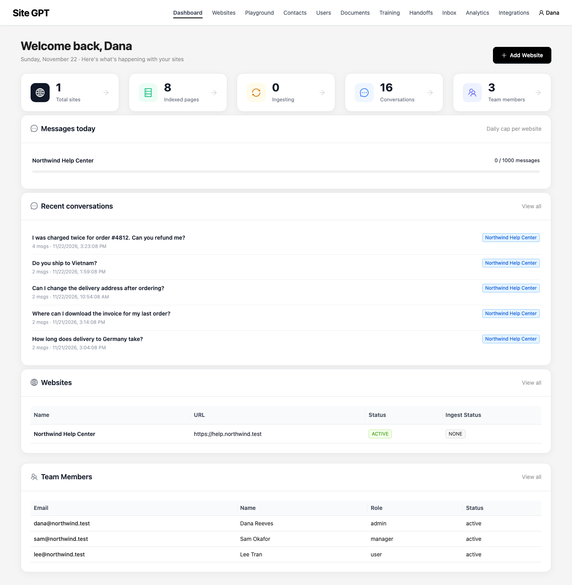
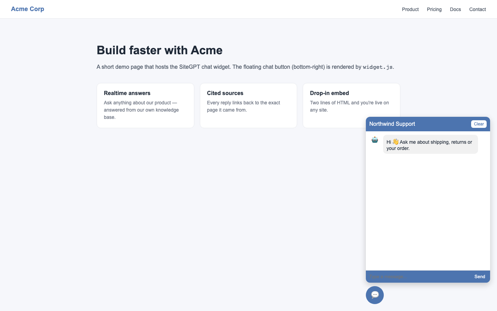
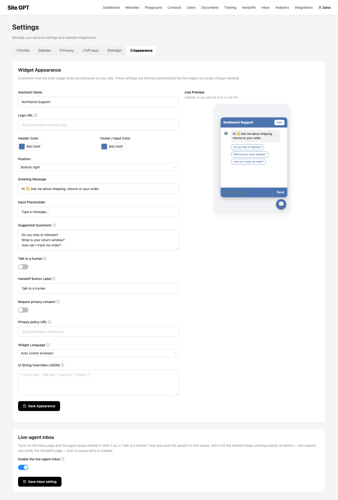

# SiteGPT

Turn any company website + extra documents into an embeddable AI chat bot (RAG).

## Screenshots

<table>
  <tr>
    <td width="50%"></td>
    <td width="50%"></td>
  </tr>
  <tr>
    <td align="center"><b>Dashboard</b> — stat cards, recent conversations, sites &amp; team</td>
    <td align="center"><b>Embeddable widget</b> — drops onto any site with two lines of HTML</td>
  </tr>
  <tr>
    <td></td>
    <td></td>
  </tr>
  <tr>
    <td align="center"><b>Websites</b> — manage crawled sources</td>
    <td align="center"><b>Website detail</b> — pages, sync sitemap, run ingest</td>
  </tr>
  <tr>
    <td></td>
    <td></td>
  </tr>
  <tr>
    <td align="center"><b>Extra documents</b> — uploads join the knowledge base</td>
    <td align="center"><b>Playground</b> — test answers with citations &amp; feedback</td>
  </tr>
  <tr>
    <td></td>
    <td></td>
  </tr>
  <tr>
    <td align="center"><b>Settings · Appearance</b> — colors, greeting &amp; suggested questions (fetched by the widget)</td>
    <td align="center"><b>Users</b> — manage team &amp; roles</td>
  </tr>
</table>

## How it works

1. Register company → creates company + admin user
2. Add website (URL + sitemap) → add/select pages → `POST /api/ingest`
3. Worker crawls pages (`trafilatura`), chunks (1000/200), embeds, stores in `pgvector`
4. Extra documents (text/file uploads in `uploads/`) are ingested the same way
5. Chat: `POST /api/chat` → embed question → pgvector similarity search (top 5, chunks further than `RAG_MAX_DISTANCE` discarded) → LLM answers with context + last 10 chat messages. When no chunk passes the threshold the bot replies "I don't have information about that" **without calling the LLM**
6. Embed on any site via `GET /widget.js`

## Tech stack

- **Backend:** FastAPI, SQLAlchemy, Alembic, pgvector, Redis (queue), JWT (`python-jose`), multi-LLM via LangChain (`ollama` / `openai` / `custom_openai` / `gemini` / `groq` / `openrouter`)
- **Frontend:** React 18 + Vite + TypeScript + Ant Design + axios + react-router
- **Infra:** PostgreSQL + pgvector, Redis, Ollama (default local LLM)

## Repo structure

```
src/site_gpt/app/
  main.py              # FastAPI app + router wiring
  api/                 # routes.py (auth/chat/ingest/widget), company, user, website, document, extra_document, setting, upload
  models.py            # Company, User, Setting, Website, WebsitePage, Document, ExtraDocument, Attachment, Embedding, ChatMessage, ChatFeedback, Contact
  schemas/             # Pydantic request/response per resource
  services/            # llm.py, rag.py, ingest.py, crawler.py, parse.py, sources.py, ratelimit.py, redis.py, mail.py
  core/                # config.py (env), auth.py (hash/JWT)
  db/                  # session.py, base.py
  scripts/widget.js    # embeddable chat widget (window.ChatWidgetConfig)
  worker.py            # Redis queue consumer (ingest jobs)
frontend/src/
  pages/ (Dashboard, Websites, WebsiteDetail, ExtraDocuments, Playground, Contacts, Handoffs, Inbox, Users, Settings, Login, Register)
  components/ (Layout, Chat, WidgetPreview, ProtectedRoute, WebsiteTable, CompanyTable, UserTable)
  context/ (AuthContext, ChatContext), utils/api.ts, types/api.ts
alembic/                # DB migrations
uploads/                # uploaded attachment storage
```

## Prerequisites

- Python 3.13 + `uv`, Node 18+, PostgreSQL with `pgvector` extension, Redis, Ollama (or any LLM API key)

## Setup — backend

```bash
cp .env.example .env   # fill DATABASE_URL, LLM_*, REDIS_*, MAIL_*
uv venv --python 3.13 && source .venv/bin/activate
uv sync
uv run alembic upgrade head
uv run uvicorn site_gpt.app.main:app --reload        # API :8000
uv run python -m site_gpt.app.worker                 # ingest worker (separate terminal)
```

## Setup — frontend

```bash
cd frontend
echo "VITE_BACKEND_URL=http://localhost:8000" > .env
npm install && npm run dev   # :5173
```

## Env vars

| Key | Default | Purpose |
|---|---|---|
| `DATABASE_URL` | — | SQLAlchemy Postgres URL |
| `LLM_AI` | `openai` | chat provider: `ollama\|openai\|custom_openai\|gemini\|groq\|openrouter` |
| `LLM_MODEL` | `gpt-4o-mini` | chat model |
| `LLM_EMBEDDING_MODEL` | `text-embedding-3-small` | embedding model name |
| `EMBEDDING_AI` | `LLM_AI` | **embedding provider, fully independent of `LLM_AI`** (same value set). Leave unset to reuse the chat provider. |
| `EMBEDDING_DIMENSIONS` | `1536` | vector dimension of the `embeddings` column; must match the embedding model's output dim |
| `OPENAI_API_BASE_URL` / `OPENAI_API_KEY` | — | OpenAI or Ollama-compatible endpoint |
| `GEMINI_API_KEY` / `GROQ_API_KEY` / `OPEN_ROUTER_API_KEY` | — | provider keys |
| `OLLAMA_HOST` / `OLLAMA_USERNAME` / `OLLAMA_PASSWORD` | `http://localhost:11434` | Ollama (optional basic auth) |
| `REDIS_HOST` / `REDIS_PORT` / `REDIS_PASSWORD` / `REDIS_DB` | `localhost/6379` | job queue |
| `MAIL_*` | — | forgot/reset password via fastapi-mail (`MAIL_SERVER`, `MAIL_PORT`, `MAIL_USERNAME`, `MAIL_PASSWORD`, `MAIL_FROM`, `MAIL_FROM_NAME`, `MAIL_TLS`, `MAIL_SSL`) |
| `JWT_SECRET_KEY` | dev default | **change in prod** |
| `API_KEY_PEPPER` | — | pepper mixed into the SHA-256 of company API keys (`/api/api-keys`, `/api/v1`); required in production, changing it invalidates every issued key |
| `DIGEST_ENABLED` | `false` | global switch for the worker's weekly-digest loop (each company also needs its `digest_enabled` setting) |
| `DIGEST_CHECK_SECONDS` | `3600` | how often the digest loop looks for companies whose send hour has come |
| `DELIVERY_CHECK_SECONDS` | `60` | how often the worker retries integration deliveries whose backoff has elapsed |
| `DELIVERY_RETENTION_DAYS` | `30` | how long a delivered/dead delivery row is kept; a dead row's payload is cleared immediately, `0` keeps the rows. Both steps run in batches of 1000 rows per transaction |
| `DELIVERY_RETENTION_CHECK_SECONDS` | `3600` | how often the worker runs the delivery retention pass (the retry tick stays at `DELIVERY_CHECK_SECONDS`) |
| `RETENTION_CHECK_SECONDS` | `86400` | how often the worker queues the retention purge for companies that set `retention_days` |
| `DIGEST_HOUR` | `9` | default UTC send hour for a company without its own `digest_hour` setting |
| `INTEGRATION_WEBHOOK_SECRET` | — | HMAC-SHA256 secret that signs outbound webhook payloads (`X-SiteGPT-Signature: sha256=...`) |
| `DEFAULT_WIDGET_LANGUAGE` | `auto` | fallback widget UI language when the visitor's browser language cannot be detected (`auto` follows the browser) |
| `SESSION_TOKEN_MODE` | `compat` | K4: whether reading a session needs its token. `compat` keeps a tokenless read of an *unclaimed* session working for older embeds; `enforce` requires the token everywhere. See [`docs/security.md`](docs/security.md) §5 |
| `SESSION_TOKEN_TTL_SECONDS` | `2592000` | lifetime of one widget session token value (30 days); an expired token can still be rotated by its holder |
| `SESSION_TOKEN_MAX_LIFETIME_SECONDS` | `15552000` | absolute lifetime of a session's token chain, counted from its creation (180 days). Rotation cannot extend it, so this — not the TTL — is what bounds a stolen token. Past it `POST /api/session-token` answers 403 and the widget starts a new session and mints once more, so it keeps working (without the old history) |
| `RATE_LIMIT_BACKEND` | `memory` | V3 (F1): `memory` = per-process in-memory limiter (V2.1); `redis` = shared sliding-window budget across API processes (wired in V3-10). Default keeps V2.1 behaviour |
| `EMBED_TOKEN_MODE` | `compat` | V3 (F4): `compat` accepts a missing `X-Embed-Token` — even for a website that has a token — but refuses a supplied token that is wrong, revoked or another website's; `enforce` requires a valid token. Refusals are `403` with `reason: invalid_embed_token` or `embed_token_required`, never a session reason. Default keeps V2.1 behaviour; see [Embed token](#embed-token-v3-f4) |
| `TOPIC_CLUSTER_MAX_MESSAGES` | `500` | V3 (F2): max visitor questions embedded per clustering run; the company setting `topic_clustering_enabled` (default `false`) opts in |
| `TOPIC_CLUSTER_INTERVAL_SECONDS` | `86400` | V3 (F2): worker scheduler check cadence for clustering; window boundaries come from `digest_day`/`normalize_period` |
| `INBOX_PRESENCE_TTL_SECONDS` | `60` | V3 (F3): TTL of one agent presence lease in the live inbox. Each `/api/inbox/events` connection owns its own lease, renewed on every heartbeat tick; a crashed tab ages out instead of showing as online forever, and the TTL never drops below two heartbeats |
| `INBOX_STREAM_HEARTBEAT_SECONDS` | `15` | V3 (F3): how often a quiet inbox stream sends a `: heartbeat` comment and renews its presence lease. Keep the proxy's idle timeout above this value (see [`docs/security.md`](docs/security.md) §3) |
| `CORS_ORIGINS` | `*` | comma-separated allowed origins; `allow_credentials` is disabled while it is `*` |
| `TRUSTED_PROXY_IPS` | *(empty)* | comma-separated IPs/CIDRs of reverse proxies / load balancers whose `X-Forwarded-For` is trusted; loopback and private peers are trusted automatically |
| `FRONTEND_URL` | `http://localhost:5173` | public admin URL, used in password-reset links |
| `CRAWL_REFRESH_HOURS` | `24` | worker re-crawl interval; `0` disables the scheduler |
| `RAG_MAX_DISTANCE` | `0.6` | max cosine distance for a retrieved chunk to count as context; above it the chunk is dropped and an empty result returns a canned "no information" reply without an LLM call. Lower = stricter, negative disables |
| `MAX_UPLOAD_MB` | `20` | largest accepted upload or remote import (URL / Google Drive); enforced while streaming, larger requests get `413` and leave no file behind |
| `SITEMAP_SYNC_MAX_URLS` | `500` | most pages one sitemap sync may create; the response reports `added`/`total`/`truncated`, and syncing again continues with the rest (`0` disables) |
| `DAILY_MESSAGE_LIMIT` | `1000` | **default** daily chat-message ceiling per website (the per-company `daily_message_limit` setting wins); counted in Redis and reset at UTC midnight; past it the visitor gets a friendly reply instead of an LLM call (`0` disables). Used whenever the company has no `daily_message_limit` row or its value is unusable |
| `SQL_ECHO` | `false` | log every SQL statement (debugging only) |
| `VITE_BACKEND_URL` (frontend) | — | backend base URL |
| `GOOGLE_DRIVE_ENABLED` / `GOOGLE_DRIVE_CLIENT_ID` | `false` / — | optional; backend flag + OAuth client id for the Google Drive import flow |
| `VITE_GOOGLE_DRIVE_CLIENT_ID` (frontend) | — | optional; when set, shows the "Pick from Google Drive" picker button |

## Key API endpoints

- `POST /api/register` — create company + admin user
- `POST /api/token` — login → JWT
- `POST /api/ingest?website_id=` — enqueue crawl+embed job
- `POST /api/chat` — `{website_id, session_id, question}` → `{answer, sources}`
- `GET /widget.js` — embeddable widget; served with `Cache-Control: max-age=300`
  and an `X-Widget-Version` content hash, and accepts `?v=<version>` so an install
  snippet can bust the cache immediately after a deploy
- `POST /api/chat/feedback` — public 👍/👎 rating `{website_id, session_id, rating, comment?}`
- `GET /api/widget-config?website_id=` — public widget appearance/config (assistant name, colors, greeting, placeholder, position, suggested questions)
- `POST /api/v1/ingest?website_id=` — API-key ingest for scripts/CI (`X-API-Key`); admins mint and revoke keys at `/api/api-keys` (the raw key is returned once)
- `GET /health`
- `POST /api/session-token` — public; mints (or rotates) the widget's per-session read token. A refusal carries `{"detail": ..., "reason": ...}`, where `session_expired` means the session must start over and `session_claimed` means another tab holds it (the widget only resets on the first)
- `GET /api/conversations` (+`/{sid}`, `DELETE /{sid}`) — history, admin-scoped; the `/{sid}` read
  needs the widget's `X-Session-Token`
- `/api/feedback` (`GET`, `POST /rebuild`, `PATCH /{id}`) — rating review and Q&A rebuild
- `/api/handoff` (public POST) and `/api/handoffs` (`GET`, `PATCH /{id}`)
- `/api/integrations` (`GET`, `POST`, `PATCH /{id}`, `DELETE /{id}`, `POST /{id}/test`)
- `GET /api/analytics/summary`, `POST /api/digest/preview`, `POST /api/digest/send-now`
- `/api/privacy/export`, `/api/privacy/conversations/{sid}`, `/api/privacy/contacts/{sid}`
  — admin-only export and erasure (see [`docs/security.md`](docs/security.md))
- `/api/api-keys` (`GET`, `POST`, `DELETE /{id}`) — admin key management; the
  key-authenticated surface is `/api/v1` (`ingest`, `settings`, `conversations`,
  `contacts`, `chat`, `analytics/summary`), documented in
  [`docs/api-v1.md`](docs/api-v1.md) and in `/docs`
- `/api/inbox` — live-agent console (manager+ **and** `live_inbox_enabled`): paginated
  queue, detail/transcript, `claim`/`assign`/`release`/`close`, the agent reply
  (`POST /conversations/{id}/messages`), `GET /events` (fetch-based SSE) and
  `GET /presence`; `GET /status` answers `{enabled}` so the UI can hide the page
- `/api/companies`, `/api/users` (+`/me`, `/forgot-password`, `/reset-password`), `/api/websites` (+`/{id}/pages`, `/{id}/load-site-map`), `/api/documents`, `/api/extra_documents`, `/api/settings`, `/api/uploads`

## Embed widget

```html
<script>
  window.ChatWidgetConfig = { apiUrl: 'http://localhost:8000', website_id: '<WEBSITE_ID>' };
</script>
<script src="http://localhost:8000/widget.js?v=<WIDGET_VERSION>"></script>
```

`?v=` is optional but recommended: the file is cached for 5 minutes, and the query
is part of the URL, so a new value fetches the new file immediately. Use the value
of the `X-Widget-Version` response header (`curl -I http://localhost:8000/widget.js`)
— it is a hash of `widget.js`, so it changes exactly when the widget changes. The
Settings page copies a snippet that already includes it.

### Embed token (V3 F4)

A website can carry a per-website token. **It is public**: it sits in the page
source next to `website_id`, so any visitor can read and replay it. It exists so
an owner can revoke a snippet they no longer deploy and can require a token at
all — it does **not** prove the request came from the owner's site, and K18 stays
accepted (§4).

Mint one in **Websites → <site> → Embed token** (admin only). The raw value is
shown **once** — only its hash is stored — and the snippet carries it as
`embedToken`:

```html
<script>
  window.ChatWidgetConfig = {
    apiUrl: 'https://api.example.com',
    website_id: '<WEBSITE_ID>',
    embedToken: 'emb_…'
  };
</script>
```

| `EMBED_TOKEN_MODE` | Missing token | Supplied token | Use it when |
|---|---|---|---|
| `compat` (default) | accepted, even for a website that has a token | must be valid | rollout: old and new snippets both work |
| `enforce` | refused | must be valid | every snippet on your sites already sends the token |

Rotation revokes the old row and mints the new one in one transaction, so any
snippet still carrying the old value stops working immediately: **update the
snippets first, rotate second**. Refusals are `403` with a machine-readable
`reason` beside the `detail`:

- `invalid_embed_token` — the token is wrong, revoked, or belongs to another
  website (one answer for all three; the value is never echoed back).
- `embed_token_required` — `enforce` is on and the request carried no token.

Neither is a session error: the widget keeps the visitor's session and history
for an embed refusal (it resets only on the K4 `session_expired` reason).

**Rollback:** set `EMBED_TOKEN_MODE=compat`. Missing tokens are accepted again,
including for websites that already have one; a *supplied* but invalid token is
still refused, so fix or remove the bad `embedToken` line in that snippet. No
migration or data change is involved.

## Widget settings (per company)

Saved from **Settings** and published by `GET /api/widget-config`. That endpoint
is public and unauthenticated, so only the keys in
`api/setting.py::WIDGET_PUBLIC_KEYS` are ever returned; the internal rows in the
same registry are seeded for every company but never published.

| Key | Public to the widget? | Purpose |
|---|---|---|
| `widget_language` | yes | `auto` follows the visitor's browser language; a code such as `vi` forces a locale. Built-in labels ship for English and Vietnamese — any other language keeps the English labels until overridden. |
| `widget_ui_strings` | yes | JSON object overriding individual widget labels, e.g. `{"startChat": "Bắt đầu", "sources": "Nguồn:"}`. Malformed JSON is ignored and the falls back to the shipped labels. |
| `widget_logo_url` | yes | Chat header badge and bot avatar. Only `https://` URLs and raster `data:image/...;base64` URIs are used; anything else falls back to 🤖. |
| `handoff_enabled` | yes | Shows a "talk to a human" button in the chat header. A click records one request (upserted per session), emails the team and emits `handoff.requested`; the visitor stays in the chat. With the company's `live_inbox_enabled` on it also creates or reuses the session's queue entry (`waiting`), and an agent claim/close moves that request to `accepted`/`closed`. Off by default. |
| `handoff_label` | yes | Button label, an English fallback the language catalogue and `widget_ui_strings` can override. |
| `require_consent`, `privacy_policy_url` | yes | When consent is on, the contact form shows a required checkbox linked to the policy URL and `POST /api/contacts` answers 400 without `consent: true`, stamping `contacts.consent_at`. Only absolute `http(s)` URLs are used; off/empty by default, so an untouched widget keeps the V1 form. |
| `handoff_email` | **no** | Where handoff requests are emailed; empty means every active admin/manager. |
| `live_inbox_enabled` | **no** | V3 (F3) the live-agent inbox: turns on the `/inbox` console, its routes and the widget's live reply path for this company (`false` by default). Admin only — Settings → Appearance → Live-agent inbox writes it through `PUT /api/settings`, and the console's navigation reads `GET /api/inbox/status`. With it off, a handoff click stays the V2.1 row + email + event and no queue entry is created. |
| `digest_enabled`, `digest_hour`, `digest_day` | **no** | Weekly digest switch, UTC send hour and week start (default `false` / `9` / `monday`). The worker also needs the global `DIGEST_ENABLED`. |
| `digest_recipients` | **no** | Comma-separated digest recipients; empty means every active admin/manager. |
| `topic_clustering_enabled`, `topic_cluster_count` | **no** | V3 (F2) topic clustering: opt in to weekly named clusters (`false` by default) and choose how many one week may produce (default `5`, clamped to `1..8`). The worker clusters the **last complete** digest week once per `TOPIC_CLUSTER_INTERVAL_SECONDS`, sending at most `TOPIC_CLUSTER_MAX_MESSAGES` (500) visitor questions of 1000 characters each through **one** embedding call and naming every cluster in **one** LLM call (at most 8 groups × 5 quoted questions — see [Topic clustering](#topic-clustering-f2)). With the flag off, or for any interval that is not exactly whole completed digest weeks, the digest and both analytics routes keep the term-count `top_topics`. Clusters are derived data: erasing a conversation drops the weeks it appears in and `retention_days` expires them too |
| `retention_days` | **no** | How long visitor data is kept (default `0` = for ever). The worker's daily retention job deletes `chat_messages`, `chat_feedback`, `handoff_requests`, `contacts`, `digest_log`, `conversations` (when the session's newest message is past the cutoff), `attachments` and `extra_documents` rows older than this, per company, in batches of 1000 rows per transaction (a document is kept while anything was attached to it inside the window) — an expired upload takes its file under `uploads/` and its document text plus the embeddings built from it, so an expired source stops answering questions instead of only losing its file. Set it, and press **Preview purge** to see the per-table counts first, in Settings → Privacy; **Apply purge now** does the same call with `dry_run: false` behind a confirmation, for when waiting for the daily worker is not acceptable. The endpoint is `POST /api/privacy/retention` (`dry_run` defaults to `true`). |
| `llm_provider`, `llm_model` | **no** | Chat model pair, written from **Settings → Model**. Only pairs listed in `services/llm.py::ALLOWED_CHAT_MODELS` are honoured (`fast` = GPT-4.1 mini, `accurate` = GPT-4.1, empty = the `LLM_AI` / `LLM_MODEL` defaults); anything else silently falls back to the environment. Embeddings are not switched here. |

Keys understood by `widget_ui_strings`: `clear`, `send`, `thinking`, `sources`,
`helpful`, `notHelpful`, `thanksFeedback`, `contactIntro`, `firstName`,
`lastName`, `email`, `contactInvalid`, `startChat`, `contactSaveFailed`,
`noResponse`, `missingWebsiteId`, `error`, `greeting`, `placeholder`,
`talkToHuman`, `handoffThanks`, `handoffFailed`, `consentAgree`,
`privacyPolicy`, `consentRequired`.

### V2 / V2.1 highlights

- **Replies in the visitor's language** — the chat prompt detects the question's
  language and answers in it, translating retrieved context when needed. Works on
  both `/api/chat` and `/api/chat/stream`.
- **Localisable widget UI** — `widget_language` + `widget_ui_strings` above.
- **Custom logo** — header badge and bot avatars, with a safe fallback.
- **Runtime model switching** — Settings → Model, applied to the next message
  with no restart; the catalogue keeps arbitrary model names out.
- **Q&A training** — a 👎 rating carries the id of the answer it judges, so
  `GET /api/feedback` can show the real question and answer. **Training** lets an
  admin correct the answer and approve it; approved pairs are re-embedded into one
  `__qa_training__` extra document per website (rebuilt on demand from
  `POST /api/feedback/rebuild`), so retrieval picks them up with no new code path.
- **Human handoff** — `POST /api/handoff` (public, rate-limited) resolves the
  contact, upserts one request per session, emails the team the last ten messages
  and emits an integration event. `/handoffs` is the team's queue.
- **Integrations (webhook, Slack, Zendesk, Crisp)** — `/integrations` configures
  one per provider, each subscribed to `lead.captured`, `feedback.received`,
  `handoff.requested` and `digest.generated`. A `handoff.requested` payload carries
  `conversation_id`/`conversation_state` only when the inbox queued the session, so
  receivers written for V2.1 keep the same keys. Webhooks are signed
  (`X-SiteGPT-Signature: sha256=…` over `<timestamp>.<body>`, keyed with
  `INTEGRATION_WEBHOOK_SECRET`). Every event is written to
  `integration_deliveries` **before** it is sent, so a lead or rating is never
  dropped when an endpoint is down: a failed send is retried by the worker with
  backoff (1m, 5m, 30m, 2h, 6h), parked as `dead` after five attempts, and can be
  resent from `/integrations` → Recent deliveries. Each event carries one
  `event_id` (`X-SiteGPT-Event-Id` and `data.event_id`) that stays the same across
  retries, so a receiver can dedupe. Those rows carry the lead's details, so a
  dead row's payload is cleared at once (resend then answers 409) and settled rows
  are deleted after `DELIVERY_RETENTION_DAYS`; `POST /api/integrations/deliveries/purge`
  previews the cleanup. Resend claims the row with `FOR UPDATE SKIP LOCKED` while it
  sends, so two admins clicking it at once produce one send and one `409`. Reads never return a stored credential —
  secrets come back as `***` and a PATCH echoing the mask keeps the stored value.
- **API keys and `/api/v1`** — Settings → API keys mints scoped keys (`read`,
  `ingest:write`, `settings:write`, `chat:write`), stored only as a peppered
  SHA-256 hash and shown once. `POST /ingest`, `GET|PUT /settings`,
  `GET /conversations`, `GET /contacts`, `POST /chat` and
  `GET /analytics/summary` reuse the same services as the console, and
  `/api/v1/settings` is limited to the public widget keys plus the chat-model
  pair so a leaked key cannot redirect handoff mail or raise a quota. Contract:
  [`docs/api-v1.md`](docs/api-v1.md), also served under `/docs`.
- **Privacy export, erasure and consent** — admins can download everything the app
  stores for one website (`GET /api/privacy/export`) and erase a session for real:
  `DELETE /api/privacy/conversations/{sid}` removes its messages, ratings,
  handoffs, inbox row and session token in one transaction,
  `DELETE /api/privacy/contacts/{sid}` removes the lead and its handoffs.
  A retention policy (`retention_days`) makes the worker delete expired rows and
  their uploaded files daily; `POST /api/privacy/retention` previews the same purge with `dry_run`
  before anything is removed.
  Both are company-scoped and 404 on a foreign website. Consent is recorded per
  contact (`consent_at`) when `require_consent` is on. What is **not** provided is
  stated plainly in [`docs/security.md`](docs/security.md): no SOC 2 Type II, no
  HIPAA BAA, no signed DPA, no GDPR certification.
- **Session tokens (K4)** — the widget mints a per-session token
  (`POST /api/session-token`) and sends it as `X-Session-Token` when it restores
  history or contact details, so the session id alone reads nothing once a session
  is claimed. Only a hash is stored; a value expires after
  `SESSION_TOKEN_TTL_SECONDS` and the whole chain after
  `SESSION_TOKEN_MAX_LIFETIME_SECONDS`. `SESSION_TOKEN_MODE=compat` (the default)
  keeps older embeds working; `enforce` requires the token everywhere. See
  [`docs/security.md`](docs/security.md) §5.1.
- **Admin pages** — `/websites`, `/documents`, `/contacts`, `/handoffs`,
  `/feedback`, `/analytics`, `/integrations`, `/inbox` (shown only when the
  company has `live_inbox_enabled=true`), `/users` and `/settings` (with the
  API keys tab). The widget itself has no separate build step: `GET /widget.js`.
- **Weekly digest and analytics** — `GET /api/analytics/summary`,
  `POST /api/digest/preview` and `POST /api/digest/send-now`, plus the `/analytics`
  page. `build_digest` reports conversation volume, messages, new contacts,
  👍/👎, top topics and the questions whose answer was tagged `answered = False`,
  each with a deep link. The digest covers the **last complete** digest week
  (`digest_day` aligned, `previous_period`), which is the same window the topic
  worker clusters, so the email's counts and its named groups describe one week.
  Delivery is at-most-once: the `digest_log` row is claimed before the email is
  sent, so a retry, a restart or a second worker cannot send the same week twice.

### V3 (released — tag `v3`)

Tag `v3` (commit `2e5ab73`) is the current release; [`plans/PLAN_V3.md`](plans/PLAN_V3.md)
records what was built and what gate `V3-4G` verified, including the checks this
repository could not run here (provider-bound ingest/chat, SMTP mail, browser
steps). V3 adds: the Redis-backed rate limiter (K5, `RATE_LIMIT_BACKEND`), the
per-website embed token (F4, `EMBED_TOKEN_MODE` + `X-Embed-Token`) — a revocation
and compatibility control that does **not** close the soft Origin check, so K18
stays accepted — LLM topic clustering (F2) and the live-agent inbox (F3): the
`/inbox` console, its queue/detail/reply routes, the fetch-based SSE stream with
presence, and agent replies rendered in the widget. Every feature is off by
default (`topic_clustering_enabled=false`, `live_inbox_enabled=false`,
`EMBED_TOKEN_MODE=compat`, `RATE_LIMIT_BACKEND=memory`), so an upgraded install
behaves as it did on `v2.1` until an admin opts in. The console
and its routes exist only for a company with `live_inbox_enabled=true` (the page
and its navigation link read `GET /api/inbox/status`; an admin turns it on in
Settings → Appearance → Live-agent inbox), the bot stays silent while a session
is with an agent, and the widget opens its live stream/poll only for a
`waiting`/`human` session — an ordinary bot chat carries no background connection
and stops as soon as the console closes the conversation.

#### Live inbox (F3)

A company opts in with `live_inbox_enabled`; nothing about the console exists for
a company that never turns it on.

- **Access model.** Every console route needs manager+ **and** the flag: with it
  off the whole `/api/inbox` surface is a 404, indistinguishable from a missing
  route, while the public `POST /api/handoff` keeps working. `GET /api/inbox/status`
  is the one exception — it answers `{enabled}` to a manager so the navigation can
  decide whether to show `/inbox`. A conversation is addressed by its UUID and
  resolved through the company's websites, so a foreign id is a 404. The
  transcript an agent reads is the stored conversation under the company's
  existing manager/admin RBAC: there is no per-conversation grant and no separate
  audit log, the same access the privacy export gives.
- **Transport and reconnect.** `GET /api/inbox/events` is server-sent events read
  with `fetch()`, not `EventSource`, because the console sends its JWT in
  `Authorization` and `EventSource` cannot attach a header. JWT, flag and a Redis
  `PING` are checked **before** the response starts (401/403, 404, 503), so a
  stream that cannot deliver is never opened. The body carries `retry:`, a `ready`
  event with `resync: true`, and `id:` / `event:` / `data:` per notification; the
  console re-reads the queue, the open transcript and presence after `ready`, after
  every event and after a reconnect, and retries with exponential backoff. Pub/sub
  is a hint, never storage: a lost notification costs a refetch, not a wrong
  screen.
- **CORS preflight.** `Authorization` makes the stream a non-simple request, so the
  browser sends `OPTIONS` first. `api/main.py` allows every header and method and
  enables credentials only for an explicit origin list; keep `CORS_ORIGINS` to the
  real console origins so the preflight and the credentialed request agree.
- **Proxy.** The stream sends `Cache-Control: no-cache, no-transform` and
  `X-Accel-Buffering: no`; disable response buffering for the path and keep the
  proxy's idle timeout above `INBOX_STREAM_HEARTBEAT_SECONDS` (15 s, the `:`
  heartbeat interval). Redis down answers `503` before streaming and the console
  falls back to re-reading the queue.
- **Presence.** Each open stream owns one lease,
  `inbox:presence:<company>:<user>:<connection>`, with
  `INBOX_PRESENCE_TTL_SECONDS` (60, never below two heartbeats), renewed on every
  tick and deleted by its own connection. Two tabs count as two connections of one
  agent, and a crashed tab ages out instead of staying online.
- **Widget side.** An agent's reply is published on
  `chat:<website_id>:<session_id>` and read by the widget with `fetch()` plus the
  **K4 session token** — the embed token alone reads nothing. The widget opens that
  path only for a `waiting`/`human` session (a queued reply or a handoff starts it)
  and stops on the console's `state` frame or a `409`, so an ordinary bot chat
  carries no background stream. The embed token is public in the page and
  replayable (K18 stays accepted): a revocation and compatibility control, not
  origin authentication.

#### Topic clustering (F2)

A company opts in with `topic_clustering_enabled`; nothing is clustered for a
company that never turns it on, and with the flag off the digest payload is the
V2.1 one, key for key.

- **Window.** One cluster window is the company's digest week (`digest_day`
  aligned), and the worker only builds the **last complete** week — the same
  window the weekly digest reports (`digest.previous_period`), so the email's
  counts and its named groups can never describe different weeks. Windows never
  overlap and never leave a gap, because both sides come from
  `normalize_period`. The week still running is not clustered: it would be
  thrown away as it fills.
- **Cadence.** `topic_loop` wakes every `TOPIC_CLUSTER_INTERVAL_SECONDS`
  (default 86400) and queues `{"type": "topic_clusters"}` for opted-in companies
  whose window has no run yet. The interval is only how often the check runs,
  never the window length. A durable `topic_cluster_runs` row unique on
  `(company_id, period_start)` is the lock: two workers cannot cluster the same
  week, `completed` is final, a claim silent for 30 minutes is taken over, and a
  `failed` window is retried on the next tick. When a digest is due for an
  opted-in company whose window is not settled, the scheduler queues the
  clustering job **before** the digest job.
- **Bounded provider cost.** One run makes exactly one embedding call and at
  most one naming call:
  - input: at most `TOPIC_CLUSTER_MAX_MESSAGES` (500) non-blank `role='user'`
    questions from the window, ordered `created_at`, then `id`, so the sample —
    and therefore the clusters — is reproducible; each question is truncated to
    1000 characters, so cost is bounded by questions × characters and not by
    whatever a visitor pasted;
  - embedding: those questions go to the configured embedding provider
    (`EMBEDDING_AI`) in one `embed_texts` call; no per-message vector is stored;
  - clustering: a deterministic leader pass at cosine ≥ 0.82, at most
    `MAX_CLUSTERS` (8) clusters, the company's `topic_cluster_count` choosing
    within that ceiling (default 5);
  - naming: **one** temperature-0 call to the configured chat LLM (`LLM_AI`
    and the company's model pair) with at most 5 quoted questions per cluster
    (40 for a full week), a fixed prompt that treats the questions as untrusted
    data, and a reply truncated to `label` ≤ 120 / `summary` ≤ 280 characters. A
    provider or parse failure falls back to a term-based label for that cluster
    instead of failing the week.
  - The digest shows `Named from S of E visitor questions` when the input was
    truncated, so a sampled week never looks like a complete one.
- **Read side.** `build_digest` (and the digest HTML) show named groups only
  when the period is exactly one completed window with a `completed` run;
  otherwise — flag off, a partial or unaligned interval, a missing or failed run
  — they keep the `top_topics` term list. `/api/analytics/summary` asks for a
  rolling `days` window, which is not a whole digest week, so it keeps
  `top_topics` by design rather than presenting partial clusters as complete.
- **Retention and erasure.** Clusters are derived data, not a second copy of the
  conversations: rows hold a label, a summary, a centroid and the window's
  sampled/eligible counts, never the question text. Erasing a conversation drops
  every week that held one of its messages (and the run row, so the window can be
  rebuilt from what is left); `retention_days` expires cluster rows on the same
  policy. Both are covered in [`docs/security.md`](docs/security.md) §4.

## Dev commands

```bash
uv run alembic revision --autogenerate -m "[name]" && uv run alembic upgrade head
uv run python -m unittest discover -s tests -v   # backend suite, no extra deps
node --test tests/*.mjs                          # widget.js suite (no npm script)
cd frontend && npm run build && npm run lint
```

## Deploying V1

V1 is self-hosted. None of the dev defaults below should survive into production.

> **Full checklist:** [`docs/security.md`](docs/security.md) lists every control
the code enforces, every control it cannot (TLS, encryption at rest, backups,
secret rotation) and the accepted risks. It also states plainly what is **not**
provided: SOC 2 Type II, a HIPAA BAA, a signed DPA, or any GDPR certification.

### 1. Secrets and config

| Key | Dev default | Production |
|---|---|---|
| `JWT_SECRET_KEY` | hardcoded fallback in `core/config.py` | **required** — e.g. `openssl rand -hex 32` |
| `CORS_ORIGINS` | `*` | explicit comma-separated list, e.g. `https://app.example.com` |
| `TRUSTED_PROXY_IPS` | *(empty)* | the proxy/LB addresses (IPs or CIDRs) that terminate TLS — required when that proxy connects from a **public** IP, see below |
| `DATABASE_URL` | — | dedicated Postgres role/database, `pgvector` installed |
| `MAIL_*` | Gmail placeholders | real SMTP host/port/user/password — password reset only works once set |
| `FRONTEND_URL` | `http://localhost:5173` | public admin URL (used in reset links) |
| `SQL_ECHO` | `false` | keep `false` |

`CORS_ORIGINS` is parsed as a comma-separated list. `allow_credentials` is disabled
automatically while the value is `*`, so an explicit list is also what enables
credential/cookie flows.

### 2. TLS and reverse proxy

Run uvicorn behind nginx/Caddy/Traefik terminating **TLS 1.2+**:

- terminate HTTPS at the proxy; uvicorn stays on plain HTTP bound to `127.0.0.1:8000`
- forward `Host`, `X-Forwarded-For`, `X-Forwarded-Proto`
- if the proxy/load balancer connects from a **public** address, list it in
  `TRUSTED_PROXY_IPS` (comma-separated IPs/CIDRs). Otherwise the app ignores
  `X-Forwarded-For` and rate limits everyone by the LB's address, so one abusive
  visitor exhausts the bucket for all of them. Loopback and private addresses
  (`127.0.0.1`, `::1`, `10.x`, `172.16-31.x`, `192.168.x`) need no entry
- **disable response buffering for the SSE endpoints** — `/api/chat/stream`,
  `/api/chat/messages/stream` (the visitor's live agent replies) and
  `/api/inbox/events` (nginx: `proxy_buffering off;`). They already send
  `X-Accel-Buffering: no`; with buffering on, SSE answers arrive in one block
  instead of streaming
- run the worker as a separate process: `uv run python -m site_gpt.app.worker`
- serve the built admin UI (`cd frontend && npm run build`) from the proxy or any static
  host; it bakes in `VITE_BACKEND_URL` at build time
- `/widget.js` and `/api/widget-config` must be reachable from the sites that embed the widget
- the public widget endpoints (`/api/chat`, `/api/chat/stream`,
  `GET /api/chat/messages`, `GET /api/chat/messages/stream`, `/api/widget-config`,
  `POST /api/contacts`, `GET /api/contacts/{session_id}`) only serve requests whose
  `Origin`/`Referer` matches the website's host (or is absent / a localhost demo), so a
  `website_id` copied from another customer's page cannot be embedded elsewhere. If you
  embed the widget on a domain different from the website's `url`, update the website URL
  or requests from that domain will get `403`

### 3. Migrations

```bash
# fresh database: create it and install the extension first
# CREATE EXTENSION IF NOT EXISTS vector;
uv run alembic upgrade head      # head is 1c5516fa864d (V3 M9 conversations + agent author)
```

The migration chain is linear from that head; never edit an already-applied revision.

### 4. Known limitations

These are the known limitations. K4 was mitigated and K8 closed in V2/V2.1; K5
was mitigated in V3 (F1). K18 remains accepted. [`docs/security.md`](docs/security.md) §5 carries the same
list with the residual risk spelled out:

| ID | Limitation | Impact / mitigation |
|---|---|---|
| K4 | `GET /api/conversations/{session_id}` and `GET /api/contacts/{session_id}` are **public by design** — the widget restores history and lead details without a login. A guessed `session_id` combined with a known `website_id` used to expose that session's transcript or contact details. | **Mitigated in V2.1** by a per-session token (`X-Session-Token`, stored only as a hash): once a session is claimed, its id alone reads nothing. Residual: `SESSION_TOKEN_MODE=compat` (the default) still allows a tokenless read of an *unclaimed* session so older embed snippets keep working, and sessions that already had data before the change can never be claimed — switch to `enforce` once your embeds ship the new snippet. See [`docs/security.md`](docs/security.md) §5.1. |
| K5 | `services/ratelimit.py` was an in-memory fixed window, **per process**. Limits reset on restart and were not shared across workers. | **Mitigated in V3 (F1)** with `RATE_LIMIT_BACKEND=redis`: one shared sliding-window budget (atomic Lua over a sorted set) across API processes, surviving restarts. Residual: with the default `memory` backend the limiter is still per process, and during a Redis outage the `redis` backend falls back to that same per-process cap (`/health` reports `rate_limiter.degraded`) — Redis is an availability dependency for the enforced path. The Redis daily message cap remains the hard spend ceiling. |
| K18 | The widget's Origin/Referer check is **soft**: requests with no `Origin`/`Referer` (non-browser clients, forged headers, `referrerpolicy="no-referrer"`) are still accepted, and loopback origins are always allowed so local demos work. | It blocks ordinary cross-site embedding (copying a `website_id` into another page), not a determined API caller. **Still accepted after V3 (F4).** The per-website embed token makes a deployed snippet revocable and can be made mandatory (`EMBED_TOKEN_MODE=enforce`), which raises the effort for casual copying, but the token is public and replayable — it does not authenticate the origin, so it does not close K18. Closing it needs a genuinely origin-bound mechanism (for example short-lived signed requests), which no release implements. |
| K8 | 👍/👎 feedback is stored in `chat_feedback` and never influences answers on its own. | Closed in V2: an admin reviews it in `/training`, corrects an answer and approves the pair; approved pairs are re-embedded into one `__qa_training__` document per website (`POST /api/feedback/rebuild`). Nothing changes without approval. |

Also note `/docs` and `/openapi.json` are enabled and unauthenticated (FastAPI default) —
restrict them at the proxy if that matters to you.

## Upgrading from V1 (V2 and V2.1)

1. `uv run alembic upgrade head` — 15 new revisions on top of the V1 head for
   V2/V2.1, ending at `c9d3e5a71b28` (V3 adds M7 `76f46b510350`, M8
   `afef1e91e0b5` and M9 `1c5516fa864d` on top; see `plans/PLAN_V3.md` §7):
   `07f83918a289 → c41d7e8a9f20 (api_keys) → 2f95a35b9d5d → 5fe07e597f12 → bebd929605ed → 94ca756068a7 (V2) → 5fbe6ce28d9b (session tokens) → b7d41c9e2f10 (deliveries) → d2f5a81c9b74 → e7b3c94a1d52 → a4c1e9d7f320 → c3f8a2b91d47 → d5b9c4e2a87f → e2a7c5d913f6 → f7c1d84b2e39 → c9d3e5a71b28`.
   They only add tables, columns and indexes; no data migration and **no re-ingest**
   (the embedded `EMBEDDING_DIMENSIONS` is unchanged). The index revisions build
   `CONCURRENTLY`, so they are not atomic — an interrupted build leaves an invalid
   index: drop it with `DROP INDEX CONCURRENTLY` and re-run (`AGENTS.md`).
2. Set `API_KEY_PEPPER` before minting any key, `INTEGRATION_WEBHOOK_SECRET`
   before enabling a webhook, and `JWT_SECRET_KEY` + `CORS_ORIGINS` as before —
   see [`docs/security.md`](docs/security.md). Leave `SESSION_TOKEN_MODE` at
   `compat` until your embed snippets carry the token; `DELIVERY_RETENTION_DAYS`
   and `RETENTION_CHECK_SECONDS` only matter once retries or a `retention_days`
   policy are in use.
3. Every V2 feature is off by default (a `settings` row or an env flag), so an
   untouched deployment behaves like V1. The one deliberate exception is the
   prompt's reply-in-the-question's-language rule.
4. Existing companies get the new settings rows when an admin saves the widget
   tab once; until then the server-side defaults apply (consent off, no logo).

## Embedding dimension caveat

The `embeddings` table column is `Vector(EMBEDDING_DIMENSIONS)`, defaulting to **1536**
(matches OpenAI `text-embedding-3-small`). The chat and embedding providers are now
fully independent — set `EMBEDDING_AI` to point the embedding model at a different
provider than the chat model.

Because some embedding models emit a different dimension, set `EMBEDDING_DIMENSIONS`
to match your chosen model:

| Embedding model | Provider | Dimension |
|---|---|---|
| `text-embedding-3-small` / `text-embedding-3-large` | openai / custom_openai | 1536 (or request via `dimensions`) |
| `bge-m3` | ollama | 1024 |
| `nomic-embed-text` / `nomic-embed-text-v2-moe` | ollama | 768 |

If you change `EMBEDDING_DIMENSIONS` from 1536, you must also:

1. Generate & apply a migration that alters the column:
   ```bash
   uv run alembic revision --autogenerate -m "embedding dimension"
   uv run alembic upgrade head
   ```
2. **Re-ingest** every website (`POST /api/ingest`) so stored vectors match the
   new dimension — existing vectors of the old size will no longer be queryable.

OpenAI-compatible providers (openai, custom_openai, openrouter, groq, gemini) that
support the `dimensions` param will be asked for `EMBEDDING_DIMENSIONS` automatically
for `text-embedding-3-*` / `auto` models. Ollama models emit a fixed native dimension,
so `EMBEDDING_DIMENSIONS` must equal that model's native size.

## Fixes & improvements applied

- **RAG now answers from uploaded documents too.** `services/rag.py::search` previously
  only queried `documents` (crawled pages). It now runs one SQL query over `embeddings`
  with `LEFT JOIN`s to `documents` and `extra_documents`, keeping a chunk when it belongs
  to a `documents` row of this website **or** to an `extra_documents` row linked to this
  website **or** to the same company, so the chatbot actually uses the knowledge users
  upload.
- **Ingestion no longer crashes.** `crawler.crawl_page` now returns `(title, text)`, fixing
  the `KeyError: 'title'` that broke every ingest job in `worker.py`. The worker also
  upserts pages by URL (no more duplicate growth) and is wrapped in error handling that sets
  `ingest_status = 'failed'` on error.
- **Uploaded files are now searchable.** New `services/parse.py` extracts text from
  `.txt/.md/.csv/.json/.html/.pdf/.docx` and the worker embeds both the extra-document text
  **and** its attachment contents (added `pypdf` + `python-docx` deps).
- **Re-ingest is idempotent.** `ingest_document` / `ingest_extra_document` drop existing
  chunks before re-embedding, so re-running ingest won't duplicate vectors.
- **`POST /api/ingest` is now protected** — requires a manager/admin token and ownership of
  the website (was fully public).
- **Sitemap sync is capped.** A sitemap can list tens of thousands of URLs, and one click used to
  create every one of them for the next ingest to crawl. A sync now creates at most
  `SITEMAP_SYNC_MAX_URLS` (default 500, `0` disables) **new** pages — already-known URLs do not use
  the budget, so repeated syncs keep making progress — and answers
  `{"status": "ok", "added": n, "total": urls, "truncated": bool, "limit": n}`.
- **Sitemap sync reports real errors.** `POST /api/websites/{id}/load-site-map` used to wrap every
  failure in `except Exception` and re-raise it as `500` with `str(e)` in `detail`, so a missing
  website answered 500 instead of 404 and an unsafe/unreachable sitemap leaked internal text. It now
  re-raises `HTTPException` untouched, maps an `UnsafeUrl` or crawler fetch/parse failure to `400`
  with a friendly message (the real reason is logged), keeps a generic logged `500` for storage
  errors, and returns `{"status": "ok", "added": <new pages>, "total": <urls found>}`. The crawler's
  `extract_urls_from_sitemap` gained `raise_on_error=True` for this caller; the crawl path still skips
  a broken sitemap silently.
- **One ingest per website at a time, claimed atomically.** `POST /api/ingest` claims the website with
  `UPDATE websites SET ingest_status='processing', updated_at=now() WHERE id=… AND company_id=… AND
  (ingest_status IS DISTINCT FROM 'processing' OR updated_at < now() - STUCK_INGEST_AFTER)`; only one
  concurrent request can match that row, and the loser gets `409` with nothing queued, so a double
  click can no longer queue a second crawl that re-embeds the same pages concurrently with the first. A finished or failed ingest can be retried normally, and
  a website left `processing` by a dead worker can be re-indexed manually once
  `websites.updated_at` is older than `STUCK_INGEST_AFTER` (6h, the same window
  `requeue_stuck_ingests` uses) — the take-over resets the timestamp so an immediate second click
  is refused again.
- **Settings are scoped per company** — `GET/PUT /api/settings` no longer leaks or edits
  other companies' settings.
- **Upload safety** — files are stored under a UUID name (collision- and path-traversal-safe)
  instead of the raw filename.
- **Forgot/reset password fixed & secured** — old flow overwrote the live password with a
  garbage hash and sent no email. Now `forgot-password` issues a 30-min token, emails a
  reset link (`FRONTEND_URL`), and `reset-password` verifies the token + expiry. Added
  `reset_token` / `reset_token_expires_at` columns (migration `3f1a9c0d7e22`).
- **CORS** — `allow_credentials` is auto-disabled when `CORS_ORIGINS=*`
  (browsers reject the wildcard+credentials combo). Set an explicit origin list in prod.
- **Dead dual embedding backend removed** — dropped `db/vector_store.py` + unused
  `ingest_documents` (langchain-postgres `PGVector`) to avoid a second, divergent vector
  store.
- **Chat prompt** — `ask()` now uses a system instruction to answer only from context and
  say it lacks the info otherwise.

## Enhancements added

- **Streaming chat (SSE).** New `POST /api/chat/stream` streams the answer token-by-token
  (`data: {"chunk": "..."}` then `data: {"done": true}`). `rag.py::ask_stream` offloads
  embedding/search/DB writes to a thread so the event loop stays responsive. The in-app
  `ChatContext` and the public `widget.js` both consume the SSE stream (the widget was also
  fixed — it previously did a `GET` that never matched the `POST` backend). The legacy
  `POST /api/chat` is kept for non-streaming callers.
- **Stale-chunk cleanup.** On ingest, documents whose URL is no longer in the successfully
  crawled active-page set are deleted (cascading their embeddings). Extra documents with no
  usable content have their embeddings dropped, so removed/empty sources stop surfacing.
  Guarded so a full crawl failure can't wipe a site's knowledge base.
- **Rate limiting.** `services/ratelimit.py` (sliding window, per client IP) caps
  `/api/chat` + `/api/chat/stream` at 20 req/min, `/api/chat/feedback` at 40 req/min,
  `/api/ingest` at 10 req/min, `/api/token` (login, brute-force guard) at 10 req/min,
  `/api/register` + `/api/forgot-password` (spam/email-flood guard) at 3 req/hour and
  `/api/users/reset-password` (token-guessing guard, separate bucket from forgot-password)
  at 10 req/5 min (429 on exceed, with a `Retry-After` header; body unchanged).
  All public limits resolve from one policy table, `RATE_LIMIT_POLICIES` in
  `services/ratelimit.py`. `X-Forwarded-For` is only trusted when the direct peer is a loopback or
  private address (a reverse proxy on the same host/VPC) or is listed in
  `TRUSTED_PROXY_IPS`; direct clients are keyed by their socket IP, so the header cannot be
  rotated to bypass a limit. Backends (`RATE_LIMIT_BACKEND`): `memory` (default, V2.1)
  keeps the window in-process — per process, reset on restart; `redis` shares one
  sliding-window budget (atomic Lua over a sorted set) across API processes and
  survives restarts. If Redis is unreachable with the `redis` backend, the limiter
  falls back to the per-process memory cap and `/health` reports it under
  `rate_limiter.degraded` — a weaker local cap, not a shared/global guarantee
  (combined outage traffic may exceed one shared budget, up to N × the per-process
  allowance).
- **Limit composition.** Three independent guards, in this order: (1) the per-IP
  rate limiter is a burst guard — it runs as a FastAPI dependency before the
  handler; (2) the daily per-website quota (`services/quota.py`, Redis counter)
  is the spend ceiling, checked inside the chat handlers after the limiter;
  (3) `/api/v1` is API-key authenticated (`X-API-Key` + scope) and has **no**
  per-IP or per-key rate limiter — per-key abuse protection is deferred, not
  implemented. The daily quota still applies to `/api/v1/chat`.
- **Periodic re-crawl.** The worker now runs a `scheduler_loop` that, every
  `CRAWL_REFRESH_HOURS` (default 24, set `0` to disable), re-enqueues ingest for websites
  whose `ingest_status == 'completed'` and last update is older than the interval — keeping
  the knowledge base fresh with no extra infra.
- **`GET /api/widget-config` is cacheable and the widget bootstraps in parallel.** The response now
  carries `Cache-Control: public, max-age=60, must-revalidate` plus an `ETag` over the payload, and
  answers `304` when the browser revalidates with a matching `If-None-Match` — so a returning visitor
  no longer costs a DB round trip before the widget can paint (a settings change still reaches sites
  within the minute, and the ETag changes immediately). On the widget side, config, restored contact
  and history are now requested together with one `Promise.all` instead of being awaited one after
  another; history is fetched early but painted only after the contact gate, so a visitor who still
  has to fill in the form sees exactly what they saw before.
- **The dashboard shows today's usage against the cap.** `GET /api/websites/{id}/quota`
  (authenticated, company-scoped) returns `{used, limit, remaining, unlimited, near_limit, available, date}`
  for the website: the Redis counter for the current UTC day, the company's `daily_message_limit`, and
  `near_limit` once 80% is used. `available=false` with `used=null` means Redis could not be read — the
  count is unknown, not zero. The dashboard renders these per website with a progress bar and a
  "Near cap" / "Cap reached" tag, so the limit can be raised before visitors get the friendly refusal.
- **The daily cap is tunable per company.** `daily_message_limit` now lives in the settings registry
  (`INTERNAL_SETTINGS`), is seeded from `DAILY_MESSAGE_LIMIT` for new companies, and is **not**
  published by `GET /api/widget-config`. `POST /api/chat` and `/api/chat/stream` read the company's
  value and fall back to the env default whenever the row is absent (companies created earlier) or its
  value is empty/garbage/negative — a typo can never silently remove the ceiling. `0` still disables it.
- **Daily per-website message cap.** Per-IP rate limiting caps a single visitor and nothing else, so one
  viral embed could spend a customer's whole LLM budget in a day. `POST /api/chat` and
  `POST /api/chat/stream` now count each message in Redis (`quota:messages:<website_id>:<UTC date>`,
  expiring at the next UTC midnight) and, once `DAILY_MESSAGE_LIMIT` is reached, answer with a
  friendly "daily limit" reply — as a normal `answer` or as the usual SSE `chunk`/`done` pair — without
  calling the LLM or embedding the question. `0` disables the cap, and a Redis outage fails open
  (chat keeps working, the error is logged) rather than taking the widget down. The counter is spent
  before the LLM call and never refunded, and flushing Redis resets today's counts.
- **The widget explains a disabled website.** A disabled site answers `403` on every public endpoint; the
  widget used to show its generic `Error!` bubble (or ask for contact details first). It now recognises
  the `403` from `widget-config`, `/api/chat/stream` and `/api/contacts`, shows
  "This assistant is temporarily unavailable. Please try again later." in the chat bubble and hides the
  input, and skips the contact form entirely. Every other failure keeps its previous behaviour.
- **`websites.status` disables a bot.** Only an *explicit* other value disables the bot; a NULL/empty
  status means "never set" and stays enabled, so a row created before the switch existed cannot be
  silently killed. Create and update normalise the value (` ACTIVE ` → `active`, the form sends
  `active`/`inactive`). A non-active status now returns `403 {"detail": "This website is disabled."}` from `POST /api/chat`,
  `POST /api/chat/stream`, `GET /api/widget-config`, both `/api/contacts` endpoints and
  `POST /api/ingest`. The worker also skips an ingest job for a disabled website and the
  refresh scheduler only picks `active` ones, so disabling a site stops its crawl and
  embedding spend too. Documents, conversations and leads are untouched — flip `status`
  back to `active` to serve the bot again.

## Further hardening (latest round)

- **Default settings are auto-seeded on register.** `POST /api/register` now creates the
  company's default `Settings` from the single `DEFAULT_SETTINGS` dict in
  `api/setting.py` — the 7 appearance keys (`assistant_name`, `widget_header_color`,
  `widget_footer_color`, `widget_position`, `greeting_message`, `placeholder_text`,
  `suggested_questions`) — so the admin/settings panel is usable immediately, with no
  separate "create settings" step required.
- **`POST /api/settings` is now idempotent.** It only inserts the default rows whose key is
  missing for the company, so calling it repeatedly never produces duplicate settings
  (previously it blindly `add_all`'d and could stack rows). Returns `created` / `skipped`
  counts. The defaults come from the same `DEFAULT_SETTINGS` dict used at registration, so
  there is one list to maintain.
- **Deleting a page removes its knowledge immediately.** `DELETE
  /api/websites/{id}/pages/{page_id}` now also deletes the matching `Document` (and its
  embeddings via the FK `ON DELETE CASCADE`) by URL+website, so a removed page stops being
  answered by the bot without waiting for a re-ingest.
- **`GET /health` is a real probe.** It opens a DB connection (`SELECT 1`) and pings Redis;
  the response now reports `{"status": "ok"|"degraded", "db": bool, "redis": bool}` so an
  orchestrator/load-balancer can detect a backend that can't reach its dependencies (instead
  of a blind `{"status":"ok"}`).
- **SQL echo is off by default.** `db/session.py` uses `echo=SQL_ECHO` (env, default
  `false`) instead of a hard-coded `echo=True`, so production logs are no longer flooded with
  every SQL statement. Set `SQL_ECHO=true` to debug queries.

## Chat UX enhancements (citations, feedback, playground, widget config)

- **Citations in answers.** `services/rag.py::search` now returns each chunk's
  `title`/`url`/`source_type` (crawled page vs. uploaded document). Both
  `POST /api/chat` (`{answer, sources}`) and the SSE `done` event
  (`{done: true, sources: [...]}` from `/api/chat/stream`) surface them, so the
  in-app chat, the Playground, and the public `widget.js` can all render "Sources".
- **Answer feedback.** New `chat_feedback` table + `POST /api/chat/feedback`
  (public, rate-limited) records 👍/👎. The in-app chat and the widget both show
  feedback buttons under each bot reply.
- **Playground page.** New admin route `/playground` reuses the in-app chat to
  test the bot (with citations + feedback) before embedding it.
- **Widget appearance via Settings.** `GET /api/widget-config?website_id=` is a
  public endpoint the widget fetches to apply `assistant_name`, `widget_header_color`,
  `widget_footer_color`, `widget_position`, `greeting_message`, `placeholder_text`, and
  `suggested_questions`. These are seeded as default `Settings` rows on register (the
  `PUT /api/settings` upsert also creates any missing key for older companies), and
  editable from the new **Appearance** tab in Settings. The embed script no longer
  hardcodes colors/name — it only needs `website_id` + `apiUrl`.
- **Public config is allowlisted.** `GET /api/widget-config` returns only the keys in
  `WIDGET_PUBLIC_KEYS` (`api/setting.py`) — an explicit 14-key literal: those 7 appearance
  keys plus the 7 V2 widget keys (`widget_language`, `widget_ui_strings`, `widget_logo_url`,
  `handoff_enabled`, `handoff_label`, `require_consent`, `privacy_policy_url`). Server-side
  settings live in `INTERNAL_SETTINGS` and can never reach it: the tuple is not derived
  from either registry dict, so a key is public only if it is added there deliberately.

## Chat streaming fix (SSE error)

The streaming chat (`POST /api/chat/stream`) was failing in the browser with
`ERR_INCOMPLETE_CHUNKED_ENCODING` / "network error". Three issues were fixed:

- **Stream never breaks.** `services/rag.py::ask_stream` is now wrapped so any failure
  (embedding API error, DB error, LLM error) emits `data: {"error": ...}` followed by
  `data: {"done": true}` instead of raising inside the generator (which closed the chunked
  response early). The full traceback is logged server-side; the client only gets a short,
  secret-free message. Both clients (`frontend/src/context/ChatContext.tsx` and
  `src/site_gpt/app/scripts/widget.js`) now render that `error` event.
- **Embeddings work with OpenAI-compatible gateways.** LangChain's `OpenAIEmbeddings` wrapper
  POSTs a request shape some gateways (e.g. a local router at a custom `OPENAI_API_BASE_URL`)
  reject with `400 input is required`. `services/llm.py` now uses a thin
  `_OpenAICompatibleEmbeddings` class that calls the OpenAI SDK directly. It also requests
  `dimensions=1536` for `auto` / `text-embedding-3-*` models, so vectors match the
  `Vector(1536)` column (the `auto` router otherwise returns 3072-dim vectors).
- **Vector double-wrapping bug.** `ask_stream` passed `embed_texts([question])`
  (a list-of-lists) into `search()` without the `[0]` unpack the sync `ask()` does, so the
  pgvector query became `[[...]]` and failed with `invalid input syntax for type vector`.
  Fixed by unpacking the single vector.

After these fixes, chat streams real tokens end-to-end. **Note:** because embeddings were
failing before, no vectors exist yet — ingest/crawl a website (settings → pages →
`POST /api/ingest`) so the bot actually has knowledge to answer from.

## Multi-source extra documents (Google Drive, URL, …)

Extra documents no longer have to come from a local file picker. The `Attachment`
table gained a `source` (`local` | `url` | `google_drive` | …) + `source_ref`
column, and every source is normalized into a local file under `uploads/` so the
rest of the RAG pipeline (`services/parse.py`, `worker.py`) is unchanged — only
*how the bytes are fetched* differs.

- **Providers** — `services/sources.py` is a small provider registry
  (`UrlProvider`, `GoogleDriveProvider`). Add Dropbox/OneDrive/S3 by writing one
  class and registering it in `PROVIDERS`; nothing else needs to change.
- **Endpoints** — `POST /api/uploads/url` (`{url, token?}`) and
  `POST /api/uploads/google-drive` (`{file_id, access_token}`), alongside the
  existing `POST /api/uploads/` (local). All three return the same
  `{file_id, filename, file_url, file_size, file_type, source, source_ref}` shape.
- **Google Drive without OAuth setup** — paste a share link for a file shared
  with *Anyone with the link*; the backend downloads it via the public endpoint
  (no token required). For private files, send an `access_token` (e.g. from the
  Google Picker) or set `VITE_GOOGLE_DRIVE_CLIENT_ID` to surface the native
  picker (`frontend/src/utils/googleDrive.ts` loads Google Identity Services +
  the Picker API on demand).
- **Frontend** — `frontend/src/pages/ExtraDocuments.tsx` adds "From URL" and
  "From Google Drive" buttons next to the upload control; imported files appear
  in the same file list with a `URL` / `Drive` badge and flow into the existing
  `file_ids` → `POST /api/extra_documents` flow.
- **Migration** — `a1b2c3d4e5f6` adds the two columns and also merges the two
  pre-existing migration heads (`09cf9d60fd13` + `fb0c17ed1234`) into one, so
  `alembic upgrade head` runs cleanly.
