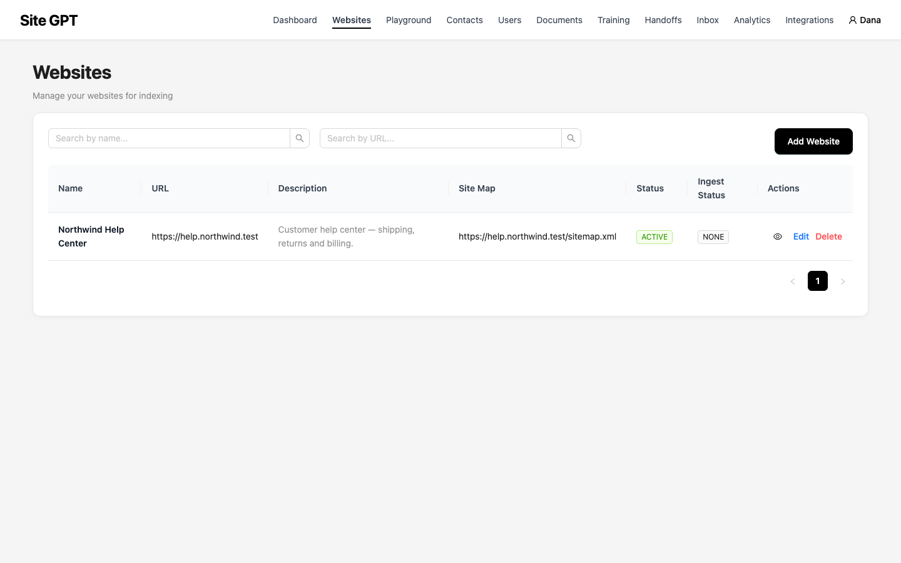
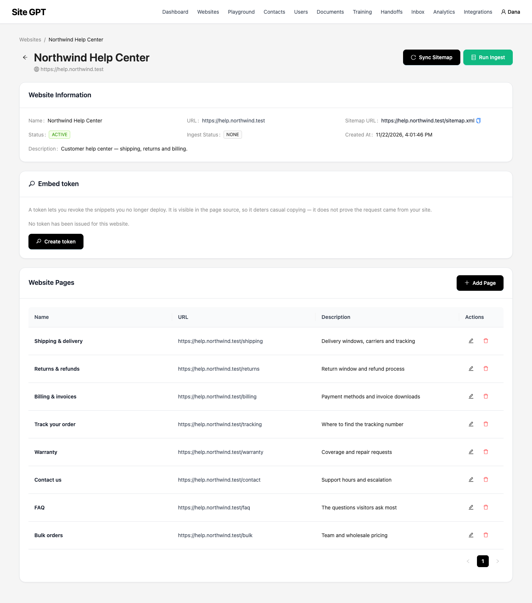
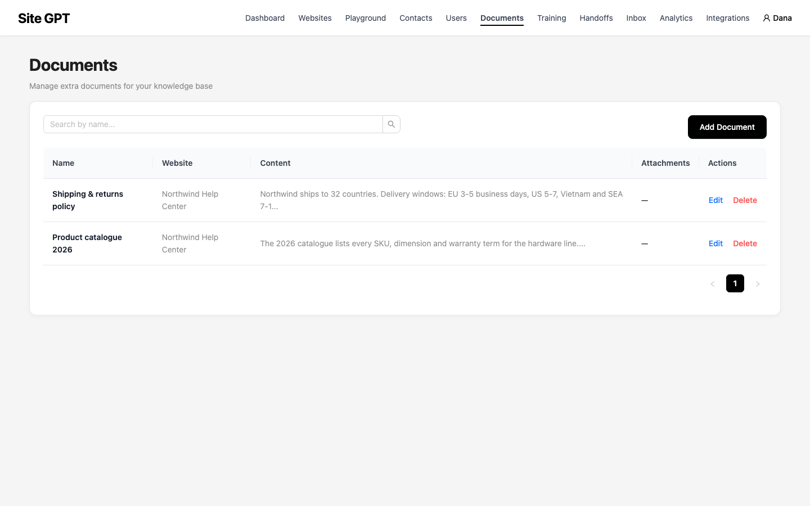
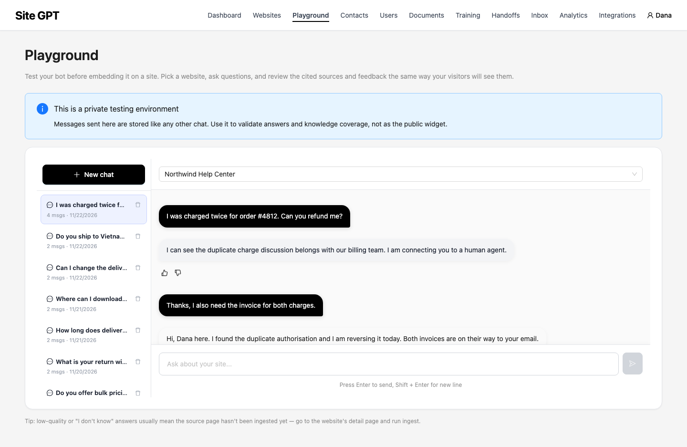
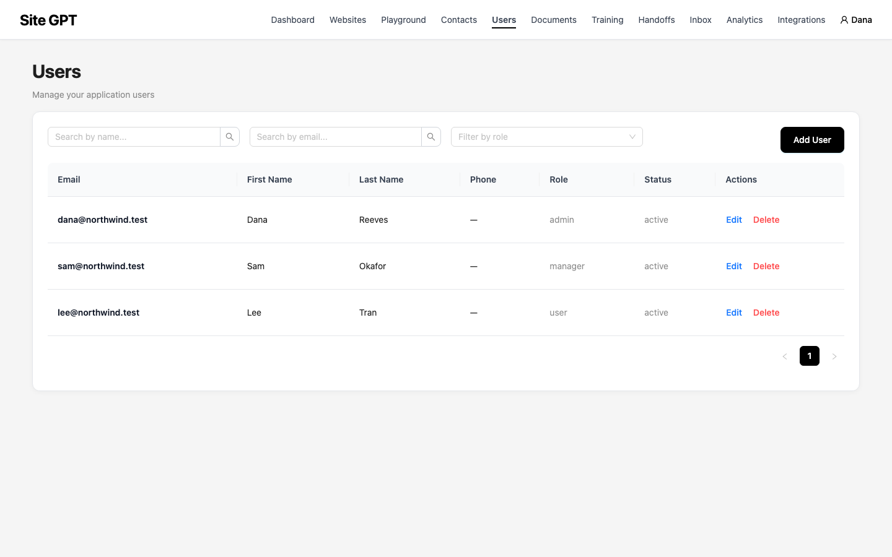

# SiteGPT

Turn any company website + extra documents into an embeddable AI chat bot (RAG).

## Screenshots

<table>
  <tr>
    <td width="50%"></td>
    <td width="50%"></td>
  </tr>
  <tr>
    <td align="center"><b>Dashboard</b> — stat cards, recent conversations, sites &amp; team</td>
    <td align="center"><b>Embeddable widget</b> — drops onto any site with two lines of HTML</td>
  </tr>
  <tr>
    <td></td>
    <td></td>
  </tr>
  <tr>
    <td align="center"><b>Websites</b> — manage crawled sources</td>
    <td align="center"><b>Website detail</b> — pages, sync sitemap, run ingest</td>
  </tr>
  <tr>
    <td></td>
    <td></td>
  </tr>
  <tr>
    <td align="center"><b>Extra documents</b> — uploads join the knowledge base</td>
    <td align="center"><b>Playground</b> — test answers with citations &amp; feedback</td>
  </tr>
  <tr>
    <td></td>
    <td></td>
  </tr>
  <tr>
    <td align="center"><b>Settings · Appearance</b> — colors, greeting &amp; suggested questions (fetched by the widget)</td>
    <td align="center"><b>Users</b> — manage team &amp; roles</td>
  </tr>
</table>

## How it works

1. Register company → creates company + admin user
2. Add website (URL + sitemap) → add/select pages → `POST /api/ingest`
3. Worker crawls pages (`trafilatura`), chunks (1000/200), embeds, stores in `pgvector`
4. Extra documents (text/file uploads in `uploads/`) are ingested the same way
5. Chat: `POST /api/chat` → embed question → pgvector similarity search (top 5, chunks further than `RAG_MAX_DISTANCE` discarded) → LLM answers with context + last 10 chat messages. When no chunk passes the threshold the bot replies "I don't have information about that" **without calling the LLM**
6. Embed on any site via `GET /widget.js`

## Tech stack

- **Backend:** FastAPI, SQLAlchemy, Alembic, pgvector, Redis (queue), JWT (`python-jose`), multi-LLM via LangChain (`ollama` / `openai` / `custom_openai` / `gemini` / `groq` / `openrouter`)
- **Frontend:** React 18 + Vite + TypeScript + Ant Design + axios + react-router
- **Infra:** PostgreSQL + pgvector, Redis, Ollama (default local LLM)

## Repo structure

```
src/site_gpt/app/
  main.py              # FastAPI app + router wiring
  api/                 # routes.py (auth/chat/ingest/widget), company, user, website, document, extra_document, setting, upload
  models.py            # Company, User, Setting, Website, WebsitePage, Document, ExtraDocument, Attachment, Embedding, ChatMessage, ChatFeedback, Contact
  schemas/             # Pydantic request/response per resource
  services/            # llm.py, rag.py, ingest.py, crawler.py, parse.py, sources.py, ratelimit.py, redis.py, mail.py
  core/                # config.py (env), auth.py (hash/JWT)
  db/                  # session.py, base.py
  scripts/widget.js    # embeddable chat widget (window.ChatWidgetConfig)
  worker.py            # Redis queue consumer (ingest jobs)
frontend/src/
  pages/ (Dashboard, Websites, WebsiteDetail, ExtraDocuments, Playground, Contacts, Users, Settings, Login, Register)
  components/ (Layout, Chat, WidgetPreview, ProtectedRoute, WebsiteTable, CompanyTable, UserTable)
  context/ (AuthContext, ChatContext), utils/api.ts, types/api.ts
alembic/                # DB migrations
uploads/                # uploaded attachment storage
```

## Prerequisites

- Python 3.13 + `uv`, Node 18+, PostgreSQL with `pgvector` extension, Redis, Ollama (or any LLM API key)

## Setup — backend

```bash
cp .env.example .env   # fill DATABASE_URL, LLM_*, REDIS_*, MAIL_*
uv venv --python 3.13 && source .venv/bin/activate
uv sync
uv run alembic upgrade head
uv run uvicorn site_gpt.app.main:app --reload        # API :8000
uv run python -m site_gpt.app.worker                 # ingest worker (separate terminal)
```

## Setup — frontend

```bash
cd frontend
echo "VITE_BACKEND_URL=http://localhost:8000" > .env
npm install && npm run dev   # :5173
```

## Env vars

| Key | Default | Purpose |
|---|---|---|
| `DATABASE_URL` | — | SQLAlchemy Postgres URL |
| `LLM_AI` | `openai` | chat provider: `ollama\|openai\|custom_openai\|gemini\|groq\|openrouter` |
| `LLM_MODEL` | `gpt-4o-mini` | chat model |
| `LLM_EMBEDDING_MODEL` | `text-embedding-3-small` | embedding model name |
| `EMBEDDING_AI` | `LLM_AI` | **embedding provider, fully independent of `LLM_AI`** (same value set). Leave unset to reuse the chat provider. |
| `EMBEDDING_DIMENSIONS` | `1536` | vector dimension of the `embeddings` column; must match the embedding model's output dim |
| `OPENAI_API_BASE_URL` / `OPENAI_API_KEY` | — | OpenAI or Ollama-compatible endpoint |
| `GEMINI_API_KEY` / `GROQ_API_KEY` / `OPEN_ROUTER_API_KEY` | — | provider keys |
| `OLLAMA_HOST` / `OLLAMA_USERNAME` / `OLLAMA_PASSWORD` | `http://localhost:11434` | Ollama (optional basic auth) |
| `REDIS_HOST` / `REDIS_PORT` / `REDIS_PASSWORD` / `REDIS_DB` | `localhost/6379` | job queue |
| `MAIL_*` | — | forgot/reset password via fastapi-mail (`MAIL_SERVER`, `MAIL_PORT`, `MAIL_USERNAME`, `MAIL_PASSWORD`, `MAIL_FROM`, `MAIL_FROM_NAME`, `MAIL_TLS`, `MAIL_SSL`) |
| `JWT_SECRET_KEY` | dev default | **change in prod** |
| `CORS_ORIGINS` | `*` | comma-separated allowed origins; `allow_credentials` is disabled while it is `*` |
| `TRUSTED_PROXY_IPS` | *(empty)* | comma-separated IPs/CIDRs of reverse proxies / load balancers whose `X-Forwarded-For` is trusted; loopback and private peers are trusted automatically |
| `FRONTEND_URL` | `http://localhost:5173` | public admin URL, used in password-reset links |
| `CRAWL_REFRESH_HOURS` | `24` | worker re-crawl interval; `0` disables the scheduler |
| `RAG_MAX_DISTANCE` | `0.6` | max cosine distance for a retrieved chunk to count as context; above it the chunk is dropped and an empty result returns a canned "no information" reply without an LLM call. Lower = stricter, negative disables |
| `MAX_UPLOAD_MB` | `20` | largest accepted upload or remote import (URL / Google Drive); enforced while streaming, larger requests get `413` and leave no file behind |
| `SQL_ECHO` | `false` | log every SQL statement (debugging only) |
| `VITE_BACKEND_URL` (frontend) | — | backend base URL |
| `GOOGLE_DRIVE_ENABLED` / `GOOGLE_DRIVE_CLIENT_ID` | `false` / — | optional; backend flag + OAuth client id for the Google Drive import flow |
| `VITE_GOOGLE_DRIVE_CLIENT_ID` (frontend) | — | optional; when set, shows the "Pick from Google Drive" picker button |

## Key API endpoints

- `POST /api/register` — create company + admin user
- `POST /api/token` — login → JWT
- `POST /api/ingest?website_id=` — enqueue crawl+embed job
- `POST /api/chat` — `{website_id, session_id, question}` → `{answer, sources}`
- `GET /widget.js` — embeddable widget; served with `Cache-Control: max-age=300`
  and an `X-Widget-Version` content hash, and accepts `?v=<version>` so an install
  snippet can bust the cache immediately after a deploy
- `POST /api/chat/feedback` — public 👍/👎 rating `{website_id, session_id, rating, comment?}`
- `GET /api/widget-config?website_id=` — public widget appearance/config (assistant name, colors, greeting, placeholder, position, suggested questions)
- `GET /health`
- `/api/companies`, `/api/users` (+`/me`, `/forgot-password`, `/reset-password`), `/api/websites` (+`/{id}/pages`, `/{id}/load-site-map`), `/api/documents`, `/api/extra_documents`, `/api/settings`, `/api/uploads`

## Embed widget

```html
<script>
  window.ChatWidgetConfig = { apiUrl: 'http://localhost:8000', website_id: '<WEBSITE_ID>' };
</script>
<script src="http://localhost:8000/widget.js?v=<WIDGET_VERSION>"></script>
```

`?v=` is optional but recommended: the file is cached for 5 minutes, and the query
is part of the URL, so a new value fetches the new file immediately. Use the value
of the `X-Widget-Version` response header (`curl -I http://localhost:8000/widget.js`)
— it is a hash of `widget.js`, so it changes exactly when the widget changes. The
Settings page copies a snippet that already includes it.

## Dev commands

```bash
uv run alembic revision --autogenerate -m "[name]" && uv run alembic upgrade head
cd frontend && npm run build && npm run lint
```

## Deploying V1

V1 is self-hosted. None of the dev defaults below should survive into production.

### 1. Secrets and config

| Key | Dev default | Production |
|---|---|---|
| `JWT_SECRET_KEY` | hardcoded fallback in `core/config.py` | **required** — e.g. `openssl rand -hex 32` |
| `CORS_ORIGINS` | `*` | explicit comma-separated list, e.g. `https://app.example.com` |
| `TRUSTED_PROXY_IPS` | *(empty)* | the proxy/LB addresses (IPs or CIDRs) that terminate TLS — required when that proxy connects from a **public** IP, see below |
| `DATABASE_URL` | — | dedicated Postgres role/database, `pgvector` installed |
| `MAIL_*` | Gmail placeholders | real SMTP host/port/user/password — password reset only works once set |
| `FRONTEND_URL` | `http://localhost:5173` | public admin URL (used in reset links) |
| `SQL_ECHO` | `false` | keep `false` |

`CORS_ORIGINS` is parsed as a comma-separated list. `allow_credentials` is disabled
automatically while the value is `*`, so an explicit list is also what enables
credential/cookie flows.

### 2. TLS and reverse proxy

Run uvicorn behind nginx/Caddy/Traefik terminating **TLS 1.2+**:

- terminate HTTPS at the proxy; uvicorn stays on plain HTTP bound to `127.0.0.1:8000`
- forward `Host`, `X-Forwarded-For`, `X-Forwarded-Proto`
- if the proxy/load balancer connects from a **public** address, list it in
  `TRUSTED_PROXY_IPS` (comma-separated IPs/CIDRs). Otherwise the app ignores
  `X-Forwarded-For` and rate limits everyone by the LB's address, so one abusive
  visitor exhausts the bucket for all of them. Loopback and private addresses
  (`127.0.0.1`, `::1`, `10.x`, `172.16-31.x`, `192.168.x`) need no entry
- **disable response buffering for `/api/chat/stream`** (nginx: `proxy_buffering off;`).
  The endpoint already sends `X-Accel-Buffering: no`; with buffering on, SSE answers
  arrive in one block instead of streaming
- run the worker as a separate process: `uv run python -m site_gpt.app.worker`
- serve the built admin UI (`cd frontend && npm run build`) from the proxy or any static
  host; it bakes in `VITE_BACKEND_URL` at build time
- `/widget.js` and `/api/widget-config` must be reachable from the sites that embed the widget
- the public widget endpoints (`/api/chat`, `/api/chat/stream`, `/api/widget-config`,
  `POST /api/contacts`, `GET /api/contacts/{session_id}`) only serve requests whose
  `Origin`/`Referer` matches the website's host (or is absent / a localhost demo), so a
  `website_id` copied from another customer's page cannot be embedded elsewhere. If you
  embed the widget on a domain different from the website's `url`, update the website URL
  or requests from that domain will get `403`

### 3. Migrations

```bash
# fresh database: create it and install the extension first
# CREATE EXTENSION IF NOT EXISTS vector;
uv run alembic upgrade head      # head is 07f83918a289 (contacts)
```

The migration chain is linear from that head; never edit an already-applied revision.

### 4. Accepted V1 limitations

These are known, documented and deliberately not fixed in V1 (see `plans/PLAN_V1.md` §7):

| ID | Limitation | Impact / mitigation |
|---|---|---|
| K4 | `GET /api/conversations/{session_id}` and `GET /api/contacts/{session_id}` are **public by design** — the widget restores history and lead details without a login. A guessed `session_id` combined with a known `website_id` exposes that session's transcript or contact details. | Session ids are random UUIDs; treat transcripts and captured leads as non-secret. Requiring auth here would break the widget, so the fix is deferred to V2. |
| K5 | `services/ratelimit.py` is an in-memory fixed window, **per process**. Limits reset on restart and are not shared across workers. | Run one API process, or put a real limiter (Redis / edge) in front before scaling horizontally. |
| K18 | The widget's Origin/Referer check is **soft**: requests with no `Origin`/`Referer` (non-browser clients, forged headers, `referrerpolicy="no-referrer"`) are still accepted, and loopback origins are always allowed so local demos work. | It blocks ordinary cross-site embedding (copying a `website_id` into another page), not a determined API caller. A signed per-website embed token would close it and needs a schema change, so it is deferred to V2. |
| K8 | 👍/👎 feedback is stored in `chat_feedback` and nothing else: it never influences answers and there is no review screen. | Inspect rows in the DB. Feeding approved answers back into RAG is a V2 feature. |

Also note `/docs` and `/openapi.json` are enabled and unauthenticated (FastAPI default) —
restrict them at the proxy if that matters to you.

## Embedding dimension caveat

The `embeddings` table column is `Vector(EMBEDDING_DIMENSIONS)`, defaulting to **1536**
(matches OpenAI `text-embedding-3-small`). The chat and embedding providers are now
fully independent — set `EMBEDDING_AI` to point the embedding model at a different
provider than the chat model.

Because some embedding models emit a different dimension, set `EMBEDDING_DIMENSIONS`
to match your chosen model:

| Embedding model | Provider | Dimension |
|---|---|---|
| `text-embedding-3-small` / `text-embedding-3-large` | openai / custom_openai | 1536 (or request via `dimensions`) |
| `bge-m3` | ollama | 1024 |
| `nomic-embed-text` / `nomic-embed-text-v2-moe` | ollama | 768 |

If you change `EMBEDDING_DIMENSIONS` from 1536, you must also:

1. Generate & apply a migration that alters the column:
   ```bash
   uv run alembic revision --autogenerate -m "embedding dimension"
   uv run alembic upgrade head
   ```
2. **Re-ingest** every website (`POST /api/ingest`) so stored vectors match the
   new dimension — existing vectors of the old size will no longer be queryable.

OpenAI-compatible providers (openai, custom_openai, openrouter, groq, gemini) that
support the `dimensions` param will be asked for `EMBEDDING_DIMENSIONS` automatically
for `text-embedding-3-*` / `auto` models. Ollama models emit a fixed native dimension,
so `EMBEDDING_DIMENSIONS` must equal that model's native size.

## Fixes & improvements applied

- **RAG now answers from uploaded documents too.** `services/rag.py::search` previously
  only queried `documents` (crawled pages). It now runs one SQL query over `embeddings`
  with `LEFT JOIN`s to `documents` and `extra_documents`, keeping a chunk when it belongs
  to a `documents` row of this website **or** to an `extra_documents` row linked to this
  website **or** to the same company, so the chatbot actually uses the knowledge users
  upload.
- **Ingestion no longer crashes.** `crawler.crawl_page` now returns `(title, text)`, fixing
  the `KeyError: 'title'` that broke every ingest job in `worker.py`. The worker also
  upserts pages by URL (no more duplicate growth) and is wrapped in error handling that sets
  `ingest_status = 'failed'` on error.
- **Uploaded files are now searchable.** New `services/parse.py` extracts text from
  `.txt/.md/.csv/.json/.html/.pdf/.docx` and the worker embeds both the extra-document text
  **and** its attachment contents (added `pypdf` + `python-docx` deps).
- **Re-ingest is idempotent.** `ingest_document` / `ingest_extra_document` drop existing
  chunks before re-embedding, so re-running ingest won't duplicate vectors.
- **`POST /api/ingest` is now protected** — requires a manager/admin token and ownership of
  the website (was fully public).
- **Settings are scoped per company** — `GET/PUT /api/settings` no longer leaks or edits
  other companies' settings.
- **Upload safety** — files are stored under a UUID name (collision- and path-traversal-safe)
  instead of the raw filename.
- **Forgot/reset password fixed & secured** — old flow overwrote the live password with a
  garbage hash and sent no email. Now `forgot-password` issues a 30-min token, emails a
  reset link (`FRONTEND_URL`), and `reset-password` verifies the token + expiry. Added
  `reset_token` / `reset_token_expires_at` columns (migration `3f1a9c0d7e22`).
- **CORS** — `allow_credentials` is auto-disabled when `CORS_ORIGINS=*`
  (browsers reject the wildcard+credentials combo). Set an explicit origin list in prod.
- **Dead dual embedding backend removed** — dropped `db/vector_store.py` + unused
  `ingest_documents` (langchain-postgres `PGVector`) to avoid a second, divergent vector
  store.
- **Chat prompt** — `ask()` now uses a system instruction to answer only from context and
  say it lacks the info otherwise.

## Enhancements added

- **Streaming chat (SSE).** New `POST /api/chat/stream` streams the answer token-by-token
  (`data: {"chunk": "..."}` then `data: {"done": true}`). `rag.py::ask_stream` offloads
  embedding/search/DB writes to a thread so the event loop stays responsive. The in-app
  `ChatContext` and the public `widget.js` both consume the SSE stream (the widget was also
  fixed — it previously did a `GET` that never matched the `POST` backend). The legacy
  `POST /api/chat` is kept for non-streaming callers.
- **Stale-chunk cleanup.** On ingest, documents whose URL is no longer in the successfully
  crawled active-page set are deleted (cascading their embeddings). Extra documents with no
  usable content have their embeddings dropped, so removed/empty sources stop surfacing.
  Guarded so a full crawl failure can't wipe a site's knowledge base.
- **Rate limiting.** `services/ratelimit.py` (in-memory fixed window, per client IP) caps
  `/api/chat` + `/api/chat/stream` at 20 req/min, `/api/chat/feedback` at 40 req/min,
  `/api/ingest` at 10 req/min, `/api/token` (login, brute-force guard) at 10 req/min,
  `/api/register` + `/api/forgot-password` (spam/email-flood guard) at 3 req/hour and
  `/api/users/reset-password` (token-guessing guard, separate bucket from forgot-password)
  at 10 req/5 min   (429 on exceed). `X-Forwarded-For` is only trusted when the direct peer is a loopback or
  private address (a reverse proxy on the same host/VPC) or is listed in
  `TRUSTED_PROXY_IPS`; direct clients are keyed by their socket IP, so the header cannot be
  rotated to bypass a limit. Swap for a Redis counter if
  you run multiple workers.
- **Periodic re-crawl.** The worker now runs a `scheduler_loop` that, every
  `CRAWL_REFRESH_HOURS` (default 24, set `0` to disable), re-enqueues ingest for websites
  whose `ingest_status == 'completed'` and last update is older than the interval — keeping
  the knowledge base fresh with no extra infra.
- **`websites.status` disables a bot.** Anything other than `active` (case-insensitive) now
  returns `403 {"detail": "This website is disabled."}` from `POST /api/chat`,
  `POST /api/chat/stream`, `GET /api/widget-config`, both `/api/contacts` endpoints and
  `POST /api/ingest`. The worker also skips an ingest job for a disabled website and the
  refresh scheduler only picks `active` ones, so disabling a site stops its crawl and
  embedding spend too. Documents, conversations and leads are untouched — flip `status`
  back to `active` to serve the bot again.

## Further hardening (latest round)

- **Default settings are auto-seeded on register.** `POST /api/register` now creates the
  company's default `Settings` from the single `DEFAULT_SETTINGS` dict in
  `api/setting.py` — the 7 appearance keys (`assistant_name`, `widget_header_color`,
  `widget_footer_color`, `widget_position`, `greeting_message`, `placeholder_text`,
  `suggested_questions`) — so the admin/settings panel is usable immediately, with no
  separate "create settings" step required.
- **`POST /api/settings` is now idempotent.** It only inserts the default rows whose key is
  missing for the company, so calling it repeatedly never produces duplicate settings
  (previously it blindly `add_all`'d and could stack rows). Returns `created` / `skipped`
  counts. The defaults come from the same `DEFAULT_SETTINGS` dict used at registration, so
  there is one list to maintain.
- **Deleting a page removes its knowledge immediately.** `DELETE
  /api/websites/{id}/pages/{page_id}` now also deletes the matching `Document` (and its
  embeddings via the FK `ON DELETE CASCADE`) by URL+website, so a removed page stops being
  answered by the bot without waiting for a re-ingest.
- **`GET /health` is a real probe.** It opens a DB connection (`SELECT 1`) and pings Redis;
  the response now reports `{"status": "ok"|"degraded", "db": bool, "redis": bool}` so an
  orchestrator/load-balancer can detect a backend that can't reach its dependencies (instead
  of a blind `{"status":"ok"}`).
- **SQL echo is off by default.** `db/session.py` uses `echo=SQL_ECHO` (env, default
  `false`) instead of a hard-coded `echo=True`, so production logs are no longer flooded with
  every SQL statement. Set `SQL_ECHO=true` to debug queries.

## Chat UX enhancements (citations, feedback, playground, widget config)

- **Citations in answers.** `services/rag.py::search` now returns each chunk's
  `title`/`url`/`source_type` (crawled page vs. uploaded document). Both
  `POST /api/chat` (`{answer, sources}`) and the SSE `done` event
  (`{done: true, sources: [...]}` from `/api/chat/stream`) surface them, so the
  in-app chat, the Playground, and the public `widget.js` can all render "Sources".
- **Answer feedback.** New `chat_feedback` table + `POST /api/chat/feedback`
  (public, rate-limited) records 👍/👎. The in-app chat and the widget both show
  feedback buttons under each bot reply.
- **Playground page.** New admin route `/playground` reuses the in-app chat to
  test the bot (with citations + feedback) before embedding it.
- **Widget appearance via Settings.** `GET /api/widget-config?website_id=` is a
  public endpoint the widget fetches to apply `assistant_name`, `widget_header_color`,
  `widget_footer_color`, `widget_position`, `greeting_message`, `placeholder_text`, and
  `suggested_questions`. These are seeded as default `Settings` rows on register (the
  `PUT /api/settings` upsert also creates any missing key for older companies), and
  editable from the new **Appearance** tab in Settings. The embed script no longer
  hardcodes colors/name — it only needs `website_id` + `apiUrl`.
- **Public config is allowlisted.** `GET /api/widget-config` returns only the keys in
  `WIDGET_PUBLIC_KEYS` (`api/setting.py`) — exactly those 7 appearance keys. Any internal
  setting added later stays private unless it is explicitly added to that tuple.

## Chat streaming fix (SSE error)

The streaming chat (`POST /api/chat/stream`) was failing in the browser with
`ERR_INCOMPLETE_CHUNKED_ENCODING` / "network error". Three issues were fixed:

- **Stream never breaks.** `services/rag.py::ask_stream` is now wrapped so any failure
  (embedding API error, DB error, LLM error) emits `data: {"error": ...}` followed by
  `data: {"done": true}` instead of raising inside the generator (which closed the chunked
  response early). The full traceback is logged server-side; the client only gets a short,
  secret-free message. Both clients (`frontend/src/context/ChatContext.tsx` and
  `src/site_gpt/app/scripts/widget.js`) now render that `error` event.
- **Embeddings work with OpenAI-compatible gateways.** LangChain's `OpenAIEmbeddings` wrapper
  POSTs a request shape some gateways (e.g. a local router at a custom `OPENAI_API_BASE_URL`)
  reject with `400 input is required`. `services/llm.py` now uses a thin
  `_OpenAICompatibleEmbeddings` class that calls the OpenAI SDK directly. It also requests
  `dimensions=1536` for `auto` / `text-embedding-3-*` models, so vectors match the
  `Vector(1536)` column (the `auto` router otherwise returns 3072-dim vectors).
- **Vector double-wrapping bug.** `ask_stream` passed `embed_texts([question])`
  (a list-of-lists) into `search()` without the `[0]` unpack the sync `ask()` does, so the
  pgvector query became `[[...]]` and failed with `invalid input syntax for type vector`.
  Fixed by unpacking the single vector.

After these fixes, chat streams real tokens end-to-end. **Note:** because embeddings were
failing before, no vectors exist yet — ingest/crawl a website (settings → pages →
`POST /api/ingest`) so the bot actually has knowledge to answer from.

## Multi-source extra documents (Google Drive, URL, …)

Extra documents no longer have to come from a local file picker. The `Attachment`
table gained a `source` (`local` | `url` | `google_drive` | …) + `source_ref`
column, and every source is normalized into a local file under `uploads/` so the
rest of the RAG pipeline (`services/parse.py`, `worker.py`) is unchanged — only
*how the bytes are fetched* differs.

- **Providers** — `services/sources.py` is a small provider registry
  (`UrlProvider`, `GoogleDriveProvider`). Add Dropbox/OneDrive/S3 by writing one
  class and registering it in `PROVIDERS`; nothing else needs to change.
- **Endpoints** — `POST /api/uploads/url` (`{url, token?}`) and
  `POST /api/uploads/google-drive` (`{file_id, access_token}`), alongside the
  existing `POST /api/uploads/` (local). All three return the same
  `{file_id, filename, file_url, file_size, file_type, source, source_ref}` shape.
- **Google Drive without OAuth setup** — paste a share link for a file shared
  with *Anyone with the link*; the backend downloads it via the public endpoint
  (no token required). For private files, send an `access_token` (e.g. from the
  Google Picker) or set `VITE_GOOGLE_DRIVE_CLIENT_ID` to surface the native
  picker (`frontend/src/utils/googleDrive.ts` loads Google Identity Services +
  the Picker API on demand).
- **Frontend** — `frontend/src/pages/ExtraDocuments.tsx` adds "From URL" and
  "From Google Drive" buttons next to the upload control; imported files appear
  in the same file list with a `URL` / `Drive` badge and flow into the existing
  `file_ids` → `POST /api/extra_documents` flow.
- **Migration** — `a1b2c3d4e5f6` adds the two columns and also merges the two
  pre-existing migration heads (`09cf9d60fd13` + `fb0c17ed1234`) into one, so
  `alembic upgrade head` runs cleanly.
