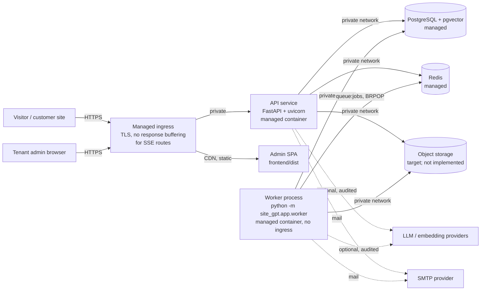

# V6 architecture and threat-model record

| | |
|---|---|
| Status | **v1 — written for the topology approved in D2 (2026-11-24).** It describes the target environment; almost none of it exists in the repository yet (no Dockerfile, compose file, CI workflow or object-storage adapter). |
| Scope | Track A only: hosted core, `BILLING_ENABLED=false`, `PLATFORM_CONSOLE_ENABLED=false`. Track B and the Stripe webhook ingress are out of scope. |
| Source decisions | `docs/preflight-v6.md` → Recorded decisions D2 (topology), D3 (objectives), D4 (security profile), D5 (console off), D6 (uploads), D7 (data), D8 (telemetry), D13 (deferrals), and D1 (scope). |
| Limitation | Self-assessed by the single repository owner; it is not an independent architecture review or penetration test. Deployment state must be inspected at the ingress before launch. |
| Risk mapping | `docs/risk-register-v6.md` v1 rows R1–R12. |

## 1. Target topology

**Components**

- **Managed ingress**: terminates TLS, forwards `Host`, `X-Forwarded-For`, `X-Forwarded-Proto`, keeps buffering off for `/api/chat/stream`, `/api/chat/messages/stream` and `/api/inbox/events`, and enforces the upload body limit consistently with `MAX_UPLOAD_BYTES` (20 MB default).
- **API container**: `site_gpt.app.main:app` under uvicorn. Public surface: `/health` (unchanged contract), the additive `/health/live` and `/health/ready` probes, `/widget.js`, `/chat/{website_id}`, `/api/widget-config`, the chat/embed and auth routes, and the tenant admin API; the operator snapshot `GET /api/ops/status` answers 404 unless `OPS_STATUS_TOKEN` is set and then requires that header (V6-21). Multiple instances are assumed, so `RATE_LIMIT_BACKEND=redis` is mandatory and no request state lives in process memory.
- **Worker container**: `python -m site_gpt.app.worker`, no inbound path, consumes `queue:jobs` and runs the scheduler loops (`digest`, `retention`, `topic_clusters`, `sitemap_scan`, `insights`). It publishes `ops:worker:heartbeat` every `WORKER_HEARTBEAT_INTERVAL_SECONDS` (TTL of three intervals), stamps `ops:queue:last_pop` on every consume and counts failed jobs in `ops:worker:job_failures`; those three keys plus `LLEN queue:jobs` are what the alerts read (V6-21). Its delivery guarantees are still **undecided** (D9 open) and are the subject of V6-20.
- **PostgreSQL with pgvector**: private network only. Schema is applied out of band with `uv run alembic upgrade head`; the chain is linear with head `0b22b30bf930`.
- **Redis**: private network only; queue, rate limiter, quota counters, inbox pub/sub and presence leases. Persistence/eviction policy must never drop `queue:jobs` keys while the worker depends on them.
- **Admin SPA**: `frontend/dist` on a CDN, with `VITE_BACKEND_URL` baked at build time to the API origin. `index.html` is not cached across releases.
- **Object storage**: the approved target for uploaded bytes. **No adapter exists**: `api/upload.py` writes `uploads/` locally and `services/retention.py` unlinks locally. V6-13 restricts uploads to tenant admins and the D6 format list, but an adapter is still required for a durable volume, so uploads stay closed for the launch cohort until it lands.

**Telemetry scope (V6-21).** The signals are per process, not aggregate. The 5xx rate has two views since V6-23: every replica's access middleware writes bucketed counters into Redis (`ops:api:requests:<bucket>`, `ops:api:errors:<bucket>`), the snapshot sums the buckets covering the window and the alert reads that sum with `source: "fleet"`; the in-process window stays as this instance's detail and is the labelled `source: "instance"` fallback while Redis is down. `/api/ops/status` is still answered by whichever instance the caller reaches, so the `worker.*` signals and the instance detail belong to that process. The worker keys are one document and one pop timestamp, overwritten by every heartbeat and every consume, so they prove that *a* worker is alive and that the queue is being drained — not how many workers exist or which one is stuck; only the queue depth is shared, because `queue:jobs` is one list. `scripts/ops_status.py` therefore proves the instance it reached serves, reaches the database, and sees a fresh heartbeat and a draining queue; it does not prove fleet-wide error rate or per-replica/per-worker health. The fleet rate is Redis-side counters now rather than a vendor collector; the rest of the fleet view — which replica the check reached and which worker is stuck — is V6-23/V6-40 work, and one blind spot no counter can close from inside remains: a 5xx the ingress returns because it has no healthy upstream never reaches an API process, so neither the in-memory window nor a Redis aggregate can see it and V6-23 must pick the ingress/CDN source for that signal. **Unset token:** with `OPS_STATUS_TOKEN` empty the route is absent (404) in every environment, and that is the chosen fail-closed answer — it exposes nothing, so the production validator does not refuse to boot over it; instead a production boot logs one `config.ops_status_disabled` warning, which is the only signal that the deployment has no alert path. Set the token on the host and run `scripts/ops_status.py` from a cron or external monitor; the deployment is otherwise blind to worker and queue state. The options for that fleet view, the recommendation and the evidence still owed to staging are recorded in [`plans/PLAN_V6.md`](../plans/PLAN_V6.md) under V6-23.

## 2. Network boundaries

| Surface | Reachability | Notes |
|---|---|---|
| API origin | Public | Serves the widget, hosted chat page and tenant API; required from customer sites. |
| Admin SPA origin | Public (authenticated UI) | No API data is served statically; auth is the JWT bearer flow. |
| `/api/platform` | Public route, 404 | `PLATFORM_CONSOLE_ENABLED=false` per D5, and `APP_ENV=production` refuses to boot with it on (V6-11), so no operator exposure this launch. |
| PostgreSQL / Redis / object storage | Private network only | No public listener; credentials in the deployment secret store. |
| Worker | No ingress | Reached only through Redis and the database. |
| Stripe webhook | Not present | Track B only; billing off. |

## 3. Data flows worth reviewing

- **Chat**: browser → API → pgvector search over `embeddings` joined to `documents`/`extra_documents` → provider call → stored `chat_messages`. Transcripts are the highest-sensitivity product data; they must not reach logs (D8) or support tooling (D11 residual R10).
- **Ingest**: admin/upload or sitemap → `documents` + `attachments` → `queue:jobs` → worker parses and embeds → rows. A crash between `BRPOP` and commit can lose a job today (R5).
- **Inbox/SSE**: Redis pub/sub and presence leases; agent console uses a `fetch()` stream because `EventSource` cannot send `Authorization`.
- **Privacy**: export and erasure are company-scoped API routes; erasure runs in one transaction through `services.conversations.erase_session`; backups retain deleted data until the 30-day backup expiry (D7).
- **Providers**: LLM/embedding/SMTP receive only the data their calls require; no raw keys in logs (D8), keys from the secret store (D4).

## 4. Deploy, migration and rollback

- **Artifact**: one immutable build per release, promoted from staging; API and worker are separate deploy units from the same commit.
- **Deploy order**: migrate (expand-only), then worker, then API, then SPA; readiness is `/health/ready` (503 only without the database; Redis is reported as `degraded` on a 200 because the API still serves), liveness is `/health/live` (no dependency check, so a degraded process is not restarted in a crash loop), and `/health` keeps its original contract for existing checks.
- **Migrations**: must be backward compatible for one release (expand now, contract later), because API and worker can run different versions during a rolling deploy.
- **Rollback**: redeploy the previous artifact and fix the schema forward. `alembic downgrade` is **not** the rollback path because M11/M12 downgrades discard billing and operator state. A restore from backup is the catastrophic path and loses everything after the 24h RPO point.
- **Untested today**: there is no manifest, no staging environment and no rehearsal; V6-40/V6-42/V6-44 must produce that evidence. This document is the target, not proof.

## 5. Threat-model classification

| Risk | Classification | Why | Closing task / expiry |
|---|---|---|---|
| R1 secure boot | fix-before-launch | Known JWT fallback and `*` CORS are exploitable defaults | V6-10 |
| R2 operator security | mitigated by keeping the console off | No MFA/SSO or operator network; console 404, refused at production boot, host/proxy-independent, disable/recovery exercise recorded | V6-11 (partial: console-off scope only); review 2027-02-28 |
| R3 unapproved paid launch | mitigated | Track A chosen; billing and console off | V6-6G stays closed |
| R4 operational ownership | fix-before-launch | Owners/objectives now named; restore and incident rehearsals missing | V6-42/V6-43 |
| R5 background job loss | fix-before-launch | Destructive `BRPOP`, no ack/visibility timeout | V6-20 (D9 open) |
| R6 health/telemetry | fix-before-launch | Structured JSON logs with request/job ids and central redaction are in (V6-22); the liveness/readiness split, worker heartbeat, queue depth/age and the D8 alert set are implemented (V6-21) but have not been fault-injected on a staging environment, and the API error window and heartbeat view are per-process rather than fleet-wide (see §1 Telemetry scope) | V6-21 (staging half in V6-40; fleet aggregation in V6-23/V6-40) |
| R7 regression coverage | fix-before-launch | No CI or browser runner | V6-30/V6-32 (D10 open) |
| R8 data protection ops | fix-before-launch | Backups/restore and private networking unverified | V6-42 |
| R9 uploads unscanned | accept-with-owner-and-expiry | Admin-only, format/size limited, no scanner | 2027-02-28 |
| R10 tenant audit | mitigate | Only platform audit exists; support access unaudited | 2027-02-28 |
| R11 session revocation | mitigate | Deactivation/deletion immediate; no single-session revoke | 2027-02-28 |
| R12 embed boundary | accept-with-owner-and-expiry | K18 accepted; compat token modes | 2027-02-28 |

## 6. Prerequisites before this topology can serve the launch cohort

1. **Object-storage adapter** for uploads (or a documented decision to keep them disabled) — V6-40.
2. **Production-config validator** that fails closed on the D4 required set — V6-10.
3. **Upload restriction** to admins with format and size limits — V6-13.
4. **Job delivery contract** (ack/visibility timeout, retry, dead-letter) — V6-20 after D9.
5. **Telemetry and alerts** per D8 — V6-21/V6-22.
6. **CI + browser acceptance** per D10 — V6-30/V6-32.
7. **Deploy/rollback runbook, backup and restore rehearsal, incident runbook** — V6-40/V6-42/V6-43.
8. **Approved public copy** (no price, SLA or certification claim) — V6-41.
