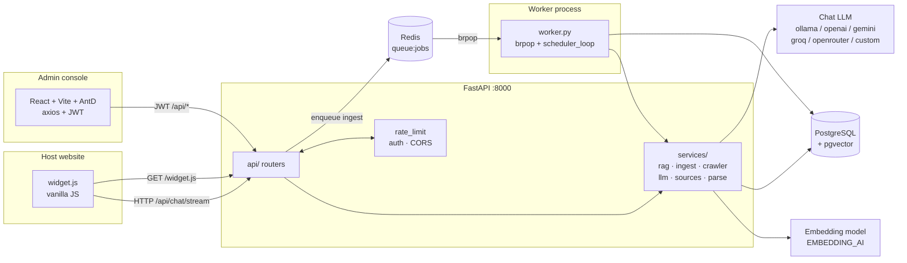

# PLAN — Version 1 (current version)

| | |
|---|---|
| Version | **V1 — the code currently on `master`** |
| Status | Baseline + stabilization plan. Feature scope **frozen**. |
| Baseline commit | `f571f95` — `feat(contacts): add contacts feature with API, model, UI, and widget integration` |
| Schema head | `07f83918a289` (`alembic/versions/07f83918a289_contacts.py`) |
| Date | 2026-11-14 |
| Companion | `plans/SPEC.md` — **V2** requirements & design; `plans/PLAN_V2.md` — **V2** execution plan (39 tasks, 5 waves, 5 gates) |
| Sources of truth | `README.md`, `AGENTS.md`, `graft/` context graph, and the code itself |

---

## 1. Version policy

**The current repository state IS Version 1.** V1 is a working, self-hosted RAG
chatbot product: a company registers, adds a website and documents, the system
crawls and embeds them, and an embeddable JS widget answers visitor questions
with citations. Everything described in §2 already exists in code.

This document is **descriptive and corrective**, not a feature roadmap. It
records:

1. what V1 ships (§2–§6),
2. what is currently broken or drifting (§7),
3. the small, ordered set of fixes that make V1 stable (§8),
4. the criteria for declaring V1 frozen (§9).

**No new product feature is introduced here.** The SiteGPT parity work in
`plans/SPEC.md` is **V2**.

| Change | Belongs to |
|---|---|
| Fix a bug, correct docs, tighten a default, add a test | **V1** (§8) |
| New DB table or column / Alembic migration | **V2** |
| New API router or new public endpoint | **V2** |
| New admin page or new widget UI element | **V2** |
| New env var or new `settings` key | **V2** |
| New third-party dependency | **V2** |

> **Recorded exceptions to this table:** `RAG_MAX_DISTANCE` (§3.5, S7),
> `TRUSTED_PROXY_IPS` (§3.5, S8) and `MAX_UPLOAD_MB` (§3.5, S9) were **pulled
> forward into V1** after the freeze. Each fixes behaviour that was actively
> wrong (answers built from irrelevant chunks; rate limits bypassable by a
> header; unbounded uploads that could OOM the API), and the rule above blocks
> new `settings` keys as well, so there was no in-policy way to make these
> values configurable. All stay deployment-level (env, not per-company) and
> migration-free. Any *further* config key still belongs to V2.

**Freeze rule:** once §9 is satisfied, tag the commit `v1` and stop adding to
V1. All subsequent product work lands on V2 via `plans/SPEC.md`.

---

## 2. V1 capability inventory

### 2.1 Multi-tenancy, accounts & access control

| Capability | Implementation | Anchor |
|---|---|---|
| Company + admin bootstrap | `POST /api/register` creates company, admin `User`, and default `Settings` rows | `api/routes.py:435` |
| Login / JWT | `python-jose` HS256, 24h token, `HTTPBearer` | `core/auth.py:24-77` |
| Password hashing | `argon2` via passlib `CryptContext` | `core/auth.py:13-21` |
| Forgot / reset password | 30-min token + emailed reset link (`FRONTEND_URL`) | `api/user.py:50-107` |
| Roles | `admin` / `manager` / `user`; `get_admin_user`, `get_manager_user` guards | `core/auth.py:80-99` |
| Tenant isolation | queries filter `company_id`; settings scoped per company | `api/website.py`, `api/setting.py` |
| Frontend route guard | `ProtectedRoute` + `AuthContext` token in `localStorage` | `components/ProtectedRoute.tsx` |

### 2.2 Knowledge ingestion

| Capability | Implementation | Anchor |
|---|---|---|
| Website + sitemap | `load_sitemap`, page selection, `trafilatura` extraction | `services/crawler.py` |
| Multi-source documents | raw text in `ExtraDocument.content`, local upload, remote URL, Google Drive (public link or OAuth token) | `services/sources.py`, `api/upload.py` |
| File parsing | `.txt .md .csv .json .html .pdf .docx` | `services/parse.py` |
| Chunking | `RecursiveCharacterTextSplitter(1000, 200)` | `services/ingest.py:9-14` |
| Embeddings | `get_embedding_model()` / `embed_texts()`, provider chosen by `EMBEDDING_AI` independently of the chat provider | `services/llm.py:107-155` |
| Vector store | pgvector `Vector(EMBEDDING_DIMENSIONS)`, default 1536 | `models.py:188-208` |
| Async jobs | Redis list `queue:jobs` via `brpop`, `{"type":"ingest","website_id":…}` | `services/redis.py`, `worker.py` |
| Ingestion status | `none → processing → completed` / `failed` | `worker.py:39-170` |
| Idempotent re-ingest | existing chunks dropped before re-embedding; stale documents removed | `services/ingest.py:22-56`, `worker.py` |
| Freshness | `scheduler_loop` re-enqueues completed websites older than `CRAWL_REFRESH_HOURS` (default 24h, `0` disables) | `worker.py:173-208` |

### 2.3 RAG chat

| Capability | Implementation | Anchor |
|---|---|---|
| Retrieval | single raw-SQL pgvector `<->` query over **both** crawled `documents` and `extra_documents` (website- or company-scoped), top 5 | `services/rag.py:19-74` |
| Retrieval floor | each chunk carries its cosine `distance`; chunks above `RAG_MAX_DISTANCE` (default `0.5`, negative disables) are dropped, and an empty result gets the canned “no information” reply without an LLM call | `services/rag.py::search`, `ask`, `ask_stream` (§8/S7) |
| Grounding | `SYSTEM_PROMPT` answers only from context, admits missing info | `services/rag.py:128-134` |
| Memory | last 10 messages of the session | `services/rag.py:98-115` |
| Sync chat | `POST /api/chat` → `{answer, sources}` | `api/routes.py:74` |
| Streaming chat | `POST /api/chat/stream` SSE, `chunk` → `done{sources}` → `error` events; thread-offloaded blocking work | `services/rag.py:181-246` |
| Citations | `title` / `url` / `source_type` (`page` vs `document`) | `services/rag.py:77-95` |
| Answer feedback | 👍/👎 persisted to `chat_feedback` | `api/routes.py:84-116` |
| Rate limiting | in-memory fixed window per client IP: chat/stream 20/min, feedback 40/min, ingest 10/min, login 10/min, register + forgot-password 3/hour, reset-password 10/5 min; `X-Forwarded-For` trusted only from loopback/private peers or `TRUSTED_PROXY_IPS` | `services/ratelimit.py` |

### 2.4 Embeddable widget

| Capability | Implementation | Anchor |
|---|---|---|
| Two-line embed | `GET /widget.js` + `window.ChatWidgetConfig` | `api/routes.py:512`, `README.md` |
| Server-driven appearance | `GET /api/widget-config?website_id=` → assistant name, header/footer colors, position, greeting, placeholder | `api/routes.py:244-269` |
| Suggested questions | `suggested_questions` setting → `renderSuggestions()` | `scripts/widget.js:452-466` |
| Lead capture | pre-chat form (first/last name/email) → `POST /api/contacts` upsert | `scripts/widget.js:513-567` |
| History | `localStorage` copy + server-side restore via `loadServerHistory()` | `scripts/widget.js:732-749` |
| Streaming, citations, feedback | rendered under each bot reply | `scripts/widget.js:372-428` |
| Vanilla JS | no build step, Shadow DOM styles | `scripts/widget.js` |

### 2.5 Admin console (React 18 + Vite + TS + Ant Design)

Dashboard with 6 stat cards and recent conversations · Websites list · Website
detail (pages, sitemap sync, run ingest, delete page removes its vectors) ·
Extra documents (text, uploads, URL, Drive) · Playground (test with citations +
feedback) · Contacts (captured leads) · Users (team + roles) · Settings (profile,
widget embed snippet, appearance with live preview) · Login / Register.

### 2.6 Reliability & hygiene already in V1

Real `/health` probe that checks DB (`SELECT 1`) and Redis · `SQL_ECHO` off by
default · `allow_credentials` auto-disabled when `CORS_ORIGINS=*` · UUID upload
filenames (path-traversal safe) · default settings auto-seeded on register ·
deleting a page cascades its embeddings immediately.

---

## 3. Architecture

### 3.1 Components



### 3.2 Core flows

**Ingest** — `POST /api/ingest?website_id=` (manager) → `enqueue_job` → Redis
`queue:jobs` → `worker.handle_ingest` → `crawl_website` (sitemap + trafilatura)
→ upsert `WebsitePage` / `Document` → `split_text` (1000/200) → `embed_texts`
→ replace rows in `embeddings` → `websites.ingest_status = completed`. Extra
documents and their attachments are embedded the same way. A full crawl failure
is guarded so it cannot wipe the knowledge base.

**Chat (streaming)** — `POST /api/chat/stream` → embed the question →
`rag.search` (single UNION query, top 5) → load last 10 messages → build
`SYSTEM_PROMPT` + context + history → LLM token stream → SSE `chunk` events →
persist user + assistant messages → `done` event carrying `sources`. Any failure
emits `error` then `done` instead of truncating the chunked response. The sync
`POST /api/chat` follows the same path without streaming.

**Widget bootstrap** — host page sets `ChatWidgetConfig` → `init()` →
`loadServerConfig()` applies appearance → if `needsContact()` then
`loadServerContact()` or `showContactForm()` → `loadServerHistory()` (fallback
local) → welcome message → `renderSuggestions()`.

### 3.3 Data model (10 tables, SQLAlchemy 2.0 `Mapped` style)

| Table | Purpose | Key relations |
|---|---|---|
| `companies` | tenant root | users, websites, settings, extra_documents |
| `users` | accounts; `role`, `status`, reset token | company |
| `settings` | per-company key/value appearance config | company |
| `websites` | URL, sitemap URL, `ingest_status` | company, pages, documents, contacts |
| `website_pages` | selectable crawl targets, UQ(website_id, url) | website |
| `documents` | crawled page text | website, embeddings |
| `extra_documents` | raw text + uploaded/imported content (nullable website_id) | company, website, embeddings, attachments |
| `attachments` | file metadata, `source` + `source_ref`, UUID filename | extra_document, user |
| `embeddings` | chunks + `Vector(1536)`, CHECK enforces exactly one source FK | document **or** extra_document |
| `chat_messages` | `session_id`, `role`, `message` | website |
| `chat_feedback` | 👍/👎 + optional comment | website |
| `contacts` | captured leads, UQ(website_id, session_id) | website |

All FKs use `ondelete` plus cascading relationships. Every table inherits
`BaseModel` (uuid `id`, `created_at`, `updated_at`).

### 3.4 Tech stack

| Layer | Stack |
|---|---|
| Runtime | Python 3.13, `uv` |
| API | FastAPI, Uvicorn, Pydantic schemas, SQLAlchemy 2.0, Alembic |
| Data | PostgreSQL + `pgvector`, Redis |
| AI | LangChain + `langchain-{openai,google-genai,openrouter,groq,ollama,community,postgres}`; 6 chat providers; independent embedding provider |
| Ingestion | `trafilatura`, `beautifulsoup4`, `pypdf`, `python-docx` |
| Auth / mail | `python-jose`, `passlib[argon2]`, `fastapi-mail` |
| Frontend | React 18, Vite 5, TypeScript 5.6, Ant Design 5, axios, react-router 6, Less |
| Tooling | ESLint, `graft` context graph (`graft/`) |

**No test suite exists** (`tests/` is empty). Verification is by import/compile
and manual smoke — see §6.

### 3.5 Configuration (V1 env keys)

Backend `.env` (see `.env.example`): `DATABASE_URL`, `JWT_SECRET_KEY`,
`LLM_AI`, `LLM_MODEL`, `LLM_EMBEDDING_MODEL`, `EMBEDDING_AI`,
`EMBEDDING_DIMENSIONS`, `OPENAI_API_BASE_URL`, `OPENAI_API_KEY`,
`GEMINI_API_KEY`, `OPEN_ROUTER_API_KEY`, `GROQ_API_KEY`, `OLLAMA_HOST`,
`OLLAMA_USERNAME`, `OLLAMA_PASSWORD`, `MAIL_*`, `REDIS_*`, `FRONTEND_URL`,
`CORS_ORIGINS`, `TRUSTED_PROXY_IPS`, `CRAWL_REFRESH_HOURS`, `RAG_MAX_DISTANCE`,
`MAX_UPLOAD_MB`, `SQL_ECHO`, `GOOGLE_DRIVE_ENABLED`, `GOOGLE_DRIVE_CLIENT_ID`.

The last three entries are the §1 recorded exceptions, added after the freeze.

Frontend `frontend/.env`: `VITE_BACKEND_URL`, `VITE_GOOGLE_DRIVE_CLIENT_ID`.

---

## 4. V1 API surface

`main.py` wires 8 routers. `routes.py` declares full paths internally; the
others get a prefix.

| Router | Prefix | Endpoints | Auth |
|---|---|---|---|
| `routes.py` | *(none)* | `/api/register`, `/api/token`, `/health`, `/widget.js` | public |
| | | `/api/chat`, `/api/chat/stream`, `/api/chat/feedback`, `/api/widget-config`, `POST /api/contacts`, `GET /api/contacts/{sid}`, `GET /api/conversations/{sid}` | public + rate limit |
| | | `/api/ingest`, `GET /api/contacts`, `GET /api/conversations`, `/api/conversations/recent`, `DELETE /api/conversations/{sid}` | JWT manager/admin |
| `website.py` | `/api/websites` | CRUD, `/stats`, `/{id}/pages` CRUD, `/{id}/load-site-map` | JWT |
| `document.py` | `/api/documents` | list (paginated), get by id | JWT |
| `extra_document.py` | `/api/extra_documents` | list, get, create, update, delete | JWT |
| `upload.py` | `/api/uploads` | `POST /`, `/url`, `/google-drive` | JWT |
| `setting.py` | `/api/settings` | `GET /`, `PUT /`, `POST /` | JWT admin |
| `company.py` | `/api/companies` | `/current` get/put, `/users` CRUD + change-password | JWT admin |
| `user.py` | `/api/users` | `/me` get/put, `/forgot-password`, `/reset-password` | mixed (me = JWT, reset = public) |

FastAPI auto-serves `/docs`, `/redoc`, `/openapi.json`. Paginated lists use
`PaginatedResponse`. There is **no API-key auth and no versioned `/v1` surface**
in V1 — that is V2/F8.

---

## 5. Frontend & widget contract

### 5.1 Admin routes (`frontend/src/App.tsx`)

`/` Dashboard · `/websites` · `/websites/:id` · `/playground` · `/contacts` ·
`/users` · `/documents` → `ExtraDocuments` · `/settings` · `/register` ·
`/login`. All except the last two are wrapped in `ProtectedRoute`.

Contexts: `AuthContext` (token + user), `ChatContext` (SSE streaming state).
Components: `Layout`, `Chat`, `WidgetPreview`, `ProtectedRoute`,
`WebsiteTable`, `UserTable`, `CompanyTable`.

### 5.2 `window.ChatWidgetConfig` keys — V1 compatibility contract

| Key | Default | Meaning |
|---|---|---|
| `apiUrl` | `''` | backend base URL |
| `website_id` | `''` | required; scopes all chat/config calls |
| `botName` | `Assistant` | overridden by `assistant_name` setting |
| `position` | `bottom-right` | `bottom-left` also supported |
| `width` / `height` | `360px` / `480px` | widget box |
| `theme.primaryColor` | `#4c74af` | header / buttons / launcher |
| `theme.backgroundColor` | `#ffffff` | panel background |
| `footerColor` | `#4c74af` | composer background |
| `placeholder` | `Type a message...` | overridden by `placeholder_text` |
| `welcomeMessage` | `Hi 👋 How can I help you?` | overridden by `greeting_message` |
| `enableHistory` | `true` | local + server history |
| `suggestedQuestions` | `[]` | overridden by `suggested_questions` |
| `requireContactInfo` | `true` | pre-chat lead form |

### 5.3 `localStorage` keys — V1 compatibility contract

`chat_widget_session`, `chat_widget_history`, `chat_widget_contact`,
`chat_widget_initialized` (widget) · `sessionId` (admin in-app chat) ·
`access_token` (JWT).

> **These two tables are a hard constraint.** V2 must not rename or remove any
> key (`AGENTS.md`, `plans/SPEC.md` §3.1). New keys must be additive and optional.

---

## 6. Runbook

### 6.1 Prerequisites

Python 3.13 + `uv`, Node 18+, PostgreSQL with the `pgvector` extension, Redis,
and either Ollama or an LLM provider API key.

### 6.2 Start

```bash
cp .env.example .env
uv venv --python 3.13 && source .venv/bin/activate
uv sync
uv run alembic upgrade head
uv run uvicorn site_gpt.app.main:app --reload       # API :8000
uv run python -m site_gpt.app.worker                # worker, separate terminal
cd frontend && npm install && npm run dev           # UI :5173
```

### 6.3 Verify (there is no test suite)

```bash
uv run python -c "import site_gpt.app.main"
cd frontend && npm run build && npm run lint
curl http://localhost:8000/health                  # {"status":"ok","db":true,"redis":true}
graft build                                        # after any significant code change
```

Manual smoke: register → add website → sitemap sync → select pages →
`POST /api/ingest` → wait for `ingest_status=completed` → chat in Playground
(citations visible) → open `screenshots/_widget-demo.html` → submit a lead →
verify `/contacts`.

### 6.4 Migration chain (linear, single head)

```
7e34b3d80b73 → 2a719698d131 → bc14c17863ee → 09cf9d60fd13 → b954e1c9dae1
  → 45d15e5ede56 → 1ad5000257e6 → 20a8a1bc864f → 3f1a9c0d7e22 → fb0c17ed1234
09cf9d60fd13 + fb0c17ed1234 ──merge──> a1b2c3d4e5f6 → 07f83918a289 (HEAD)
```

`a1b2c3d4e5f6` is the **merge** migration; the actual current head is
`07f83918a289_contacts.py`. V2 migrations M1–M5 in `plans/SPEC.md` must chain
from `07f83918a289`.

### 6.5 Embedding dimension caveat

`embeddings.embedding` is `Vector(EMBEDDING_DIMENSIONS)` (default 1536). The
model's output dimension must match: `text-embedding-3-*` → 1536, `bge-m3` →
1024, `nomic-embed-text*` → 768. Changing the value requires an Alembic
migration **and re-ingesting every website**, because existing vectors become
unqueryable. V2 explicitly does not change this.

### 6.6 Screenshot index (`screenshots/`)

`01-login` · `02-dashboard` · `03-websites` · `04-website-detail` ·
`05-extra-documents` · `06-users` · `07-settings-profile` ·
`08-settings-widget` · `09-settings-appearance` · `10-playground` ·
`11-widget-closed` · `12-widget-open` · `_widget-demo.html` (host-page demo).

---

## 7. Known issues & tech debt in V1

These are verified against the code, not inferred from docs.

| ID | Issue | Severity | Evidence | V1 disposition | V2 ref |
|---|---|---|---|---|---|
| K1 | **Email is never actually sent.** `send_email` calls the async `FastMail.send_message()` without awaiting it; the coroutine is discarded. Password-reset "succeeds" but delivers nothing. | **High** | `services/mail.py:29-47`; verified `inspect.iscoroutinefunction(FastMail.send_message) is True` | Fix in §8/S1 | SPEC P0.1 |
| K2 | **Docs drift from code.** `README.md` claims `POST /api/settings` is idempotent and returns `created`/`skipped`; the handler blindly `db.add_all(default_settings)` on every call. `AGENTS.md` says `rag.py` searches "documents only" while it actually UNIONs `extra_documents`. | Medium | `api/setting.py:75-107`, `services/rag.py:19-74` | Correct docs in §8/S2 | SPEC ADR-2 |
| K3 | `GET /api/widget-config` is public and returns **every** `settings` row. Harmless today (only appearance keys exist), but becomes a leak the moment any internal key is added. | Low now / **High before V2** | `api/routes.py:244-269` | Allowlist in §8/S3 | SPEC ADR-1 |
| K4 | Several read endpoints are public by design: `GET /api/conversations/{sid}`, `GET /api/contacts/{sid}` — a guessed `session_id` + known `website_id` yields full history or PII. | Medium | `api/routes.py:212-241`, `:346-381` | Document; breaking fix deferred (would break the widget) | SPEC F8 follow-up |
| K5 | `rate_limit` is an in-memory fixed window per process/IP — not shared across workers or restarts. | Medium | `services/ratelimit.py` | Document | SPEC §14 |
| K6 | `JWT_SECRET_KEY` has a hardcoded dev fallback and `CORS_ORIGINS` defaults to `*`. Both are unsafe if deployed as-is. | **High on deploy** | `core/config.py:8-10`, `:44` | Deployment checklist §9 | SPEC F10 |
| K7 | No automated tests; `tests/` is empty. Only import/compile + manual smoke. | Medium | `tests/` | Add a minimal harness in §8/S5 | SPEC §13 |
| K8 | `chat_feedback` is write-only — 👍/👎 is stored but never influences answers, and there is no admin review screen. | Low (intentional in V1) | `models.py:224-234` | Leave as-is; V1 scope boundary | SPEC F4 |
| K9 | Default `settings` keys are duplicated in `_default_setting_rows()` and `create_settings()`. | Low | `api/setting.py:12-28`, `:80-104` | Fix in §8/S3 | SPEC ADR-2 |
| K10 | `api/setting.py::create_settings` is not idempotent (see K2) — repeated calls stack duplicate rows. | Medium | `api/setting.py:105-107` | Fix in §8/S3 | SPEC P0.3 |
| K11 | Built frontend assets are committed (`frontend/dist/`, 3 files) and not gitignored; they go stale silently. | Low | `git ls-files frontend/dist`, `.gitignore` | Ignore + untrack in §8/S6 | — |
| K12 | `send_email` builds `ConnectionConfig` at import time and `USE_CREDENTIALS=True` even when `MAIL_*` are unset. | Low | `services/mail.py:15-26` | Covered by S1 | — |
| K13 | **No retrieval floor.** `search` returned the top 5 chunks unconditionally, so a question outside the knowledge base still received unrelated passages and the prompt forced an answer from them. | Medium | `services/rag.py::search` before S7 | Fix in §8/S7 (adds `RAG_MAX_DISTANCE`) | — |
| K14 | **`X-Forwarded-For` trusted unconditionally.** Any caller could rotate the header to reset the rate-limit window, defeating every limit. | High before deploy | `services/ratelimit.py::_client_ip` before S8 | Fix in §8/S8 (adds `TRUSTED_PROXY_IPS`) | — |
| K19 | **Anyone could embed any bot by copying its `website_id`.** The public chat/widget-config/contacts endpoints were scoped only by the website id, which is visible in the embedding page's HTML — a third party could spend a customer's LLM credits and route captured leads into that customer's dashboard. | High | `api/routes.py` (public widget endpoints) | Fixed: `services/embed_guard.py` compares `Origin` (falling back to `Referer`) against the website's host, with `www.` and localhost demos allowed and no-referrer requests still accepted; authenticated playground requests skip the check. `tests/test_embed_origin.py` covers allowed and foreign origins | README K18 documents the soft-check gap (signed embed token = V2) |
| K17 | **SSRF through URL imports and the crawler.** `UrlProvider` fetched any URL with `follow_redirects=True` and no scheme/host checks, and `crawler.crawl_page` / `extract_urls_from_sitemap` used `requests.get` on user-supplied sitemap URLs and page URLs — a registered user could reach loopback, internal services or `169.254.169.254` and read the stored body back through chat. | High | `services/sources.py`, `services/crawler.py` | Fixed: new `services/net_guard.py` allows only http(s) and rejects hosts whose every resolved address must be public; redirects are followed manually with each hop re-validated (`MAX_REDIRECTS=5`), and the import token is not forwarded to a redirect target on another host. `tests/test_ssrf.py` covers the rejections | — |
| K16 | **Stored XSS through the widget renderer.** `widget.js::renderMarkdown` applied markdown to raw model output and assigned it to `innerHTML`, so crawled content or a prompt injection could inject `` tags on the customer's site; link `href`s also accepted `javascript:`. Source titles were interpolated into `innerHTML` the same way. | High | `src/site_gpt/app/scripts/widget.js` | Fixed: HTML is escaped before markdown, links must be absolute `http(s)`, sources are built as DOM text nodes; `tests/widget_sanitize.test.mjs` (run by `tests/test_widget_markdown.py`) covers the payloads | — |
| K15 | **Unbounded uploads / remote imports.** `api/upload.py` read the whole body with `await file.read()` and `services/sources.py` buffered `resp.content`, both with no size limit — one large request could OOM the API or fill `uploads/`. | High | `api/upload.py`, `services/sources.py` before S9 | Fix in §8/S9 (adds `MAX_UPLOAD_MB`) | — |

---

## 8. V1 stabilization backlog (ordered, no new features)

Every item here is a **fix, a doc correction or a default change** — allowed by
the version policy in §1. No migration, no new router, no new page, no new env
key.

### S1 — Fix email delivery (blocks password reset)
- Add `async def send_email_async(...)` that awaits `FastMail.send_message`.
- Keep `send_email(...)` as a sync wrapper for `api/user.py::forgot_password`:
  `asyncio.run(...)` when no loop is running, `create_task` when one is.
- **Acceptance:** a reset password email and a test email are actually delivered
  against a test SMTP server; no `RuntimeWarning: coroutine was never awaited`.
- *Shared with `SPEC.md` P0.1 — do it once, here in V1.*

### S2 — Reconcile documentation with code
- `README.md`: correct the `POST /api/settings` idempotency claim (or implement
  it — that is S3).
- `AGENTS.md`: correct the `rag.py` description to "unions `documents` and
  `extra_documents`, top 5, website/company scoped"; correct the migration-head
  note if present.
- **Acceptance:** every claim in the README "Fixes & improvements" section can
  be verified in the code it cites.

### S3 — Harden settings handling
- Unify the two default-key lists into one `DEFAULT_SETTINGS` dict.
- Make `POST /api/settings` idempotent (insert only missing keys, return
  `created`/`skipped`) so `README.md` becomes true.
- Replace `widget_config`'s catch-all `{s.key: s.value}` with an explicit
  `WIDGET_PUBLIC_KEYS` allowlist containing exactly the 7 V1 appearance keys.
- **Acceptance:** calling `POST /api/settings` twice produces no duplicate rows;
  `GET /api/widget-config` returns exactly the 7 allowlisted keys.
- *Shared with `SPEC.md` P0.2 / P0.3 / ADR-1 / ADR-2 — do it once, here in V1.*

### S4 — Production defaults checklist
- Add a `README.md` "Deploying V1" section: set `JWT_SECRET_KEY`, set an
  explicit `CORS_ORIGINS` list, terminate TLS 1.2+ at a reverse proxy, configure
  real `MAIL_*`, and note K4/K5/K8 as accepted V1 limitations.
- **Acceptance:** a reader can deploy V1 without leaving dev defaults in place.

### S5 — Minimal test harness
- Seed `tests/` with unit tests for the purest services: `split_text`,
  `extract_text_from_file`, `collect_sources`, `format_history`,
  `_client_ip`, and the settings allowlist. No new dependency beyond what's
  installed (plain `unittest` is sufficient).
- **Acceptance:** one command runs them and they pass; `AGENTS.md` "No test
  suite exists" line is updated.

### S6 — Stop committing built assets
- Add `frontend/dist/` to `.gitignore` and `git rm --cached` the 3 tracked files.
- **Acceptance:** `git status` stays clean after `npm run build`.

### S7 — Retrieval quality floor (post-freeze, recorded exception)
- `services/rag.py::search` now selects each chunk's cosine `distance` and drops
  chunks above `RAG_MAX_DISTANCE` (env, default `0.5`; a negative value restores
  the pre-freeze “always use top-k” behaviour).
- `ask` and `ask_stream` return a canned “no information” answer **without an
  LLM call** when nothing survives the threshold, persisting the exchange so
  history stays consistent. `NO_CONTEXT_ANSWER` lives in `rag.py`.
- **Why the exception:** the §1 rule forbids new env keys *and* new `settings`
  keys, so the floor could not be made configurable without one of them. It is
  deployment-level rather than per-company to avoid `DEFAULT_SETTINGS`,
  `WIDGET_PUBLIC_KEYS` and an admin control. Recorded here instead of silently
  drifting from the plan.
- **Acceptance:** an in-scope question still answers with citations; an
  out-of-scope one returns the canned reply, `sources: []`, and never calls the
  LLM; `RAG_MAX_DISTANCE=-1` reproduces the old behaviour.
- *V2 may promote the floor to a per-company setting; the env key would then
  become the default.*

### S8 — Trusted proxy allowlist (post-freeze, recorded exception)
- `_client_ip` trusts `X-Forwarded-For` only when the direct peer is
  loopback/private (same host, Docker, VPC) **or** listed in `TRUSTED_PROXY_IPS`
  (comma-separated IPs/CIDRs, empty by default). This covers a load balancer
  that connects from a public address, without which every visitor would share
  one bucket keyed by the LB.
- Auth endpoints were throttled in the same round: `/api/token` 10/min,
  `/api/register` + `/api/forgot-password` 3/hour, `/api/users/reset-password`
  10 per 5 min (separate bucket from the reset-request one).
- **Why the exception:** same reasoning as S7 — configurable proxy trust needs
  an env key. One key, no migration.
- **Acceptance:** rotating `X-Forwarded-For` on a direct connection never resets
  a window; with the LB allowlisted, each visitor is counted separately.

### S9 — Upload size limit (post-freeze, recorded exception)
- `MAX_UPLOAD_MB` (env, default `20`) caps both local uploads and remote imports.
  Local uploads are written in 64 KiB chunks and the partial file is deleted the
  moment the limit is exceeded; URL / Google Drive fetches stream through
  `services/sources.read_limited`, which also rejects an oversized
  `Content-Length` before reading the body. Both paths answer `413`.
- **Why the exception:** the limit has to be tunable per deployment (hosted
  services allow more than a laptop), and the §1 rule blocks new env *and*
  `settings` keys.
- **Acceptance:** an upload above the limit returns `413` and leaves no file in
  `uploads/`; a remote import above it returns `413`; a request under the limit
  still saves and ingests normally.

> **Order:** S1 → S2 → S3 → S4 → S5 → S6 → S7 → S8 → S9. S1 and S3 are
> prerequisites for V2; completing them in V1 removes the entire Phase 0 from
> `plans/SPEC.md`.

---

## 9. Definition of done — V1 freeze checklist

- [ ] S1–S9 merged; `git status` clean apart from intentional untracked files.
- [ ] `uv run python -c "import site_gpt.app.main"` succeeds.
- [ ] `uv run alembic upgrade head` applies cleanly from an empty DB with
      `pgvector` installed; head is `07f83918a289`.
- [ ] `cd frontend && npm run build && npm run lint` pass.
- [ ] `GET /health` returns `{"status":"ok","db":true,"redis":true}`.
- [ ] End-to-end smoke: register → sitemap sync → ingest → status `completed`
      → Playground answer with citations → SSE stream works → widget opens on
      `_widget-demo.html` → lead appears on `/contacts` → 👍/👎 records a row.
- [ ] Password reset delivers a real email.
- [ ] `GET /api/widget-config` exposes only the 7 appearance keys.
- [ ] With the default `RAG_MAX_DISTANCE`, an out-of-scope question returns the
      canned “no information” reply with no LLM call, and an in-scope one still
      answers with citations (`-1` restores the old behaviour).
- [ ] Rotating `X-Forwarded-For` on a direct connection does not reset a
      rate-limit window.
- [ ] `README.md` and `AGENTS.md` match the code.
- [ ] `graft build` run; graph matches the code.
- [ ] Commit tagged `v1`.

Once tagged, **V1 receives only security fixes**. All other work goes through
`plans/SPEC.md`.

---

## 10. Explicitly outside V1 (V2 boundary)

Recorded so nobody "backports" these into V1 by accident.

| Gap in V1 | V2 feature |
|---|---|
| Q&A training from feedback (K8) | `SPEC.md` F4 |
| Human escalation / live-agent handoff | `SPEC.md` F5 |
| Weekly email digest + analytics | `SPEC.md` F6 |
| Crisp / Slack / Zendesk / webhook integrations | `SPEC.md` F7 |
| API keys, `/api/v1`, published API docs | `SPEC.md` F8 |
| Multilingual widget + language-aware prompt | `SPEC.md` F1 |
| Custom logo / full branding | `SPEC.md` F2 |
| Runtime model switching | `SPEC.md` F3 |
| Privacy export/deletion, consent | `SPEC.md` F9 |
| Encryption & transport hardening beyond docs | `SPEC.md` F10 |
| SOC 2 / HIPAA / DPA / GDPR certification | **Not code** — out of scope for both versions |
| Trial, pricing, onboarding | **Not code** — SaaS packaging, out of scope |

**V1 coverage vs the 19 SiteGPT features:** 6 full · 6 partial · 3 missing ·
4 not-applicable. Detail in `.workbuddy-ai/memory/2026-11-14.md` and
`plans/SPEC.md` §2.

---

## 11. Handoff to V2

The ordered task list for everything below is `plans/PLAN_V2.md` (Waves 0–4,
tasks V2-01…V2-46, gates V2-0G…V2-4G). This section is the policy summary.

1. Tag the frozen V1 commit `v1`.
2. `plans/SPEC.md` Phase 0 items P0.1–P0.3 are already delivered by V1 S1/S3 —
   mark them done there rather than redoing them.
3. V2 migrations M1–M5 chain from `07f83918a289`.
4. V2 must preserve the contracts in §5.2 / §5.3 and the invariants in
   `SPEC.md` §3 (widget keys, `rag.py::search` as the only retrieval SQL,
   chunking 1000/200, `EMBEDDING_DIMENSIONS` unchanged).
5. Any V1 limitation promoted into V2 must be removed from the accepted-risk
   list in §7 and from the `README.md` deployment notes.
6. After each phase: run `graft build` and update `README.md`, `AGENTS.md` and
   this file's "out of scope" table.

---

## Appendix — V1 at a glance

- **78 indexed files · 369 symbols · 1026 edges** (`graft map`).
- **8 routers, ~50 endpoints, 10 services, 11 Pydantic schema modules,
  10 admin pages, 7 components, 12 screenshots.**
- **Fully self-hostable**, including a 100% local path (Ollama chat +
  Ollama embeddings) with no paid API required.
- **V1 differentiators not on SiteGPT's feature page:** answer citations, SSE
  streaming, Playground, Google Drive / URL source providers, scheduled
  re-crawl, independent chat vs embedding providers, idempotent re-ingest,
  stale-chunk cleanup, real health probe, and full source ownership.
