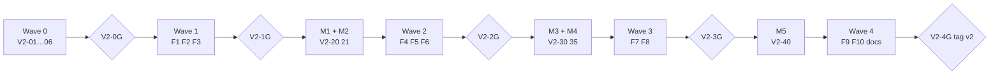

# PLAN — Version 2 execution plan

| | |
|---|---|
| Version | **V2** — implements `plans/SPEC.md` |
| Status | Ready to execute · all boxes unchecked |
| Created | 2026-11-14 |
| Derived from | `plans/SPEC.md` (requirements + design), `plans/PLAN_V1.md` (V1 baseline) |
| V1 baseline | commit `e23faba` (the existing `v1` tag: three commits past the original `f571f95` freeze — atomic ingest claim, 409 UI, ESLint 9 lint script), Alembic head `07f83918a289` |
| Scope | 10 features (F1–F10), 7 ADRs, 5 migrations (M1–M5), 5 waves, 39 tasks + 5 gates |
| Out of scope | SOC 2 / HIPAA / DPA certification, trial & pricing, live-agent inbox, retention purge, LLM topic clustering, Redis rate limiter, signed session tokens |

---

## 1. How to use this plan

- Each task has an ID `V2-xx`, a size (`S` / `M` / `L`), dependencies, the files
  it touches, what to do, and a **Done when** condition. Tick the box only when
  that condition is met.
- **One wave at a time.** Do not start Wave N+1 until the gate of Wave N is fully
  ticked. Gates are non-negotiable: they exist because later tasks assume the
  earlier contracts actually work.
- **One task ≈ one commit**, on branch `feat/v2`. Gates are their own commit
  (docs + `trail build` output).
- `SPEC.md` says *what* and *why*; this file says *in what order*. If they
  conflict, `SPEC.md` wins and this plan must be updated.
- Sizes are relative complexity, not time estimates.

---

## 2. Traceability matrix

| SPEC feature | Tasks | Migration | Wave | Parity |
|---|---|---|---|---|
| ADR-1 / ADR-2 / P0 | V2-01 … V2-06 | — | 0 | foundation |
| F1 Multilingual | V2-10, 11, 12 | — | 1 | ⚠️ → ✅ |
| F2 Custom logo | V2-13 | — | 1 | ⚠️ → ✅ |
| F3 Runtime model switching | V2-14, 15 | — | 1 | ⚠️ → ✅ |
| F4 Q&A training | V2-21, 22, 23, 24 | M2 | 2 | ⚠️ → ✅ |
| F5 Human escalation | V2-20, 25, 26 | M1 | 2 | ❌ → ✅ |
| F6 Digest + analytics | V2-20, 27, 28, 29 | M1 | 2 | ❌ → ✅ |
| F7 Integrations + webhooks | V2-30, 31, 32, 33, 34 | M3 | 3 | ❌ → ✅ |
| F8 API keys + `/api/v1` | V2-35, 36, 37, 38 | M4 | 3 | ⚠️ → ✅ |
| F9 Privacy controls | V2-40, 41, 42 | M5 | 4 | new |
| F10 Encryption hardening | V2-43, 44 | — | 4 | ⚠️ → ✅ |
| Docs / tests / release | V2-45, 46 | — | 4 | — |
| Gates | V2-0G, 1G, 2G, 3G, 4G | — | all | — |

**Target result:** 15 of 19 SiteGPT features full, 4 explicitly out of scope
(certifications / DPA). Coverage by group: Training 5/5, Chat 5/5,
Extensions 3/3, Security 2 technical + 4 legal N/A.

---

## 3. Pre-flight decisions (blocking)

The 7 open questions in `SPEC.md` §14 are resolved with the defaults below so
execution is not blocked. Record any change here before starting the affected
wave; changing a decision after its wave is complete requires rework.

| ID | Question | Default for V2 | Revisit before |
|---|---|---|---|
| D1 | Real-time agent inbox? | **No** — notify-and-callback (ADR-4). Handoff = email + integration event. | V2-25 |
| D2 | Claim "95+ languages"? | **No** — market as "replies in the visitor's language". | V2-10 |
| D3 | Per-user timezone for digest? | **No** — UTC hour + weekly `digest_day`; no `users.timezone` column. | V2-27 |
| D4 | All 4 integration providers? | **Yes**, all four, but Webhook + Slack land first (V2-31), Zendesk + Crisp as separate tasks in the same commit series. | V2-31 |
| D5 | Real `/api/v1` router? | **Yes** — new versioned router, legacy endpoints untouched. | V2-37 |
| D6 | App-level secret encryption? | **No** — hashed API keys, signed webhooks, deployment-level encryption at rest; no new Python dependency (ADR-6). | V2-43 |
| D7 | Trial / pricing / onboarding? | **Out of scope** — SaaS packaging, not code. | — |

### Environment pre-flight

- [x] `v1` tag exists **at `e23faba`** (`git rev-parse v1` dereferences to `e23faba`; the annotated tag object is `0cc68c5`) and `git status` is clean. The tag already sits on the post-V1-fix HEAD, not on `f571f95`; V2 branches from `e23faba`, and `plans/SPEC.md`'s header is corrected to match during V2-45.
- [x] PostgreSQL database backed up (`pg_dump`) before M1 — `backups/site_gpt_pre_v2.dump` (custom format), `backups/` is gitignored.
- [x] `pgvector` extension present; `.env` populated from `.env.example` — `uv run alembic current` and `GET /health` (`{"db":true,"redis":true}`) both work against it.
- [x] Branch `feat/v2` created — from `master`, which is `v1` + 3 commits that already carry the inherited stabilization, the settings split and the early M4 API keys. Branching from `v1` itself would have discarded them.
- [x] V1 stabilization S1 (email) and S3 (settings/config allowlist) are done —
      otherwise execute them as V2-02. **Do not implement them twice.**

---

## 4. Invariants (every task)

From `SPEC.md` §3 and `PLAN_V1.md` §5:

1. `ChatWidgetConfig` keys and all `localStorage` keys stay valid; new keys are
   optional with defaults.
2. `services/rag.py::search` remains the **only** retrieval SQL.
3. Chunking stays 1000/200 via `split_text`.
4. `EMBEDDING_DIMENSIONS` unchanged → **no re-ingest at any point in V2**.
5. Reuse `get_llm`, `embed_texts`, `enqueue_job`, `rate_limit`, `send_email_async`;
   no new SDK clients.
6. JWT auth stays; API keys are an additional path, no new auth library.
7. Ant Design only — no chart library, no new UI framework.
8. New env var → `core/config.py` + `.env.example` + `README.md` table, all in
   the same task.
9. New settings key → `DEFAULT_SETTINGS` + `WIDGET_PUBLIC_KEYS` decision, same task.
10. Every feature is **off by default** (setting row or env flag). Sole exception: the `SYSTEM_PROMPT` language rule (V2-10) is unconditional and has no flag, so it is the only intended V1→V2 behavioural difference with everything off. Never describe V2 as byte-for-byte V1.
11. After each gate: `trail build`, then update `README.md` and `AGENTS.md`.

---

## 5. Waves

### Wave 0 — Foundation (no schema change)

**Goal:** safe ground to build on. Everything here is a prerequisite; nothing is
user-visible. **Entry:** §3 pre-flight complete.

- [x] **V2-01 · Pre-flight & branch** — `S`, depends: —, migration: —
  - Files: git only.
  - Do: confirm the existing `v1` tag already points at `e23faba` (`git rev-parse v1` — do **not** move or re-create it), `pg_dump` backup, `git checkout -b feat/v2 v1`, verify `uv run alembic current` reports `07f83918a289`.
  - Done when: clean tree on `feat/v2` branched from `v1` = `e23faba`, backup file exists, head confirmed.
  - Done: `v1^{commit}` = `e23faba` (tag not moved); `backups/site_gpt_pre_v2.dump` written with `pg_dump -Fc`; `feat/v2` branched from `master` (= `v1` + `27ff560`, `83f0451`, `a1073fe`) because `master` already held this wave's inherited work; `alembic current` = `c41d7e8a9f20 (head)`, not `07f83918a289`, because M4 landed early (§7) — single head either way.

- [x] **V2-02 · Inherit V1 stabilization** — `S`, depends: V2-01, migration: —
  - Files: `services/mail.py`, `api/setting.py`, `api/routes.py` (only if V1 S1/S3 were not done).
  - Do: verify `send_email_async` exists and `WIDGET_PUBLIC_KEYS` allowlists the 7 V1 appearance keys; if absent, port V1 tasks S1 and S3 verbatim. Verify a real email is delivered.
  - Done when: password reset delivers an email, `POST /api/settings` twice creates no duplicates, `GET /api/widget-config` returns exactly the allowlist (7 keys at this point; 14 after V2-04).
  - **Why first:** F5/F6/F7 all depend on working mail; F1–F10 all add settings keys.
  - Done: `send_email_async` is awaited and the sync wrapper never blocks a running loop (`services/mail.py`); `POST /api/settings` idempotency and the allowlist are covered by `tests/test_settings.py` (passing); `GET /api/widget-config` returned 7 keys for a pre-V2 company, none outside the allowlist. **Not exercised:** a delivered email — no SMTP server is configured here, same limitation PLAN_V1 recorded for S1.

- [x] **V2-03 · Env & config plumbing** — `S`, depends: V2-01, migration: —
  - Files: `core/config.py`, `.env.example`, `README.md`.
  - Do: add `DIGEST_ENABLED=false`, `DIGEST_CHECK_SECONDS=3600`, `DIGEST_HOUR=9`, `INTEGRATION_WEBHOOK_SECRET`, `API_KEY_PEPPER`, `DEFAULT_WIDGET_LANGUAGE=auto`. Boolean parsing matches existing `.lower() in (...)` pattern; no secret defaults.
  - Done when: `uv run python -c "from site_gpt.app.core import config; print(config.DIGEST_ENABLED)"` works and all 6 keys appear in `.env.example` + README table.
  - Done: `DIGEST_ENABLED` (`False`), `DIGEST_CHECK_SECONDS` (`3600`), `DIGEST_HOUR` (`9`), `INTEGRATION_WEBHOOK_SECRET` (`None`), `API_KEY_PEPPER` (already there), `DEFAULT_WIDGET_LANGUAGE` (`auto`) are read in `core/config.py`; all 6 are present in `.env.example` and the README env table. No secret has a default.

- [x] **V2-04 · Settings registry + public allowlist** — `M`, depends: V2-02, migration: —
  - Files: `api/setting.py`, `api/routes.py`, `tests/test_settings.py`.
  - Do — split by visibility, keeping the existing three-layer registry (`DEFAULT_SETTINGS` / `INTERNAL_SETTINGS` / `ALL_SETTINGS`, `setting.py:16-38`): the **7 public** keys from `SPEC.md` §9 (`widget_language`, `widget_ui_strings`, `widget_logo_url`, `handoff_enabled`, `handoff_label`, `require_consent`, `privacy_policy_url`) go into `DEFAULT_SETTINGS`; the **7 internal** keys (`llm_provider`, `llm_model`, `handoff_email`, `digest_enabled`, `digest_hour`, `digest_day`, `digest_recipients`) go into `INTERNAL_SETTINGS`. `ALL_SETTINGS` stays the union and keeps seeding both through `_default_setting_rows()` / `create_settings()`; keep `PUT /api/settings` upsert behaviour.
  - Do — replace the derived allowlist `WIDGET_PUBLIC_KEYS = tuple(DEFAULT_SETTINGS.keys())` (`setting.py:43`) with an **explicit literal tuple**: the 7 V1 appearance keys + the 7 public V2 keys = **14 public keys**. Never derive it again — a key added to `DEFAULT_SETTINGS` must not become public by accident.
  - Do — update `tests/test_settings.py`: extend the `APPEARANCE_KEYS` (L16-24) and `INTERNAL_KEYS` (L27-32) fixtures with the new keys, rewrite the two old-contract assertions (`DEFAULT_SETTINGS == APPEARANCE_KEYS` and `WIDGET_PUBLIC_KEYS == DEFAULT_SETTINGS`, L37-41) to the 14-key explicit allowlist, and keep the `len(ALL_SETTINGS)`-based seeding/count assertions (L50-93) passing at 22 keys.
  - Done when: a fresh company gets all 22 keys; `GET /api/widget-config` returns exactly the 14 allowlisted keys and never `digest_recipients` / `handoff_email` / `llm_model`; `uv run python -m unittest tests.test_settings -v` passes.
  - Done: landed in `83f0451` before this wave started — `DEFAULT_SETTINGS` holds the 7 appearance + 7 public V2 keys, `INTERNAL_SETTINGS` the 7 server-side ones, `ALL_SETTINGS` = 22, and `WIDGET_PUBLIC_KEYS` is the 14-key literal tuple. `tests/test_settings.py` pins all of it and passes.

- [x] **V2-05 · Event-bus stub** — `S`, depends: V2-01, migration: —
  - Files: `services/integrations.py` (new, skeleton only).
  - Do: create `PROVIDERS: dict = {}` and `emit_event(db, company_id, event_type, payload)` that logs and returns `None` inside `try/except`. No HTTP yet. This lets F5/F6 call the final API in Wave 2 before providers exist in Wave 3.
  - Done when: `emit_event` can be imported and called with no integrations configured without raising.
  - Done: `services/integrations.py` ships `PROVIDERS = {}` and `emit_event(db, company_id, event_type, payload)`, which logs the event type and company only (never the payload) and swallows every error. Called with `PROVIDERS` empty it returns `None`.

- [x] **V2-06 · Shared frontend contracts** — `M`, depends: V2-04, migration: —
  - Files: `frontend/src/types/api.ts`, `frontend/src/utils/api.ts`, `frontend/src/components/Layout.tsx`.
  - Do: add the TS types the next wave actually reads and typed API helpers for endpoints that already exist; each V2 page adds its own nav entry in the task that creates it (no disabled placeholders — a nav item for a page that does not exist is dead weight). Do not create pages yet.
  - Done when: `npm run build` passes and no dead links are rendered.
  - Done: `types/api.ts` gains `Setting` (mirrors `SettingRes`); `utils/api.ts` gains typed `getSettings` / `updateSettings`, and `pages/Settings.tsx` uses them instead of raw `api.get` / `api.put`, so nothing is added unused. Deliberately **not** added: a `WidgetSettings` key map (nothing narrows on it — `WidgetConfig` stays the free-form `Record<string, string>` V1 shipped) and the four nav placeholders (Wave 1 creates no page; each page adds its own nav entry when it lands). `npm run build` and `npm run lint` both exit 0.

#### Gate V2-0G

- [x] `uv run python -c "import site_gpt.app.main"` passes.
- [x] `uv run alembic upgrade head` is a no-op on an up-to-date DB (still `07f83918a289`). — no-op, but the head is `c41d7e8a9f20` because M4 was built early (§7); the upgrade itself applied nothing.
- [x] `cd frontend && npm run build && npm run lint` pass.
- [ ] A V1 embed with no new config keys still opens, chats and streams. — **partially verified:** `GET /widget.js` (`200`, `application/javascript`, 30 427 bytes) and `GET /api/widget-config` (7 keys for a pre-V2 company, none outside the allowlist, ETag + `max-age=60`) both work over HTTP; the widget `.mjs` suite passes. **Not exercised:** an actual chat and SSE stream — no LLM provider was reachable in this environment (Ollama was down), and `widget.js` plus the chat routes are untouched by Wave 0.
- [x] `GET /api/widget-config` leaks no internal key.
- [x] `trail build` run; `README.md` env table updated; commit.

---

### Wave 1 — Quick wins: F1, F2, F3 (no migration)

**Goal:** highest visible parity gain at lowest risk. All three are
settings-driven, so Wave 0's registry is the only dependency. **Entry:** V2-0G.

- [x] **V2-10 · F1a language-aware prompt** — `S`, depends: V2-0G, V2-03, migration: —
  - Files: `services/rag.py`.
  - Do: extend `SYSTEM_PROMPT` (`rag.py:168`) with the detect-and-reply-in-same-language instruction from `SPEC.md` F1; apply to **both** `ask` (`rag.py:177`) and `ask_stream` (`rag.py:224`); honour `DEFAULT_WIDGET_LANGUAGE` only as a UI fallback, never as a prompt override.
  - Note: this ships with **no** flag and changes the prompt for every existing embed, so it is the single intended behavioural difference from V1 with all flags off (§4 invariant 10). Gates measure regression, not byte-identity.
  - Done when: an English knowledge base answers a Vietnamese, Spanish and French question in the question's language, on both `/api/chat` and `/api/chat/stream`, and no other answer path (retrieval, citations, persistence) changed.
  - Done: the rule is appended to the shared `SYSTEM_PROMPT`, so `ask` and `ask_stream` both get it and cannot drift. `DEFAULT_WIDGET_LANGUAGE` stayed a UI fallback. **Not exercised:** the three-language answer test — no LLM provider was reachable, so no reply was generated; the prompt string is the only change and `tests/test_rag_search.py` still passes.

- [x] **V2-11 · F1b widget i18n** — `M`, depends: V2-04, V2-10, migration: —
  - Files: `scripts/widget.js`.
  - Do: add `t(key)` with English fallbacks; map `widget_language` (`auto` → `navigator.language`) and `widget_ui_strings` (JSON overrides) in `loadServerConfig()`; replace hardcoded strings in `showContactForm`, `renderSuggestions`, `addMessage` error paths, and the placeholder/greeting. Malformed JSON must fall back silently.
  - Done when: `widget_language=vi` renders Vietnamese labels, `auto` follows the browser, and an embed with neither key behaves exactly as V1.
  - Done: `t(key, fallback)` resolves owner overrides → the built-in catalogue → the English text at the call site, and every hardcoded label in `addMessage`, `attachExtras`, `showContactForm`, `sendMessage` and the missing-id path now goes through it. Catalogue ships for English and Vietnamese; a company with no `widget_language` row keeps the exact V1 strings, and the seed now reads `DEFAULT_WIDGET_LANGUAGE`. A one-off node harness confirmed auto→vi, en-GB→en, vi labels, override precedence, malformed-JSON fallback and an untranslated language staying English; the four committed widget suites still pass.

- [x] **V2-12 · F1c admin language controls** — `S`, depends: V2-11, migration: —
  - Files: `pages/Settings.tsx`, `components/WidgetPreview.tsx`, `types/api.ts`.
  - Do: add language `Select` + UI-strings editor to the Appearance tab, include keys in `APPEARANCE_KEYS`, pass language into the preview.
  - Done when: saving from Settings changes the live widget and the preview.
  - Done: language `Select` (auto/en/vi) plus a JSON editor whose validator rejects a non-object; both keys joined `APPEARANCE_KEYS` and flow through `fetchAppearance` / `handleAppearanceSubmit`, and the preview resolves labels in the same order, using the admin browser for `auto`. Only en and vi have built-in labels, so the select offers those plus auto and says other locales need overrides. `types/api.ts` needed no change.

- [x] **V2-13 · F2 branding / logo** — `M`, depends: V2-04, V2-11, migration: —
  - Files: `scripts/widget.js`, `pages/Settings.tsx`, `components/WidgetPreview.tsx`, `api/routes.py` (allowlist already done in V2-04).
  - Do: `widget_logo_url` → `` in header + bot avatars replacing the hardcoded 🤖; `onerror` fallback; allow only `https:` / `data:image/`; `referrerpolicy="no-referrer"`; add `logoUrl?` prop to `WidgetPreview`; add key to `APPEARANCE_KEYS`.
  - Done when: logo appears in widget + preview, clearing restores 🤖, and a `javascript:` URL is ignored without breaking the widget.
  - Done: header badge and every bot avatar use the logo, both fall back to 🤖 on error, and only `https:` or raster `data:image/…;base64` URLs are accepted — `javascript:` and inline-SVG values sanitise to empty. The node harness covered 5 logo cases and all pass; the header/preview rendering itself was only built, not viewed in a browser.

- [x] **V2-14 · F3a runtime model switching (backend)** — `M`, depends: V2-04, V2-10, migration: —
  - Files: `services/llm.py`, `services/model_settings.py` (new), `services/rag.py`.
  - Do: `get_llm(provider=None, model=None, temperature=0.5)` with `None` → existing env globals; `ALLOWED_CHAT_MODELS` catalogue mapping `fast` / `accurate` → `(provider, model)`; `model_settings.resolve(db, website_id)` reads `llm_provider` / `llm_model` for the company; `ask` / `ask_stream` pass the override. Never touch `EMBEDDING_AI`.
  - Done when: switching a company's setting changes the model used by the very next chat with no restart; unknown values fall back to env; a provider with no key emits the SSE `error` event rather than a 500.
  - Done: `get_llm(provider=None, model=None, temperature=0.5)` falls back to `LLM_AI` / `LLM_MODEL`; `ALLOWED_CHAT_MODELS` = `default` / `fast` / `accurate`; `model_settings.resolve` joins website→company settings in one query and returns a pair only when it is in that catalogue, so a stored value can never name an arbitrary model. Live-DB smoke: a catalogue pair resolves, an unknown pair and a cleared pair both return `(None, None)`. **Not exercised:** a real chat switching models and the no-key SSE error — both need a provider.

- [x] **V2-15 · F3b admin Model tab** — `S`, depends: V2-14, migration: —
  - Files: `pages/Settings.tsx`, `utils/api.ts`.
  - Do: **Model** tab with a `Select` over the catalogue labels, a hint about per-provider API keys, and save through `PUT /api/settings`.
  - Done when: an admin can switch `accurate` → `fast` and back; `llm_*` keys never appear in `GET /api/widget-config`.
  - Done: the **Model** tab selects one of the three labels, states which provider key each needs and that embeddings are not switched, and saves the pair through the typed settings helper. The `llm_*` exclusion is proven by the gate's seeded-company check; the tab itself was built, not clicked through.

- [x] **V2-16 · Wave 1 verification set** — `S`, depends: V2-12, 13, 15, migration: —
  - Files: `README.md` (feature list).
  - Do: smoke-test the 3 languages, logo on/off, model switch, and a legacy V1 embed; document the new settings keys in README.
  - Done when: all four scenarios pass with no console errors.
  - Done: README documents every public setting, the `widget_ui_strings` keys and the model catalogue. Model switch verified against the live DB; widget language and logo verified with a node harness (13 checks); the three-language chat and a live legacy-embed chat were **not exercised** — no LLM provider was reachable. `widget.js` and `GET /api/widget-config` serve correctly and the widget suites pass.

#### Gate V2-1G

- [x] Import/compile, `npm run build && npm run lint`, `trail build` all pass.
- [x] No migration was generated in Wave 1 (`alembic current` still `07f83918a289`). — head is `c41d7e8a9f20` because M4 landed early (§7); `git status alembic/` is empty, so Wave 1 added no revision.
- [ ] Legacy `ChatWidgetConfig` embed regression check passes (keys, history, lead form, SSE). — **partially verified:** `GET /widget.js` returns `200 application/javascript` (36 655 bytes) and the four widget suites pass (they pin the config keys, history keys, lead-form and 403 paths). **Chat and SSE were not exercised** — no LLM provider was reachable, the same blocker recorded on the V2-0G item.
- [x] All new settings default to off/empty and are absent from public widget config unless allowlisted (`WIDGET_PUBLIC_KEYS` is the 14-key literal allowlist). — proven against the real query: a flushed company holding all 22 rows publishes exactly 14 keys, 0 outside the allowlist, 0 internal.
- [ ] V1 regression, not byte-identity: same API payloads, same widget strings, no console errors — with the V2-10 `SYSTEM_PROMPT` language rule as the only intended change. — payloads are unchanged and a company with no new rows still gets the identical English strings, but a company seeded with `widget_language=auto` now follows the visitor's browser (F1's stated behaviour, not a regression). No browser run, so console errors were not observed.
- [x] `README.md` updated; commit.

---

### Wave 2 — Feedback, handoff, digest (M1, M2)

**Goal:** close the three biggest functional gaps. These share the feedback and
conversation plumbing, so they ship together. **Entry:** V2-1G.

- [ ] **V2-20 · Migration M1** — `M`, depends: V2-1G, migration: **M1**
  - Files: `models.py`, `alembic/versions/<rev>_v2_m1.py`.
  - Do: add `chat_messages.answered` (Boolean, nullable, old rows stay `NULL`), new `handoff_requests` (website_id FK cascade, session_id, contact_id?, message?, status, channel + indexes), new `digest_log` (company_id FK cascade, period_start, period_end, **`sent_at` nullable**, recipient_count, `UniqueConstraint(company_id, period_start)` — `sent_at IS NULL` means "claimed, not yet sent"; see V2-28). Add `Company` / `Website` / `Contact` relationships. `uv run alembic revision --autogenerate -m "v2 m1 handoff digest answered"`, **review the diff**, `uv run alembic upgrade head`, then `downgrade -1` and re-upgrade to prove reversibility.
  - Done when: single head, upgrade + downgrade + upgrade clean, no data loss, `EMBEDDING_DIMENSIONS` untouched.

- [ ] **V2-21 · Migration M2** — `S`, depends: V2-20, migration: **M2**
  - Files: `models.py`, `alembic/versions/<rev>_v2_m2.py`.
  - Do: `chat_feedback` gains `message_id` (UUID, nullable), `status` (String 20, default `pending`), `reviewed_answer` (Text, nullable). Backfill `status='pending'` in the migration. Leave `message_id` NULL for old rows.
  - Done when: existing 👍/👎 rows survive with `status='pending'`; upgrade/downgrade reversible.

- [ ] **V2-22 · F4a feedback↔message linkage + admin API** — `M`, depends: V2-21, migration: —
  - Files: `services/rag.py`, `schemas/chat.py`, `schemas/feedback.py` (new), `api/routes.py`, `api/feedback.py` (new), `main.py`.
  - Do: make `save_message` return the persisted `ChatMessage`; add `message_id` to `ChatResponse` and the SSE `done` event; add optional `message_id: UUID | None` to `FeedbackRequest`; server resolves the question from the preceding user message in the same session (**never trust client text**); add `GET /api/feedback`, `PATCH /api/feedback/{id}`, `POST /api/feedback/rebuild?website_id=` (manager/admin) with `PaginatedResponse`.
  - Done when: a 👍/👎 call without `message_id` still returns 200; one with it stores the linked row; approve/reject persists status + reviewed answer.

- [ ] **V2-23 · F4b Q&A corpus via `ExtraDocument`** — `M`, depends: V2-22, migration: —
  - Files: `services/qa_training.py` (new).
  - Do: `rebuild_qa_document(db, website_id)` renders approved rows as `"Q: …\nA: …\n\n"`, upserts the single `ExtraDocument(name="__qa_training__", website_id=…, company_id=…)`, calls `ingest_extra_document`. Reuse `split_text` / `embed_texts` indirectly — **do not** add a third FK to `embeddings` or a new SQL search path (ADR-3). Invoke from approve/reject and the rebuild endpoint only, never in the chat path.
  - Done when: no change to `embeddings` schema or `rag.py::search`; rebuilding twice produces no duplicate chunks; rejected pairs disappear.

- [ ] **V2-24 · F4c Training UI + message_id plumbing** — `M`, depends: V2-22, V2-23, migration: —
  - Files: `scripts/widget.js`, `components/Chat.tsx`, `pages/Training.tsx` (new), `App.tsx`, `components/Layout.tsx`, `utils/api.ts`, `types/api.ts`.
  - Do: carry `message_id` on each assistant bubble and send it with feedback (widget + admin chat); build `/training` page with 👎 queue, original answer, corrected-answer textarea, Approve / Reject / Rebuild. Wrap in `ProtectedRoute`.
  - Done when: 👎 → approve with correction → re-asking returns the corrected answer with `__qa_training__` in Sources.

- [ ] **V2-25 · F5a handoff backend** — `M`, depends: V2-20, V2-02, V2-05, migration: —
  - Files: `schemas/handoff.py` (new), `api/handoff.py` (new), `main.py`, `services/mail.py` (reuse `send_email_async`).
  - Do: `POST /api/handoff` (public, `rate_limit("chat", 10, 60)`) resolves the `Contact`, upserts by `(website_id, session_id)` to avoid spam, emails `handoff_email` (fallback: active admin/manager emails) with the last 10 messages via `get_chat_history`, calls `emit_event(..., "handoff.requested", ...)`; `GET /api/handoffs` + `PATCH /api/handoffs/{id}` (manager). Off → 404/409.
  - Done when: one click = one row + one email + one event; repeated clicks upsert; a failing integration never fails the request.

- [ ] **V2-26 · F5b handoff UI** — `S`, depends: V2-25, V2-11, migration: —
  - Files: `scripts/widget.js`, `pages/Handoffs.tsx` (new), `App.tsx`, `components/Layout.tsx`, `components/WidgetPreview.tsx`, `utils/api.ts`, `types/api.ts`.
  - Do: header button gated on `handoff_enabled`, label from `handoff_label` via `t()`, acknowledgement state (no new localStorage keys); `/handoffs` admin page mirroring `Contacts.tsx`; preview shows the button.
  - Done when: off = no button; on = click shows confirmation and creates a row.

- [ ] **V2-27 · F6a digest + analytics services/API** — `L`, depends: V2-20, V2-02, migration: —
  - Files: `services/rag.py` (set `answered`), `services/digest.py` (new), `schemas/digest.py` (new), `api/digest.py` (new), `api/analytics.py` (new), `main.py`.
  - Do: `build_digest(db, company_id, start, end)` → conversation volume, message count, new contacts, feedback up/down, top-10 topics via `collections.Counter` + stopwords, top-10 unanswered questions from `answered = False` with `FRONTEND_URL + ?website=<id>&focus=<session>` deep links; all queries company-scoped via `Website` join. `render_digest_html` as plain f-string. Endpoints `GET /api/analytics/summary?days=7`, `POST /api/digest/preview` (no send), `POST /api/digest/send-now` (admin).
  - Do — tag `answered` at **all three** assistant write sites in `services/rag.py`, or the unanswered report is silently empty: `_no_context_answer` (`rag.py:161`) → `False`; the streaming no-context branch (`rag.py:247-259`) → `False`; the normal `ask` / `ask_stream` saves → `bool(results)`. The partial answer saved in the `ask_stream` `except` block (`rag.py:~299`) deliberately leaves `answered` `NULL` (unknown), like pre-V2 rows.
  - Do — add `normalize_period(now, digest_day)` in `services/digest.py`: the week start at `digest_day` 00:00 UTC (D3). Both `digest_loop` and `send-now` must use it, otherwise a rolling `now - 7 days` differs on every call and `digest_log`'s `UniqueConstraint(company_id, period_start)` never matches.
  - Done when: preview renders correct counts for a seeded week; unanswered questions are exactly the rows tagged `answered = False`; the same `now` normalizes to the same `period_start` twice; no new dependency; no LLM call.

- [ ] **V2-28 · F6b worker scheduling & idempotency** — `M`, depends: V2-27, migration: —
  - Files: `worker.py`, `services/mail.py` (reuse).
  - Do: `digest_loop()` started via `asyncio.create_task` next to `scheduler_loop()` (`worker.py:127`); wakes every `DIGEST_CHECK_SECONDS`; for companies with `digest_enabled=true` whose `digest_hour` (UTC, D3) matches now, computes the normalized period from `normalize_period` (V2-27) and enqueues `{"type":"digest","company_id":…,"period_start":…,"period_end":…}` only when `digest_log` has no row for that period. `worker()` dispatches to `handle_digest`. Respect `DIGEST_ENABLED=false`.
  - Do — **claim before send, never after.** `handle_digest` first inserts the `digest_log` row with `sent_at=NULL` via `INSERT … ON CONFLICT (company_id, period_start) DO NOTHING`; if nothing was inserted another worker already owns that period, so the job returns without sending. Only the claiming worker builds, renders and sends through `send_email_async`, then stamps `sent_at` and `recipient_count`. Logging after a successful send double-sends on any crash between the two steps, on a retry, and on a second worker.
  - Do: `POST /api/digest/send-now` (V2-27) uses the same claim, so a second call for the same normalized period is a no-op instead of a duplicate email. A `sent_at IS NULL` claim older than `DIGEST_CHECK_SECONDS` belongs to a dead worker and is reclaimable.
  - Done when: `send-now` delivers exactly once; a second call for the same period sends nothing; killing the worker between claim and send does not resend on restart; two concurrent workers produce one email; a company with no activity gets no email and leaves no permanently-stuck claim.

- [ ] **V2-29 · F6c Analytics page** — `M`, depends: V2-27, V2-28, migration: —
  - Files: `pages/Analytics.tsx` (new), `App.tsx`, `components/Layout.tsx`, `utils/api.ts`, `types/api.ts`.
  - Do: Ant Design `Statistic` / `Progress` / `Table` only (no chart lib); volume, topics, unanswered list with deep links; Preview digest + Send now buttons. `ProtectedRoute`.
  - Done when: page renders seeded data and both buttons behave as specified.

#### Gate V2-2G

- [ ] M1 → M2 applied in order; `alembic current` shows the M2 revision; downgrade/upgrade path tested.
- [ ] Full smoke: register → ingest → chat (sync + SSE) → 👎 → approve correction → re-ask → handoff → digest preview → send-now.
- [ ] No duplicate digest after worker restart, after a kill between claim and send, or with two workers on the same period (claim-before-send, V2-28); no duplicate `__qa_training__` chunks after two rebuilds.
- [ ] With every new flag off, behaviour matches V1 apart from the intended `SYSTEM_PROMPT` language rule (§4.10): same payloads, same rows written, same widget strings.
- [ ] `npm run build && npm run lint`, import/compile, `trail build`, `README.md` updated; commit.

---

### Wave 3 — Integrations & public API (M3, M4)

**Goal:** outbound events and a documented, key-authenticated API. Both introduce
secrets, so ADR-1 (V2-04) must already be in place. **Entry:** V2-2G.

- [ ] **V2-30 · Migration M3** — `S`, depends: V2-2G, migration: **M3**
  - Files: `models.py`, `alembic/versions/<rev>_v2_m3.py`.
  - Do: new `integrations` table (company_id FK cascade, type, name, config Text JSON, events Text JSON, enabled Boolean default true, index on `(company_id, enabled)`) + `Company.integrations` relationship. Autogenerate, review, upgrade, downgrade/upgrade check.
  - Done when: single head; no secret column added to any public-facing table.

- [ ] **V2-31 · F7a provider registry + signed webhooks** — `L`, depends: V2-05, V2-03, V2-30, migration: —
  - Files: `services/integrations.py` (fill the skeleton).
  - Do: implement `PROVIDERS` mirroring `services/sources.py`: `WebhookProvider` (HMAC-SHA256 `X-SiteGPT-Signature: sha256=…` with `INTEGRATION_WEBHOOK_SECRET`, `X-SiteGPT-Event`, UTC timestamp), `SlackProvider` (Incoming Webhook), `ZendeskProvider` (ticket), `CrispProvider` (message). All via `httpx`, 5s timeout, `try/except` around every call — **never propagate to the request path**. Replace the V2-05 stub's `emit_event` with the real dispatcher that filters by `enabled` + subscribed `events`.
  - Done when: a `ping` event reaches a local test receiver with a verifiable signature; a dead endpoint logs an error and the originating request still succeeds.

- [ ] **V2-32 · F7b integrations API** — `M`, depends: V2-31, migration: —
  - Files: `api/integration.py` (new), `schemas/integration.py` (new), `main.py`.
  - Do: `GET/POST/PATCH/DELETE /api/integrations` (admin), `POST /api/integrations/{id}/test` emitting a synthetic `ping`. Mask `config` secrets as `"***"` in **every** read; a PATCH without the secret field preserves the stored value. Never log payloads.
  - Done when: GET never returns a stored token; disabling stops delivery; test endpoint returns the provider result.

- [ ] **V2-33 · F7c event hooks** — `M`, depends: V2-32, migration: —
  - Files: `api/routes.py` (`upsert_contact`, `chat_feedback`), `api/handoff.py`, `services/digest.py` / `worker.py`.
  - Do: emit `lead.captured`, `feedback.received`, `handoff.requested`, `digest.generated` with company-scoped payloads. All four call sites already exist from Waves 0–2 via the stub.
  - Done when: each of the four actions delivers exactly one event to a subscribed integration; an integration failure never breaks the action.

- [ ] **V2-34 · F7d Integrations UI** — `M`, depends: V2-32, migration: —
  - Files: `pages/Integrations.tsx` (new) or an Integrations tab in `pages/Settings.tsx`, `App.tsx`, `components/Layout.tsx`, `utils/api.ts`, `types/api.ts`.
  - Do: list/create/edit/enable/disable/test with type-specific config fields; masked secrets displayed as placeholders. `ProtectedRoute`.
  - Done when: an admin can configure a webhook end-to-end from the UI and see the test result.

- [ ] **V2-35 · Migration M4** — `S`, depends: V2-30, migration: **M4**
  - Files: `models.py`, `alembic/versions/<rev>_v2_m4.py`.
  - Do: new `api_keys` table (company_id FK cascade, name, key_prefix String 12 indexed, key_hash String 255, scopes Text JSON, last_used_at?, revoked_at?) + `Company` relationship. Autogenerate, review, upgrade/downgrade check.
  - Done when: single head; no plaintext key column exists.

- [ ] **V2-36 · F8a API-key auth + admin CRUD** — `M`, depends: V2-03, V2-35, migration: —
  - Files: `core/auth.py`, `schemas/api_key.py` (new), `api/api_key.py` (new), `main.py`.
  - Do: `get_api_key_user` reads `X-API-Key`, hashes with `API_KEY_PEPPER`, compares via `hmac.compare_digest`, rejects revoked keys, resolves company, updates `last_used_at`. Raw key returned **once** on creation, never stored. `GET/POST/DELETE /api/api-keys` (admin). JWT dependencies untouched.
  - Done when: unknown/revoked key → 401; a valid key resolves the right company; no raw key appears in DB or logs.

- [ ] **V2-37 · F8b `/api/v1` + published docs** — `L`, depends: V2-36, migration: —
  - Files: `api/v1.py` (new), `main.py`, `docs/api-v1.md` (new).
  - Do: versioned router `prefix="/api/v1"`, `tags=["v1"]`, reusing **existing service functions** (no duplicated RAG/ingest logic): `POST /ingest`, `GET|PUT /settings`, `GET /conversations`, `GET /contacts`, `POST /chat`, `GET /analytics/summary`. Scope checks (`ingest:write`, `settings:write`, `chat:write`, `read`). Explicit `docs_url` / `redoc_url`, `openapi_tags`, documented `ApiKeyAuth` scheme. Write `docs/api-v1.md` with auth, scopes, rate limits, examples.
  - Done when: a created key can retrain a website and read conversations; an out-of-scope key → 403; `/docs` shows the v1 group + `X-API-Key`; all legacy JWT routes still pass.

- [ ] **V2-38 · F8c API keys UI** — `S`, depends: V2-36, migration: —
  - Files: `pages/Settings.tsx`, `utils/api.ts`, `types/api.ts`.
  - Do: **API keys** tab — create (show-once modal), list (prefix, scopes, last used), revoke.
  - Done when: key shown exactly once, revoked key immediately stops working.

#### Gate V2-3G

- [ ] M3 → M4 applied in order; single head; downgrade/upgrade tested.
- [ ] Signed webhook verified; dead-endpoint resilience confirmed; GET leaks no secret.
- [ ] API key create / scope / revoke verified; `/docs` correct; JWT admin console unaffected.
- [ ] `npm run build && npm run lint`, import/compile, `trail build`, `README.md` updated; commit.

---

### Wave 4 — Privacy, hardening, release (M5)

**Goal:** technical compliance groundwork, documentation, and the release gate.
**Entry:** V2-3G.

- [ ] **V2-40 · Migration M5** — `S`, depends: V2-3G, migration: **M5**
  - Files: `models.py`, `alembic/versions/<rev>_v2_m5.py`, `schemas/contact.py`.
  - Do: `contacts.consent_at` (datetime, nullable); `ContactCreate` gains optional `consent: bool`. Autogenerate, review, upgrade/downgrade check.
  - Done when: single head; existing contacts unaffected (`consent_at` NULL).

- [ ] **V2-41 · F9a privacy export & deletion** — `M`, depends: V2-40, migration: —
  - Files: `api/privacy.py` (new), `schemas/privacy.py` (new), `main.py`, `services/conversations.py` (reuse `delete_conversation`).
  - Do: `GET /api/privacy/export?website_id=` (admin) → JSON of `chat_messages`, `contacts`, `chat_feedback`, `handoff_requests` for that website, **strictly company-scoped**; `DELETE /api/privacy/conversations/{sid}` and `/contacts/{sid}` cascading contact + handoff rows.
  - Done when: export contains no other company's rows; deletion removes the session everywhere.

- [ ] **V2-42 · F9b consent in widget** — `M`, depends: V2-40, V2-11, V2-04, migration: —
  - Files: `scripts/widget.js`, `api/routes.py` (`upsert_contact`), `pages/Settings.tsx`.
  - Do: when `require_consent=true`, `showContactForm` renders a required checkbox linking `privacy_policy_url`; POST body sends `consent`; server returns 400 when required but false and sets `consent_at`. With it off, the V1 form is unchanged.
  - Done when: form cannot submit unchecked; `consent_at` is persisted; legacy embeds see no change.

- [ ] **V2-43 · F10a security documentation** — `M`, depends: V2-3G, migration: —
  - Files: `docs/security.md` (new), `README.md`.
  - Do: document TLS 1.2+ at reverse proxy, explicit `CORS_ORIGINS`, `JWT_SECRET_KEY` rotation, Postgres/disk encryption at rest, `uploads/` backups, `INTEGRATION_WEBHOOK_SECRET`, `API_KEY_PEPPER`. State plainly that SOC 2 Type II / HIPAA BAA / DPA / GDPR certification are **not** provided (D6, D7, `SPEC.md` F10). List V1 K4/K5 as accepted risks with the planned breaking fix deferred.
  - Done when: every control the code cannot enforce is listed; no marketing wording implies a certification.

- [ ] **V2-44 · F10b secret-leak audit** — `S`, depends: V2-37, V2-32, V2-04, migration: —
  - Files: any fixes found + `README.md`.
  - Do: grep the codebase and logs for raw API keys / integration tokens / `settings` values; assert `GET /api/widget-config` returns only allowlisted keys; assert `hmac.compare_digest` is used for key comparison; assert no secret is logged in `emit_event` or `handle_digest`.
  - Done when: zero findings, or every finding has a committed fix.

- [ ] **V2-45 · Documentation & graph sync** — `M`, depends: V2-42, V2-43, V2-44, V2-46, migration: —
  - Files: `README.md`, `AGENTS.md`, `plans/PLAN_V1.md` §10, `plans/SPEC.md`, `plans/PLAN_V2.md`, `.trail/`.
  - Do: README — new features, all 6 env vars, full endpoint list, new admin pages, embed options, V2 migration note. AGENTS.md — new `services/` modules and ownership, new routers, and the two test commands (the `tests/` paragraph already documents the unittest suite; add `node --test tests/*.mjs`). Update `PLAN_V1.md` §10 to mark promoted items. Mark `SPEC.md` features implemented. Run `trail build`.
  - Done when: every file path mentioned in the docs exists; `plans/SPEC.md`'s V1 baseline and "no test suite" claims are corrected; `trail ask` returns the new modules.

- [ ] **V2-46 · Test harness** — `M`, depends: V2-2G, migration: —
  - Files: `tests/test_digest.py`, `tests/test_qa_training.py`, `tests/test_integrations.py`, `tests/test_api_keys.py`, `tests/test_settings.py`, `tests/widget_*.test.mjs`, `AGENTS.md`.
  - Do: **extend the existing suite, do not create one.** `tests/` already holds 29 `unittest` modules (`test_settings.py`, `test_rag_search.py`, `test_worker.py`, `test_widget_config_cache.py`, …) run with `uv run python -m unittest discover -s tests -v`, plus 4 widget `.mjs` tests run with `node --test tests/*.mjs` (there is no npm `test` script). `AGENTS.md` already documents the unittest command.
  - Do: add unit tests for the purest V2 logic — `build_digest`, `render_digest_html`, `normalize_period` + the claim-before-send insert, `rebuild_qa_document` (with a mocked `ingest_extra_document`), `emit_event` failure isolation, `get_api_key_user` hash/revoke, and `WIDGET_PUBLIC_KEYS` filtering (exactly 14 public keys, no internal key). Extend the widget `.mjs` tests for `t()` i18n, logo sanitisation, the handoff button and the consent checkbox. Plain `unittest` / `node:test` only — no new dependency.
  - Done when: both commands pass and cover every module added in V2; `README.md` and `AGENTS.md` document both commands.

#### Gate V2-4G (release gate)

- [ ] M5 applied; full chain `07f83918a289 → M1 → M2 → M3 → M4 → M5` upgrades cleanly from an empty DB with `pgvector`.
- [ ] Full end-to-end smoke (see §9) passes on a fresh database.
- [ ] With all new flags off, behaviour matches V1 (regression check).
- [ ] `uv run python -c "import site_gpt.app.main"`, test suite, `npm run build && npm run lint`, `trail build` all pass.
- [ ] `docs/security.md`, `docs/api-v1.md`, `README.md`, `AGENTS.md` consistent with code.
- [ ] V2-45 documentation sync done; tag `v2`.

---

## 6. Dependency graph & critical path



**Longest dependency chain:** `V2-02 → V2-04 → V2-0G → V2-10 → V2-14 →
V2-1G → V2-20 → V2-21 → V2-22 → V2-23 → V2-2G → V2-30 → V2-31 → V2-35 →
V2-36 → V2-37 → V2-3G → V2-40 → V2-42 → V2-43 → V2-46 → V2-45 → V2-4G`.
(Wave 3 has two parallel branches — providers `V2-31…34` and API keys
`V2-35…38` — both must finish before V2-3G.)

Anything not on that path can slip without moving the release: V2-12, 13, 15,
24, 26, 29, 34, 38, 42, 44, 46 are independently parallelizable once their
direct dependencies land. **Do not** use that as a reason to ship a wave without
its gate.

---

## 7. Migration ledger

| ID | Revision file | Contents | Task | Chains from |
|---|---|---|---|---|
| M4 | `c41d7e8a9f20_api_keys.py` | `api_keys` — **landed early**, see note | V2-35 | `07f83918a289` |
| M1 | `…_v2_m1.py` | `chat_messages.answered`, `handoff_requests`, `digest_log` | V2-20 | current head (`c41d7e8a9f20`) |
| M2 | `…_v2_m2.py` | `chat_feedback` +3 columns, status backfill | V2-21 | M1 |
| M3 | `…_v2_m3.py` | `integrations` | V2-30 | M2 |
| M5 | `…_v2_m5.py` | `contacts.consent_at` | V2-40 | M3 |

`api_keys` (M4) was built ahead of schedule because `POST /api/v1/ingest` needs
a key store before it can authenticate anything. It chains directly from the V1
head `07f83918a289`, so the remaining migrations must chain from whatever the
current head is (autogenerate does this) rather than from the IDs listed here.

For **each** migration:

```bash
uv run alembic revision --autogenerate -m "v2 mN <topic>"
# review the generated diff by hand — autogenerate is not authority
uv run alembic upgrade head
uv run alembic downgrade -1 && uv run alembic upgrade head   # reversibility
uv run alembic current                                       # single head
```

**Never edit an applied migration.** If a mistake is found, write a corrective
M6 rather than rewriting history. No migration touches `embeddings` or
`EMBEDDING_DIMENSIONS`, so **no re-ingest is ever required in V2**.

---

## 8. Commit & review strategy

- Branch `feat/v2` from tag `v1`; one task per commit, message `feat(v2): V2-xx <title>`.
- Gate commits: `chore(v2): V2-NG gate — docs + trail build`.
- Never bundle a migration with the feature that consumes it (M1 → V2-20, then
  V2-25 uses it). This keeps `downgrade -1` meaningful.
- Before each gate commit: re-read `SPEC.md` §3 invariants and this file's §4.
- Review focus per wave: W0 = security (allowlist, secrets), W1 = widget backward
  compat, W2 = migration reversibility + idempotency, W3 = secret handling +
  auth, W4 = tenant isolation on export/delete.

---

## 9. Verification runbook

Run after **every** task's Done-when check, and in full at each gate:

```bash
source .venv/bin/activate
uv run python -c "import site_gpt.app.main"
uv run alembic upgrade head && uv run alembic current
uv run python -m unittest discover -s tests -v   # existing suite (29 modules) + V2 additions
node --test tests/*.mjs                          # existing widget suite (no npm test script)
uv run uvicorn site_gpt.app.main:app --reload    # :8000
uv run python -m site_gpt.app.worker             # ingest + scheduler + digest loops
cd frontend && npm run build && npm run lint     # :5173 dev server for UI smoke
trail build
curl -s http://localhost:8000/health
```

**End-to-end smoke (full, at V2-4G):** register company → add website +
sitemap → select pages → `POST /api/ingest` → wait `completed` → Playground chat
with citations (sync + SSE) → ask in Vietnamese → switch model `accurate → fast`
→ set a logo → 👎 on an answer → approve a corrected answer in `/training` →
re-ask (answer corrected, `__qa_training__` cited) → widget lead form with
consent → `lead.captured` webhook received with valid signature → handoff button
→ `handoff.requested` event + email → `/analytics` → digest preview →
`send-now` twice (one email) → restart worker (no resend) → create API key →
`POST /api/v1/ingest` with `X-API-Key` → revoke key (401) → privacy export →
delete conversation → verify rows gone → turn **all** flags off and repeat the
V1 smoke to prove no regression.

**Negative checks:** unknown API key → 401; out-of-scope key → 403; dead webhook
endpoint → originating request still succeeds; invalid logo URL → widget still
renders; `require_consent` on + unchecked → 400; `GET /api/widget-config` → no
internal keys; `DIGEST_ENABLED=false` → no digest loop.

---

## 10. Rollback plan

| Situation | Action |
|---|---|
| A task breaks import/build | Revert that single commit; gates are separate so the wave stays intact. |
| A migration is wrong but not yet committed | Delete the untracked revision file, `alembic downgrade -1`, regenerate. |
| A migration is applied and wrong | **Do not edit it.** Write corrective M6; if data was lost, restore the §3 `pg_dump` backup. |
| A wave gate fails | Stop. Fix within the same wave; do not start the next wave. |
| V2 must be abandoned after deployment | `alembic downgrade 07f83918a289` (all M* must be reversible — see §7), redeploy tag `v1`, restore DB backup if any destructive downgrade ran. |
| A feature misbehaves in production | Turn its `Setting`/env flag off — every feature is off by default and independently switchable. No rollback deploy needed. |

---

## 11. Risk register

| Risk | Trigger | Mitigation | Owner task |
|---|---|---|---|
| Email never delivered | V1 S1 not done | Verify real delivery in V2-02 before Wave 2 | V2-02 |
| Public config leaks a secret | Any new internal setting | Allowlist + assertion in gate | V2-04, V2-0G |
| Widget regression | Any `widget.js` change | Legacy-embed check in every wave gate | V2-11, 1G, 2G |
| Migration breaks existing data | M1–M5 | Backup + downgrade/upgrade proof per migration | V2-20 … V2-40 |
| Double digest / duplicate Q&A chunks | Worker restart, repeated rebuild | `digest_log` UQ, idempotent `ingest_extra_document` | V2-28, V2-23 |
| Integration outage blocks chat/lead | Any outbound call | `try/except` inside `emit_event`, 5s timeout | V2-31 |
| Secret exposed via API or logs | F7/F8 | Mask on read, hash keys, never log payloads, audit | V2-32, 36, 44 |
| Model switch without credentials | F3 | Graceful SSE `error`, not 500 | V2-14 |
| Cross-tenant data in export | F9 | Join + `company_id` filter, negative test in gate | V2-41, 4G |
| Docs drift from code (V1 K2 repeats) | Any wave | Docs updated in the same gate, `trail build` | V2-45 |
| Rate limiting ineffective across workers | Any new public endpoint | Document as accepted V1 K5; Redis limiter is V3 | V2-43 |

---

## 12. Progress dashboard

| Wave | Tasks | Done | Gate |
|---|---|---|---|
| 0 — Foundation | 6 | 6 / 6 | ☑ V2-0G (1 item partial: live chat/SSE embed check) |
| 1 — Quick wins (F1–F3) | 7 | 7 / 7 | ☐ V2-1G (2 items need an LLM provider / browser) |
| 2 — Feedback/handoff/digest (F4–F6) | 10 | 0 / 10 | ☐ V2-2G |
| 3 — Integrations/API (F7–F8) | 9 | 0 / 9 | ☐ V2-3G |
| 4 — Privacy/hardening/release (F9–F10) | 7 | 0 / 7 | ☐ V2-4G |
| **Total** | **39 tasks + 5 gates** | **13** | **Wave 1 verified except the provider-blocked checks** |

---

## 13. Definition of done — V2

- [ ] All 39 tasks ticked and all 5 gates passed.
- [ ] 10/10 SPEC features F1–F10 implemented; 7 ADRs honoured; 5 migrations applied.
- [ ] 15/19 SiteGPT features at full parity; the remaining 4 documented as legal/commercial N/A in `docs/security.md`.
- [ ] Zero widget backward-compatibility breaks; zero changes to `EMBEDDING_DIMENSIONS`; zero re-ingest required.
- [ ] Every feature off by default (settings row or env flag); with all flags off, behaviour matches V1 except the intended unconditional `SYSTEM_PROMPT` language rule (V2-10, §4.10).
- [ ] Both suites green (`unittest discover` + `node --test tests/*.mjs`); builds green; `trail build` run; docs consistent.
- [ ] `git tag v2` created and `README.md` describes V2 as the current version.

---

## Appendix — task index

| Wave | IDs |
|---|---|
| 0 | V2-01, 02, 03, 04, 05, 06 → gate V2-0G |
| 1 | V2-10, 11, 12, 13, 14, 15, 16 → gate V2-1G |
| 2 | V2-20, 21, 22, 23, 24, 25, 26, 27, 28, 29 → gate V2-2G |
| 3 | V2-30, 31, 32, 33, 34, 35, 36, 37, 38 → gate V2-3G |
| 4 | V2-40, 41, 42, 43, 44, 45, 46 → gate V2-4G |

Companion docs: `plans/PLAN_V1.md` (V1 baseline & stabilization),
`plans/SPEC.md` (V2 requirements & design), `.workbuddy-ai/memory/MEMORY.md`
(versioning convention).
