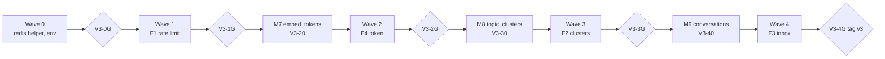

# PLAN — Version 3 execution plan

| | | |
|---|---|---|
| Version | **V3** — implements what `V2` and `V2.1` deliberately left out (`plans/PLAN_V2.md` §14) |
| Status | **In progress — Waves 0–3 signed off; Wave 4 is in progress: M9 (`conversations` + `chat_messages.author_user_id`), the lazy conversation creation / state machine / erasure / retention paths, the agent inbox service with its routes, the agent SSE stream with presence and agent replies reaching the widget have landed (22 / 25 tasks, 4 / 5 gates); the `/inbox` console page (V3-44) is next** |
| Created | 2026-11-16 |
| Derived from | `plans/PLAN_V2.md` (§14, §11 risk register), `plans/SPEC.md`, `docs/security.md` §5 (accepted risks K5 / K18), `README.md` §4 |
| Baseline | V2.1 tag `v2.1` = `4031b6f4a063e62bf5bdc6e20f3d8ac67781ae99`; current `master` HEAD `1616332ed8d1d32ee21bb628ddb2d270e1304374` is docs-only after that tag (the V3 plan); V3 work lives on `feat/v3`; Alembic head `c9d3e5a71b28`; baseline suite counts are historical and must be re-run at pre-flight |
| Scope | 4 features (F1–F4), 5 waves (W0–W4), 5 gates, 3 migrations (M7–M9), 25 tasks |
| Review note | Pre-implementation plan review; security and data-model assumptions are clarified below before any feature work starts |
| Out of scope | SOC 2 Type II / HIPAA BAA / signed DPA / "GDPR certification" (legal, not code — unchanged from V2), trial & pricing, the "95+ languages" claim (V2 D2), an application-level encryption layer or HSM (V2 D6), a charting library (Ant Design only), a Redis-backed **quota** rewrite (the daily message cap already counts in Redis), and any backport of V3 work into V2 |

---

## 1. How to use this plan

- Each task has an ID `V3-xx`, a size (`S` / `M` / `L`), a dependency, the files it
  touches, what to do, and a **Done when** condition. Tick the box only when that
  condition is met; add a `Done:` line with the evidence, as `PLAN_V2.md` does.
- **Follow the dependency graph.** Wave 2 starts only after the Wave 1 gate
  (`V3-1G`), then Wave 3 after `V3-2G` and Wave 4 after `V3-3G`. Do not parallelize
  a task against a gate it depends on; §6 is authoritative.
- **One task ≈ one commit**, on branch `feat/v3` (branch from current `master`
  after verifying its delta from the V2.1 tag, not from an older tag). A gate is its own commit —
  `chore(v3): V3-NG gate — docs + trail build`.
- `PLAN_V2.md` says what V2 did; this file says what V3 does and in what order.
  `plans/SPEC.md` still owns the requirement/design text for F1–F10; when a V3
  task contradicts it, fix the docs in that task rather than deferring.
- Sizes are relative complexity, not time estimates.

---

## 2. Traceability matrix

| V3 feature | Why it exists | PLAN_V2 pointer | Migration | Wave | Exit criterion |
|---|---|---|---|---|---|
| F1 Redis rate limiting | The limiter is in-memory per process, so multiple API processes have independent budgets and restarts reset them (accepted risk **K5**). | §11 risk register, last row ("Redis limiter is V3") | — | 1 | With Redis healthy, two API processes share one atomic budget; outage behavior is explicitly weaker and per-process |
| F2 LLM topic clustering | `digest`'s "top topics" are stopword-filtered **term counts** (`services/digest.py::_topics`), not topics; nothing clusters or names them. | §14, third bullet (V3 reserved) | M8 | 3 | A complete digest-aligned week yields named clusters, with sample/total counts distinguished; unsupported partial windows retain term counts |
| F3 Live-agent inbox | Handoff is notify-and-callback by decision (V2 **D1**, ADR-4). Customers asked for an agent who can answer in the widget. | §14, third bullet; ADR-4 | M9 | 4 | An agent claims a waiting session and answers it in the widget without the visitor reloading; privacy, retention and auth paths include the new records |
| F4 Per-website embed token (**K18 residual**) | Origin/Referer is a soft signal. A token shipped in browser HTML/JavaScript is also public and replayable; it can deter casual copying, but cannot prove origin or stop deliberate reuse. | §14 bullet 3; README K18 row | M7 | 2 | Compatibility mode preserves old snippets; enforce mode requires the website's token and documents K18 as an accepted residual |

Non-goals mapped to V2 decisions, restated so they are not reopened: no WebSocket
transport (the repo has none — see D1), no new Python or JS dependency, no
`EMBEDDING_DIMENSIONS` change (**no re-ingest anywhere in V3**), no second auth
library. An embed token is not a secret once included in a public page; it is a
compatibility/control mechanism and raises the effort for casual copying, not an
origin-authentication boundary or a DRM/credit-abuse guarantee.

---

## 3. Pre-flight decisions (blocking)

Resolve these before the affected wave starts; record any change here first.
Changing one after its wave is complete means rework, so decide now.

| ID | Question | Default for V3 | Revisit before |
|---|---|---|---|
| D1 | Transport/auth for agent inbox and presence? | **SSE over `fetch()` streaming**, not native `EventSource`, so the browser can send the existing JWT Authorization header (and `X-Session-Token` for the widget stream). Document proxy buffering/timeouts and use DB polling/reconciliation as fallback. Presence uses per-connection Redis leases with TTL, not a socket registry. | V3-42 |
| D2 | Is there a `conversations` table to attach an agent to? | **No** — sessions exist only as `chat_messages.session_id`, scoped by website. M9 adds a row unique on `(website_id, session_id)`, created lazily; route identifiers are the conversation UUID because session ids are not unique within a company. No message backfill. `delete_conversation` must delete messages and the conversation in one transaction; privacy export/erasure and retention are updated. | V3-40 |
| D3 | Which messages, windows and embeddings feed topic clusters? | **Company-wide visitor `user` questions only; embed a bounded sample at run time.** Chat messages do not currently have stored embeddings. Cluster deterministically within fixed weekly UTC windows aligned with `normalize_period`/`digest_day` (no cross-window centroid mutation), persist centroids/labels by company/window, and use the existing LLM only for capped naming. Distinguish sampled counts from total eligible questions when the cap truncates input. A unique durable run/claim per company + window prevents duplicate work; avoid retaining raw representative questions in derived rows. | V3-31 |
| D4 | Embed token shape, limits and rollout | **Per-website high-entropy token**, SHA-256 hash at rest (random token does not need the API-key pepper), raw value shown once, sent as `X-Embed-Token`. It is public/replayable in a snippet. `compat` accepts missing tokens whether or not one has been issued; a supplied invalid/revoked token is refused. `enforce` requires a valid token and is a documented breaking rollout, not an origin-authentication guarantee. Do not reset visitor session state on refusal. | V3-23 |
| D5 | Behaviour when Redis is unreachable | **If configured for Redis, fall back to the existing in-process limiter and emit a rate-limited warning/health signal.** This preserves a local cap, but is not a shared/global limit during an outage and can admit up to the per-process budget. Default backend stays `memory`; document the weaker guarantee and do not describe fallback as fail-closed or globally enforced. | V3-10 |
| D6 | Clustering cost control and reporting windows | **Opt-in per company** (`topic_clustering_enabled`, internal key, default off), bounded by input-question, cluster-count, embedding-call and LLM-naming-call caps. Runs use non-overlapping weekly UTC windows aligned with the company's `normalize_period`/`digest_day` and a durable idempotent claim; digest/analytics show named clusters only for complete windows exactly covered by the request, otherwise retain the existing term-count fallback. Derived windows are invalidated/rebuilt after message erasure and covered by retention. | V3-32 |
| D7 | Legal/commercial items | **Still out of scope** — SOC 2, HIPAA BAA, signed DPA, pricing, trial, "95+ languages". V3 adds no compliance claim and no marketing wording; `docs/security.md` §1 stays true. | — |

**D1–D7 verified against code (V3-01, 2026-11-17) — all confirmed, none rewritten:**
- D1: No WebSocket in repo; chat stream is `StreamingResponse` SSE-shaped (`services/quota.py::quota_sse_events`), dashboard auth is a JWT `Authorization` header (`utils/api.ts`) — `fetch()`-based SSE is the only transport that can carry both headers. Confirmed.
- D2: `models.py` has no `Conversation` class; sessions are `chat_messages.session_id` (indexed) and `session_tokens` already uses unique `(website_id, session_id)`. M9 lazy-create + UUID routing stands. Confirmed.
- D3: `ChatMessage` has no embedding column; `digest.py::_topics` is stopword term counts; `embed_texts` exists in `services/llm.py` for runtime embedding. Confirmed.
- D4: `embed_guard.ensure_embed_allowed` is the single chokepoint; `services/api_keys.py` is the SHA-256-hash precedent. **F4 decision: keep F4 in scope** — value is casual-copy deterrence + operational gate, not K18 closure; K18 stays accepted (README §4 / `docs/security.md` §5 unchanged). Confirmed as documented.
- D5: `services/redis.py` constructs a module-level `redis.asyncio` client from `REDIS_HOST/PORT/PASSWORD/DB` (`core/config.py:78-81`); `rate_limit` is in-memory. Confirmed.
- D6: `api/setting.py` `INTERNAL_SETTINGS` registry + `digest.py::normalize_period` weekly windows are the anchors. Confirmed.
- D7: `docs/security.md` §1 makes no compliance claim; V3 keeps it that way. Confirmed.

Environment pre-flight recorded at V3-01: `v2.1` annotated tag `^{commit}` = `4031b6f4a063e62bf5bdc6e20f3d8ac67781ae99` ✓; `master` HEAD `1616332ed8d1d32ee21bb628ddb2d270e1304374` (docs-only delta from tag: `1574765`, `1616332`); `feat/v3` branched from it; alembic single head `c9d3e5a71b28` ✓. Remaining pre-flight items (pg_dump, Redis reachability, baseline suite) belong to V3-04 baseline, not V3-01.

### Environment pre-flight

- [x] Confirm `v2.1` resolves to `4031b6f4a063e62bf5bdc6e20f3d8ac67781ae99` and
      the V2.1 code baseline is clean. `master` may contain documentation-only
      commits after the tag (currently the V3 plan); record `git rev-parse HEAD`,
      inspect the delta from `v2.1`, and branch `feat/v3` from the current `master`
      rather than requiring the branch to equal the release tag. Keep any unrelated
      code changes out of the V3 starting point.
      Done (V3-01/V3-04): tag `^{commit}` = `4031b6f…` ✓; HEAD `1616332` docs-only; `feat/v3` branched from it.
- [x] `uv run alembic current` = `uv run alembic heads` = `c9d3e5a71b28` (single
      head). Every M7–M9 chains from it.
      Done (V3-04): verified, still `c9d3e5a71b28`.
- [x] `pg_dump` backup before M7 (`backups/`, already gitignored).
      Done (V3-04): `backups/site_gpt_pre_v3.dump` (40K) via `docker exec postgres16 pg_dump`.
- [x] Redis reachable (`GET /health` reports `redis: true`); if not, F1 remains
      implementable, but cross-process sharing cannot be verified. Record that
      specific check as blocked, never tick it silently.
      Done (V3-04): `services.redis.ping()` → True (redis6 container). Cross-process sharing verifiable in Wave 1.
- [x] Baseline green: `uv run python -m unittest discover -s tests -v` (406 tests),
      `node --test tests/*.mjs` (24 checks), `cd frontend && npm run build && npm run lint`,
      `trail build`.
      Done (V3-04): 419 Python tests OK (406 + 12 redis_helpers + 1 settings case), 24 node checks pass, build+lint clean, `trail build` done, `trail ask` finds the new redis helpers.
- [x] Branch `feat/v3` created from the verified current `master`; record its
      base SHA and the reviewed V2.1-to-master delta.
      Done: base `1616332`, delta = 2 docs-only commits (`1574765`, `1616332`).

---

## 4. Invariants (every task)

Carried from `PLAN_V2.md` §4 and `AGENTS.md`; new V3 rules marked **V3**.

1. `ChatWidgetConfig` keys and every `localStorage` key stay valid; new config is
   optional with a default. **V3:** `X-Embed-Token` is additive — a snippet that
   never sends it keeps working in `compat` mode.
2. `services/rag.py::search` stays the only retrieval SQL. Topic clustering reads
   bounded `user` chat messages and embeds them on demand; it does not query the
   document `embeddings` table or fork retrieval SQL.
3. Chunking stays 1000/200 via `split_text`.
4. `EMBEDDING_DIMENSIONS` unchanged → **no re-ingest at any point in V3**.
5. Reuse `get_llm`, `embed_texts`, `enqueue_job`, `rate_limit`, `send_email_async`,
   `authorize` (session tokens), `claim_ingest`. No new SDK client, no new
   dependency — including no clustering or charting library.
6. Public endpoints keep `ensure_embed_allowed` + `ensure_website_active`; adding
   the embed token means **extending** `embed_guard`, never a parallel copy.
7. New env var → `core/config.py` + `.env.example` + the README table, same task.
8. New settings key → `api/setting.py` registry **and** `tests/test_settings.py`'s
   `INTERNAL_KEYS`/public tuple in the same commit (AGENTS.md rule).
9. Every feature is **off by default** (env flag or settings row). With all flags
   off, behaviour is V2.1's, with one exception to state explicitly: once a
   website has a token and `EMBED_TOKEN_MODE=enforce` is set, tokenless requests
   are refused — that is the feature, not a regression.
10. Tenant scoping is not optional: every inbox, clustering and token query filters
    by the caller's `company_id`, and a foreign resource id is a **404**, never a
    403 (matches `api/privacy.py`). Inbox APIs use conversation UUIDs, not
    company-scoped `session_id` values.
11. Migrations that add indexes to busy tables build `CONCURRENTLY` inside
    `op.get_context().autocommit_block()` — see AGENTS.md and `d2f5a81c9b74`.
12. After each gate: `trail build`, then update `README.md`, `AGENTS.md`,
    `docs/security.md` and this file's dashboard.
13. **V3:** Redis pub/sub events are best-effort notifications, not a durable or
    exactly-once message queue. Persist messages/state first; clients must
    reconcile from the database and deduplicate by message/event id after reconnect.
14. **V3:** Changes to conversation deletion, privacy export/erasure, retention,
    message schemas and frontend history must include agent-authored messages and
    `conversations` rows. Erasure is transactional; cluster derived data is either
    rebuilt or removed when source messages are erased.

---

## 5. Waves

### Wave 0 — Foundation (no schema change)

**Goal:** decide the four contracts and make the shared plumbing real, so no wave
invents its own version. **Entry:** environment pre-flight above.

- [x] **V3-01 · Decisions + scope doc** — `S`, depends: —, migration: —
  - Done: D1–D7 confirmed against code (see verification block above); F4 kept in scope with K18 accepted. README "V3 (planned)" note already accurate — no edit needed.
  - Done when: every D-row is either confirmed or rewritten, and no task below
    depends on an unconfirmed decision.

- [x] **V3-02 · One Redis access module** — `M`, depends: V3-01, migration: —
  - Done: `services/redis.py` now has `create_client()`/`get_client()`, `ping()`, `publish_event()`, `subscribe()` (unsubscribe+aclose in finally), `increment()`; `enqueue_job`/`queue:jobs` payload unchanged; `routes.health` uses `ping()`; `tests/test_redis_helpers.py` (12 tests, stubbed) + `test_health` updated; full suite 418 tests OK, imports OK.
  - Files: `src/site_gpt/app/services/redis.py`, `tests/test_redis_helpers.py`.
  - Do: `services/redis.py` currently owns a module-level `redis_client` and
    `enqueue_job`, and nothing else. Extract a single client construction point,
    `ping()` used by `/health`, lifecycle-safe publish/subscribe helpers for the
    inbox, and a rate-limit counter primitive for F1. Keep `enqueue_job` and the
    `queue:jobs` payload contract unchanged. Avoid connecting at import time;
    close pubsub/subscriber resources on disconnect and keep operations on the
    application's event loop.
  - Done when: import works with Redis **down** (no connection at import time),
    `enqueue_job` behaviour and payload are unchanged, and the new helpers have
    unit tests that stub the client.

- [x] **V3-03 · Env + settings scaffolding** — `S`, depends: V3-02, migration: —
  - Done: 6 env vars in `config.py` + `.env.example` + README table; 3 internal keys in registry + `INTERNAL_KEYS` + defaults test; `WIDGET_PUBLIC_KEYS` still exactly 14 (verified). Commit `7f5e539`.
  - Files: `core/config.py`, `.env.example`, `README.md`, `api/setting.py`,
    `tests/test_settings.py`.
  - Do: add (all defaulted to the V2.1 behaviour) `RATE_LIMIT_BACKEND=memory`,
    `EMBED_TOKEN_MODE=compat`, `TOPIC_CLUSTER_MAX_MESSAGES=500`,
    `TOPIC_CLUSTER_INTERVAL_SECONDS=86400` (scheduler due-check cadence; actual
    window boundaries come from `normalize_period`/`digest_day`), `INBOX_PRESENCE_TTL_SECONDS=60`,
    `INBOX_STREAM_HEARTBEAT_SECONDS=15`; internal keys `topic_clustering_enabled`
    (`false`), `topic_cluster_count` (`5`) and `live_inbox_enabled` (`false`).
    Nothing is wired yet beyond the registry, so `WIDGET_PUBLIC_KEYS` does not grow.
  - Done when: settings tests pass at the new key count, `GET /api/widget-config`
    still publishes exactly the 14 allowlisted keys, and `.env.example` documents
    every variable with its default.

- [x] **V3-04 · Test + graph baseline** — `S`, depends: V3-03, migration: —
  - Done: AGENTS.md states V3 suites + runbook pointer; baseline 419 tests / 24 node / build+lint / trail build all green; `trail ask` finds redis helpers; pg_dump + Redis pre-flight recorded above.
  - Files: `AGENTS.md`, `tests/`, `.trail/`.
  - Do: state in `AGENTS.md` which suites V3 extends (no new runner), add the V3
    runbook to §9 here, run `trail build`. Do not create a second test framework.
  - Done when: the suite count recorded here matches a real run, and `trail ask`
    finds `services/redis.py`'s new helpers.

#### Gate V3-0G

- [x] `uv run python -c "import site_gpt.app.main"` and `import site_gpt.app.worker` pass.
- [x] `alembic current` is still `c9d3e5a71b28` (Wave 0 adds no revision).
- [x] Both suites, `npm run build && npm run lint`, `trail build` pass.
- [x] `GET /api/widget-config` remains unchanged; `/health` retains its current
      fields and adds only documented Redis/backend degradation diagnostics.
- [x] commit `chore(v3): V3-0G gate — foundation`.

---

### Wave 1 — F1 Redis rate limiting (no schema change)

**Goal:** mitigate K5 when Redis is healthy: the limit becomes shared across API
processes and survives restarts, without changing any caller's contract. An outage
fallback remains per-process and is an explicitly weaker mitigation.
**Entry:** V3-0G.

- [x] **V3-10 · Sliding-window limiter with a memory fallback** — `M`, depends: V3-0G, migration: —
  - Done: atomic Lua (ZREMRANGEBYSCORE/ZCOUNT/ZADD/PEXPIRE, unique member) on sorted set; memory deque for `memory` backend; Redis error → throttled log + memory fallback + `_redis_degraded` flag cleared on success; `/health` reports `rate_limiter: {backend, degraded}`. Commit `648467e`; 23 ratelimit tests.
  - Files: `services/ratelimit.py`, `services/redis.py`, `tests/test_ratelimit.py`.
  - Do: keep `allow(key, max_requests, window_seconds)` and `rate_limit(...)` as
    the public surface — call sites keep working. For the sliding window, use a
    Redis sorted set and one atomic Lua script (prune, count, conditionally add,
    set expiry); a pipeline alone is not atomic under concurrent API processes.
    Keep the current in-process deque when `RATE_LIMIT_BACKEND=memory`. A Redis
    error logs with process-level throttling and falls through to memory (D5); this
    is a per-process cap during outage, not globally enforced.
  - Done when: concurrent requests against two API processes cannot exceed one
    Redis budget; restart does not reset a non-expired window; limiter Redis errors
    trigger bounded timeout/fallback and an explicit degraded limiter signal in
    `/health` (not just the independent Redis ping); tests prove fallback limits
    each process locally and document that combined outage traffic may exceed one
    shared budget.

- [x] **V3-11 · One policy table for public limits** — `S`, depends: V3-10, migration: —
  - Done: `RATE_LIMIT_POLICIES` (12 entries incl. reserved `v1`, not wired); all public routes migrated to `rate_limit_policy()` with identical (scope,max,window); 429 gains `Retry-After`, body unchanged. Commit `696e996`.
  - Files: `api/routes.py`, `api/handoff.py`, `api/v1.py`, `core/config.py`.
  - Do: route limits are currently scattered literal arguments. Collect them in a
    module-level policy table (`chat`, `stream`, `contacts`, `handoff`,
    `session-token`, `v1`). Keep public widget limits IP-scoped. For `/api/v1`,
    do not add per-key limiting in this task unless an authenticated dependency can
    safely expose the full key-row id before the limiter; preserve key auth/scope
    ordering and current limits. Add a standards-compliant `Retry-After` on 429
    without changing body or numeric limits; separately decide whether API-key
    abuse protection merits a follow-up.
  - Done when: every public route resolves its limit from the table, the 429 body
    is unchanged apart from the added header, and a test pins the table.

- [x] **V3-12 · Compose with quota and API keys** — `S`, depends: V3-11, migration: —
  - Done: `tests/test_limit_ordering.py` pins limiter-before-quota ordering and /api/v1 key-only auth (no per-key limiter, deferred); README "Limit composition" documents precedence. Commit `7fe1f05`.
  - Files: `services/quota.py`, `api/v1.py`, `README.md`.
  - Do: document precedence — the existing per-IP limiter is a burst guard and
    daily Redis quota is the spend ceiling. Do not claim API-key-specific limiting
    unless this task adds/tests an auth-before-limit dependency; otherwise defer
    per-key quotas explicitly. Do not change the quota counter itself.
  - Done when: tests/docs prove the actual auth, limiter and quota ordering; do not
    claim independent per-key buckets unless they are implemented.

- [x] **V3-13 · Docs: K5 leaves the accepted list** — `S`, depends: V3-12, migration: —
  - Done: README §4 K5 mitigated + security.md §5 K5 residual (memory per-process, Redis availability dependency, fallback named explicitly) + AGENTS.md ownership note. Commit `7cd6081`.
  - Files: `README.md` §4, `docs/security.md` §5, `AGENTS.md`.
  - Do: rewrite K5 as mitigated (with the honest residual: a single process with
    the `memory` backend is still per process, and Redis is a availability
    dependency for the enforced path). Add the `RATE_LIMIT_BACKEND` row to the env
    table and the `rate_limit` ownership note to AGENTS.md.
  - Done when: no doc says "Redis limiter is V3" any more, and `docs/security.md`
    names the fallback behaviour explicitly.

#### Gate V3-1G

- [x] Two uvicorn processes on different ports share one budget (proved by hand, recorded here).
  Done: ports 8001+8002 with `RATE_LIMIT_BACKEND=redis`, 50× `POST /api/chat/feedback` (policy 40/min) split across both → exactly 40 allowed (404), 10 × 429 with `Retry-After: 60`. One shared budget, not 2×40.
- [x] `RATE_LIMIT_BACKEND=memory` reproduces V2.1 behaviour exactly (same numbers, same 429 body).
  Done: policy-table test pins every (scope,max,window) to the pre-V3 literals; 429 body test asserts the exact V2.1 string.
- [x] Both suites + widget suite + build + lint + `trail build` pass; `alembic current` unchanged.
  Done: 432 Python tests OK, 24 node pass, build+lint clean, `trail build` done, head still `c9d3e5a71b28`.
- [x] commit `chore(v3): V3-1G gate — Redis rate limiting`.

---

### Wave 2 — F4 Per-website embed token (K18 residual), M7

**Goal:** provide a per-website token gate and casual-copy deterrent without
breaking deployed snippets by default. This does not close deliberate copying or
prove origin. **Entry:** V3-1G.

- [x] **V3-20 · Migration M7 — `embed_tokens`** — `M`, depends: V3-1G, migration: **M7**
  - Done: revision `76f46b510350` (parent `c9d3e5a71b28`) creates `embed_tokens` with unique `token_hash` and the partial unique index `uq_embed_tokens_website_id_active` (`website_id WHERE revoked_at IS NULL`). Autogenerate proposed the new table plus only the four known drift changes, which were removed; a second autogenerate after `upgrade` detects nothing about `embed_tokens`. `upgrade → downgrade -1 → upgrade` clean, `alembic heads` = `76f46b510350` alone. DB-level checks: a second active token for one website raises `IntegrityError`, inserting after revoking the old row succeeds, a reused `token_hash` is refused, deleting the company cascades to 0 token rows. No separate history index — the partial unique index serves the active lookup by website and the hash unique serves verification. `tests/test_models_indexes.py` (13 tests); suite 445 Python tests OK, 24 node checks; `trail build` re-run (3 files parsed: the model, migration and test module). The remaining doc sweep belongs to the V3-2G gate.
  - Files: `models.py`, `alembic/versions/76f46b510350_v3_m7_embed_tokens.py`, `tests/test_models_indexes.py`.
  - Do: table `embed_tokens`: `website_id` FK `ondelete="CASCADE"`,
    `token_prefix` (String 12), `token_hash` (String 64, unique), `created_at`,
    `revoked_at`, `last_used_at`. Enforce one active token per website with a
    partial unique index on `website_id WHERE revoked_at IS NULL`; a regular index
    build is appropriate because the new table has no existing traffic/data.
    Rotation revokes the previous row and inserts the replacement in one
    transaction (no overlap). Add an appropriate history index if the read path
    warrants it.
  - Done when: `upgrade → downgrade → upgrade` works, `alembic heads` shows a
    single head chained from `c9d3e5a71b28`, duplicate active tokens are rejected
    by the database, and a pre-existing website with no row remains unaffected.

- [x] **V3-21 · Token issue / rotate / revoke** — `M`, depends: V3-20, migration: —
  - Done: `services/embed_tokens.py` (`mint` / `rotate` / `revoke` / `latest_token`; plain `sha256`, no pepper, with the reason stated; rotation revokes and inserts in one transaction so a lost race leaves the old token valid; `IntegrityError` maps to the same 409 as the pre-check), `api/website.py` GET / POST / POST `…/rotate` / DELETE under `/api/websites/{id}/embed-token` guarded by `get_admin_user` and the shared `_owned_website` 404, `schemas/embed_token.py` (`EmbedTokenCreated.token` is the only place a raw value appears). The model's partial index now also carries `sqlite_where` so the SQLite test database enforces the real one-active-token rule. `tests/test_embed_tokens.py` (19 tests: format/hash, mint-once, DB-level duplicate rejection, rotation keeps history with exactly one active row, revoke then 404, endpoint 201/409/404/403 plus a foreign website 404 on all four routes). Real Postgres: mint → second mint refused → rotate leaves one active row with the old prefix revoked → revoke leaves none, and the raw token appears in no stored column. Suite 464 Python tests OK, 24 node checks. The snippet/UI wiring stays with V3-22.
  - Files: `services/embed_tokens.py` (new), `api/website.py`, `schemas/embed_token.py` (new), `tests/test_embed_tokens.py`.
  - Do: `POST /api/websites/{id}/embed-token` mints (raw value returned **once**),
    `POST …/embed-token/rotate` revokes the previous row and mints a new one,
    `DELETE …/embed-token` revokes, `GET` returns prefix/created/revoked only.
    Admin-only, company-scoped, foreign id → 404. Hash the high-entropy token
    with centralized SHA-256 logic; unlike customer API keys, it is public in the
    browser and must not be described as a confidential credential.
  - Done when: the raw token never appears in a read, a log or the DB; rotation
    leaves the old prefix invalid and the new one valid; another company's website
    id is a 404.

- [x] **V3-22 · Widget and snippet carry the token** — `M`, depends: V3-21, migration: —
  - Done: `widget.js` gains an optional `embedToken` (default `''`, trimmed/capped by the config sanitiser) and `embedTokenHeaders()`, merged into every public request the widget makes — session-token mint, chat stream, feedback, contacts POST/GET, conversations GET, handoff and widget-config — including both 403 retry paths, which drop the stale `X-Session-Token` but keep `X-Embed-Token`. An embed refusal never resets the session. `widgetSnippet.ts` emits an `embedToken` line only when one is given (the tokenless snippet is asserted byte-for-byte against the V2.1 text) and scrubs the token to the alphabet the server mints, so a tampered value cannot close the string. `WebsiteDetail.tsx` shows an admin-only card (create / rotate / revoke, prefix + dates) and opens a one-time modal with the raw token for copying; a 409 means the website already has an active token. `tests/widget_embed_token.test.mjs` (9 checks) evaluates the real helper and two real request paths: header present only when configured, request body/URL unchanged, retry keeps the token. Node suite 33 checks, Python suite 464 tests, `npm run build` + `npm run lint` clean. Enforcing the header stays in V3-23; the raw token is not yet threaded into the Settings snippet UI.
  - Files: `scripts/widget.js`, `frontend/src/utils/widgetSnippet.ts`, `frontend/src/pages/WebsiteDetail.tsx`, `frontend/src/types/api.ts`, `tests/widget_embed_token.test.mjs`.
  - Do: add an explicit operator UI flow to copy the raw token once and regenerate
    the installation snippet with it; never put the token in public widget-config
    or persist it in a public setting. Optional `window.ChatWidgetConfig.embedToken`
    becomes `X-Embed-Token` on every applicable public widget request. Keep config
    and existing `localStorage` keys backward-compatible. Do not conflate
    embed-token errors with K4 session-token errors: an embed-token refusal must
    not reset/replace the visitor's session or retry with a different identity.
    Update all actual public widget call sites, including config, chat/stream,
    contacts, handoff and session-token minting where applicable.
  - Done when: the node suite proves header presence when configured, absence when
    not, and that no other request shape changed.

- [x] **V3-23 · Enforce in `embed_guard`** — `M`, depends: V3-22, migration: —
  - Done: `ensure_embed_allowed` was extended, not forked, with `ensure_embed_token_allowed`: `compat` accepts a missing token even after issuance (deployed snippets keep working) and refuses a supplied token that does not resolve; `enforce` requires one. Refusals are `EmbedTokenRefused` rendered by `embed_token_error_response` in `main.py` as `{detail, reason}` — `embed_token_required` for a tokenless `enforce` request, `invalid_embed_token` for wrong/revoked/another website's token (one answer for all three, token never echoed). Those codes are disjoint from K4's four, and the widget's 403 handling is untouched: an embed refusal cannot reset a session. `services/embed_tokens.py` adds `find_active_token` (hash lookup + `compare_digest` + website scope + not revoked) and `record_use`, which throttles `last_used_at` in the row itself (≤ one UPDATE per minute per token) instead of an unbounded in-memory map. CORS stays a wildcard because replacing it with an allowlist would tighten existing embeds; a preflight test carrying `X-Embed-Token` pins that it is allowed. `/api/v1` passes `require_embed_token=False`: the API key already authenticates the caller, and `enforce` must not break server-to-server integrations. Tests: the full matrix in `tests/test_embed_origin.py` (compat with/without issuance, enforce missing/valid/invalid, reason codes, no token echo, authenticated bypass, API-key bypass, endpoint 403 bodies, preflight) plus lookup/throttle cases on a real SQLite database in `tests/test_embed_tokens.py`; suite 482 Python tests OK, 24 → 33 node checks, and a live-Postgres run confirms verify/throttle/rotation behaviour.
  - Files: `services/embed_guard.py`, `services/embed_tokens.py`, `api/v1.py`, `main.py`, `tests/test_embed_origin.py`, `tests/test_embed_tokens.py`.
  - Do: extend `ensure_embed_allowed` (do not fork it). `compat` accepts a missing
    token whether or not one has been issued, preserving deployed snippets; any
    supplied token must match an active token. Add `X-Embed-Token` to the explicit
    CORS allowed-header list and test browser preflight from an already-allowed
    origin; do not broaden the origin policy. `enforce` requires a valid token.
    A wrong/revoked token is `403` with stable machine-readable reason
    `invalid_embed_token`. Keep this distinct from K4's `session_expired`,
    `session_claimed` and `invalid_token`; never reset session state for an embed
    refusal. Update `last_used_at` at most once per minute without an unbounded
    per-token in-memory map.
  - Done when: matrix covered by tests — no token + compat + website with/without
    an issued token → allowed; wrong/foreign/revoked token → 403; enforce + no
    token → 403; valid token → allowed and `last_used_at` updated under the
    throttle. Verify token enforcement is additive to the host check and document
    that neither Origin/Referer nor a public snippet token proves browser origin.

- [x] **V3-24 · Docs: embed-token residual and rollout** — `S`, depends: V3-23, migration: —
  - Done: README gained an "Embed token (V3 F4)" section (public/replayable nature, `embedToken` snippet, a `compat`/`enforce` table, rotate-after-updating-the-snippet warning, both reason codes, and `EMBED_TOKEN_MODE=compat` as the rollback); the §4 K18 row now says the token raises casual-copy effort but does not authenticate origin, so K18 stays accepted, and the env-table row documents both reasons. The stale "V3 (planned) — not implemented" note was replaced with what has actually landed (F1, F4) and what has not, explicitly denying that the token closes K18. `docs/security.md` §2 gained an embed-token control row, §5 a K18 bullet (public token, no origin proof, "enforce" is a breaking rollout, rollback is a mode change), and §6 the staged rollout/rollback plus hand-run token-matrix items. `AGENTS.md` lists `embed_tokens.py`, describes the extended guard and its reason codes, marks `PLAN_V3.md` as in progress, and adds the "an embed refusal never resets a session" rule. No claim that a browser-visible token closes K18 survives in any doc.
  - Files: `README.md` §4 (K18 row, embed section), `docs/security.md` §2/§5/§6, `AGENTS.md`.
  - Do: describe the token's public/replayable nature, the `compat → enforce`
    breaking rollout, the exact snippet change required, and that it cannot prove
    origin or stop deliberate copying. Keep K18 listed as an accepted residual
    unless a separate, genuinely origin-bound mechanism is designed.
  - Done when: README/security docs make no claim that a browser-visible token
    closes K18; the deployment checklist includes staged snippet validation and
    rollback.

#### Gate V3-2G

- [x] M7 applied; single head; `downgrade -1 && upgrade head` clean.
  Done: `alembic heads`/`current` = `76f46b510350` (one head); `downgrade -1` ran `76f46b510350 -> c9d3e5a71b28` and `to_regclass('embed_tokens')` came back `None`; `upgrade head` rebuilt the table with `embed_tokens_pkey`, `embed_tokens_token_hash_key` and `uq_embed_tokens_website_id_active`, and `alembic_version` is back at `76f46b510350` with a single head. The table held 0 rows before the round-trip (backed up to `/tmp` first), so nothing was lost.
- [x] Token matrix (compat missing with/without issuance, enforce missing, valid,
      wrong, foreign and revoked tokens) re-run by hand against a real server.
  Done: 20/20 manual checks over two real uvicorn servers (`8011` in `compat`, `8012` with `EMBED_TOKEN_MODE=enforce`) against the real Postgres DB, with fixtures created and deleted by the run: no token before issuance → 200; admin `POST …/embed-token` → 201 with the raw value once; no token *after* issuance → 200; wrong token → 403 `invalid_embed_token`; valid token → 200; another website's token → 403 `invalid_embed_token`; revoked token → 403 `invalid_embed_token`; `enforce` + no token → 403 `embed_token_required`; rotate → 201 and the pre-rotation token → 403 `invalid_embed_token`; `enforce` + valid token → 200; `/api/v1` with an API key → 200 in both modes. Also observed, and worth knowing: `GET /api/conversations/{sid}` is not an F4-gated route — it stays gated by its K4 session token and answers 200 in `enforce` when that token is held.
- [x] A V2.1 snippet with no `embedToken` still chats in `compat` mode after an
      admin issues a token; record both pre- and post-issuance checks.
  Done: same run, same website, same session: `POST /api/chat` with no `X-Embed-Token` returned 200 **before** the admin minted a token and 200 **after** it, which is the deployed-snippet guarantee V3-23 promised. No widget change is needed to keep chatting in `compat`.
- [x] Both suites + widget suite + build + lint + `trail build` pass.
  Done: 482 Python tests OK (0 failures), 33/33 node checks pass, `npm run build` ✓ (2.06s) and `npm run lint` clean (0 warnings), `trail build` exit 0 (1872 nodes / 4180 edges; `.trail/cache/` is git-ignored, so it leaves the tree clean).
- [x] commit `chore(v3): V3-2G gate — embed token`.
  Done: the gate commit carries this tick and its evidence; `trail build` left the tree clean because `.trail/cache/` is git-ignored.

Re-run on the final tree: 20/20 manual checks, 482 Python tests, 33 node checks, build 1.97 s, lint clean (exit 0 with `--max-warnings 0`), `trail build` 1872 nodes / 4180 edges, and the downgrade round-trip again restored the table with both unique indexes. One behaviour to carry into Wave 4 when the inbox adds public reads: `GET /api/conversations/{sid}` is gated by K4, not by F4, so `enforce` does not refuse it without an embed token — deliberate, but do not assume the embed gate covers every public read.

---

### Wave 3 — F2 LLM topic clustering, M8

**Goal:** replace term counts with named clusters, and put them in the digest and
`/analytics`. **Entry:** V3-2G.

- [x] **V3-30 · Migration M8 — topic clusters + run claims** — `M`, depends: V3-2G, migration: **M8**
  - Done: revision `afef1e91e0b5` (parent `76f46b510350`, single head) adds `topic_clusters` — company-scoped, `period_start` weekly window, `cluster_key` (stable, derived not random), `label`/`summary`, `centroid VECTOR(1536)` nullable, `sampled_messages`/`eligible_messages`, with unique `(company_id, period_start, cluster_key)` — and `topic_cluster_runs` — unique `(company_id, period_start)`, `status` bounded by `ck_topic_cluster_runs_status` to running/completed/failed, `claimed_at`/`completed_at`, `error` bounded to 500 chars — plus `(status, claimed_at)` for stale-run recovery and `(company_id, created_at)` on both tables for the purge. Autogenerate's four known drift changes were stripped; a test now asserts the migration contains no `alter_column`/`drop_constraint` at all. Retention: `topic_clusters` and `topic_cluster_runs` joined `SCOPED_BY_COMPANY`, so a policy expires derived windows on the same clock and reports them in `deleted` instead of deleting them invisibly. Privacy: `DELETE /api/privacy/conversations/{sid}` reads the message timestamps *before* deleting, then `retention.invalidate_topic_windows` drops every window containing one of them plus its run row (so the worker may rebuild), provider-free and company-scoped. Moments are matched **per group** (`_window_groups`): timestamps at most seven days apart share one containment range and a longer gap starts a new one, so a conversation that goes quiet for a fortnight loses the weeks it spoke in and keeps the silent week between them — that week's clusters were not built from erased text, and the first min→max range over-reached here and was corrected in review. Alignment is still by containment, so a non-Monday `digest_day` cannot keep a stale window, and naive SQLite timestamps are normalised to UTC. Two tests pin the shape: a conversation spanning two consecutive weeks drops both windows (and leaves the one after), and stamps fifteen days apart leave the week in between intact (514 Python tests OK, 87 in the two touched files, after the review's two new tests). Verified on real Postgres: downgrade drops both tables, upgrade restores the unique constraints, the check and `vector(1536)`; 512 Python tests OK (85 in the three touched files), 33 node checks pass, no `CONCURRENTLY` and no `EMBEDDING_DIMENSIONS` change → no re-ingest.
  - Files: `models.py`, `alembic/versions/afef1e91e0b5_v3_m8_topic_clusters.py`, `services/retention.py`, `api/privacy.py`, `tests/test_models_indexes.py`, `tests/test_retention.py`, `tests/test_privacy_erasure_topics.py`.
  - Do: `topic_clusters` stores company-scoped clusters by weekly window:
    `company_id` FK CASCADE, `label`, `summary`, `centroid`
    `Vector(EMBEDDING_DIMENSIONS)`, stable `cluster_key`, sampled/eligible counts,
    `period_start`, `created_at`, with unique `(company_id, period_start, cluster_key)`.
    Add `topic_cluster_runs` with unique `(company_id, period_start)`, status,
    claim/completion timestamps and bounded error metadata. Use indexes/constraints appropriate to expected query volume;
    these new empty tables do not require `CONCURRENTLY` by default. Apply explicit
    retention to cluster and run rows. Same vector dimension — **no re-ingest**.
  - Done when: reversible, single head from M7; DB constraints enforce unique
    company/window runs and stable cluster identities; centroid matches
    `EMBEDDING_DIMENSIONS`; retention and privacy invalidation are tested.

- [x] **V3-31 · Clustering service** — `L`, depends: V3-30, migration: —
  - Done: `services/topics.py` (new) with `window_bounds(db, company_id, now=None)` and `cluster_topics(db, company_id, window=(start, end) | now=…, max_messages=None, commit=True)`. The window is `digest.normalize_period(now, digest_day)`, so `period_start` is the company's digest week rather than a rolling seven days; a passed window is normalised to UTC and rejected when `end <= start`. Inputs are company-scoped through the `Website` join, `role='user'` only, with a non-blank body filtered in SQL (`trim(coalesce(message, ''))`) so a blank row cannot inflate `eligible` or make a window look truncated; ordering is total (`created_at`, then `id`) and the sample is capped at `TOPIC_CLUSTER_MAX_MESSAGES` (per-call override for the worker's later cap). The bounded sample is embedded once with `embed_texts` — nothing is persisted per message — and an embedding failure is raised, since a run without vectors has nothing to store and the caller must record the failure. Clustering is a deterministic leader pass: cosine ≥ `0.82` joins the best centroid (ties keep the lower position), new clusters open in input order up to `MAX_CLUSTERS`, and a centroid is the unit-normalised mean of its members, so two runs over the same input give the same members, centroids and `cluster_key`s (`c1…` by size, then first member). Naming is **one** temperature-0 LLM call for the window with a fixed `NAMING_SYSTEM_PROMPT` that treats the questions as untrusted data and asks for a JSON list; `NAMING_SAMPLES` (5) questions per cluster and 1000 chars per question bound the prompt, the reply is validated per cluster index, whitespace-collapsed and truncated (`label` ≤ 120 = the column, `summary` ≤ 280), and a provider error, non-JSON reply or missing entry falls back to a label built from the cluster's own most frequent terms with `summary=None` — so a failed LLM still writes rows. Rows replace the window (delete by `company_id` + `period_start`, then insert) and an empty window clears its old rows, which is what makes a rebuild after an erasure honest; `sampled_messages`/`eligible_messages` are stored window-level (schema unchanged) while per-cluster sizes are returned in `clusters`. `commit=False` lets V3-32 commit the rows with the run's completion status. No provider call, run claim or flag check here: `retention.invalidate_topic_windows` and the privacy erasure stay provider-free exactly as V3-30 landed them. 10 tests in `tests/test_topics.py` (digest-day alignment, stability across two runs including centroids and keys, failing LLM, malformed reply, label/summary bounds, tenant isolation including the prompt payload, truncation totals, assistant/blank exclusion, empty-window clearing, one bounded naming call) with embeddings and the chat model stubbed; 524 Python tests OK (10 in the new file), import of `site_gpt.app.main` clean. Two review follow-ups landed with it, both covered by tests: `_assign` keeps each centroid as a running sum divided by the member count (bit-identical to re-adding the members, verified against the old quadratic implementation, 500 × 1536 in one cluster: ~5.0 s → ~0.08 s), and `cluster_topics` deletes the window's old rows only after `embed_texts` and naming have produced a replacement, so a failed run leaves the previous clusters committed and a caller that records the failure and commits cannot drop a window that was never rebuilt.
  - Files: `services/topics.py` (new), `services/llm.py` (reuse only), `tests/test_topics.py`, `services/retention.py`, `api/privacy.py`.
  - Do: `cluster_topics(db, company_id, window=…)` — select visitor `role='user'`
    questions across company websites in a full weekly window aligned with
    `normalize_period`/`digest_day`, bounded by `TOPIC_CLUSTER_MAX_MESSAGES`; current
    chat messages have no stored vectors, so embed this sample at run time with
    `embed_texts` and do not persist duplicate message vectors. Use stable ordered
    inputs, deterministic centroid initialization/assignment and stable cluster
    IDs; define cosine threshold and tie-breaking. Cap embedding inputs and LLM
    naming calls separately. Treat visitor questions as untrusted input: use a
    fixed constrained naming prompt, request a bounded structured response, validate
    and length-limit label/summary fields, and fall back on malformed/provider
    output. Store labels, summaries and aggregates only, not raw representative
    questions. Track eligible and sampled counts; label counts sampled/estimated
    when truncated. On privacy erasure, delete/invalidate the affected company/week
    without an external provider call; rebuild later through the worker only when
    enabled. Retention covers run/cluster rows.
  - Done when: a stubbed run yields stable clusters across two runs, a failing LLM
    still produces rows, and no company's rows can appear in another's run.

- [x] **V3-32 · Worker job + settings** — `M`, depends: V3-31, migration: —
  - Done: run lifecycle in `services/topics.py`. `claim_run` inserts the row and lets the unique `(company_id, period_start)` be the lock — a lost insert race raises `IntegrityError`, rolls back and returns `None`, so two workers cannot both own a window; `completed` is final; a `running` claim is skipped while its heartbeat is inside `STALE_RUN_AFTER` (30 min) and taken over in place after that (`claimed_at` reset, `error` cleared); a `failed` row is immediately retryable. `complete_run`/`fail_run` (error bounded to the column's 500 chars), `recover_stale_runs` flips dead `running` rows to `failed` and returns their `(company, window)`, and `window_settled` is the scheduler's "done, or alive" test. `run_window` claims, clusters with `commit=False`, then commits the clusters **and** the `completed` stamp together; a provider failure rolls back, marks the run `failed` and re-raises, leaving the previous clusters intact. Caps: `TOPIC_CLUSTER_MAX_MESSAGES` bounds the input and therefore the single embedding call, `cluster_count_for` reads `topic_cluster_count` clamped to `1..MAX_CLUSTERS`, and one naming call is made regardless of cluster count — no new env key. Worker: `enqueue_due_topics` queues `{"type": "topic_clusters"}` only for companies with `topic_clustering_enabled=true`, for `previous_window` (the last complete `normalize_period` week, `digest_day` aware) and skips settled windows; each tick also runs `recover_stale_runs`; `topic_loop` wakes every `TOPIC_CLUSTER_INTERVAL_SECONDS` and is started from `worker()`, and the job loop dispatches the new type to `handle_topic_clusters` (parses ids and window, always closes its session). Read-side invariant for V3-33: `completed_windows` returns an interval's clusters only when it is a whole number of digest-aligned weeks and every window has a `completed` run, otherwise `None` so the caller falls back to `top_topics`. The settings registry needed no change: `topic_clustering_enabled` and `topic_cluster_count` already existed from V3-03 with pinned defaults (`tests/test_settings.py`). Tests: 6 in `tests/test_worker.py` (flag off queues nothing, last-complete-week payload, completed window skipped, dead claim recovered then queued, incomplete job opens no session, handler parses and closes) and 13 in `tests/test_topics.py` (completed never rebuilt, live claim kept, stale taken over in place, failed retried, recovery marks only dead claims, `previous_window`, clusters + completion in one commit, duplicate job spends nothing, failed run keeps old clusters and is retryable, setting bounds the run, setting clamped, `completed_windows` exact/None); 545 Python tests OK (53 across the three touched files), worker imports clean.
  - Files: `worker.py`, `api/setting.py`, `tests/test_settings.py`, `tests/test_worker.py`.
  - Do: schedule each enabled company into digest-aligned weekly windows using
    `TOPIC_CLUSTER_INTERVAL_SECONDS` only as the scheduler check cadence. Add the
    `topic_clusters` job type to worker dispatch. M8 has a durable run row unique on
    `(company_id, period_start)` with status, claim/completion timestamps and
    bounded error metadata; atomically claim, recover stale runs, and commit output
    plus completion status. `topic_cluster_count` and input/embedding/LLM caps bound
    every run.
  - Done when: flag off → no job/provider call; flag on → duplicate jobs/two workers
    cannot duplicate a completed window; a failed/stale claim is recoverable; digest
    and analytics only aggregate complete, non-overlapping windows, falling back
    to `top_topics` when the requested interval cannot be represented exactly.

- [x] **V3-33 · Digest + analytics read clusters** — `M`, depends: V3-32, migration: —
  - Done: `services/digest.py` gained `_topic_groups`, a read-only bridge to `topics.completed_windows` behind `company_settings.flag("topic_clustering_enabled")` — the import is inside the function because `topics` already imports `digest` for stopwords and `normalize_period`. `build_digest` attaches `topic_groups` **only** when `completed_windows` returns windows (whole digest-aligned weeks, every run `completed`) and leaves the key out otherwise, so the flag-off payload is the V2.1 dict key for key (asserted, and `completed_windows` is stubbed to fail if it is called with the flag off) while `top_topics` stays populated either way for `/api/v1` clients. Each group is `{label, summary (nullable), sampled_messages, eligible_messages}` in `cluster_key` order (the writer's size order): per-cluster sizes are deliberately not stored, so no count is invented, and the week's sampled/eligible pair (the same on every group) is the truncation disclosure. A digest period is one week, so an interval that is not exactly one completed window — several weeks, an unaligned range — returns no groups and keeps the term list instead of inventing a multi-week aggregate. `render_digest_html` renders a `Topic groups` list **in place of** the term list when groups exist, escaping label and summary and printing `Named from S of E visitor questions`; with no groups the string is byte-for-byte the old one (a test pins the `Top topics` block adjacency). Schemas/types: `DigestGroup` + `DigestData.topic_groups: list[DigestGroup] = []` — additive only, `DigestTopic`/`DigestSummary` and every existing `/api`, `/api/v1/analytics/summary` field are untouched; the frontend `DigestSummary` gains the field and Analytics shows a `Topic groups` card with the sample indicator, falling back to the term table. Compatibility review: both analytics routes ask for a **rolling** `days` window (`end = now`), which is never a whole digest week, so they keep `top_topics` by design (D6) — the `Topic groups` read is reachable from the digest's aligned week, and a test pins the analytics fallback. Checks: 553 Python tests OK (23 in `test_digest`, including key-for-key flag-off, flag-on mapping with the exact interval asserted, and a real-SQLite completed vs `running` window), `npm run build` ✓ (2.11 s) and `npm run lint` exit 0.
  - Follow-up (review found the read path could never fire): the digest period and the clustered window disagreed. `enqueue_due_digests` and `api/digest.py::_period` used `normalize_period(now)` — the week **in progress** — while `enqueue_due_topics` queues `previous_window`, so the digest's period could never have a `completed` run and `topic_groups` stayed empty by construction. Fixed by `digest.previous_period(now, digest_day)` (last complete digest week) as the one definition; `topics.previous_window` now delegates to it and `api/digest.py::_period` and the digest scheduler both use it, so `send_period`, preview, send-now and the worker job all report the week the clustering run built. The scheduler also queues the `topic_clusters` job **before** the digest job when the company is opted in and the window is not settled (`window_settled` with `STALE_RUN_AFTER`), so the FIFO queue (`lpush` + `brpop`, one worker) finishes the run before the email that reads it; a completed window queues nothing. Note this is a deliberate behaviour fix, not parity drift: V2.1 mailed a week-to-date digest and, with `digest_day=monday`, usually an empty one, then stamped that period sent. Evidence: `WorkerToDigestTests` runs the real path end to end — `enqueue_due_topics` → `handle_topic_clusters` (stubbed embed/naming, real SQLite) → `enqueue_due_digests` → `handle_digest` — and asserts both jobs name `2026-11-02 → 2026-11-09`, only one topic job is queued once the run completed, and the delivered email contains `Topic groups`, the label and `Named from 2 of 2 visitor questions`; `DigestScheduleTests` pins the period and the queue order, `PreviousPeriodTests`/`DigestEndpointPeriodTests` pin the shared definition and the endpoint. 561 Python tests OK after the fix (`npm run build`/`lint` not re-run: no frontend file changed).
  - Review pass (kept to the fallback contract — flag off or a not-exactly-one-week interval still renders the V2.1 term list): `_topic_groups` returns `[]` instead of a `None` sentinel, because nothing distinguished "no groups" from "empty groups" and `build_digest` already keys off truthiness; groups no longer carry `period_start`; and only **one** completed window qualifies, which removed the multi-week flattening branch and the `max()` sample hedge it needed (the digest is weekly: `previous_period` is 7 days and every caller passes that). The redundant real-SQLite digest test went too — `WorkerToDigestTests` already proves the same rows reach the payload and the email, while `CompletedWindowsTests` owns the `running`/missing-window cases. Checks: 559 Python tests OK (26 in `test_digest`), `npm run build` ✓ (1.92 s), `npm run lint` exit 0.
  - Files: `services/digest.py`, `api/analytics.py`, `api/v1.py` (compatibility review), digest/analytics schemas and frontend types/page, `tests/test_digest.py`.
  - Do: `build_digest` adds `topic_groups` only when complete weekly partitions
    cover the requested interval without gaps or double-counting; otherwise preserve
    `top_topics` as the fallback. Keep clustering-off digest output byte-for-byte
    compatible. Render groups in digest HTML; preserve analytics fields and review
    `/api/v1/analytics/summary` compatibility before changing its public payload.
    Update schemas/types and show fallback/sample-count indicators. Keep `_topics`.
  - Done when: flag off reproduces the old digest exactly (asserted), flag on shows
    clusters, and the analytics payload keeps its existing fields.

- [x] **V3-34 · Docs: topics** — `S`, depends: V3-33, migration: —
  - Done: docs only, no code change. `README.md` documents the two internal settings (`topic_clustering_enabled` default `false`, `topic_cluster_count` default `5` clamped to `1..8`) in the settings table and adds a `Topic clustering (F2)` section: the window is the company's digest week and only the **last complete** one is built (the same `previous_period` the digest reports); the cadence is `TOPIC_CLUSTER_INTERVAL_SECONDS` (86400) as a check interval, never a window length; the durable unique run row is the lock (one owner per week, `completed` final, a 30-minute-silent claim taken over, `failed` retried, clustering queued before the digest for an unsettled window); and the bounded provider cost is stated as **one embedding call and at most one naming call per run** — ≤ 500 questions of 1000 characters, deterministic leader pass at cosine ≥ 0.82 with ≤ 8 clusters, naming over ≤ 5 quoted questions per cluster with `label` ≤ 120 / `summary` ≤ 280 and a term-based fallback. The section also states the read side (groups only for exactly one completed window, `top_topics` otherwise; `/api/analytics/summary` keeps terms because its interval is rolling — D6) and points at the retention/erasure policy. `AGENTS.md` adds the same caps to the worker-job bullet so the cost of a run is visible where the scheduler is described, and bumps the recorded suite marker to V3-34. `docs/security.md` gains a §2 row (one bounded sample to the configured embedding provider, one bounded naming call to the configured chat LLM, erasure without a provider call) and §4 lists both tables: `topic_clusters` (label, summary, centroid, counts — the text itself is not stored, but a label can quote a customer) and `topic_cluster_runs` (status, timestamps, bounded provider error), with a **Derived cluster data** paragraph covering erasure (`invalidate_topic_windows` drops every week holding an erased message plus its run row, locally and provider-free, so the worker rebuilds a remaining week and an emptied week rebuilds to nothing) and retention (both tables in the `retention_days` purge, scoped by `company_id`, keyed on each row's own `created_at` — when the window was clustered — while the questions expire on their own timestamps). Checks after the edits: `uv run python -m unittest discover -s tests` — 559 tests, OK (41 modules, unchanged; this task touches no Python); `npm run build` ✓ (1.97 s) and `npm run lint` exit 0 (no frontend file touched either, re-run so the gate line is not taken on trust).
  - Files: `README.md`, `AGENTS.md`, `docs/security.md` §4 (data inventory).
  - Do: document settings and the scheduler cadence/input/embedding/LLM caps,
    disclosure that bounded visitor questions go to the configured embedding
    provider and cluster names/summaries to the configured chat LLM, plus the
    retention and erasure/recomputation policy for derived cluster data.
  - Done when: docs state bounded provider-call cost, and the data inventory lists
    both `topic_clusters` and `topic_cluster_runs`.

#### Gate V3-3G

- [x] M8 applied from M7; `downgrade -1 && upgrade head` clean; single head.
  Done: `alembic heads`/`current` = `afef1e91e0b5`, one head, before and after the
  round-trip. `downgrade -1` ran `afef1e91e0b5 -> 76f46b510350` and `to_regclass`
  then answered `None` for both `topic_clusters` and `topic_cluster_runs`;
  `upgrade head` rebuilt them with `topic_clusters_company_id_period_start_cluster_key_key`,
  `topic_cluster_runs_company_id_period_start_key`, `ck_topic_cluster_runs_status`,
  `idx_topic_cluster_runs_status_claimed_at` and `(company_id, created_at)` on both
  tables, and `centroid` as `vector(1536)`. Both tables held 0 rows before the
  round-trip, so no cluster data was lost.
- [x] A seeded full weekly UTC window produces clusters; the weekly digest shows
      them; analytics displays them only when complete weekly partitions cover its
      requested interval exactly. Partial/missing coverage uses term-count fallback.
  Done: fixed window `2026-11-09T00:00Z → 2026-11-16T00:00Z` (what
  `previous_period(2026-11-19)` returns), seeded in the real Postgres DB as one
  company + website with 8 visitor questions in three groups, 3 assistant rows,
  `digest_day=monday`, `topic_clustering_enabled=true`, `topic_cluster_count=3`.
  Against the **real** provider (`LLM_AI=custom_openai`; embeddings 1536-d),
  `topics.run_window` returned `completed`, 3 clusters — `Pro Plan Pricing and
  Billing`, `Refund Policy and Requests`, `API and Integrations` — with
  `sampled = eligible = 8`, `truncated=false`, keys `c1..c3` in size order, and a
  `completed` run row stamped on the window. `build_digest` for that window carried
  the same 3 `topic_groups` (8/8 on every group, `top_topics` still populated) and
  `render_digest_html` printed `Topic groups`, the labels and `Named from 8 of 8
  visitor questions` **instead of** the term list. The analytics shape (rolling
  `days` window ending now, never digest-aligned) returned no `topic_groups` and
  the non-empty term list; a two-week range that covers the built week plus an
  unbuilt one returned no groups (`completed_windows` → `None`), so partial
  coverage falls back. Fixture deleted afterwards: the `topic_clusters` /
  `topic_cluster_runs` counts are back to 0 and no `V3-3G Gate Co` row remains.
- [x] Flag off reproduces the V2.1 digest (diffed, recorded here). Diff one fixed window
      through both versions: the digest period is now the last complete week
      (V3-33 follow-up), so the scheduler's period choice is a documented fix and
      not a payload difference — the same `build_digest`/`render_digest_html` input
      must produce the same output.
  Done: same fixed window, same DB rows, `topic_clustering_enabled=false`. The
  current `build_digest` payload deep-equals the `v2.1` tag's payload (the same ten
  keys, no `topic_groups`) and `render_digest_html` is byte-identical (651 bytes
  each; `difflib` reported no lines). The v2.1 side ran from a `git archive v2.1`
  checkout with its own `site_gpt` package (`site_gpt.__file__` confirmed), so the
  comparison is code-to-code and not a stubbed copy. Both sides were fed the same
  `[start, end)`: the V3-33 fix changed which week the **scheduler** asks for
  (`previous_period`), not what `build_digest`/`render_digest_html` render for a
  given period.
- [x] Both suites + widget suite + build + lint + `trail build` pass.
  Done: 559 Python tests OK (41 modules, 2.58 s), 33/33 node checks, `npm run
  build` ✓ (1.97 s), `npm run lint` exit 0 (`--max-warnings 0`), `trail build`
  exit 0 (2069 nodes / 4581 edges; `.trail/cache/` is git-ignored, tree clean).
  Also verified `import site_gpt.app.main` and `import site_gpt.app.worker`.
- [x] commit `chore(v3): V3-3G gate — topic clustering`.
  Done: this commit carries the five ticks, their evidence, the dashboard/status
  update and the README state change; no code changed at the gate.

---

### Wave 4 — F3 Live-agent inbox, M9

**Goal:** an agent can take a waiting session and answer it inside the widget;
handoff email remains the fallback when nobody is there. **Entry:** V3-3G.

- [x] **V3-40 · Migration M9 — conversations + agent authorship** — `M`, depends: V3-3G, migration: **M9**
  - Done: revision `1c5516fa864d` (parent `afef1e91e0b5`, single head) adds `conversations` — `website_id` FK CASCADE, `session_id`, `state`, nullable `assigned_user_id` FK `SET NULL`, `claimed_at`, `closed_at`, `last_message_at`, unique `(website_id, session_id)` and the queue index `(website_id, state, last_message_at)` — and `chat_messages.author_user_id` (nullable, FK `users.id` `SET NULL`). The new table is empty, so its indexes build transactionally; the author column is added and then its FK as `ADD CONSTRAINT … NOT VALID` + `VALIDATE CONSTRAINT`, so the busy `chat_messages` table never takes a write-blocking validation lock. Autogenerate's known drift was stripped again (naive `DateTime()` ALTERs + the `chat_feedback` FK churn); `ConversationMigrationTests` pins the absence, the `NOT VALID`/`VALIDATE` pair and the downgrade, and `ConversationSchemaTests` pins the unique pair, the index columns and both `SET NULL`/`CASCADE` FKs. Verified on real Postgres: `downgrade -1` dropped `conversations` and the column, `upgrade head` restored the table, the unique key, the index and a **validated** FK, and `heads`/`current` stayed at a single `1c5516fa864d`.
  - Done: `services/conversations.py` owns creation — `ensure_conversation` inserts inside a SAVEPOINT and returns the winner's row when it loses the unique race (tested by making the pre-read miss once), `note_message` is called from `rag.save_message` in the *same* transaction as the message so the inbox clock can never disagree with the transcript, and `api/handoff.py` calls `mark_waiting` on create and on reopen. Transitions are explicit in one table: `bot → waiting` (`mark_waiting`, idempotent while queued or claimed), `waiting → human` (`claim`), `human → waiting` (`release`, clears assignee), `human → closed` (`close`), plus a later visitor message reopening `closed → bot`; anything else raises `ConversationStateError`. No backfill (D2): a session with no row still lists (`conversation_id`/`state` come back `None`), reads and deletes through the message helpers, and `delete_conversation` now also removes the inbox row. Erasure is one transaction: `erase_session` deletes messages, inbox row, feedback, handoffs and the session's `session_tokens`, the privacy route calls it and then drops the affected cluster windows (the existing erasure tests still pass); a route-level test asserts the new counts, that the K4 token is gone and that the contact (the owner's lead) is kept. Retention expires inbox metadata on its **own** clock — `conversations.last_message_at < cutoff` — so an old session that just received a message keeps its state while an expired one cannot outlive its transcript, reported in `deleted["conversations"]` and covered by dry-run/apply/other-tenant tests. The export gains a `conversations` section. Postgres smoke: 8/8 checks over the real DB (lazy row on first message, `waiting`/`human`/`waiting`/`closed`, reopen on a later visitor message, erasure removing all five row kinds), fixture deleted afterwards. Suite: **589 Python tests OK in 42 modules** (30 new in `tests/test_conversations.py`, 5 schema/migration tests in `tests/test_models_indexes.py`); frontend untouched.
  - Files: `models.py`, `alembic/versions/1c5516fa864d_v3_m9_inbox.py`, `services/conversations.py`, `services/rag.py`, `services/retention.py`, `api/privacy.py`, `api/handoff.py`, `schemas/privacy.py`, `schemas/chat.py`, `tests/test_conversations.py`, `tests/test_models_indexes.py`.
  - Do: `conversations` — `website_id` FK CASCADE, `session_id` String(255),
    `state` String(20) (`bot` | `waiting` | `human` | `closed`), `assigned_user_id`
    FK `users.id` `ondelete="SET NULL"` nullable, `claimed_at`, `closed_at`,
    `last_message_at`; unique `(website_id, session_id)` and an index for the
    company website/state/queue ordering. Since `conversations` is new and empty,
    create its indexes normally; use concurrent index work only for indexes on
    existing busy tables. Add `chat_messages.author_user_id` FK SET NULL nullable
    (`role='agent'` rows).
    **No backfill** (D2): rows are created lazily; extend transcript/history,
    export, retention, deletion and erasure paths. Define transitions explicitly:
    `bot → waiting → human`, `human → waiting` on release, and `human → closed` on
    close, plus behavior for a later visitor message. Explicit erasure must use one
    transaction/service for messages, conversation, linked handoffs/feedback and
    that session's `session_tokens`; retention must not orphan conversation
    metadata after messages expire.
  - Done when: reversible; a session with no row still lists/deletes through
    existing helpers; `services/conversations.py` owns conversation creation;
    explicit erasure is transactional and leaves no messages, conversation, token,
    feedback or handoff rows for that session and invalidates affected cluster data;
    retention removes expired metadata consistently.

- [x] **V3-41 · Inbox service: claim, assign, close** — `L`, depends: V3-40, migration: —
  - Done: `services/inbox.py` is the agent surface and the only new writer. It addresses a conversation by **UUID** and resolves the website through a join on `websites` (`_scoped`), so a foreign id is `InboxNotFound` (404) and the same `session_id` on two websites stays two entries. `locked_query` is the only claim path: `SELECT … FOR UPDATE OF conversations SKIP LOCKED` over a company-scoped `waiting` row, held until `claim`/`assign` commits, so two agents racing produce one winner and one `InboxConflict` (409) — a repeat claim by the same agent is idempotent, and a state that is not `waiting` is refused before any write. `assign` hands a waiting row to an active manager/admin of the caller's company (`assignable_user`, a foreign or non-agent id never reaches a transition), `release` returns it to the queue and `close` finishes it from `waiting`/`human` (never `bot`); `_ensure_holder` lets only the assignee or an admin move someone else's claim, and every transition goes through `services/conversations.py` (`ConversationStateError` surfaces as 409). `list_conversations` pages the company queue with `state`/`website_id`/`assigned_user_id` filters and fills title, message count, assignee name and contact in two extra queries; `detail` adds the oldest-first transcript with author names and the contact row. No route edits a row: `api/inbox.py` validates, calls the service and maps `InboxNotFound`→404 / `InboxConflict`→409.
  - Done: `api/inbox.py` mounts at `/api/inbox` (`main.py`) with six routes — paginated queue list, detail, claim, assign, release, close. Every one requires manager+ **and** the company's `live_inbox_enabled` flag through the `live_inbox_user` dependency, so with the flag off the whole surface is a 404 while the public `POST /api/handoff` keeps producing its V2.1 row and waiting state (tested with the flag off). The key already existed from V3-03 (`INTERNAL_SETTINGS`, default `false`) and `tests/test_settings.py::test_v3_internal_defaults_are_off` still pins it, so `api/setting.py` and the settings test needed no change.
  - Done: `tests/test_inbox.py` adds 36 tests over disabled-flag 404s (plus the intact handoff), the claim race (sequential loser and a simulated `SKIP LOCKED` miss), idempotent re-claim, foreign UUID 404 on every route, the same session id on two websites, list scoping/state filter/pagination/title truncation/contact+assignee names, detail transcript with an agent author, release/close holder rules and idempotency, the pinned `FOR UPDATE … SKIP LOCKED` statement (Postgres dialect) and a source check that the routes only call the service. Suite: **625 Python tests OK in 43 modules** (3.2 s), 33/33 node checks. Real Postgres smoke, 12/12 checks: two concurrent claims with a barrier → exactly one `human` winner with `claimed_at` and the loser refused, plus a second scenario where one transaction holds the row and the contender gets “Another agent is claiming this conversation” from the lock (not the state check) and the row is claimable once released; fixture deleted afterwards (`leftover smoke conversations: 0`).
  - Files: `services/inbox.py` (new), `schemas/inbox.py` (new), `api/inbox.py` (new), `main.py`, `tests/test_inbox.py` (new).
  - Do: address agent routes by conversation UUID, scoped to the caller's company.
    Add `live_inbox_enabled=false`; disabled inbox routes return 404 while existing
    public handoff stays intact. When enabled, claim uses
    `SELECT … FOR UPDATE SKIP LOCKED`: one agent wins and loser gets `409`. Add
    release/assign/close, paginated manager+ list and transcript/contact reads.
    Default to current company manager RBAC. Claim/handoff changes go through the
    service in one transaction.
  - Done when: two concurrent claims produce one winner and one 409; foreign
    conversation UUID is a 404; same session id on two websites resolves
    unambiguously; closing applies the defined state transition; no route edits
    rows by hand outside the service.

- [x] **V3-42 · Agent SSE stream + presence** — `L`, depends: V3-41, migration: —
  - Files: `api/inbox.py`, `services/inbox.py`, `services/redis.py`, `tests/test_inbox_stream.py`.
  - Do: `GET /api/inbox/events` (JWT, `fetch()`-based SSE so Authorization headers
    are available) authenticates/authorizes and checks `live_inbox_enabled` before
    starting a `StreamingResponse`; it streams Redis pub/sub notifications. Publish
    stable-id notifications only after DB transactions commit. Each event carries a stable id;
    clients reconcile authoritative DB state and deduplicate after reconnect
    (pub/sub is not durable or exactly once). The UI periodically reconciles from
    the DB. Heartbeat at `INBOX_STREAM_HEARTBEAT_SECONDS`; disconnect closes the
    subscription. Track a
    unique presence lease per connection with TTL, aggregate by company/user, and
    renew while connected so one tab disconnecting cannot clear another tab's
    presence. Redis unavailable → 503 before streaming; poll the DB.
  - Done when: multiple dashboards receive notifications and converge on the same
    DB state; reconnect does not lose messages; one tab closing does not clear a
    second tab's presence; Redis outage degrades to polling.
  - Done: `GET /api/inbox/events` checks the JWT + `live_inbox_user` (manager+, `live_inbox_enabled`) and `await redis.ping()` **before** the `StreamingResponse` returns, so the flag off is a 404 and Redis down is a 503 (`STREAM_UNAVAILABLE`) with no stream opened; the body comes from `services/inbox.py::event_stream` — `retry: 3000`, a `ready` event carrying `resync: true`, `id:`/`event:`/`data:` per notification, and a `: heartbeat` comment every `INBOX_STREAM_HEARTBEAT_SECONDS`. It subscribes to `inbox:<company_id>` **before** the first frame, so `ready` means the browser is attached and nothing published afterwards is lost; the socket read is one pending `get_message` task raced against `asyncio.wait(timeout=heartbeat)` rather than a read timeout, because a timeout can leave the pub/sub parser mid-frame. A dying Redis ends the stream with an `error` frame (`redis_unavailable` when the lease cannot be written, `stream_interrupted` when the reader raises), which is what the console turns into polling. `conversation_event` derives the id from the committed row (`<uuid>:<updated_at>`), so an idempotent retry republishes the same id and a reconnect can dedupe; only the four routes publish, and only after `claim`/`assign`/`release`/`close` committed — the routes stay sync so a `FOR UPDATE` transaction never runs on the event loop, and `publish_after_commit` only puts the event on a queue that one daemon thread drains with its own loop and client (the service itself never publishes). Presence is a lease per connection, `inbox:presence:<company>:<user>:<uuid4>` in Redis with a TTL of `max(2 × heartbeat, INBOX_PRESENCE_TTL_SECONDS)`, renewed on every tick and deleted by its own connection — plus `presence`/`GET /api/inbox/presence`, which aggregates the caller's company leases per user, so two tabs count as two connections and one closing cannot clear the other. `services/redis.py` gains `set_lease`/`renew_lease`/`delete_lease`/`lease_keys`, all best-effort like the rest of that module. `tests/test_inbox_stream.py` (26 tests): the flag/401-403/503 gates before any stream, framing and heartbeat, forwarded ids, error frames, lease uniqueness/renewal/release, presence aggregation with foreign and malformed keys and an outage reading as nobody online, the no-transform/no-buffering headers, publish-after-commit (the row is already `human` when the notification is sent), a refused action publishing nothing and the service never publishing. Suite: **651 Python tests in 44 modules** (6.6 s), 33/33 node checks. Real-Redis smoke, 12/12: three streams (two tabs of one agent, one of another) each got the lease, a publish reached all three with the same id, closing one tab removed only its lease (2 left) and the others still received the next event, closing all left 0 leases, TTL inside `0 < ttl ≤ 60`; leftover keys swept. **Not exercised:** a browser `fetch()` reader behind a real proxy — the route was driven through `TestClient`, the body itself on the generator against real Redis.

- [x] **V3-43 · Agent replies reach the widget** — `L`, depends: V3-42, migration: —
  - Files: `api/inbox.py`, `services/rag.py` (`save_message` reuse), `api/routes.py`, `scripts/widget.js`, `tests/widget_inbox.test.mjs`.
  - Do: agent message routes use the conversation UUID and store `role='agent'` +
    `author_user_id`; extend message schemas/UI types, history/transcript readers,
    privacy export and retention to preserve and expire agent-authored messages. Persist before publishing. The public widget
    stream resolves website + session, checks `ensure_website_active` and
    `ensure_embed_allowed`, and authorizes with the **K4 session token**
    (`services/session_tokens.py::authorize`) — never the embed token alone. Poll
    by stable `(created_at, id)` keyset cursor if SSE is blocked or reconnects. In
    `human` state, `/api/chat` persists the visitor message and returns a queued
    result without invoking the LLM; define transitions back to bot/closed and test
    both sync and streaming handlers.
  - Done when: visitor message → agent sees it; agent reply → widget shows it
    without reload; bot silent while `state='human'`; a foreign session token
    cannot read another session's stream; reconnect does not lose persisted
    messages; lead form and history still work.
  - Done: `POST /api/inbox/conversations/{id}/messages` (`api/inbox.py`) stores the holder's reply as `role='agent'` + `author_user_id` through `inbox.reply` → `rag.save_message` (one commit, `last_message_at` refreshed), refuses a non-holder or a session that is not `human` (409) and publishes **after** that commit: a `message` event on the company inbox channel plus the visitor's own `chat:<website_id>:<session_id>` frame (`rag.publish_agent_reply`, queue drained off the request thread). The widget learns about it without a reload: `widget.js` opens `GET /api/chat/messages/stream` with `fetch()` (both tokens, since `EventSource` cannot send headers), replays from the `(created_at, id)` cursor the route read for it, then forwards live frames; when the stream is blocked, ends or Redis is down (`503`, `WIDGET_STREAM_UNAVAILABLE`) it polls `GET /api/chat/messages?after=…`, which is keyset-paged (`rag.messages_after`) so a reconnect neither skips nor repeats a message, and the client-side `agentMessagesToShow` dedupes by the same cursor before rendering. Both public endpoints resolve the website, check `ensure_website_active` + `ensure_embed_allowed` and call `session_tokens.authorize` — the embed token alone reads nothing. While `conversations.human_handling` is true, `/api/chat` and `/api/chat/stream` persist the visitor's message and answer with `QUEUED_MESSAGE`/`{"queued": true}` without calling the LLM or spending daily quota; `waiting` still gets bot answers and a `closed` session reopens to `bot` on the visitor's next message. `format_history` labels an agent row `Agent`, the inbox transcript already named the author, the privacy export now carries `author_user_id`, and retention expires agent rows with the rest of the transcript. `tests/test_agent_replies.py` (32 tests) covers reply storage/author/ordering (row committed before both notifications), holder and state refusals, foreign/flag-off 404s, empty 400, transcript + privacy attribution, token gating (claimed/forged/foreign-website token, disabled website), cursor paging/resume/garbage, the 503-before-stream path, the stream body (retry/replay/live/heartbeat/error), the sync + streaming queued paths with no LLM call, the `waiting`/`closed` transitions and `format_history`; `tests/test_retention.py` adds an agent-row expiry case. Suite: **689 Python tests in 45 modules** (8.1 s), **42 node checks** (9 new in `tests/widget_inbox.test.mjs`). Real-Redis smoke, 4/4: a reply published from a sync context reached a live widget stream with its id, role and text, on the per-session channel, and did **not** reach another session's stream. The admin transcript types now include `agent`, and `npm run build && npm run lint` pass. **Not exercised:** a browser `fetch()` reader end to end, and the widget's UI against a real agent reply — the parsing/cursor functions are covered by the node suite, `node --check` passes, and the DOM was not clicked.

- [ ] **V3-44 · `/inbox` page** — `L`, depends: V3-43, migration: —
  - Files: `frontend/src/pages/Inbox.tsx` (new), `App.tsx`, `components/Layout.tsx`, `utils/api.ts`, `types/api.ts`, `api/setting.py`, `tests/test_settings.py`.
  - Do: Ant Design only — queue list (state, website, waiting time, assigned agent),
    transcript pane with an agent composer, Claim/Release/Close actions, live
    updates from the event stream, presence avatars. Gate page/navigation on
    `live_inbox_enabled`; no chart library or new UI dependency; reuse auth context
    and `ProtectedRoute`.
  - Done when: `npm run build && npm run lint` pass, the page renders seeded
    sessions, and a claim made in one browser shows in another.

- [ ] **V3-45 · Handoff becomes a queue entry** — `M`, depends: V3-44, migration: —
  - Files: `api/handoff.py`, `services/inbox.py`, `frontend/src/pages/Handoffs.tsx`, `services/integrations.py`.
  - Do: when `live_inbox_enabled=true`, a handoff click atomically creates/reuses
    the conversation and waiting state, preserving the current idempotent handoff
    row, email and integration event. When false, preserve the exact V2.1 path and
    create no inbox state. Document additive event fields and expose no internal
    or cross-tenant URL/data.
  - Done when: with `handoff_enabled=false` nothing changes; with handoff and inbox
    enabled, one click produces one `handoff_requests` row, one email, one event and
    one waiting session; with inbox disabled, the V2.1 path creates no conversation
    row. `/handoffs` status remains in sync with an inbox claim.

- [ ] **V3-46 · Docs: inbox** — `S`, depends: V3-45, migration: —
  - Files: `README.md`, `AGENTS.md`, `docs/security.md`, `plans/SPEC.md` (ADR-4 note).
  - Do: update ADR-4 as superseded by the implemented queue + fallback email;
    document env vars, fetch-based SSE auth/reconnect semantics, CORS preflight,
    proxy buffering/timeouts, presence TTL and the actual access model. Document the residual that embed tokens are public and
    replayable, and that inbox agents can read visitor transcripts under existing
    company RBAC.
  - Done when: README's admin-page list includes `/inbox`, ADR-4 is marked
    superseded with a pointer to D1, and no doc still claims "no live chat".

#### Gate V3-4G (release gate)

- [ ] M7 → M8 → M9 applies from empty DB with `pgvector`, replaying from
      `c9d3e5a71b28`; each downgrade/upgrade is proved, including cluster-run and
      per-window cluster uniqueness plus conversation/message deletion paths.
- [ ] Full smoke (see §9) passes on a throwaway database.
- [ ] With every V3 flag off (including `live_inbox_enabled=false` and
  `topic_clustering_enabled=false`), a V2.1 company behaves as at tag `v2.1`;
  record the comparison and any explicitly documented additive diagnostics.
- [ ] Both suites + widget suite + build + lint + `trail build` pass; docs consistent.
- [ ] Merge the verified release commit from `feat/v3` to `master`, then create
      and push tag `v3` on the merged release commit.

---

## 6. Dependency graph & critical path



Critical path: **W0 → W1 → M7/W2 → M8/W3 → M9/W4**. The listed task
dependencies are serial; do not parallelize a wave against a gate it depends on.

---

## 7. Migration ledger

Chain from the current head. **Do not** write a revision number by hand; let
autogenerate chain it, then confirm the parent is the head above.

| ID | Revision file | Contents | Task | Chains from |
|---|---|---|---|---|
| M7 | `76f46b510350_v3_m7_embed_tokens.py` ✅ | `embed_tokens` (website FK cascade, prefix, unique hash, revoked/last-used) + partial unique active-token index `website_id WHERE revoked_at IS NULL`, which also serves the active lookup — no separate history index | V3-20 | `c9d3e5a71b28` |
| M8 | `<rev>_v3_m8_topic_clusters.py` | Company/window `topic_clusters` plus unique durable `topic_cluster_runs` claim/status table, both with CASCADE company FKs | V3-30 | M7 |
| M9 | `1c5516fa864d_v3_m9_inbox.py` ✅ | `conversations` (unique website+session, state, assignee, timestamps) + `chat_messages.author_user_id` + transactional indexes on the new table (the author FK is added `NOT VALID` and then validated, so the busy table is never write-blocked); privacy/retention updated | V3-40 | M8 |

Rules that still apply:

- Build indexes concurrently on existing busy tables only, using
  `op.get_context().autocommit_block()`; those migrations are **not atomic**, an
  interrupted build can leave an invalid index, and the fix is `DROP INDEX
  CONCURRENTLY` + re-run (not idempotent). New empty V3 tables normally use
  transactional index/constraint creation; justify any concurrent build explicitly.
- Autogenerate will propose the known drift (naive `DateTime()` ALTERs on
  `api_keys.last_used_at`/`revoked_at`, `users.reset_token_expires_at`,
  `contacts.consent_at`, and the `chat_feedback.website_id` FK drop/create).
  Remove those lines; keep only the real change.
- Every downgrade must be real and explicitly document data loss where applicable:
  dropping `conversations` or `topic_clusters` removes inbox/history or derived
  data. Prefer disabling features and rolling back app code before a destructive
  schema downgrade; the `author_user_id` column goes first.
- No migration touches `embeddings` or `EMBEDDING_DIMENSIONS`; M8's centroid column
  uses the same dimension, so there is **no re-ingest**.

---

## 8. Commit & review strategy

- Subjects: `feat(v3): …`, `fix(v3): …`, `docs(v3): …`, `perf(v3): …`,
  `chore(v3): V3-NG gate — …`. One concern per commit, body explains the *why* and
  records the measurement or the test that proves it (V2.1's style).
- Never bundle a migration with the feature that consumes it: M7 with V3-20, the
  token service in V3-21, enforcement in V3-23.
- Review focus per wave: W0 = contracts + no import-time Redis, W1 = identical
  behaviour with the memory backend, W2 = token secrecy (hash, never logged, raw
  once) and old-snippet compatibility, W3 = cost caps + tenant scoping + fallback
  digest, W4 = exactly-one-claim, stream auth, and privacy erasure still complete.
- Before each gate: re-read §4. Then `trail build` and the doc updates, in the gate
  commit — never a follow-up "docs" commit after the tag (that is exactly the drift
  V2.1 had to clean up).

---

## 9. Verification runbook

Run after **every** task's Done-when check, and in full at each gate:

```bash
source .venv/bin/activate
uv run python -c "import site_gpt.app.main"
uv run python -c "import site_gpt.app.worker"
uv run alembic upgrade head && uv run alembic current   # single head
uv run python -m unittest discover -s tests -v          # 38 modules / 445 tests at V3-20; grows every wave
node --test tests/*.mjs                                 # 6 widget files / 24 checks
uv run uvicorn site_gpt.app.main:app --reload           # :8000
uv run python -m site_gpt.app.worker                    # ingest + digest loops (cluster loop arrives in V3-32)
cd frontend && npm run build && npm run lint
trail build
curl -s http://localhost:8000/health
```

**End-to-end smoke (full, at V3-4G):** fresh DB → `alembic upgrade head` → register
a company → website + sitemap → ingest → chat (sync + SSE) → Redis backend on, two
API processes, one budget → mint an embed token, install the updated snippet,
verify tokenless is accepted in `compat` even after issuance and refused in
`enforce` → enable clustering, run a complete weekly job, see named clusters in
the weekly digest and in `/analytics` when the range aligns → `/inbox`: visitor
clicks handoff, agent claims, exchanges messages both ways, closes the session,
bot resumes only per the specified state transition → privacy export + transactional
erasure of the session (conversation, messages, session token, linked handoff/
feedback and affected cluster data accounted for) → turn **all** V3 flags off and
repeat the V2.1 smoke to prove no regression.

**Negative checks:** foreign/revoked embed token → 403; tokenless request in
`compat` → accepted even after token issuance; tokenless request in `enforce` →
403; embed-token refusal does not reset the K4 session; two agents claiming at
once → one 409; duplicate session ids on different websites remain unambiguous;
a session token reading another session's stream → 403; clustering disabled → no
provider call and old digest; duplicate cluster jobs cannot duplicate a window;
Redis down → `/health` reports degradation, rate limit falls back per process with
that limitation explicit, inbox falls back to polling; `/api/widget-config` still
publishes exactly 14 public keys.

**Blocked-item rule:** if this environment has no reachable LLM/embedding provider,
no SMTP or no browser, tick the gate but record the item as **blocked and
unexecuted** with the reason, exactly as `PLAN_V2.md` §12 now does. Do not tick a
check that was not run.

---

## 10. Rollback plan

| Situation | Action |
|---|---|
| A task breaks import/build | Revert that commit; gates are separate so the wave survives. |
| A migration is wrong, not yet applied | Delete the untracked revision, `alembic downgrade -1`, regenerate. |
| A migration is applied and wrong | **Do not edit it.** Write the next revision; restore from the §3 backup only if data was lost. |
| Wave gate fails | Stop. Fix inside the same wave; the next wave assumes the contract. |
| Redis outage in production | Redis-configured limiting falls back per process and health is degraded; the inbox page polls. Set `RATE_LIMIT_BACKEND=memory` only as an explicit operational mode, not an equivalent shared limit. |
| Embed token rollout goes wrong | Set `EMBED_TOKEN_MODE=compat` — missing tokens are accepted again for all websites, including those with an issued token. A supplied invalid token remains refused; fix/remove the bad snippet header if necessary. |
| Inbox misbehaves | Disable the inbox feature/route while preserving the existing handoff path; do not disable `handoff_enabled`, which would also remove the V2.1 fallback. |
| V3 abandoned after deployment | Prefer forward-compatible feature flags and redeploy the last supported app. Only downgrade after a verified backup and explicit data-loss review: M9 inbox/agent data and M8 derived history are lost. Reverse migrations in order, then redeploy tag `v2.1`. |

---

## 11. Risk register

| Risk | Trigger | Mitigation | Owner task |
|---|---|---|---|
| Rate limiting now depends on Redis | Redis down or slow | In-memory fallback (D5) is per process and weakens the global cap; emit a degraded health signal, use bounded retries/timeouts, and avoid retry storms. | V3-10 |
| Embed token breaks a live customer's widget | Enabling `enforce` before snippets ship the token | `compat` default accepts missing tokens even after issuance; validate snippets first and treat `enforce` as a breaking operator rollout. | V3-23, V3-24 |
| Embed token offers limited protection against deliberate copying | Any visitor can inspect the deployed snippet and replay its token | Keep K18 accepted; treat the token as a casual-copy deterrent/operational gate only, not origin authentication or credit-abuse protection. Reconfirm product value before M7; omit F4 if no requirement justifies key management and the breaking enforce rollout. | V3-01, V3-21, V3-24 |
| Clustering burns provider credits | A large company on a scheduled window | Off by default; cap input questions, embedding requests/tokens, cluster count, and LLM naming calls separately; skip empty windows | V3-31, V3-32 |
| Cluster labels are misleading | Poor embeddings or a spammy window | Store aggregate labels/counts only, keep term fallback, label is advisory; do not persist raw representative visitor questions in derived rows | V3-31, V3-33 |
| Two agents answer the same visitor | Double claim | `FOR UPDATE SKIP LOCKED` claim, 409 for the loser, state transitions only through `services/inbox.py` | V3-41 |
| Stream leaks another tenant's messages | Missing session/token check | K4 session-token `authorize` on the widget stream, company filter on the agent stream, negative tests at the gate | V3-42, V3-43 |
| Privacy erasure/retention misses inbox state | Existing helpers only delete chat messages | Transactionally extend privacy export/erasure, retention, and conversation deletion to cover conversation rows and session tokens; gate checks for zero orphan rows | V3-40, V3-4G |
| Docs drift again (V1 K2 / V2.1 repeats) | Gate rushed | Docs + `trail build` inside the gate commit; §13 requires it | All gates |
| Inbox scope creep into a helpdesk | "Just add SLAs/tags/reports" | The four features here are the scope; anything beyond is a new plan | — |

---

## 12. Progress dashboard

| Wave | Tasks | Done | Gate |
|---|---|---|---|
| 0 — Foundation | 4 | 4 / 4 | ☑ V3-0G |
| 1 — Redis rate limiting (F1) | 4 | 4 / 4 | ☑ V3-1G |
| 2 — Embed token / K18 (F4) | 5 | 5 / 5 | ☑ V3-2G |
| 3 — Topic clustering (F2) | 5 | 4 / 5 | ☑ V3-3G |
| 4 — Live-agent inbox (F3) | 7 | 4 / 7 | ☐ V3-4G |
| **Total** | **25 tasks + 5 gates** | **22 / 25** | **4 / 5 gates** |

---

## 13. Definition of done — V3

- [ ] All 25 tasks ticked and all 5 gates signed off (blocked items recorded, not hidden); all D1–D7 assumptions and the added privacy, token and cluster-window invariants are resolved before their waves.
- [ ] F1–F4 implemented; M7–M9 applied; single head chained from `c9d3e5a71b28`; cluster runs and inbox conversations are idempotent and tenant-scoped.
- [ ] K5 is described as mitigated only when Redis is available, with the
  per-process fallback limitation explicit. K18 remains an accepted residual; a
  public embed token is not described as closing it. ADR-4 is marked superseded
  for the inbox.
- [ ] Zero widget backward-compatibility breaks: a V2.1 snippet with no
  `embedToken` still chats in `compat` both before and after token issuance; a
  V2.1 digest is reproduced byte-for-byte with clustering off.
- [ ] Zero `EMBEDDING_DIMENSIONS` change, zero re-ingest.
- [ ] Every feature off by default; with all flags off, behaviour equals tag
  `v2.1` except explicitly opted-in `EMBED_TOKEN_MODE=enforce`.
- [ ] Both suites green (counts recorded at the tag), frontend build + lint green, `trail build` run, docs consistent.
- [ ] Verified release commit is merged to `master`; tag `v3` points to that commit
  and is pushed; README describes V3 as the current version.

---

## Appendix — task index

| Wave | IDs |
|---|---|
| 0 | V3-01, 02, 03, 04 → gate V3-0G |
| 1 | V3-10, 11, 12, 13 → gate V3-1G |
| 2 | V3-20, 21, 22, 23, 24 → gate V3-2G |
| 3 | V3-30, 31, 32, 33, 34 → gate V3-3G |
| 4 | V3-40, 41, 42, 43, 44, 45, 46 → gate V3-4G |

Companion docs: `plans/PLAN_V2.md` (§14 lists what V3 inherits, §11 the risk K5),
`plans/SPEC.md` (ADR-4, F1–F10), `plans/PLAN_V1.md` (V1 baseline),
`docs/security.md` §5 (the accepted risks this plan retires).
