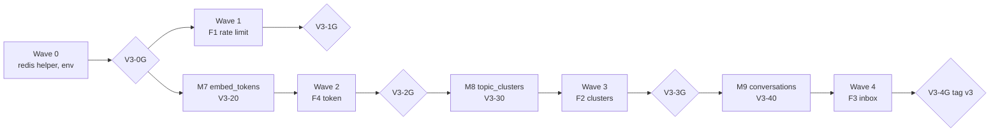

# PLAN — Version 3 execution plan

| | | |
|---|---|---|
| Version | **V3** — implements what `V2` and `V2.1` deliberately left out (`plans/PLAN_V2.md` §14) |
| Status | **Planned — not started.** No task below is ticked and no migration exists yet |
| Created | 2026-11-16 |
| Derived from | `plans/PLAN_V2.md` (§14, §11 risk register), `plans/SPEC.md`, `docs/security.md` §5 (accepted risks K5 / K18), `README.md` §4 |
| Baseline | tag `v2.1` = `4031b6f` (annotated); `master` = `feat/v2` = `4031b6f`; Alembic head `c9d3e5a71b28`; 35 `unittest` modules / 406 tests, 6 widget files / 24 checks |
| Scope | 4 features (F1–F4), 5 waves (W0–W4), 5 gates, 3 migrations (M7–M9), 25 tasks |
| Out of scope | SOC 2 Type II / HIPAA BAA / signed DPA / "GDPR certification" (legal, not code — unchanged from V2), trial & pricing, the "95+ languages" claim (V2 D2), an application-level encryption layer or HSM (V2 D6), a charting library (Ant Design only), a Redis-backed **quota** rewrite (the daily message cap already counts in Redis), and any backport of V3 work into V2 |

---

## 1. How to use this plan

- Each task has an ID `V3-xx`, a size (`S` / `M` / `L`), a dependency, the files it
  touches, what to do, and a **Done when** condition. Tick the box only when that
  condition is met; add a `Done:` line with the evidence, as `PLAN_V2.md` does.
- **One wave at a time.** A wave's gate must be fully ticked before the next wave
  starts. The gates are not ceremony: Wave 3's clustering reads the settings and
  worker conventions Wave 1 fixes, and Wave 4's inbox writes through the
  conversation helpers Wave 0 establishes.
- **One task ≈ one commit**, on branch `feat/v3` (branch from `master` at
  `4031b6f`, not from an older tag). A gate is its own commit —
  `chore(v3): V3-NG gate — docs + trail build`.
- `PLAN_V2.md` says what V2 did; this file says what V3 does and in what order.
  `plans/SPEC.md` still owns the requirement/design text for F1–F10; when a V3
  task contradicts it, fix the docs in that task rather than deferring.
- Sizes are relative complexity, not time estimates.

---

## 2. Traceability matrix

| V3 feature | Why it exists | PLAN_V2 pointer | Migration | Wave | Exit criterion |
|---|---|---|---|---|---|
| F1 Redis rate limiting | The limiter is in-memory per process, so N workers allow N× the rate and a restart resets it (accepted risk **K5**). | §11 risk register, last row ("Redis limiter is V3") | — | 1 | Two API processes share one budget; a restart does not reset it |
| F2 LLM topic clustering | `digest`'s "top topics" are stopword-filtered **term counts** (`services/digest.py::_topics`), not topics; nothing clusters or names them. | §14, third bullet (V3 reserved) | M8 | 3 | A week of questions yields named clusters with counts, and the digest shows them |
| F3 Live-agent inbox | Handoff is notify-and-callback by decision (V2 **D1**, ADR-4). Customers asked for an agent who can answer in the widget. | §14, third bullet; ADR-4 | M9 | 4 | An agent claims a waiting session and answers it in the widget without the visitor reloading |
| F4 Per-website embed token (**K18**) | The Origin/Referer check is soft: no header (or a forged one) is accepted, so a copied `website_id` still spends the customer's credits. `services/embed_guard.py` says closing it "needs a signed embed token per website (a schema change, so V2)". | §14 bullet 3; README K18 row | M7 | 2 | A request with no token (or another website's token) is refused once the mode is `enforce` |

Non-goals mapped to V2 decisions, restated so they are not reopened: no WebSocket
transport (the repo has none — see D1), no new Python or JS dependency, no
`EMBEDDING_DIMENSIONS` change (**no re-ingest anywhere in V3**), no second auth
library.

---

## 3. Pre-flight decisions (blocking)

Resolve these before the affected wave starts; record any change here first.
Changing one after its wave is complete means rework, so decide now.

| ID | Question | Default for V3 | Revisit before |
|---|---|---|---|
| D1 | Transport for the agent inbox and presence: WebSocket or SSE? | **SSE**, matching `/api/chat/stream`. The codebase has no WebSocket route, `requirements`/`pyproject` need nothing new, and a reverse proxy that already passes the chat stream passes this. Presence is a Redis key with a TTL, not a socket registry. | V3-42 |
| D2 | Is there a `conversations` table to attach an agent to? | **No** — sessions exist only as `chat_messages.session_id` (`services/conversations.py` groups them in SQL). M9 adds a real `conversations` row with `(website_id, session_id)` unique, created **lazily** on the first widget message or agent action. **No backfill**: old sessions keep working through the existing string-keyed queries, and `delete_conversation` deletes the row when it deletes the messages. | V3-40 |
| D3 | How are topics clustered without a new dependency? | **Assign by pgvector distance to stored centroids, name by the existing chat LLM.** Centroids are computed in Python over the already-embedded messages (`services/llm.py::embed_texts`, `EMBEDDING_DIMENSIONS` unchanged), so no scikit-learn/numpy requirement is added; the LLM is only asked to name/summarise each cluster once per run. | V3-31 |
| D4 | Embed token shape and rollout | **Per-website hashed token**, stored like an API key (`api_keys` pattern: `sha256(token)` + prefix, raw value shown once), sent by the widget as `X-Embed-Token`. Rollout mirrors K4: env `EMBED_TOKEN_MODE=compat` (default, tokenless requests still accepted when the website has no token) → `enforce`. | V3-23 |
| D5 | Behaviour when Redis is unreachable | **Degrade to the in-memory limiter and log once**, never fail open into unlimited traffic. `GET /health` reports which backend answered. Default backend stays `memory`, so a deployment that changes nothing behaves exactly like V2.1. | V3-10 |
| D6 | Clustering cost control | **Opt-in per company** (`topic_clustering_enabled`, internal key, default off) and capped by env (`TOPIC_CLUSTER_MAX_MESSAGES`, default 500 per run). It spends the company's LLM credits, so it is never on by default. | V3-32 |
| D7 | Legal/commercial items | **Still out of scope** — SOC 2, HIPAA BAA, signed DPA, pricing, trial, "95+ languages". V3 adds no compliance claim and no marketing wording; `docs/security.md` §1 stays true. | — |

### Environment pre-flight

- [ ] `master` = tag `v2.1` = `4031b6f`, working tree clean, `git tag --list` shows
      `v1`, `v2`, `v2.1` and nothing newer. Record `git rev-parse master`.
- [ ] `uv run alembic current` = `uv run alembic heads` = `c9d3e5a71b28` (single
      head). Every M7–M9 chains from it.
- [ ] `pg_dump` backup before M7 (`backups/`, already gitignored).
- [ ] Redis reachable (`GET /health` reports `redis: true`); if it is not, F1 is
      still implementable and testable but its gate cannot prove cross-process
      sharing — record that as a blocked gate item, never tick it silently.
- [ ] Baseline green: `uv run python -m unittest discover -s tests -v` (406 tests),
      `node --test tests/*.mjs` (24 checks), `cd frontend && npm run build && npm run lint`,
      `trail build`.
- [ ] Branch `feat/v3` created from `master` (`4031b6f`).

---

## 4. Invariants (every task)

Carried from `PLAN_V2.md` §4 and `AGENTS.md`; new V3 rules marked **V3**.

1. `ChatWidgetConfig` keys and every `localStorage` key stay valid; new config is
   optional with a default. **V3:** `X-Embed-Token` is additive — a snippet that
   never sends it keeps working in `compat` mode.
2. `services/rag.py::search` stays the only retrieval SQL. Clustering reads
   `embeddings` through its own aggregate query and must not fork the search.
3. Chunking stays 1000/200 via `split_text`.
4. `EMBEDDING_DIMENSIONS` unchanged → **no re-ingest at any point in V3**.
5. Reuse `get_llm`, `embed_texts`, `enqueue_job`, `rate_limit`, `send_email_async`,
   `authorize` (session tokens), `claim_ingest`. No new SDK client, no new
   dependency — including no clustering or charting library.
6. Public endpoints keep `ensure_embed_allowed` + `ensure_website_active`; adding
   the embed token means **extending** `embed_guard`, never a parallel copy.
7. New env var → `core/config.py` + `.env.example` + the README table, same task.
8. New settings key → `api/setting.py` registry **and** `tests/test_settings.py`'s
   `INTERNAL_KEYS`/public tuple in the same commit (AGENTS.md rule).
9. Every feature is **off by default** (env flag or settings row). With all flags
   off, behaviour is V2.1's, with one exception to state explicitly: once a
   website has a token and `EMBED_TOKEN_MODE=enforce` is set, tokenless requests
   are refused — that is the feature, not a regression.
10. Tenant scoping is not optional: every inbox, clustering and token query filters
    by the caller's `company_id`, and a foreign id is a **404**, never a 403
    (matches `api/privacy.py`).
11. Migrations that add indexes to busy tables build `CONCURRENTLY` inside
    `op.get_context().autocommit_block()` — see AGENTS.md and `d2f5a81c9b74`.
12. After each gate: `trail build`, then update `README.md`, `AGENTS.md`,
    `docs/security.md` and this file's dashboard.

---

## 5. Waves

### Wave 0 — Foundation (no schema change)

**Goal:** decide the four contracts and make the shared plumbing real, so no wave
invents its own version. **Entry:** environment pre-flight above.

- [ ] **V3-01 · Decisions + scope doc** — `S`, depends: —, migration: —
  - Files: `plans/PLAN_V3.md`, `README.md` (a "V3 (planned)" note only — no
    feature claims yet).
  - Do: confirm D1–D7 against the code (SSE vs WebSocket, no `conversations`
    table, no clustering dependency, `api_keys` hashing pattern, `REDIS_*` config,
    `INTERNAL_SETTINGS` registry). Record each confirmation inline here.
  - Done when: every D-row is either confirmed or rewritten, and no task below
    depends on an unconfirmed decision.

- [ ] **V3-02 · One Redis access module** — `M`, depends: V3-01, migration: —
  - Files: `src/site_gpt/app/services/redis.py`, `tests/test_redis_helpers.py`.
  - Do: `services/redis.py` currently owns a module-level `redis_client` and
    `enqueue_job`, and nothing else. Extract `get_client()` (single construction
    point), a `ping()` used by `/health`, `publish_channel`/`subscribe_channel`
    helpers for the inbox, and a `fixed_window`/`sliding_window` counter helper
    for F1. Keep `enqueue_job` and the `queue:jobs` contract byte-identical.
  - Done when: import works with Redis **down** (no connection at import time),
    `enqueue_job` behaviour and payload are unchanged, and the new helpers have
    unit tests that stub the client.

- [ ] **V3-03 · Env + settings scaffolding** — `S`, depends: V3-02, migration: —
  - Files: `core/config.py`, `.env.example`, `README.md`, `api/setting.py`,
    `tests/test_settings.py`.
  - Do: add (all defaulted to the V2.1 behaviour) `RATE_LIMIT_BACKEND=memory`,
    `EMBED_TOKEN_MODE=compat`, `TOPIC_CLUSTER_MAX_MESSAGES=500`,
    `TOPIC_CLUSTER_INTERVAL_SECONDS=86400`, `INBOX_PRESENCE_TTL_SECONDS=60`,
    `INBOX_STREAM_HEARTBEAT_SECONDS=15`; internal keys `topic_clustering_enabled`
    (`false`) and `topic_cluster_count` (`5`). Nothing is wired yet beyond the
    registry, so `WIDGET_PUBLIC_KEYS` does not grow.
  - Done when: settings tests pass at the new key count, `GET /api/widget-config`
    still publishes exactly the 14 allowlisted keys, and `.env.example` documents
    every variable with its default.

- [ ] **V3-04 · Test + graph baseline** — `S`, depends: V3-03, migration: —
  - Files: `AGENTS.md`, `tests/`, `.trail/`.
  - Do: state in `AGENTS.md` which suites V3 extends (no new runner), add the V3
    runbook to §9 here, run `trail build`. Do not create a second test framework.
  - Done when: the suite count recorded here matches a real run, and `trail ask`
    finds `services/redis.py`'s new helpers.

#### Gate V3-0G

- [ ] `uv run python -c "import site_gpt.app.main"` and `import site_gpt.app.worker` pass.
- [ ] `alembic current` is still `c9d3e5a71b28` (Wave 0 adds no revision).
- [ ] Both suites, `npm run build && npm run lint`, `trail build` pass.
- [ ] `GET /health` and `GET /api/widget-config` unchanged for a V2.1 company.
- [ ] commit `chore(v3): V3-0G gate — foundation`.

---

### Wave 1 — F1 Redis rate limiting (no schema change)

**Goal:** make K5 stop being an accepted risk: the limit becomes shared across API
processes and survives restarts, without changing any caller's contract.
**Entry:** V3-0G.

- [ ] **V3-10 · Sliding-window limiter with a memory fallback** — `M`, depends: V3-0G, migration: —
  - Files: `services/ratelimit.py`, `services/redis.py`, `tests/test_ratelimit.py`.
  - Do: keep `allow(key, max_requests, window_seconds)` and `rate_limit(...)` as
    the public surface — call sites keep working. Back it by Redis (sorted set per
    `{scope}:{ip}` with `ZREMRANGEBYSCORE` + `ZCARD` in one pipeline, `EXPIRE` as
    a floor against orphans) when `RATE_LIMIT_BACKEND=redis`; keep the current
    in-process deque when it is `memory`. A Redis error logs **once** per process
    and falls through to the memory path (D5) — never to "always allow".
  - Done when: the same key exhausted in process A is refused in process B, a
    restart does not reset a non-expired window, and a stubbed Redis failure still
    enforces the limit in-process.

- [ ] **V3-11 · One policy table for public limits** — `S`, depends: V3-10, migration: —
  - Files: `api/routes.py`, `api/handoff.py`, `api/v1.py`, `core/config.py`.
  - Do: route limits are currently scattered literal arguments. Collect them in a
    module-level table (`chat`, `stream`, `contacts`, `handoff`, `session-token`,
    `v1`) so a change is one edit, and return `Retry-After` on 429. Do not change
    any existing number in this task — behaviour must be identical with the
    `memory` backend.
  - Done when: every public route resolves its limit from the table, the 429 body
    is unchanged apart from the added header, and a test pins the table.

- [ ] **V3-12 · Compose with quota and API keys** — `S`, depends: V3-11, migration: —
  - Files: `services/quota.py`, `api/v1.py`, `README.md`.
  - Do: document and verify precedence — the per-IP window is a burst guard, the
    daily Redis quota is the spend ceiling, and an API key is limited per key
    (`key:{prefix}`) instead of per IP so one customer cannot fill another's
    bucket from a shared NAT. No change to the quota counter itself.
  - Done when: two keys behind one IP get independent buckets, and an exhausted
    key still gets the documented `429` with `Retry-After`.

- [ ] **V3-13 · Docs: K5 leaves the accepted list** — `S`, depends: V3-12, migration: —
  - Files: `README.md` §4, `docs/security.md` §5, `AGENTS.md`.
  - Do: rewrite K5 as mitigated (with the honest residual: a single process with
    the `memory` backend is still per process, and Redis is a availability
    dependency for the enforced path). Add the `RATE_LIMIT_BACKEND` row to the env
    table and the `rate_limit` ownership note to AGENTS.md.
  - Done when: no doc says "Redis limiter is V3" any more, and `docs/security.md`
    names the fallback behaviour explicitly.

#### Gate V3-1G

- [ ] Two uvicorn processes on different ports share one budget (proved by hand, recorded here).
- [ ] `RATE_LIMIT_BACKEND=memory` reproduces V2.1 behaviour exactly (same numbers, same 429 body).
- [ ] Both suites + widget suite + build + lint + `trail build` pass; `alembic current` unchanged.
- [ ] commit `chore(v3): V3-1G gate — Redis rate limiting`.

---

### Wave 2 — F4 Per-website embed token (K18), M7

**Goal:** close the "copied `website_id`" hole without breaking a single deployed
snippet. **Entry:** V3-1G.

- [ ] **V3-20 · Migration M7 — `embed_tokens`** — `M`, depends: V3-1G, migration: **M7**
  - Files: `models.py`, `alembic/versions/<rev>_v3_m7_embed_tokens.py`, `tests/test_models_indexes.py`.
  - Do: table `embed_tokens` following `api_keys` (`5fbe6ce28d9b`-era style):
    `website_id` FK `ondelete="CASCADE"`, `token_prefix` (String 12), `token_hash`
    (String 64, **unique**), `created_at`, `revoked_at`, `last_used_at`; index on
    `(website_id, created_at)` built `CONCURRENTLY` (AGENTS.md rule). One active
    row per website is enforced in the service, not by a partial index, so rotation
    can keep a short overlap.
  - Done when: `upgrade → downgrade → upgrade` works, `alembic heads` shows a
    single head chained from `c9d3e5a71b28`, and a pre-existing website is
    unaffected (a website with no row is "no token yet", not "invalid").

- [ ] **V3-21 · Token issue / rotate / revoke** — `M`, depends: V3-20, migration: —
  - Files: `services/embed_tokens.py` (new), `api/website.py`, `schemas/embed_token.py` (new), `api/api_key.py` for the pattern.
  - Do: `POST /api/websites/{id}/embed-token` mints (raw value returned **once**),
    `POST …/embed-token/rotate` revokes the previous row and mints a new one,
    `DELETE …/embed-token` revokes, `GET` returns prefix/created/revoked only.
    Admin-only, company-scoped, foreign id → 404. Hash with `API_KEY_PEPPER`
    exactly as `services/api_keys.py` does (one definition, no copy).
  - Done when: the raw token never appears in a read, a log or the DB; rotation
    leaves the old prefix invalid and the new one valid; another company's website
    id is a 404.

- [ ] **V3-22 · Widget and snippet carry the token** — `M`, depends: V3-21, migration: —
  - Files: `scripts/widget.js`, `frontend/src/utils/widgetSnippet.ts`, `tests/widget_embed_token.test.mjs`.
  - Do: `window.ChatWidgetConfig.embedToken` (optional) becomes `X-Embed-Token` on
    every public call the widget makes (`/api/chat`, `/api/chat/stream`,
    `/api/widget-config`, `POST /api/contacts`, session-token call); the snippet
    generator emits it. Config key and `localStorage` names stay untouched; with no
    `embedToken` the widget sends exactly the V2.1 headers. Keep the dead-token
    recovery rule from K4: reset **once** on `invalid_token`-style refusal, and
    never loop.
  - Done when: the node suite proves header presence when configured, absence when
    not, and that no other request shape changed.

- [ ] **V3-23 · Enforce in `embed_guard`** — `M`, depends: V3-22, migration: —
  - Files: `services/embed_guard.py`, `api/routes.py`, `tests/test_embed_origin.py`.
  - Do: `ensure_embed_allowed` gains the token check as a third layer after the
    existing host check: with `EMBED_TOKEN_MODE=compat` a website that has **no**
    active token still accepts tokenless requests (old snippet), a website that
    **has** one requires a matching token, and `enforce` requires it everywhere.
    A wrong/revoked token is `403` with a machine-readable `reason`
    (`invalid_embed_token`), never a generic prose the widget must parse. Update
    `last_used_at` at most once per minute per token to avoid a write per message.
  - Done when: matrix covered by tests — no token + compat + unclaimed website →
    200; no token + website with active token → 403; foreign website's token →
    403; revoked → 403; enforce + no token → 403; valid → 200 and `last_used_at`
    set. `services/embed_guard.py`'s docstring no longer says "a schema change, so V2".

- [ ] **V3-24 · Docs: K18 leaves the accepted list** — `S`, depends: V3-23, migration: —
  - Files: `README.md` §4 (K18 row, embed section), `docs/security.md` §2/§5, `AGENTS.md`.
  - Do: describe the token, the `compat → enforce` rollout (same shape as K4), the
    residual (a token in the page source of a compromised customer site is still
    readable — it raises the bar and stops casual copies), and the exact snippet
    change a customer must ship.
  - Done when: README's K18 row says "mitigated in V3, residual X", and the
    deployment checklist tells an operator how to flip the mode.

#### Gate V3-2G

- [ ] M7 applied; single head; `downgrade -1 && upgrade head` clean.
- [ ] Token matrix (six cases in V3-23) re-run by hand against a real server.
- [ ] A V2.1 snippet with no `embedToken` still chats in `compat` mode (recorded).
- [ ] Both suites + widget suite + build + lint + `trail build` pass.
- [ ] commit `chore(v3): V3-2G gate — embed token`.

---

### Wave 3 — F2 LLM topic clustering, M8

**Goal:** replace term counts with named clusters, and put them in the digest and
`/analytics`. **Entry:** V3-2G.

- [ ] **V3-30 · Migration M8 — `topic_clusters`** — `M`, depends: V3-2G, migration: **M8**
  - Files: `models.py`, `alembic/versions/<rev>_v3_m8_topic_clusters.py`.
  - Do: `topic_clusters` — `company_id` FK CASCADE, `website_id` FK CASCADE
    nullable (NULL = whole company, matching `extra_documents`), `label` String,
    `summary` Text, `centroid` `Vector(EMBEDDING_DIMENSIONS)` nullable (NULL for a
    hand-named cluster), `message_count` int, `period_start` timestamptz,
    `created_at`; index `(company_id, created_at)` and `(website_id, created_at)`
    both `CONCURRENTLY`. Same vector dimension — **no re-ingest**.
  - Done when: reversible, single head from M7, and the dimension matches
    `EMBEDDING_DIMENSIONS` (a test asserts it, as the embeddings table does).

- [ ] **V3-31 · Clustering service** — `L`, depends: V3-30, migration: —
  - Files: `services/topics.py` (new), `services/llm.py` (reuse only), `tests/test_topics.py`.
  - Do: `cluster_topics(db, company_id, website_id=None, period=…)` — take visitor
    questions from the window (bounded by `TOPIC_CLUSTER_MAX_MESSAGES`), embed only
    what is not already embedded (reuse `embed_texts`), assign each question to an
    existing centroid within a cosine threshold or start a new one, then ask the
    chat model **once per cluster** for a short label + one-sentence summary.
    Purely deterministic assignment so tests can pin it with stubbed embeddings;
    the LLM call is isolated and its failure degrades to the first question's
    trimmed text as the label. Skips questions shorter than a few tokens and the
    `__qa_training__` content (that is not a visitor question).
  - Done when: a stubbed run yields stable clusters across two runs, a failing LLM
    still produces rows, and no company's rows can appear in another's run.

- [ ] **V3-32 · Worker job + settings** — `M`, depends: V3-31, migration: —
  - Files: `worker.py`, `api/setting.py`, `tests/test_settings.py`, `tests/test_worker.py`.
  - Do: job `{"type": "topic_clusters", "company_id": …}` handled by the worker's
    own loop on `TOPIC_CLUSTER_INTERVAL_SECONDS`, queued only for companies with
    `topic_clustering_enabled=true` (D6), skipped when nothing new is in the
    window. `topic_cluster_count` bounds the number stored per run. Add both keys
    to the settings test in the same commit.
  - Done when: flag off → no job, no LLM call; flag on → one run per interval even
    with two workers (claim it the way the digest claims a period), and the digest
    loop is unaffected.

- [ ] **V3-33 · Digest + analytics read clusters** — `M`, depends: V3-32, migration: —
  - Files: `services/digest.py`, `api/analytics.py`, `frontend/src/pages/Analytics.tsx`, `tests/test_digest.py`.
  - Do: `build_digest` gains `topic_groups` (label, count, summary) when clusters
    exist for the window and keeps `top_topics` (term counts) as the fallback so a
    company with clustering off sees the V2.1 digest byte-for-byte.
    `render_digest_html` renders the groups; `/api/analytics/summary` returns them
    and the page shows one table with a "Show terms" toggle. Do not delete
    `_topics` — it is the fallback.
  - Done when: flag off reproduces the old digest exactly (asserted), flag on shows
    clusters, and the analytics payload keeps its existing fields.

- [ ] **V3-34 · Docs: topics** — `S`, depends: V3-33, migration: —
  - Files: `README.md`, `AGENTS.md`, `docs/security.md` §4 (data inventory).
  - Do: document the two keys, the two env caps, what is sent to the LLM (questions
    only, bounded), and that clusters are derived data deleted with the company's
    website rows.
  - Done when: the README states the cost model (one LLM call per cluster per run)
    and the inventory lists `topic_clusters`.

#### Gate V3-3G

- [ ] M8 applied from M7; `downgrade -1 && upgrade head` clean; single head.
- [ ] A seeded week produces clusters; digest HTML contains them; `/analytics` renders them.
- [ ] Flag off reproduces the V2.1 digest (diffed, recorded here).
- [ ] Both suites + widget suite + build + lint + `trail build` pass.
- [ ] commit `chore(v3): V3-3G gate — topic clustering`.

---

### Wave 4 — F3 Live-agent inbox, M9

**Goal:** an agent can take a waiting session and answer it inside the widget;
handoff email remains the fallback when nobody is there. **Entry:** V3-3G.

- [ ] **V3-40 · Migration M9 — conversations + agent authorship** — `M`, depends: V3-3G, migration: **M9**
  - Files: `models.py`, `alembic/versions/<rev>_v3_m9_inbox.py`, `services/conversations.py`.
  - Do: `conversations` — `website_id` FK CASCADE, `session_id` String(255),
    `state` String(20) (`bot` | `waiting` | `human` | `closed`), `assigned_user_id`
    FK `users.id` `ondelete="SET NULL"` nullable, `claimed_at`, `closed_at`,
    `last_message_at`; **unique** `(website_id, session_id)`, index
    `(website_id, state, last_message_at)` built `CONCURRENTLY`. Add
    `chat_messages.author_user_id` FK SET NULL nullable (`role='agent'` rows).
    **No backfill** (D2): rows are created lazily; `delete_conversation` removes the
    conversation row with its messages so privacy erasure stays complete.
  - Done when: reversible; a session with no row still lists and deletes through
    the existing helpers; `services/conversations.py` is the only place that
    creates the row (one `get_or_create_conversation`).

- [ ] **V3-41 · Inbox service: claim, assign, close** — `L`, depends: V3-40, migration: —
  - Files: `services/inbox.py` (new), `schemas/inbox.py` (new), `api/inbox.py` (new), `main.py`.
  - Do: `POST /api/inbox/{session_id}/claim` with `SELECT … FOR UPDATE SKIP LOCKED`
    on the conversation row (the K5a delivery-claim rule, reused): exactly one
    agent wins, the loser gets `409`. `POST …/release`, `POST …/assign`,
    `POST …/close`, `GET /api/inbox` (manager+, company-scoped, filter by state,
    paginated with `PaginatedResponse`), `GET /api/inbox/{session_id}` (transcript
    + contact). `handoff_requests.status` becomes `accepted` when a session is
    claimed so `/handoffs` and `/inbox` agree.
  - Done when: two concurrent claims produce one winner and one 409; a foreign
    session is a 404; closing frees the session; no route edits rows by hand
    outside the service.

- [ ] **V3-42 · Agent SSE stream + presence** — `L`, depends: V3-41, migration: —
  - Files: `api/inbox.py`, `services/inbox.py`, `services/redis.py`, `tests/test_inbox_stream.py`.
  - Do: `GET /api/inbox/events` (JWT) as an SSE `StreamingResponse` that subscribes
    to `inbox:{company_id}` and emits `session.waiting`, `message.created`,
    `session.claimed`, `session.closed`; heartbeat every
    `INBOX_STREAM_HEARTBEAT_SECONDS`; a client disconnect closes the subscription.
    Presence is `inbox:presence:{company_id}:{user_id}` with
    `INBOX_PRESENCE_TTL_SECONDS` refreshed by the stream itself (D1) — no socket
    registry. Redis unavailable → the endpoint answers `503` with a clear detail
    (the page then polls `GET /api/inbox` every few seconds), never a silent hang.
  - Done when: two dashboards see the same event once; closing the tab drops
    presence within the TTL; a Redis outage degrades to polling.

- [ ] **V3-43 · Agent replies reach the widget** — `L`, depends: V3-42, migration: —
  - Files: `api/inbox.py`, `services/rag.py` (`save_message` reuse), `api/routes.py`, `scripts/widget.js`, `tests/widget_inbox.test.mjs`.
  - Do: `POST /api/inbox/{session_id}/messages` stores `role='agent'` +
    `author_user_id`, sets `last_message_at`, publishes `message.created`. The
    widget gets the other direction through an SSE endpoint
    `GET /api/session/{session_id}/events` authenticated by the **K4 session
    token** (`services/session_tokens.py::authorize` — never by the embed token
    alone), which streams only that session's agent messages and falls back to
    polling `?after=` where SSE is blocked. Visitor messages already arrive via
    `/api/chat`; when the session is `human`, the bot does **not** answer and the
    message is queued to the agent instead (one line in `ask`/`ask_stream`, keyed
    on the conversation state).
  - Done when: visitor message → agent sees it; agent reply → widget shows it
    within a second without reload; bot silent while `state='human'`; a foreign
    session token cannot read another session's stream; lead form and history still
    work.

- [ ] **V3-44 · `/inbox` page** — `L`, depends: V3-43, migration: —
  - Files: `frontend/src/pages/Inbox.tsx` (new), `App.tsx`, `components/Layout.tsx`, `utils/api.ts`, `types/api.ts`.
  - Do: Ant Design only — queue list (state, website, waiting time, assigned agent),
    transcript pane with an agent composer, Claim/Release/Close actions, live
    updates from the event stream, presence avatars. No chart library, no new UI
    dependency; reuse the existing auth context and `ProtectedRoute`.
  - Done when: `npm run build && npm run lint` pass, the page renders seeded
    sessions, and a claim made in one browser shows in another.

- [ ] **V3-45 · Handoff becomes a queue entry** — `M`, depends: V3-44, migration: —
  - Files: `api/handoff.py`, `services/inbox.py`, `frontend/src/pages/Handoffs.tsx`, `services/integrations.py`.
  - Do: a handoff click sets `conversations.state='waiting'` (creating the row),
    still emails and emits `handoff.requested` so the V2.1 behaviour is intact
    when nobody is in `/inbox`, and now also appears in the inbox queue. The
    `handoff.requested` payload gains `inbox_url`; nothing is removed from it.
  - Done when: with `handoff_enabled=false` nothing changes; with it on, one click
    produces exactly one `handoff_requests` row, one email, one event and one
    waiting session; `/handoffs` still marks `accepted/closed` and stays in sync
    with a claim.

- [ ] **V3-46 · Docs: inbox** — `S`, depends: V3-45, migration: —
  - Files: `README.md`, `AGENTS.md`, `docs/security.md`, `plans/SPEC.md` (ADR-4 note).
  - Do: replace "notify-and-callback, not an inbox" with the actual behaviour
    (queue + fallback email), document the new env vars, the SSE endpoints and
    their auth, the presence TTL, and the residual risk (an agent can read a
    visitor's transcript — same data admins already see; RBAC unchanged).
  - Done when: README's admin-page list includes `/inbox`, ADR-4 is marked
    superseded with a pointer to D1, and no doc still claims "no live chat".

#### Gate V3-4G (release gate)

- [ ] M7 → M8 → M9 applies from empty DB with `pgvector`, replaying from `c9d3e5a71b28`; each downgrade/upgrade proved.
- [ ] Full smoke (see §9) passes on a throwaway database.
- [ ] With every V3 flag off, a V2.1 company behaves exactly as at tag `v2.1` (diffed, recorded).
- [ ] Both suites + widget suite + build + lint + `trail build` pass; docs consistent.
- [ ] Tag `v3`; push `feat/v3`, merge `master`, tag pushed.

---

## 6. Dependency graph & critical path



Critical path: **W0 → M7 → W2 → M8 → W3 → M9 → W4**. Wave 1 (F1) is deliberately
independent of the migrations and can run in parallel with Wave 2 by a second
person, but only after V3-0G — both need the shared `services/redis.py` helpers.

---

## 7. Migration ledger

Chain from the current head. **Do not** write a revision number by hand; let
autogenerate chain it, then confirm the parent is the head above.

| ID | Revision file | Contents | Task | Chains from |
|---|---|---|---|---|
| M7 | `<rev>_v3_m7_embed_tokens.py` | `embed_tokens` (website FK cascade, prefix, unique hash, revoked/last-used) + `(website_id, created_at)` index | V3-20 | `c9d3e5a71b28` |
| M8 | `<rev>_v3_m8_topic_clusters.py` | `topic_clusters` (company + nullable website, label/summary, centroid `Vector(EMBEDDING_DIMENSIONS)`, counts) + two `CONCURRENTLY` indexes | V3-30 | M7 |
| M9 | `<rev>_v3_m9_inbox.py` | `conversations` (unique website+session, state, assignee, timestamps) + `chat_messages.author_user_id` + queue index | V3-40 | M8 |

Rules that still apply:

- New indexes on `chat_messages`, `conversations`, `embed_tokens` build
  `CONCURRENTLY` inside `op.get_context().autocommit_block()`; those migrations are
  **not atomic**, an interrupted build leaves an invalid index, and the fix is
  `DROP INDEX CONCURRENTLY` + re-run (not idempotent).
- Autogenerate will propose the known drift (naive `DateTime()` ALTERs on
  `api_keys.last_used_at`/`revoked_at`, `users.reset_token_expires_at`,
  `contacts.consent_at`, and the `chat_feedback.website_id` FK drop/create).
  Remove those lines; keep only the real change.
- Every downgrade must be real: dropping `conversations` must not silently orphan
  `chat_messages` (the `author_user_id` column goes first), and `embed_tokens`'
  cascade must not be relied on in the downgrade path.
- No migration touches `embeddings` or `EMBEDDING_DIMENSIONS`; M8's centroid column
  uses the same dimension, so there is **no re-ingest**.

---

## 8. Commit & review strategy

- Subjects: `feat(v3): …`, `fix(v3): …`, `docs(v3): …`, `perf(v3): …`,
  `chore(v3): V3-NG gate — …`. One concern per commit, body explains the *why* and
  records the measurement or the test that proves it (V2.1's style).
- Never bundle a migration with the feature that consumes it: M7 with V3-20, the
  token service in V3-21, enforcement in V3-23.
- Review focus per wave: W0 = contracts + no import-time Redis, W1 = identical
  behaviour with the memory backend, W2 = token secrecy (hash, never logged, raw
  once) and old-snippet compatibility, W3 = cost caps + tenant scoping + fallback
  digest, W4 = exactly-one-claim, stream auth, and privacy erasure still complete.
- Before each gate: re-read §4. Then `trail build` and the doc updates, in the gate
  commit — never a follow-up "docs" commit after the tag (that is exactly the drift
  V2.1 had to clean up).

---

## 9. Verification runbook

Run after **every** task's Done-when check, and in full at each gate:

```bash
source .venv/bin/activate
uv run python -c "import site_gpt.app.main"
uv run python -c "import site_gpt.app.worker"
uv run alembic upgrade head && uv run alembic current   # single head
uv run python -m unittest discover -s tests -v          # 35 modules / 406 tests at V2.1; grows with V3
node --test tests/*.mjs                                 # 6 widget files / 24 checks at V2.1
uv run uvicorn site_gpt.app.main:app --reload           # :8000
uv run python -m site_gpt.app.worker                    # ingest + digest + cluster loops
cd frontend && npm run build && npm run lint
trail build
curl -s http://localhost:8000/health
```

**End-to-end smoke (full, at V3-4G):** fresh DB → `alembic upgrade head` → register
a company → website + sitemap → ingest → chat (sync + SSE) → Redis backend on, two
API processes, one budget → mint an embed token, snippet sends it, tokenless is
refused in `enforce` and accepted in `compat` → enable clustering, run the job, see
named clusters in `/analytics` and in the digest preview → `/inbox`: visitor clicks
handoff, agent claims, exchanges three messages both ways, closes the session, bot
answers again → privacy export + erase the session (conversation row gone too) →
turn **all** V3 flags off and repeat the V2.1 smoke to prove no regression.

**Negative checks:** foreign website's token → 403; revoked token → 403; no token
in `enforce` → 403; two agents claiming at once → one 409; a session token reading
another session's stream → 403; clustering disabled → no LLM call and the old
digest; Redis down → `/health` honest, rate limit still enforced in memory, inbox
falls back to polling; `GET /api/widget-config` still exactly 14 public keys.

**Blocked-item rule:** if this environment has no reachable LLM/embedding provider,
no SMTP or no browser, tick the gate but record the item as **blocked and
unexecuted** with the reason, exactly as `PLAN_V2.md` §12 now does. Do not tick a
check that was not run.

---

## 10. Rollback plan

| Situation | Action |
|---|---|
| A task breaks import/build | Revert that commit; gates are separate so the wave survives. |
| A migration is wrong, not yet applied | Delete the untracked revision, `alembic downgrade -1`, regenerate. |
| A migration is applied and wrong | **Do not edit it.** Write the next revision; restore from the §3 backup only if data was lost. |
| Wave gate fails | Stop. Fix inside the same wave; the next wave assumes the contract. |
| Redis outage in production | Set `RATE_LIMIT_BACKEND=memory` (documented, immediate); the inbox page polls; no code change needed. |
| Embed token rollout goes wrong | Set `EMBED_TOKEN_MODE=compat` — tokenless requests are accepted again for websites without a token, so old snippets recover. |
| Inbox misbehaves | Turn `handoff_enabled` off: the button hides and `POST /api/handoff` 404s, which is V2.1's behaviour. |
| V3 abandoned after deployment | `alembic downgrade c9d3e5a71b28` (M9 → M8 → M7 must each reverse), redeploy tag `v2.1`. |

---

## 11. Risk register

| Risk | Trigger | Mitigation | Owner task |
|---|---|---|---|
| Rate limiting now depends on Redis | Redis down or slow | Memory fallback (D5), one-time log, `/health` reports the backend, no per-request retry storm | V3-10 |
| Embed token breaks a live customer's widget | Enforcing before snippets ship the token | `compat` default; a website with no token keeps working; per-website flip, not global first | V3-23, V3-24 |
| Token leaks in page source | Copy of the customer's HTML | Hash at rest, prefix-only reads, revoke/rotate; documented residual — it raises the bar, it is not DRM | V3-21, V3-24 |
| Clustering burns LLM credits | A large company on a daily interval | Off by default, `TOPIC_CLUSTER_MAX_MESSAGES`, `topic_cluster_count`, one call per cluster, skip empty windows | V3-31, V3-32 |
| Cluster labels are misleading | Poor embeddings or a spammy window | Summary + representative questions stored, term fallback kept, label is advisory not a stored fact about a customer | V3-31, V3-33 |
| Two agents answer the same visitor | Double claim | `FOR UPDATE SKIP LOCKED` claim, 409 for the loser, state transitions only through `services/inbox.py` | V3-41 |
| Stream leaks another tenant's messages | Missing session/token check | K4 session-token `authorize` on the widget stream, company filter on the agent stream, negative tests at the gate | V3-42, V3-43 |
| Privacy erasure misses the new tables | `delete_conversation` not extended | Extend it in M9's task; gate re-runs the erase smoke and asserts zero rows | V3-40, V3-4G |
| Docs drift again (V1 K2 / V2.1 repeats) | Gate rushed | Docs + `trail build` inside the gate commit; §13 requires it | All gates |
| Inbox scope creep into a helpdesk | "Just add SLAs/tags/reports" | The four features here are the scope; anything beyond is a new plan | — |

---

## 12. Progress dashboard

| Wave | Tasks | Done | Gate |
|---|---|---|---|
| 0 — Foundation | 4 | 0 / 4 | ☐ V3-0G |
| 1 — Redis rate limiting (F1) | 4 | 0 / 4 | ☐ V3-1G |
| 2 — Embed token / K18 (F4) | 5 | 0 / 5 | ☐ V3-2G |
| 3 — Topic clustering (F2) | 5 | 0 / 5 | ☐ V3-3G |
| 4 — Live-agent inbox (F3) | 7 | 0 / 7 | ☐ V3-4G |
| **Total** | **25 tasks + 5 gates** | **0 / 25** | **not started** |

---

## 13. Definition of done — V3

- [ ] All 25 tasks ticked and all 5 gates signed off (blocked items recorded, not hidden).
- [ ] F1–F4 implemented; M7–M9 applied; single head chained from `c9d3e5a71b28`.
- [ ] K5 and K18 leave `README.md` §4 / `docs/security.md` §5 as **mitigated, with residual**; ADR-4 marked superseded for the inbox.
- [ ] Zero widget backward-compatibility breaks: a V2.1 snippet with no `embedToken` still chats in `compat`, and a V2.1 digest is reproduced byte-for-byte with clustering off.
- [ ] Zero `EMBEDDING_DIMENSIONS` change, zero re-ingest.
- [ ] Every feature off by default; with all flags off, behaviour equals tag `v2.1` except the documented `enforce` opt-in.
- [ ] Both suites green (counts recorded at the tag), frontend build + lint green, `trail build` run, docs consistent.
- [ ] `git tag v3` created, pushed, `master` merged, README describes V3 as the current version.

---

## Appendix — task index

| Wave | IDs |
|---|---|
| 0 | V3-01, 02, 03, 04 → gate V3-0G |
| 1 | V3-10, 11, 12, 13 → gate V3-1G |
| 2 | V3-20, 21, 22, 23, 24 → gate V3-2G |
| 3 | V3-30, 31, 32, 33, 34 → gate V3-3G |
| 4 | V3-40, 41, 42, 43, 44, 45, 46 → gate V3-4G |

Companion docs: `plans/PLAN_V2.md` (§14 lists what V3 inherits, §11 the risk K5),
`plans/SPEC.md` (ADR-4, F1–F10), `plans/PLAN_V1.md` (V1 baseline),
`docs/security.md` §5 (the accepted risks this plan retires).
