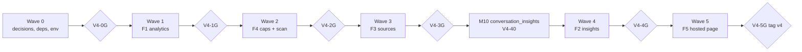

# PLAN — Version 4 execution plan

| | | |
|---|---|---|
| Version | **V4** — closes the feature gap against sitegpt.ai recorded in the 2026-11-20 comparison (§2): advanced analytics, per-conversation AI insights, new training sources, per-conversation cost caps + sitemap auto-scan, and a hosted chat page |
| Status | **In progress — Wave 0 and Wave 1 complete (gates V4-0G and V4-1G signed off): V4-10 done (trend, funnel, top questions), V4-11 done (aggregate CSV export), V4-12 done (analytics page: SVG trend, funnel, top questions, export button), V4-13 done (docs: the analytics surface in README/AGENTS/api-v1); gate V4-1G signed off (both suites, widget suite, build/lint, `trail build`, digest byte-comparison, CSV by way of the API, `/api/v1` summary + foreign-id 404). Wave 2 is under way: V4-20 done (per-session message cap), V4-21 done (Settings field + docs), V4-22 done (daily sitemap diff scan), V4-23 done (docs: caps and freshness); gate V4-2G signed off (both suites, widget suite, build/lint, `trail build`, `alembic current`, the session-cap refusal on the API, and the scan + 500-sitemap hand checks). Wave 3 is under way: V4-30 done (PPTX extraction), V4-31 done (YouTube source provider), V4-32 done (Notion source provider). No migration written yet — Alembic head is still `1c5516fa864d`.** D1–D9 confirmed twice against code anchors (§3) |
| Created | 2026-11-20 |
| Derived from | `plans/PLAN_V3.md` (§2 non-goals, §4 invariants, §8 release-tag policy), `plans/SPEC.md`, `README.md` §V3, `docs/security.md` §5 (K18 stays accepted), and the sitegpt.ai feature/pricing comparison of 2026-11-20 (gap list reproduced in §2 so this plan is self-contained) |
| Baseline | V3 tag `v3` = `2e5ab734b09b4eb229f927a875e737153c544779` (immutable); `master` HEAD `59e0cc2d13c51dacdb05fb3572715d0e5c40d85f` is docs-only after the tag (8 commits, incl. this plan); `feat/v4` branched from it at V4-01; Alembic head `1c5516fa864d`; suite counts are historical (V3-4G recorded 47 modules / 718 Python tests / 46 node checks; the **V4 baseline is 47 / 720 / 46**, recorded in §3's pre-flight block) and **must be re-run at pre-flight, never copied** |
| Scope | 5 features (F1–F5), 6 waves (W0–W5), 6 gates, 1 migration (M10), 25 tasks, exactly 2 new Python dependencies (D2), 0 new JS dependencies |
| Review note | Pre-implementation plan. Every feature is off by default; with all V4 flags off the deployment behaves exactly as tag `v3` |
| Out of scope | iOS app, WhatsApp / Messenger / Google Chat / Freshdesk Messaging / Zoho SalesIQ channels, Zendesk AI Agent (OAuth install), AI Email Support, Dropbox / OneDrive / Box / GitHub sources (each needs its own OAuth app — V5 candidates), white-label / billing / plans, SOC 2 Type II / HIPAA BAA / signed DPA / "GDPR certification" (legal, not code — unchanged since V2), a charting library (D1), an `EMBEDDING_DIMENSIONS` change (**no re-ingest anywhere in V4**), WebSocket transport, a second auth library, and any backport of V4 work into V3 |

---

## 1. How to use this plan

- Each task has an ID `V4-xx`, a size (`S` / `M` / `L`), a dependency, the files it
  touches, what to do, and a **Done when** condition. Tick the box only when that
  condition is met; add a `Done:` line with the evidence, as `PLAN_V3.md` does.
- **Follow the dependency graph.** Wave 1 starts only after the Wave 0 gate
  (`V4-0G`), then Wave 2 after `V4-1G`, and so on. Do not parallelize a task
  against a gate it depends on; §6 is authoritative.
- **One task ≈ one commit**, on branch `feat/v4` (branch from current `master`
  after verifying its delta from the `v3` tag, not from the tag itself — the
  docs commits above the tag are expected, §8 of PLAN_V3). A gate is its own
  commit — `chore(v4): V4-NG gate — docs + trail build`.
- `PLAN_V3.md` says what V3 did; this file says what V4 does and in what order.
  When a V4 task contradicts `README.md`, `AGENTS.md` or `docs/security.md`, fix
  the docs in that task rather than deferring.
- Sizes are relative complexity, not time estimates.
- **Wave order is deliberate:** analytics first (no provider cost, no schema),
  then the spend/freshness guards (they must exist **before** V4 adds features
  that cost provider money), then sources, then insights (the LLM-cost feature,
  built last among the data features so the caps and claim patterns are already
  proven), then the hosted page (smallest, but touches `embed_guard`, so it gets
  its own wave and negative tests).

---

## 2. Traceability matrix — the gap this plan closes

Gap source: sitegpt.ai homepage + pricing pages, fetched 2026-11-20. The project
already matches the Growth tier's core (widget, digest, handoff + live inbox,
leads, Q&A training, Slack/Zendesk/Crisp/webhook integrations, scoped API keys,
rate limiting, auto re-crawl) and parts of Scale (signed durable webhooks,
weekly topic clustering). What remains, and where V4 answers it:

| V4 feature | sitegpt.ai capability it matches | Tier there | What the repo has today (verified anchor) | Migration | Wave | Exit criterion |
|---|---|---|---|---|---|---|
| F1 Advanced analytics | Daily trend charts, engagement funnel, CSV export, "exact top questions visitors keep asking" | Growth+ | `GET /api/analytics/summary` returns only `build_digest` aggregates over a rolling window (`api/analytics.py:22-33`); no trend, funnel, export or repeated-question list | — | 1 | Trend + funnel + top questions render from one shared definition; aggregate CSV downloads; digest payload byte-unchanged |
| F2 Per-conversation AI insights | "AI-classified topics, sentiment, and resolution outcomes for every conversation" | Scale+ | Topic clusters exist but are **weekly aggregates** (`services/topics.py`); nothing classifies an individual conversation | M10 | 4 | Opt-in company gets sentiment/resolution/summary per conversation at bounded provider cost; rows are derived data that cascade with erasure/retention |
| F3 New training sources | YouTube videos/playlists/channels; Notion; PPTX uploads | all tiers | `services/sources.py` registry has only `local`/`url`/`google_drive`; `services/parse.py` handles txt/md/csv/json/html/pdf/docx — **no pptx** (`parse.py:10-65`) | — | 3 | A YouTube playlist, a Notion page and a `.pptx` file all become searchable knowledge through the **unchanged** ingest pipeline |
| F4 Cost & freshness controls | "Rate Limiting: max messages per conversation"; "Auto Scan (Daily): find new or removed URLs" | Growth+ / Scale+ | `services/quota.py` caps per **website per day** only; sitemap sync is manual (`crawler.extract_urls_from_sitemap`, `crawler.py:82`); `scheduler_loop` re-crawls known pages but never re-reads the sitemap | — | 2 | A chatty single session hits a friendly per-session ceiling without spending the daily budget; an opted-in site picks up new/removed sitemap URLs daily without wiping knowledge on a bad fetch |
| F5 Hosted chat page | "Each chatbot gets its own unique url… directly link to the chatbot" | all tiers | Widget is embed-only (`GET /widget.js` + `ChatWidgetConfig`); no first-party page | — | 5 | `GET /chat/{website_id}` serves a full-page chat that passes the same guards as the embed; third-party origin posture (K18) unchanged |

**Explicitly deferred (V5 candidates, not silently dropped):** mobile agent app,
chat channels (WhatsApp/Messenger/Google Chat/Freshdesk/Zoho SalesIQ), Zendesk AI
Agent OAuth install, AI Email Support, Dropbox/OneDrive/Box/GitHub providers,
white-label and billing. Compliance certifications remain legal work, not code
(D9). Anything beyond the five features here is a new plan.

---

## 3. Pre-flight decisions (blocking)

Resolve these before the affected wave starts; record any change here first.
Changing one after its wave is complete means rework, so decide now.

| ID | Question | Default for V4 | Revisit before |
|---|---|---|---|
| D1 | How are trend/funnel charts rendered? | **Hand-rolled inline SVG inside `frontend/src/pages/Analytics.tsx`, Ant Design for everything else.** No charting library — the V3 non-goal stands. The dataset is tiny (≤ 90 daily points, 5 funnel stages), so a dependency buys nothing. Charts get direct labels and luminance-separable fills, not color-only encoding. | V4-12 |
| D2 | Which new dependencies are allowed? | **Exactly two Python packages: `python-pptx` (PPTX text) and `youtube-transcript-api` (YouTube captions).** Both follow the `pypdf`/`python-docx` optional-import pattern in `parse.py` — a clear error when missing, never a silent skip. Notion uses the **existing `httpx`** against `api.notion.com` (no SDK). No new JS dependency. Versions pinned in `pyproject.toml` + `uv.lock` in V4-03; any further package needs a rewritten D2 first. | V4-03 |
| D3 | Insight storage, claim, cost and refresh | **One `conversation_insights` row per conversation (unique `conversation_id`, FK CASCADE), no runs table.** The unique insert **is** the claim (lost race → skip, the `ensure_conversation`/`topics.claim_run` precedent). Eligible: ≥ 1 visitor message, settled (`last_message_at` older than `INSIGHT_SETTLE_MINUTES`), and no row or a completed row older than the conversation's newest message. Caps: ≤ `INSIGHT_MAX_CONVERSATIONS` (50) per company per run, transcript ≤ `INSIGHT_TRANSCRIPT_CHARS` (4000) over the last ≤ 20 messages, ≤ `INSIGHT_BATCH_SIZE` (10) conversations per temperature-0 LLM call, fixed prompt treating transcripts as untrusted data (the topics naming precedent). A completed row may be refreshed in place when the conversation grows; `failed` retries next tick. Rows store enums + a ≤ 280-char summary — **never raw transcript text**. | V4-41 |
| D4 | Funnel / top-question definitions, and the digest | **One definition, shared with the digest's session/unanswered semantics.** Funnel stages (each a count of distinct sessions in the window): `started` → `answered` (≥ 1 `assistant`/`agent` reply) → `lead` (a `contacts` row) → `handoff` (a `handoff_requests` row) → `human` (a `conversations` row that reached `human`). Stages are documented as overlapping counts, not a strict subset chain. Top questions = exact-match grouping of normalized visitor questions (lowercase, whitespace collapsed, trailing punctuation stripped), top 10 with counts — **no embeddings, no LLM**. The weekly **digest payload stays byte-for-byte unchanged** in V4 (the V3 guarantee is not reopened); insights surface only in the console and `/api/analytics/*`. | V4-10 |
| D5 | What does the CSV export contain? | **Aggregates only** — daily trend, funnel, top questions/topics for the requested window. Manager+, company-scoped, `text/csv` attachment. Every cell starting with `=`, `+`, `-`, `@`, TAB or CR is prefixed with `'` (spreadsheet formula injection). **No PII**: transcripts, contacts and session ids stay in the existing `/api/privacy/export`, which already owns that surface. | V4-11 |
| D6 | Per-session cap semantics and ordering | **Internal key `session_message_limit` (default `0` = off, seeded from env `SESSION_MESSAGE_LIMIT`).** Counts visitor (`role='user'`) messages per `(website_id, session_id)` in Redis (`quota:session:<website>:<session>`, TTL `SESSION_CAP_TTL_SECONDS` = 86400, refreshed on each accepted message — an idle window, not a lifetime ban). Order in the chat handlers: per-IP limiter (burst) → **session cap** → daily quota consume — a session-capped refusal never spends the daily budget. Refusal is a friendly answer / the usual SSE `chunk`+`done` pair (`quota_sse_events` precedent), no LLM call, no session reset. Redis outage **fails open** exactly like the daily quota. | V4-20 |
| D7 | Sitemap auto-scan safety | **Internal key `sitemap_scan_enabled` (default `false`), company-wide; worker `sitemap_loop` every `SITEMAP_SCAN_INTERVAL_SECONDS` (86400).** Only `active` websites with a sitemap URL of opted-in companies. New pages capped by the existing `SITEMAP_SYNC_MAX_URLS`; a URL that disappeared is marked inactive and its document deleted (the existing page-delete semantics). **A failed or empty sitemap fetch changes nothing** — removals are applied only after a fully successful, non-empty fetch, so a transient 500 can never wipe a knowledge base. Ingest is queued only when something changed, through `claim_ingest` (a processing site is skipped, never double-crawled). No new column in V4; the website detail page keeps showing pages + `ingest_status`. | V4-22 |
| D8 | Hosted page vs the Origin allowlist | **First-party exception, narrowly scoped:** `embed_guard` additionally accepts an `Origin`/`Referer` whose scheme+host+port equals the API's **own request origin** (`request.base_url`) — the hosted page is served by this API, so its chat calls are first-party. Third-party origins keep the exact V3 behaviour; the no-Origin soft acceptance (K18) is unchanged and stays documented as accepted. The page is public, `ensure_website_active` applies (a disabled site renders the widget's existing unavailable state), and every chat call keeps the IP limiter, session cap, daily quota and K4 session token. `ChatWidgetConfig` gains one **optional** key `displayMode: 'page'` (default `'bubble'`); no `localStorage` key changes. | V4-51 |
| D9 | Legal/commercial items | **Still out of scope** — SOC 2, HIPAA BAA, signed DPA, pricing, trial, white-label, mobile app, chat channels. V4 adds no compliance claim and no marketing wording; `docs/security.md` §1 stays true. | — |

**D1–D9 verified against code (plan authoring, 2026-11-20) — anchors confirmed:**

- D1: `frontend/src/pages/Analytics.tsx` exists; `frontend/package.json` has no
  chart library; V3 §2 non-goals already forbid one. Confirmed.
- D2: `services/parse.py:45-63` is the optional-dependency precedent (`pypdf`,
  `python-docx` imported inside the branch); `services/sources.py:33-91` already
  downloads via `httpx` with `read_limited` (size cap) and a credential-host
  rule. No `youtube`, `notion` or `pptx` code exists anywhere in `src/`.
  Confirmed.
- D3: `models.py:295` — `conversations` is unique on `(website_id, session_id)`
  with `last_message_at`; `services/topics.py` owns the claim/cap/untrusted-prompt
  pattern to copy. Confirmed.
- D4: `api/analytics.py:22-33` reuses `build_digest` so page and email cannot
  disagree; `chat_messages.answered` (`models.py:270`) and
  `idx_chat_messages_website_id_created_at` (`models.py:258`) already exist —
  trend/funnel need **no new index**. Confirmed.
- D5: `/api/privacy/export` already owns PII export (`api/privacy.py`); the
  analytics CSV is a second, aggregate-only surface. Confirmed.
- D6: `services/quota.py:30-119` — `parse_limit`, `consume_message`,
  `quota_sse_events` are the exact helpers to extend; README "Limit composition"
  documents the current ordering the session cap slots into. Confirmed.
- D7: `crawler.extract_urls_from_sitemap(..., raise_on_error=...)`
  (`crawler.py:82-101`), `worker.scheduler_loop` (`worker.py:619-666`) and
  `topic_loop` (`worker.py:562-574`) are the loop precedents; `claim_ingest`
  guards the queue. Confirmed.
- D8: `services/embed_guard.py:42` (`LOOPBACK_HOSTS`) and `:185`
  (`ensure_embed_allowed`) — the guard already has a documented first-party-style
  exception (loopback demos); the hosted-page origin rule extends the same
  function, never a copy. Confirmed.
- D9: `docs/security.md` §1 makes no compliance claim; V4 keeps it that way.
  Confirmed.

**D1–D9 re-verified (V4-01, 2026-11-20) — all confirmed, none rewritten:**

- D1: `frontend/package.json` has no chart/plot/d3/echarts/recharts entry. ✓
- D2: no `youtube`/`notion`/`pptx` match anywhere under `src/` (case-insensitive
  sweep); `parse.py:45-63` optional-import pattern and `sources.py` httpx
  download path unchanged. ✓
- D3: `models.py:295` unique `(website_id, session_id)` on `conversations`;
  `services/topics.py` claim/cap pattern intact. ✓
- D4: `api/analytics.py:22-33` still delegates to `build_digest`;
  `chat_messages.answered` (`models.py:270`) and
  `idx_chat_messages_website_id_created_at` (`models.py:258`) present. ✓
- D5: `api/privacy.py:63` `GET /export` owns the PII surface. ✓
- D6: `services/quota.py:30-119` helpers unchanged. ✓
- D7: `crawler.py:82` `extract_urls_from_sitemap(raise_on_error=…)`,
  `worker.py:562-666` loop precedents unchanged. ✓
- D8: `embed_guard.py:42` `LOOPBACK_HOSTS`, `:185` `ensure_embed_allowed`
  unchanged. ✓
- D9: `docs/security.md:18-22` explicitly lists no SOC 2 / HIPAA BAA / DPA /
  GDPR certification. ✓
- Anchor correction worth recording: `embed_texts` lives in
  **`services/ingest.py:17`** (sync), not `llm.py` as PLAN_V3's D3 verification
  said; invariant 5's reuse list is unaffected. `WIDGET_PUBLIC_KEYS` counted
  at exactly **14** entries (`api/setting.py:82-98`).

### Environment pre-flight

- [x] Confirm `v3` resolves to `2e5ab734b09b4eb229f927a875e737153c544779`, record
      `git rev-parse HEAD` (`6dd8866…` at authoring), inspect the delta from the
      tag (expected: docs-only), and branch `feat/v4` from current `master`.
      Keep unrelated code changes out of the V4 starting point.
      Done (V4-01): tag `^{commit}` = `2e5ab73…` ✓; HEAD `59e0cc2` (the plan +
      AGENTS pointer landed as `docs(v4): add plan and update agents tag rule`);
      delta `v3..HEAD` = 8 docs-only commits touching exactly AGENTS.md,
      README.md, docs/api-v1.md, docs/security.md, plans/PLAN_V3.md,
      plans/PLAN_V4.md; working tree clean; `feat/v4` branched from `59e0cc2`.
- [x] `uv run alembic current` = `uv run alembic heads` = `1c5516fa864d` (single
      head). M10 chains from it.
      Done (V4-01): both print `1c5516fa864d (head)` against `site_gpt_db`.
- [x] `pg_dump` backup before M10 (`backups/`, already gitignored).
      Done (V4-01): `backups/site_gpt_pre_v4.dump` (59K) via
      `docker exec postgres16 pg_dump -U postgres -Fc site_gpt_db`.
- [x] Redis reachable (`GET /health` reports `redis: true`); if not, the session
      cap and insight loop remain implementable but their Redis paths cannot be
      verified — record those checks as **blocked**, never tick them silently.
      Done (V4-01): `asyncio.run(services.redis.ping())` → `True` (redis6
      container, localhost:6379 db 0). Session-cap and insight Redis paths are
      verifiable in Waves 2/4.
- [x] Baseline green, counts recorded from the **actual run**:
      `uv run python -m unittest discover -s tests -v`,
      `node --test tests/*.mjs`, `cd frontend && npm run build && npm run lint`,
      `trail build`. (V3-4G recorded 47 modules / 718 / 46 — do not copy; the
      number to use is the **last `Done` line here**: 47 modules / 720 Python
      tests / 46 node checks, the V4-04 re-run of this same pre-flight.)
      Done (V4-01): **718 Python tests / 47 modules, OK** (9.3 s); **46 node
      checks, 46 pass / 0 fail** across 8 `.mjs` files; `npm run build` +
      `npm run lint` exit 0; `trail build` exit 0. Run with the sanitized
      `NO_PROXY` below. Counts happen to equal the V3-4G record — they are
      from this run, not copied.
      Done (V4-04): **720 Python tests / 47 modules, OK** (8.7 s), **46 node
      checks, 46 pass / 0 fail** across 8 `.mjs` files, `npm run build` +
      `npm run lint` exit 0, `trail build` exit 0 (2563 nodes / 5718 edges /
      198 cards) — the Wave 0 baseline every gate re-runs. V4-01's 718 above
      was the pre-scaffolding run; the +2 are the V4-02 settings cases
      (`test_v4_internal_defaults_are_off`, `test_no_v4_key_reaches_the_widget`).
      Module count stayed 47: Wave 0 added no test module, by design.
- [x] Provider reachability probe for D2/D3: can this environment reach
      `youtube.com` captions and `api.notion.com`, and is an LLM/embedding
      provider configured? If not, F2/F3 end-to-end checks are **blocked and
      unexecuted** at their gates (unit tests with stubs still run), exactly as
      V3-4G recorded its provider-bound items.
      Done (V4-01): **providers are reachable here — unlike the V3 gate.**
      Chat/embedding gateway `http://127.0.0.1:31415/v1` (`LLM_AI=custom_openai`,
      model `auto`): `GET /models` 200 with key; one minimal chat completion
      200; `services.ingest.embed_texts(["preflight probe"])` → **1536-dim**,
      matching `EMBEDDING_DIMENSIONS` (a raw probe without the `dimensions`
      param returns the router's native 3072 — the service layer requests
      1536, which is what matters). `https://www.youtube.com/` → 200;
      `https://api.notion.com/v1/users/me` → 401 (reachable, needs a token —
      a live Notion import still needs a real integration token at V4-3G).
      SMTP and browser steps remain unprobed; apply the blocked-item rule to
      those at the gates, not to the provider-bound ones.

**Environment note (V4-01):** this shell exports
`NO_PROXY=localhost,.localhost,127.0.0.1,127.0.0.0/8,[::1],::1`. The `ollama`
package builds a module-level `Client()` at import, and the installed httpx
fails to parse the bare `[::1]` entry (`InvalidURL: Invalid port: ':1]'`), so
`import site_gpt.app.services.llm` — and therefore the whole suite — crashes
at import under that variable. All baseline commands were run with
`NO_PROXY=localhost,127.0.0.1 no_proxy=localhost,127.0.0.1`. This is an
environment quirk, not a V4 code change; any gate run in this shell must
sanitize the variable the same way (or the operator fixes their profile).

---

## 4. Invariants (every task)

Carried from `PLAN_V3.md` §4 and `AGENTS.md`; new V4 rules marked **V4**.

1. `ChatWidgetConfig` keys and every `localStorage` key stay valid; new config is
   optional with a default. **V4:** `displayMode` is additive — a snippet that
   never sends it renders the bubble exactly as before.
2. `services/rag.py::search` stays the only retrieval SQL. New sources normalize
   into local files under `uploads/` so `parse.py` → chunk → embed is unchanged;
   insights read bounded `chat_messages`, never the `embeddings` table.
3. Chunking stays 1000/200 via `split_text`.
4. `EMBEDDING_DIMENSIONS` unchanged → **no re-ingest at any point in V4**.
5. Reuse `get_llm`, `embed_texts`, `enqueue_job`, `rate_limit`, `send_email_async`,
   `authorize`, `claim_ingest`, `parse_limit`, `consume_message`. No new SDK
   client; the **only** new dependencies are the two approved in D2.
6. Public endpoints keep `ensure_embed_allowed` + `ensure_website_active`;
   the hosted-page origin rule **extends** `embed_guard`, never a parallel copy.
7. New env var → `core/config.py` + `.env.example` + the README table, same task.
8. New settings key → `api/setting.py` registry **and** `tests/test_settings.py`'s
   `INTERNAL_KEYS`/public tuple in the same commit. `WIDGET_PUBLIC_KEYS` stays
   **exactly 14** — no V4 key is widget-public.
9. Every feature is **off by default** (`session_message_limit=0`,
   `sitemap_scan_enabled=false`, `conversation_insights_enabled=false`). With all
   V4 flags off, behaviour equals tag `v3`, including a byte-identical digest.
10. Tenant scoping is not optional: every analytics, insight, export and hosted
    page query filters by company/website ownership; a foreign resource id is a
    **404**, never a 403.
11. Migrations that add indexes to busy tables build `CONCURRENTLY` inside
    `op.get_context().autocommit_block()`. M10 is a **new empty table** — its
    indexes build transactionally (the M7/M8 precedent).
12. After each gate: `trail build`, then update `README.md`, `AGENTS.md`,
    `docs/security.md` (where affected) and this file's dashboard — inside the
    gate commit, never after the tag.
13. Redis counters and pub/sub are best-effort: the session cap fails open on a
    Redis outage (D6), and no V4 feature stores state only in Redis.
14. **V4:** insight rows are derived data. They cascade from `conversations`
    (FK `ON DELETE CASCADE`), so `erase_session`, `delete_conversation` and the
    retention purge cover them **without a second delete path** — and a task
    that touches any of those must prove it with a test, not assume it.
15. **V4:** the weekly digest payload (JSON and HTML) stays byte-for-byte the
    V3 output. F1/F2 surface in `/api/analytics/*` and the console only.
16. **V4:** the analytics CSV contains aggregates only — no session ids, no
    contact details, no message text — and neutralizes formula-leading cells.

---

## 5. Waves

### Wave 0 — Foundation (no schema change)

**Goal:** lock the nine contracts, add the two approved dependencies and the
env/settings scaffolding, and record a real baseline so no wave invents its own
version. **Entry:** environment pre-flight above.

- [x] **V4-01 · Decisions + scope doc** — `S`, depends: —, migration: —
  - Done: D1–D9 re-verified against code (second verification block above) — all confirmed, none rewritten; one anchor correction recorded (`embed_texts` is `services/ingest.py:17`). Deferred list in §2 unchanged. Environment pre-flight fully recorded: tag/HEAD/delta/branch ✓, single alembic head ✓, `backups/site_gpt_pre_v4.dump` ✓, Redis ping True ✓, baseline 718/47 + 46 node + build/lint/trail green ✓, providers reachable (chat 200, embed 1536-dim, YouTube 200, Notion API reachable) ✓; `NO_PROXY`/httpx environment quirk documented with the sanitization used.
  - Files: `plans/PLAN_V4.md`.
  - Do: re-verify every D-row against the code (the anchors in §3 were checked
    at authoring; re-check anything that moved). Confirm the deferred list in
    §2 is still the right scope. Record the environment pre-flight results.
  - Done when: every D-row is confirmed or rewritten here first, and no task
    below depends on an unconfirmed decision.

- [x] **V4-02 · Env + settings scaffolding** — `S`, depends: V4-01, migration: —
  - Done (V4-02): all 11 env vars in `core/config.py` (V4 block after the inbox
    values) with the plan's defaults and a comment on each; `.env.example`
    documents every one under `--- V4 scaffolding`; README gains the env-table
    rows and three settings rows; `INTERNAL_SETTINGS` gains
    `session_message_limit` (seeded from `SESSION_MESSAGE_LIMIT`, the
    `daily_message_limit` precedent), `sitemap_scan_enabled`=`"false"` and
    `conversation_insights_enabled`=`"false"`. `tests/test_settings.py` adds the
    three keys to `INTERNAL_KEYS` and two cases (`test_v4_internal_defaults_are_off`,
    `test_no_v4_key_reaches_the_widget`); 14 settings tests OK, pinned literal
    still exactly 14 keys. Nothing is wired yet — no route reads the keys.
  - Files: `core/config.py`, `.env.example`, `README.md`, `api/setting.py`,
    `tests/test_settings.py`.
  - Do: add (all defaulted to the V3 behaviour) `SESSION_MESSAGE_LIMIT=0`,
    `SESSION_CAP_TTL_SECONDS=86400`, `SITEMAP_SCAN_INTERVAL_SECONDS=86400`,
    `INSIGHT_INTERVAL_SECONDS=86400`, `INSIGHT_MAX_CONVERSATIONS=50`,
    `INSIGHT_BATCH_SIZE=10`, `INSIGHT_TRANSCRIPT_CHARS=4000`,
    `INSIGHT_SETTLE_MINUTES=60`, `YOUTUBE_MAX_VIDEOS=25`,
    `NOTION_MAX_BLOCKS=1000`, `NOTION_MAX_PAGES=25`; internal keys
    `session_message_limit` (`"0"`), `sitemap_scan_enabled` (`"false"`),
    `conversation_insights_enabled` (`"false"`). Nothing is wired yet beyond
    the registry, so `WIDGET_PUBLIC_KEYS` does not grow.
  - Done when: settings tests pass at the new key count, `GET /api/widget-config`
    still publishes exactly the 14 allowlisted keys, and `.env.example`
    documents every variable with its default.

- [x] **V4-03 · The two approved dependencies** — `S`, depends: V4-02, migration: —
  - Done (V4-03): `python-pptx (>=1.0.2,<2.0.0)` and
    `youtube-transcript-api (>=1.2.2,<2.0.0)` in `pyproject.toml`; `uv lock`
    resolved 134 packages → `python-pptx 1.0.2` / `youtube-transcript-api 1.2.5`
    plus their transitive deps only (`pillow`, `xlsxwriter`, `defusedxml`);
    `uv sync` clean. `services/parse.py` is unchanged on purpose (its `pptx`
    branch is V4-30) — the probe asked for here is that neither package is
    imported at module load: with both blocked from `sys.modules`,
    `import site_gpt.app.main` and `site_gpt.app.worker` still succeed and the
    unimplemented path raises its clear error (`FileNotFoundError` for a missing
    file, `ImportError` for a missing optional dep — the `pypdf` pattern, never
    a silent empty document).
  - Files: `pyproject.toml`, `uv.lock`, `services/parse.py` (import probe only).
  - Do: add `python-pptx` and `youtube-transcript-api`, pinned, with a one-line
    justification each in the commit body (D2). Verify `uv sync` resolves and
    `import site_gpt.app.main` / `worker` still pass with both installed **and**
    with neither importable at module load (they are branch-local imports, the
    `pypdf` pattern). No other package changes.
  - Done when: `uv.lock` diff contains only the two packages and their
    transitive deps, and a missing-package path raises a clear error rather
    than failing silently.

- [x] **V4-04 · Test + graph baseline** — `S`, depends: V4-03, migration: —
  - Done (V4-04): `AGENTS.md` gains the V4 paragraph (same two suites, no new
    runner; `PLAN_V4.md` §9 is the runbook; the two branch-local deps) and
    `trail build` ran clean — 2563 nodes / 5718 edges / 198 cards. Baseline from
    the actual run: **720 Python tests / 47 modules, OK** (8.7 s) and **46 node
    checks, 46 pass / 0 fail**, now also recorded in §3's pre-flight block so
    the 718 left by V4-01 is not the count an agent reads first; `trail
    ask`/`trail grep` resolve the three new keys to `api/setting.py`.
  - Files: `AGENTS.md`, `tests/`, `.trail/`.
  - Do: state in `AGENTS.md` which suites V4 extends (no new runner), point at
    this plan's §9 runbook, run `trail build`. Record the real baseline counts
    in the pre-flight block — from the run, not from a doc.
  - Done when: the recorded counts match a real run, and `trail ask` finds the
    new settings keys.

#### Gate V4-0G

- [x] `uv run python -c "import site_gpt.app.main"` and `import site_gpt.app.worker` pass.
      Done (V4-0G): both exit 0, including with `pptx`/`youtube_transcript_api`
      blocked from `sys.modules` (branch-local imports, D2).
- [x] `alembic current` is still `1c5516fa864d` (Wave 0 adds no revision).
      Done (V4-0G): `1c5516fa864d (head)`, single head; no revision file added.
- [x] Both suites, `npm run build && npm run lint`, `trail build` pass; counts recorded.
      Done (V4-0G): **720 Python tests / 47 modules, OK**; **46 node checks, 46
      pass / 0 fail**; `npm run build` and `npm run lint` exit 0; `trail build`
      exit 0. Run with the sanitized `NO_PROXY` from §3.
- [x] `GET /api/widget-config` unchanged (14 keys); `/health` unchanged.
      Done (V4-0G): `tests.test_settings` pins `WIDGET_PUBLIC_KEYS` to the
      literal 14-key tuple (order included) and `tests.test_widget_config_cache`
      exercises the route itself; `tests.test_health` covers `/health` and was
      green in the full run. No route's response shape changed in Wave 0.
- [x] commit `chore(v4): V4-0G gate — foundation`.

---

### Wave 1 — F1 Advanced analytics (no schema change)

**Goal:** daily trends, an engagement funnel, repeated-question detection and an
aggregate CSV export — from the data already stored, with the digest's
definitions, no new index and no chart library. **Entry:** V4-0G.

- [x] **V4-10 · Trend, funnel and top questions, one definition** — `M`, depends: V4-0G, migration: —
  - Done (V4-10): new `services/analytics.py` with the three definitions —
    `daily_trend` (one zero-filled row per UTC day: conversations, messages,
    visitor messages, new contacts, 👍/👎, unanswered), `engagement_funnel` (the
    five D4 stages as distinct-session counts) and `top_questions` (normalized
    exact-match grouping, top 10) — plus `normalize_question` and
    `is_unanswered`. Shared, not forked: the window's messages come from
    `digest._period_messages`, a conversation is one `session_id` exactly as
    `conversation_volume` counts it (pinned by test to equal the funnel's
    `started`), and `is_unanswered` is pinned to the same messages
    `digest._unanswered` reports. `AnalyticsSummary` gains `trend`/`funnel`/
    `top_questions` **additively**; both `/api/analytics/summary` and
    `/api/v1/analytics/summary` return them; **`build_digest` is not edited** and
    its payload is pinned key for key. Two decisions recorded here: `answered`
    means "has an assistant **or** agent reply" (D4 literal — an ungrounded answer
    still counts; its quality is the trend's `unanswered`), and `human` means the
    inbox row is `human` now or was closed after being claimed, because `release`
    clears the claim and leaves no marker. `tests/test_analytics.py` (19 cases,
    real in-memory SQLite fixture): multi-website company, agent-answered session,
    an unanswered question, a lead without a handoff, released vs closed, a
    foreign company reading nothing (even with a reused session id), the half-open
    window, a blank question, and the digest payload unchanged after the new
    reads run. Suite: **48 modules / 739 Python tests, OK** (8.9 s); imports
    and `trail build` green.
  - Files: `services/analytics.py` (new), `services/digest.py` (read-only reuse),
    `schemas/digest.py`, `api/analytics.py`, `api/v1.py`,
    `tests/test_analytics.py` (new).
  - Do: add `daily_trend(db, company_id, start, end)` (per-UTC-day conversations,
    messages, visitor messages, new contacts, 👍/👎, unanswered — grouped over
    the company's websites, riding `idx_chat_messages_website_id_created_at`),
    `engagement_funnel(...)` (the five D4 stages, distinct sessions each) and
    `top_questions(...)` (normalized exact-match grouping, top 10 with counts).
    Import the session/unanswered definitions from `digest.py` — do not fork
    them. Extend `AnalyticsSummary` **additively** (`trend`, `funnel`,
    `top_questions`); existing keys keep their exact meaning, so
    `/api/v1/analytics/summary` gains the fields without a contract break.
    `build_digest` is not edited.
  - Done when: unit tests pin each aggregation against a seeded fixture
    (multi-website company, agent rows, an unanswered question, a lead without
    a handoff); a foreign company id reads nothing; the digest output for the
    same fixture is byte-identical to the pre-change module.

- [x] **V4-11 · Aggregate CSV export** — `S`, depends: V4-10, migration: —
  - Done (V4-11): `GET /api/analytics/export.csv?days=` in `api/analytics.py`
    (manager+ through `get_manager_user`, company-scoped by `user.company_id`,
    window clamped to 1…90 days exactly like the summary) returns a `text/csv`
    attachment named `analytics-<first UTC day>_<last UTC day>.csv`
    (`export_filename`). The body comes from `services.analytics.export_csv`,
    which renders the V4-10 helpers — `daily_trend`, `engagement_funnel`,
    `top_questions` — with **no second aggregation**, as three sections each with
    its own header and a blank line between them: trend (`date,conversations,
    messages,visitor_messages,new_contacts,feedback_up,feedback_down,
    unanswered`), funnel (`stage,sessions`) and top questions (`question,count`,
    top 10). `csv_cell` neutralizes every cell starting with `=`, `+`, `-`, `@`,
    TAB or CR by prefixing `'` (D5), so a question asked as
    `=HYPERLINK("http://x.test","click")` is exported as text. Aggregate rows
    only: no session id, contact field or transcript text — `/api/privacy/export`
    keeps owning that surface. `tests/test_analytics_export.py` (13 cases, real
    in-memory SQLite fixture placed relative to "now" because the window is
    rolling): content type and `Content-Disposition` filename, the three headers
    and row shape, trend counts per day, the five funnel stages, the ranked
    questions, formula neutralization (no cell left executable), the PII canary
    and the absent column names, a Globex manager seeing only its own three
    sessions and question, a signed-out caller refused, `export_filename`, and the
    export matching the summary aggregates row for row. Suite: **49 modules / 752
    Python tests, OK** (9.3 s); `trail build` green. No `schemas/` change — a CSV
    has no response model.
  - Files: `api/analytics.py`, `services/analytics.py`, `schemas/`,
    `tests/test_analytics_export.py` (new).
  - Do: `GET /api/analytics/export.csv?days=` — manager+, company-scoped,
    `text/csv` attachment named with the window dates, rows = daily trend +
    funnel + top questions (D5). Neutralize every cell leading with `=`, `+`,
    `-`, `@`, TAB or CR by prefixing `'`. No session ids, no contact fields, no
    message text. Reuse the V4-10 helpers; no second aggregation.
  - Done when: a test downloads the CSV, asserts the header/row shape, asserts
    a question starting with `=HYPERLINK(...)` comes out neutralized, and
    asserts a manager of another company gets 404/empty-for-own-data only.

- [x] **V4-12 · Analytics page: SVG trend, funnel, top questions, export** — `M`, depends: V4-11, migration: —
  - Done (V4-12): three new cards on `frontend/src/pages/Analytics.tsx`, all fed
    by the summary the page already fetches (every existing card untouched):
    **Daily activity** — a hand-rolled SVG bar chart (D1: no chart library), two
    grouped bars per UTC day (messages `#0958d9`, conversations `#bae0ff`, chosen
    for luminance separation rather than hue), zero-based axis ticks, `<title>`
    per bar, direct value labels while the slot has room (~≤30 days) and thinned
    date labels, and "No data in this window" instead of an empty axis;
    **Engagement funnel** — five labelled horizontal bars with the count and the
    share of the previous stage, "Distinct sessions; stages overlap" in the
    header, "No data in this window" when every stage is zero; **Top questions**
    — an Ant Design table (Question / Asked) with its own empty state. An
    **Export CSV** button in the window row downloads the V4-11 route for the
    page's current `days`: `utils/api.ts::exportAnalyticsCsv` fetches the file as
    a blob because a plain link cannot carry the JWT, and names the download from
    `Content-Disposition`. `types/api.ts` gains `TrendPoint`, `FunnelStage`,
    `TopQuestion` and the three additive `AnalyticsSummary` fields. The digest
    button pair gained `Space wrap` — at 390 px the pre-existing pair overflowed
    its half-width column by ~130 px and pushed the card past the viewport; the
    fix is one prop in this task's own file. **Render check:** the dev database
    holds zero chat messages, so the page was exercised with a fixture (a
    temporary Vite entry and a stubbed axios adapter, both deleted afterwards):
    the single-point series a 1-day window returns, the 90-day window (180 bars,
    2.7-unit bars, ~10 date labels), the funnel conversions and the questions
    table all render; no horizontal overflow at 1280×900 or 390×844
    (`scrollWidth == clientWidth`), and clicking Export CSV produced a
    `text/csv` blob saved as `analytics-2026-11-13_2026-11-20.csv` with no error
    toast. `npm run build` and `npm run lint` green; zero new JS dependencies.
  - Files: `frontend/src/pages/Analytics.tsx`, `frontend/src/types/api.ts`,
    `frontend/src/utils/api.ts`.
  - Do: render the daily trend as a hand-rolled SVG bar/line chart (D1) with
    direct value labels and a luminance-separable two-series fill (messages vs
    conversations), the funnel as five labelled horizontal bars with counts and
    stage-to-stage conversion, and top questions as an Ant Design table with
    counts. Add an **Export CSV** button hitting V4-11 (window = the page's
    current `days` selector). Keep every existing card unchanged; new sections
    degrade to "no data in this window" on an empty range, never a broken axis.
  - Done when: `npm run build && npm run lint` pass; the page renders seeded
    data end-to-end against the dev API (or the blocked-item rule applies and
    the component is exercised with a fixture); the 1-day and 90-day windows
    both render without overflow at desktop and mobile widths.

- [x] **V4-13 · Docs: analytics surface** — `S`, depends: V4-12, migration: —
  - Files: `README.md`, `AGENTS.md`, `docs/api-v1.md`.
  - Do: document the new summary fields, the CSV endpoint and its
    aggregate-only/PII boundary, and the funnel definition (overlapping counts,
    not a strict chain). Note the additive `/api/v1` change in `docs/api-v1.md`.
  - Done when: no doc still describes analytics as "counts + topics only", and
    the digest-unchanged guarantee is stated where F2 will later be tempted.
  - Done: `README.md` lists `GET /api/analytics/export.csv?days=` in the endpoint
    list and gains a **Advanced analytics (F1)** section — the three panels and
    the definitions they borrow from the digest, the funnel's overlapping stages
    (with the `agent` reply and `closed_at` rules), the CSV's three sections,
    filename, aggregate-only boundary and `'` neutralization, and the **digest is
    untouched** guarantee (invariant 15, re-checked at `V4-1G`); the weekly-digest
    bullet links to it and says neither the fields nor the CSV touch
    `build_digest`. `AGENTS.md` records `services/analytics.py` and
    `api/analytics.py` (summary + `export.csv`, deliberately no `/api/v1` twin) in
    the layout notes and adds the Do/don't line that `build_digest` and
    `render_digest_html` are never edited to add a report field. `docs/api-v1.md`
    documents the additive `trend`/`funnel`/`top_questions` shapes, the funnel
    overlap, the normalized top questions and that the CSV is console-only.
    `grep -iE "counts.{0,20}topics|topics only|counts \+ topics"` over `README.md`,
    `AGENTS.md` and `docs/*.md` returns 0 matches. Docs only — no code, schema or
    migration touched.

#### Gate V4-1G

- [x] Both suites + widget suite + build + lint + `trail build` pass; `alembic current` unchanged.
  - Done: `uv run python -m unittest discover -s tests` → **49 modules / 752
    tests, OK** (9.1 s); `node --test tests/*.mjs` → **46 checks, 46 pass, 0
    fail**; `cd frontend && npm run build` (✓ built in 1.98 s) and `npm run lint`
    (`eslint … --max-warnings 0`) both exit 0; `trail build` → 201 cards /
    2656 nodes / 5912 edges, exit 0; `uv run alembic current` is `1c5516fa864d
    (head)`, unchanged — V4 has written no migration.
- [x] Digest byte-comparison: `build_digest` JSON + HTML for a fixed fixture
      identical to the module loaded from tag `v3` (the V3-3G technique).
  - Done: a throwaway Postgres database (`v4_gate_1g`, migrated to
    `1c5516fa864d` and **dropped afterwards**; the dev database was not touched)
    held one fixed fixture for `[2026-11-02, 2026-11-09)` — 2 sessions, 5
    messages including one `answered=False`, 1 contact, 1 👍, 1 handoff,
    clustering off. `build_digest` ran twice against those rows: once from HEAD
    (`PYTHONPATH=src`, `site_gpt.__file__` = the repo's `src/site_gpt/__init__.py`)
    and once from a `git archive v3` checkout (`site_gpt.__file__` =
    `/tmp/…/v3/src/site_gpt/__init__.py`; tag `v3` is the annotated tag
    `f82ea09` on commit `2e5ab73`) — code-to-code, not a copy. JSON **744 B** and
    `render_digest_html` **691 B** were byte-identical (`cmp` silent, sha256
    `3be8818a…` for both JSONs and `4925960…` for both HTMLs), with only the V3
    keys: `company_id, conversation_volume, feedback_down, feedback_up,
    message_count, new_contacts, period_end, period_start, top_topics,
    unanswered_questions` — no `days`/`trend`/`funnel`/`top_questions` leaked in.
- [x] CSV downloaded by hand from the dev API; formula cell neutralized; no PII
      column present (record the header line here).
  - Done: a local API (`uvicorn … --port 8099`) served the gate database; the
    seeded admin logged in, minted the run's read key and downloaded
    `GET /api/analytics/export.csv?days=7` → **200 `text/csv; charset=utf-8`,
    `attachment; filename="analytics-2026-11-13_2026-11-20.csv"`** (401 without
    auth). **Header line:** `date,conversations,messages,visitor_messages,
    new_contacts,feedback_up,feedback_down,unanswered`, then `stage,sessions`,
    then `question,count` — no session id, contact field, email or transcript
    column anywhere. A question stored as `=HYPERLINK("http://x.test","click")`
    was written as `'=hyperlink("http://x.test","click` and `@SUM(A1:A9)` as
    `'@sum(a1:a9`: both carry the leading `'`, so neither is a live formula, and
    the funnel section (`started 2, answered 2, lead 1, handoff 1, human 1`)
    matched the JSON the page reads. The CSV was taken from the running API and
    inspected as a file, not asserted from a unit test.
- [x] `/api/v1/analytics/summary` with a `read`-scoped key returns the new fields
      and still refuses a foreign website id with 404.
  - Done: a key minted with `scopes: ["read"]` (`POST /api/api-keys`, raw value
    returned once) got **200** from `/api/v1/analytics/summary?days=7` with
    `trend` (8 UTC-day rows), `funnel` (`started 2 / answered 2 / lead 1 /
    handoff 1 / human 1`) and `top_questions`; `days=500` answered `days: 90`
    (clamped) and a keyless call **401**. The summary route takes no
    `website_id` (the company comes from the key), so the foreign-id refusal was
    exercised on the same `_scoped_website` guard:
    `/api/v1/conversations?website_id=<own>` → 200 and
    `?website_id=<another company's>` → **404 `{"detail":"Website not
    found"}`**. Read-only key, so no mutation was attempted.
- [x] commit `chore(v4): V4-1G gate — advanced analytics`.
  - Done: this commit; the gate database and temporary fixtures were removed
    afterwards, and `git status` is clean.

---

### Wave 2 — F4 Cost & freshness controls (no schema change)

**Goal:** the per-conversation ceiling and the daily sitemap scan exist **before**
V4 adds provider-cost features. Both opt-in, both fail safe. **Entry:** V4-1G.

- [x] **V4-20 · Per-session message cap** — `M`, depends: V4-1G, migration: —
  - Files: `services/quota.py`, `api/routes.py`, `api/v1.py`,
    `tests/test_session_cap.py` (new).
  - Do: extend `quota.py` with `consume_session_message(website_id, session_id,
    *, limit)` — Redis `INCR` + TTL refresh on
    `quota:session:<website_id>:<session_id>`, `parse_limit` for the setting
    (garbage/negative → env default, `0` disables, the daily-cap precedent).
    Wire into `POST /api/chat`, `/api/chat/stream` and `/api/v1/chat` **after**
    the IP limiter and **before** `consume_message` (D6): a capped session gets
    the friendly refusal as a normal answer / SSE `chunk`+`done`, spends no
    daily budget, calls no LLM, and never resets the K4 session. Redis outage
    fails open with a logged error, exactly like the daily quota.
  - Done when: tests prove the ordering (capped refusal leaves the daily
    counter untouched), the TTL refresh, the `0`/garbage fallbacks, fail-open,
    and that two sessions of one website have independent counters; the
    limit-ordering test from V3-12 is extended, not duplicated.
  - Done: `services/quota.py` gains `SESSION_CAP_MESSAGE`, `session_cap_key`
    and `consume_session_message` (`INCR` on
    `quota:session:<website>:<session>` plus `EXPIRE SESSION_CAP_TTL_SECONDS`,
    refreshed on every message; `0`/negative disables the cap; a Redis failure
    fails open with a logged error that names the website, never the session
    id), and `quota_sse_events` takes the notice to send (default
    `QUOTA_MESSAGE`, so the daily path is unchanged). `api/setting.py` gains
    `company_session_message_limit` with the `company_daily_message_limit`
    fallback rules (`SESSION_MESSAGE_LIMIT` as the missing-row default).
    `POST /api/chat`, `/api/chat/stream` and `/api/v1/chat` check it **after** the
    IP limiter / website resolution and **before** `consume_message`; a refusal
    is `{"answer": SESSION_CAP_MESSAGE, "sources": []}` (200), the SSE
    `chunk`+`done` pair, or the same friendly 200 for a key caller — no LLM call,
    no daily spend, no session reset. `tests/test_session_cap.py` (new, 18 cases)
    covers the boundary, per-session and per-website isolation, the TTL refresh
    on every message, `0`, garbage/negative/empty fallbacks, fail-open, the
    setting helper, and all three handlers (capped → friendly answer + daily
    quota untouched; allowed → session cap then daily quota, in that order).
    `tests/test_limit_ordering.py` extends its V3-12 ordering test to all three
    handlers instead of duplicating it, and `tests/test_daily_limit_setting.py`
    pins the session cap off in the stream test whose coarse db mock would
    otherwise answer the settings read with the website row. Suite: **50
    modules / 770 tests, OK** (9.1 s).

- [x] **V4-21 · Session cap in Settings + dashboard visibility** — `S`, depends: V4-20, migration: —
  - Files: `frontend/src/pages/Settings.tsx`, `frontend/src/pages/Dashboard.tsx`,
    `README.md`.
  - Do: expose `session_message_limit` in Settings (internal key, admin-only
    write path already exists) next to `daily_message_limit`, with helper text
    ("0 = unlimited; counted per visitor session, idle-reset after 24 h").
    Dashboard keeps the daily quota bar unchanged; no per-session UI in V4.
  - Done when: saving the key round-trips through `PUT /api/settings`, the
    widget-config allowlist is still 14 keys, and the README settings table
    documents the key and its ordering.
  - Done: the Privacy tab gains a **Message limits** section next to the other
    internal server-side limit (`retention_days`; this console has no
    `daily_message_limit` field to sit beside, and the Dashboard quota bar stays
    read-only as the task specifies): an `InputNumber` for
    `session_message_limit` (min 0) with the helper text "counted per visitor
    session and idle-reset after 24 hours; 0 is unlimited ... checked before the
    daily message ceiling", fetched through `getSettings` and saved through
    `updateSettings` → `PUT /api/settings` exactly like the retention field.
    Round-trip on a throwaway Postgres database (`v4_task21`, dropped
    afterwards): default `0` → `PUT 3` → `GET /api/settings` reads `3` → `PUT 0`
    back, while `GET /api/widget-config` still publishes exactly **14 keys** and
    `session_message_limit` is not one of them. README's settings row gains the
    UI location ("Settings → Privacy → Message limits writes it through
    `PUT /api/settings`"); its ordering wording (after the per-IP limiter, before
    the daily quota) was already there from V4-02. `npm run build` (✓ 1.95 s) and
    `npm run lint` (`--max-warnings 0`) both exit 0; the backend is untouched.


- [x] **V4-22 · Daily sitemap auto-scan** — `L`, depends: V4-21, migration: —
  - Files: `worker.py` (`sitemap_loop`, `handle_sitemap_scan`,
    `enqueue_due_sitemap_scans`), `services/crawler.py` (reuse only),
    `api/website.py` (reuse the sync helpers), `tests/test_sitemap_scan.py` (new).
  - Do: a new worker loop on `SITEMAP_SCAN_INTERVAL_SECONDS` queues
    `{"type": "sitemap_scan", "website_id": …}` for `active` websites with a
    sitemap URL whose company has `sitemap_scan_enabled=true` and whose last
    scan is older than the interval (track last-scan in Redis,
    `sitemap:scan:<website_id>` — best-effort; a lost key costs one extra scan,
    never a wrong deletion). The handler: fetch via
    `extract_urls_from_sitemap` (silent-skip path — on **any** fetch/parse
    failure or an empty URL set, change nothing and log); add new pages capped
    by `SITEMAP_SYNC_MAX_URLS`; only after a fully successful non-empty fetch,
    mark vanished pages inactive and delete their documents (the existing
    page-delete semantics, embeddings cascade); queue one ingest via
    `claim_ingest` **only if something changed** — a processing website is
    skipped. Register the job type in the worker dispatch and AGENTS.md.
  - Done when: tests prove — failed fetch changes zero rows; empty sitemap
    changes zero rows; a successful diff adds/removes exactly the delta; a
    second concurrent scan cannot double-queue ingest (claim 409 path); the
    flag off queues nothing; removals never run before a successful fetch.
  - Done: `worker.py` gains `sitemap_scan_key`, `sitemap_recently_scanned`,
    `mark_sitemap_scanned`, `enqueue_due_sitemap_scans`, `handle_sitemap_scan`
    and `sitemap_loop`, registered in `worker()` (the loop task plus the
    `sitemap_scan` dispatch branch). The loop queues
    `{"type": "sitemap_scan", "website_id": …}` only for an opted-in company's
    `active` websites that have a sitemap URL and no live
    `sitemap:scan:<website_id>` key (Redis `SET … EX SITEMAP_SCAN_INTERVAL_SECONDS`
    after queueing; a Redis error answers "not scanned", so an outage costs one
    extra scan, never a missed one). The handler fetches through
    `extract_urls_from_sitemap` and returns **before touching a row** when the
    set is empty — a failed fetch and a genuinely empty sitemap take the same
    path, so neither can retire pages. On a successful non-empty fetch it adds
    missing pages through `services/sitemap.py::add_missing_pages` (the manual
    `/load-site-map` endpoint calls the same helper, and the cap is read from
    that module by both, so the rule exists once and existing pages cost
    nothing; the helper lives in `services/` rather than `api/website.py` because
    the worker must not import the router layer — `import site_gpt.app.worker`
    pulls in no `site_gpt.app.api` module), marks vanished `active` pages
    `inactive` and deletes **every** document row for that URL (embeddings
    cascade), commits, and
    only when `added or removed` claims through `claim_ingest` and queues
    **one** ingest — a `processing` website keeps its page changes and gets no
    second crawl. `tests/test_sitemap_scan.py` (new, 20 cases) proves the
    failed / empty / raising fetch paths change zero rows, the exact add+retire
    delta with documents, two documents on one retired URL both disappearing
    (the admin page-delete path takes `.first()`, which would leak the second),
    the `409` claim path, the cap counting only new pages,
    an already-retired page not re-counted, a second scan of the same sitemap as
    a no-op, the flag off / `false` queueing nothing, one queue per interval, and
    the Redis-outage still-queue path. Suite: **51 modules / 790 tests, OK**
    (9.4 s); `import site_gpt.app.main` and `import site_gpt.app.worker` pass.
    AGENTS.md's job-type list records `sitemap_scan` and its rules.

- [x] **V4-23 · Docs: caps and freshness** — `S`, depends: V4-22, migration: —
  - Files: `README.md` (Limit composition, env table, worker job types),
    `AGENTS.md`, `docs/security.md` (fail-open note).
  - Do: rewrite "Limit composition" to the three-guard order (IP limiter →
    session cap → daily quota) and document the scan's fail-safe rule and its
    Redis last-scan key as best-effort. State plainly that fail-open means an
    outage admits messages, as the daily cap already does.
  - Done when: no doc describes the daily cap as the only per-visitor ceiling,
    and the scan's "never wipe on a bad fetch" rule is written where an
    operator will read it.
  - Done: README's "Limit composition" now lists the three guards in order —
    per-IP limiter → **per-session cap** (`session_message_limit`, Redis
    `quota:session:<website>:<session>`, TTL refreshed per message) → **daily
    per-website quota** — keeps the `/api/v1` note, and states plainly that
    **both Redis guards fail open**, so an outage admits messages past the
    session cap and past the daily ceiling. "V4 (in progress)" is retitled to
    Waves 0–2 landed (`V4-0G`, `V4-1G`) with `V4-2G` next, and gains
    "Per-session message cap (F4)" and "Daily sitemap auto-scan (F4)": the
    opt-in, the **best-effort** `sitemap:scan:<website_id>` key (a Redis outage
    costs one extra scan, never a missed one), the add cap shared with the admin
    **Sync Sitemap** button, deletion of **every** document row of a retired URL,
    the **never wipe on a bad fetch** rule, and the full job-type list
    (`ingest`, `digest`, `retention`, `topic_clusters`, `sitemap_scan`).
    `docs/security.md` §2 gains a "Session cap" row and a "Sitemap scan (V4 F4)"
    row, its "Spend ceiling" row now says the session cap is checked first, and a
    "The Redis guards fail open" paragraph replaces the implicit behaviour (both
    caps admit on an outage; with both at `0` neither counter is written, so a
    default deployment adds no Redis writes). AGENTS.md's services list names
    `services/sitemap.py` and the reason the worker must not import `api/`.
    Docs only: no code, test or build impact.

#### Gate V4-2G

- [x] Both suites + widget suite + build + lint + `trail build` pass; `alembic current` unchanged.
  - Ran on `feat/v4` above V4-23: Python **51 modules / 790 tests, OK** (9.6 s),
    node **46 + 46 passed, 0 failed**, `npm run build` ✓ (2.01 s) and
    `npm run lint` clean, `trail build` exit 0, `alembic current` =
    `1c5516fa864d (head)` — still no migration, as V4 requires.
- [x] Hand check on the dev API: set `session_message_limit=3`, send 4 messages
      in one session → 4th is the friendly refusal, daily counter unchanged;
      a second session still chats. Set `0` → unlimited again.
  - Ran the API (`uvicorn`, `:8099`, `/health` `{db:true, redis:true}`) against a
    throwaway database (`v4_gate_2g` at `1c5516fa864d`, dropped afterwards) and
    Redis DB index 15, against the configured provider (a real embedding call,
    dim 1536): messages 1–3 were answered, the **4th** returned the friendly
    `SESSION_CAP_MESSAGE` with `sources: []`, the session counter went 3 → 4
    while the daily counter stayed **3 → 3** (the refusal spent no daily
    budget); a second session on the same website was answered (counter 1);
    setting the company value to `0` let the **same** session continue; and a
    website with no `session_message_limit` wrote **no** `quota:session:*` key.
- [x] Hand check: opt a test website in, point it at a local sitemap fixture,
      run one scan → new page added, removed page's document gone, one ingest
      queued; serve a 500 sitemap → zero changes (record both).
  - Throwaway DB + fixture server on `:8123` (`/sitemap.xml` lists `/keep` and
    `/new`; `/broken-sitemap.xml` answers 500), website with active pages
    `/keep` and `/old`, each with one `Document`. The SSRF guard
    (`services/net_guard.py`) refuses loopback **by design**, so it was left
    active for the first run: that refused fetch changed **zero** rows — and the
    harness allowed only `127.0.0.1` for the other two runs. Then
    `enqueue_due_sitemap_scans()` queued the website and set
    `sitemap:scan:<id>` (TTL 86400), and `handle_sitemap_scan` added `/new`,
    made `/old` `inactive`, deleted `/old`'s document (kept `/keep`'s), set
    `ingest_status=processing` and left exactly **one** `ingest` job in
    `queue:jobs` next to the `sitemap_scan` one. Re-pointing the website at the
    500 sitemap left every page, document and `ingest_status` exactly as before.
  - Deviation at the gate: the checks called the worker's own
    `enqueue_due_sitemap_scans` / `handle_sitemap_scan` in-process against the
    real DB, Redis and HTTP fixture rather than starting the worker **process**,
    so the loop's sleep/dispatch wiring rested on `tests/test_sitemap_scan.py`.
  - **Deviation closed** (after the gate commit): the same scenario was re-run as
    the **real worker process** — `site_gpt.app.worker.worker()`, the same entry
    as `python -m site_gpt.app.worker` — against a fresh throwaway DB
    (`v4_gate_2g_w` at `1c5516fa864d`, dropped afterwards), Redis DB index 15 and
    the fixture on `:8124`, with `SITEMAP_SCAN_INTERVAL_SECONDS=5` so the loop
    fires within the run. Log, in order: `Worker started, waiting for jobs...` →
    `[sitemap] queued scan for website …` / `queued 1 website scan(s)` →
    `Processing: {'type': 'sitemap_scan', …}` →
    `[sitemap] website …: added=1 removed=1 truncated=False queued=True` →
    `Processing: {'type': 'ingest', …}` → `Ingest completed for website …`.
    Final DB: `keep`/`new` **active**, `old` **inactive**, documents `keep`+`new`
    (the retired URL's gone), `ingest_status=completed`, job queue empty. The
    following ticks re-scanned (the harness's 5 s TTL equals its 5 s tick) and
    logged `added=0 removed=0 queued=False`, so a re-scan of the same sitemap is
    a no-op and the best-effort key only gates how often the loop queues. Only
    harness-level adjustments: the throwaway DB and Redis index, the short
    interval, and the SSRF guard allowing exactly the `127.0.0.1:8124` fixture —
    no production code changed for the run.
- [x] All V4 flags off → chat, ingest and worker behaviour identical to `v3`
      (no scan jobs queued, no session counter written).
  - A company without `sitemap_scan_enabled` was absent from
    `enqueue_due_sitemap_scans()` and got no `sitemap:scan:*` key; a website
    without `session_message_limit` wrote no session counter and was answered
    normally. V4-20…23 added only new code paths behind those keys — the digest
    payload/HTML are untouched and were byte-compared to tag `v3` at `V4-1G`.
- [x] commit `chore(v4): V4-2G gate — cost & freshness`.

---

### Wave 3 — F3 New training sources (no schema change)

**Goal:** YouTube, Notion and PPTX become knowledge through the **unchanged**
pipeline: every source normalizes into a local file under `uploads/`, then
`parse.py` → chunk 1000/200 → embed. **Entry:** V4-2G.

- [x] **V4-30 · PPTX extraction** — `S`, depends: V4-2G, migration: —
  - Files: `services/parse.py`, `tests/test_parse.py` (extend).
  - Do: a `pptx` branch using `python-pptx` (branch-local import, D2): slide
    text from every shape with a text frame, plus speaker notes, joined per
    slide. Unsupported/empty decks raise the same clear errors as the PDF
    path. Add `pptx` to the upload accept list in the frontend only in V4-33.
  - Done when: a seeded two-slide deck with notes extracts both slides' text
    and notes; a missing `python-pptx` raises a clear error; the existing
    parse tests stay green.
  - Done: `services/parse.py` gains a `pptx` branch after the PDF/DOCX ones,
    importing `python-pptx` branch-locally (D2) so a deployment without it raises
    `ImportError` on use while `import site_gpt.app.main` / `worker` stay clean.
    Per slide it reads every shape with a text frame (placeholders and added text
    boxes, in slide order), appends the speaker notes through `_speaker_notes`
    (which checks `has_notes_slide` first, because `slide.notes_slide` would
    create one), and joins the parts with a newline; slides are joined with a
    blank line, so a chunk never mixes two slides. A deck whose slides **and**
    notes all carry no text raises
    `ValueError("The presentation contains no readable text: …")`, while a legacy
    `.ppt` still falls through to the existing `Unsupported file type: .ppt`.
    `tests/test_parse.py` gains `PptxExtractionTests` — a seeded two-slide deck
    with notes extracts both slides and both notes in order, a notes-only slide
    still extracts, an empty deck raises the clear error, and `pptx` absent from
    `sys.modules` raises `ImportError` — plus the legacy `.ppt` rejection: 5 new
    cases, the 6 existing ones green. Suite: **51 modules / 795 tests, OK**
    (9.5 s); both imports pass. No frontend change: `pptx` joins the upload
    accept list in V4-33.

- [x] **V4-31 · YouTube provider** — `M`, depends: V4-30, migration: —
  - Files: `services/sources.py` (`YoutubeProvider`), `api/upload.py`
    (`POST /api/uploads/youtube`), `core/config.py` (reuse `YOUTUBE_MAX_VIDEOS`),
    `tests/test_sources_youtube.py` (new, stubbed).
  - Do: accept a video URL/ID, a playlist URL or a channel URL. Playlist/channel
    expansion is capped at `YOUTUBE_MAX_VIDEOS` (25) and reports
    `added/total/truncated` like the sitemap sync. Each video becomes one
    `AcquiredFile` — a `.md` with title, video URL and caption text
    (`youtube-transcript-api`, prefer manually-created captions, fall back to
    the first available language). No captions → a clear 400 naming the video,
    never a silent empty document. Synthesized files respect `MAX_UPLOAD_MB`.
    Register in `PROVIDERS`; the endpoint returns the exact
    `{file_id, filename, file_url, file_size, file_type, source, source_ref}`
    shape of the URL/Drive endpoints, so `file_ids` → `POST /api/extra_documents`
    → worker ingest is untouched. All HTTP in tests is stubbed.
  - Done when: stubbed tests cover single video, capped playlist, no-caption
    400, oversize refusal, and that the produced file flows through
    `extract_text_from_file` unchanged; a live import is attempted at the gate
    (blocked-item rule if the network/provider is unavailable).
  - Done: `services/sources.py` gains `parse_youtube_ref` + `YoutubeProvider`,
    registered as `"youtube"` in `PROVIDERS`. The parser accepts a bare
    11-character id, `youtu.be/…`, `/watch?v=…`, `/shorts/`, `/embed/`, `/live/`,
    a `/playlist?list=…` page and a channel (`/@handle`, `/channel/`, `/c/`,
    `/user/`) URL — a channel becomes its `/videos` tab — and rejects any
    non-YouTube host **before** a request is made (`SourceRefError` → 400).
    Playlist/channel pages are fetched, their `/watch?v=` ids deduped in page
    order and capped at `YOUTUBE_MAX_VIDEOS`, with `total` and `truncated`
    reported like the sitemap sync. Each video is one `AcquiredFile`: a `.md`
    named from the oEmbed title (fallback `YouTube video <id>`) whose body is
    `# title`, `Video: <watch url>`, then the caption text, preferring a
    manually-created transcript over a generated one; no captions (or empty
    ones) raises `SourceRefError` naming the video, so an import never stores an
    empty document, and a synthesized file over `MAX_UPLOAD_BYTES` raises the
    existing `FileTooLarge`. `AcquiredFile` gained an optional `source_ref` (the
    watch URL) and `SourceProvider` an `acquire_many` default of one file, so the
    multi-file case required no new provider interface. `POST /api/uploads/youtube`
    (`YoutubeUploadIn.url`) saves every file through the same `_save_attachment`
    as `/url` and `/google-drive` and answers
    `{files: [{file_id, filename, file_url, file_size, file_type, source,
    source_ref}], added, total, truncated}` — each item is exactly the existing
    import shape; the list wrapper (a reading of "returns the exact shape") is
    what a capped playlist needs instead of dropping all but one video.
    `tests/test_sources_youtube.py` (new, 14 cases, every HTTP call and the
    transcript library stubbed) covers a single video and a bare id,
    manual-over-generated captions, a capped playlist (cap 2 → 2 files, total 3,
    truncated), channel expansion, `YOUTUBE_MAX_VIDEOS=0` meaning **no cap**
    (matching `SITEMAP_SYNC_MAX_URLS=0`; slicing by 0 used to import nothing), the
    no-caption error naming the video and its
    400, oversized `FileTooLarge` and its 413 with nothing written, the
    non-YouTube 400, the shared response shape, registration, and that the
    produced markdown round-trips through `extract_text_from_file`. Suite:
    **52 modules / 810 tests, OK** (9.5 s); both imports pass. The frontend
    button and the docs rows are V4-33's, so no UI change here.

- [x] **V4-32 · Notion provider** — `M`, depends: V4-31, migration: —
  - Files: `services/sources.py` (`NotionProvider`), `api/upload.py`
    (`POST /api/uploads/notion`), `tests/test_sources_notion.py` (new, stubbed).
  - Do: accept a page or database URL/ID plus an **integration token passed per
    request** (the Google Drive `access_token` precedent — never stored, never
    logged, never echoed; reads mask it). Existing `httpx` against
    `api.notion.com` only — the token is sent to no other host, including
    redirects (the `UrlProvider.headers_for` rule). Page → recursive block
    fetch capped at `NOTION_MAX_BLOCKS` (1000), rendered to markdown (headings,
    lists, tables, code, quotes; unsupported blocks degrade to their plain
    text). Database → query capped at `NOTION_MAX_PAGES` (25), one file per
    page, same `truncated` reporting. Auth failure → clear 401/400 from the
    endpoint, not a stored half-file.
  - Done when: stubbed tests cover page render, block cap, database cap,
    token-never-logged (caplog assertion), redirect-host refusal, and the
    shared response shape; a live import is attempted at the gate or recorded
    blocked.
  - Done: `services/sources.py` gains `parse_notion_ref`, `SourceAuthError`
    (a `SourceRefError`, so callers can still catch one type) and
    `NotionProvider`, registered as `"notion"`. A reference is a page URL, a
    database URL (`?v=` view id), a `*.notion.site` page, or a bare 32-hex /
    dashed id — a bare id is `auto`, and the provider asks `/v1/pages/<id>` then
    `/v1/databases/<id>` which one it is. Non-Notion hosts and links without an
    id are refused before any request. Every call is built from the fixed
    `https://api.notion.com/v1` base and the parsed id only; the client runs with
    `follow_redirects=False` and a redirect is a `SourceRefError`, so the
    `Authorization: Bearer <token>` header only ever reaches `api.notion.com`.
    The token is a required per-request argument (Google Drive precedent): it is
    never stored, never put in an error message (errors carry only the status),
    never logged, and never echoed by the endpoint. A missing token and a
    401/403 are `SourceAuthError` → HTTP 401; 404 and other statuses are
    `SourceRefError` → HTTP 400, all **before** `_save_attachment`, so a failed
    import stores nothing. A page renders depth-first to markdown: its title
    property becomes the `#` title, block headings shift one level down, and
    bulleted/numbered/to-do/toggle lists, quotes, callouts, fenced code with its
    language, dividers, tables (header row + `| --- |` separator), media links
    and child-page names are supported; unknown block types degrade to their
    plain rich text, and inline bold/italic/strikethrough/code/href are kept.
    `NOTION_MAX_BLOCKS` (0 disables, like the other caps) counts fetched blocks
    across nesting and pagination; when it bites, the document ends with a
    `_Truncated: only the first N blocks…_` note so the cap is visible in the
    ingested text rather than silent. A database pages `POST /query` at
    `page_size=100` until it has enough (or there is no more), then imports one
    file per page, capped at `NOTION_MAX_PAGES` (0 disables), with `total` the
    number of pages the query saw and `truncated` true when the cap dropped
    some. `AcquiredFile.source_ref` is the `https://www.notion.so/<id>` page URL,
    filenames are slugged titles. `POST /api/uploads/notion` (`NotionUploadIn.url`,
    `.token`) saves each file through the same `_save_attachment` and returns
    `{files: [{file_id, filename, file_url, file_size, file_type, source,
    source_ref}], added, total, truncated}` — same per-file shape as the other
    imports. `tests/test_sources_notion.py` (new, 21 cases, every HTTP call
    stubbed with a recording `httpx.MockTransport`) covers the full page render,
    the block cap, a capped database (3 pages, cap 2 → 2 files / total 3 /
    truncated), the bare-id page probe and its database fallback, a rejected
    token (provider `SourceAuthError`, endpoint 401, nothing written, token
    absent from the error and the response), a log-capture assertion that the
    token never appears in a record, every request's host being
    `api.notion.com` with `Bearer` + `Notion-Version`, redirect refusal with no
    request off-host, non-Notion and id-less refs refused without a request, a
    missing token refused up front, the markdown round-tripping through
    `extract_text_from_file`, registration, ref parsing and the endpoint's
    shared response shape / 400 for a missing page. Suite: **53 modules / 831
    tests, OK** (10.3 s); both imports pass. The frontend button and docs rows
    are V4-33's, so no UI change here.

- [ ] **V4-33 · Frontend + docs: the new sources** — `S`, depends: V4-32, migration: —
  - Files: `frontend/src/pages/ExtraDocuments.tsx`, `frontend/src/types/api.ts`,
    `README.md`, `AGENTS.md`, `.env.example` (already written in V4-02 — verify).
  - Do: "From YouTube" and "From Notion" buttons beside the existing URL/Drive
    controls (Notion prompts for the integration token in a password field,
    held in component state only); imported files show `YouTube` / `Notion`
    badges in the same list and flow into the existing `file_ids` path. Accept
    `.pptx` in the upload control. README: the source table, the two new
    endpoints, the caps, and the token-handling rule.
  - Done when: build + lint pass; the three new source kinds appear in the
    list with badges after a stubbed/dev import; no token value persists in
    localStorage, the DB or a log line.

#### Gate V4-3G

- [ ] Both suites + widget suite + build + lint + `trail build` pass; `alembic current` unchanged.
- [ ] One end-to-end import per source (YouTube video, Notion page, `.pptx`)
      → ingest → a chat question answered **from that source** with a citation.
      Provider/network-bound steps follow the blocked-item rule.
- [ ] Negative: a video without captions → 400 and no attachment row; a wrong
      Notion token → 401/400 and no file left under `uploads/`; an oversize
      synthesized file → 413-equivalent refusal, nothing stored.
- [ ] `MAX_UPLOAD_MB`, `read_limited` and the credential-host rule are reused,
      not re-implemented (review checklist).
- [ ] commit `chore(v4): V4-3G gate — training sources`.

---

### Wave 4 — F2 Per-conversation AI insights, M10

**Goal:** opt-in sentiment/resolution/summary per conversation at bounded,
auditable provider cost — derived data that lives and dies with its
conversation. **Entry:** V4-3G.

- [ ] **V4-40 · M10: `conversation_insights`** — `S`, depends: V4-3G, migration: M10
  - Files: `models.py`, `alembic/versions/<rev>_v4_m10_conversation_insights.py`.
  - Do: one new table — uuid `id`, `conversation_id` FK **unique** `ON DELETE
    CASCADE`, `status` (`processing`/`completed`/`failed`, check constraint),
    `sentiment` (`positive`/`neutral`/`negative`/`frustrated`, nullable),
    `resolution` (`resolved`/`unresolved`/`escalated`/`unknown`, nullable),
    `summary` `String(280)` nullable, `model` `String(120)` (which pair
    produced it), `claimed_at`, BaseModel timestamps. Indexes:
    unique `conversation_id` (the claim lock) and `(status, claimed_at)` for
    stale recovery — both transactional, new empty table (invariant 11).
    Autogenerate drift removal per AGENTS.md. **Migration only — no service.**
  - Done when: `alembic upgrade head` from the §3 backup replays to a single
    head chained from `1c5516fa864d`; downgrade drops the table (documented
    data loss: derived classifications only); the drift lines are gone.

- [ ] **V4-41 · Insight service: claim, cap, classify** — `L`, depends: V4-40, migration: —
  - Files: `services/insights.py` (new), `tests/test_insights.py` (new).
  - Do: `claim(conversation_id)` inserts the `processing` row — a lost insert
    race rolls back and returns `None` (the `topics.claim_run` pattern); a
    stale `processing` claim (silent > 30 min) is taken over in place;
    `completed` rows are re-claimable only when the conversation has newer
    messages (D3). `run_for_company(db, company_id)`: select eligible
    conversations (flag on, ≥ 1 visitor message, settled per
    `INSIGHT_SETTLE_MINUTES`, no row or refresh-due), cap at
    `INSIGHT_MAX_CONVERSATIONS`; build each transcript from the last ≤ 20
    messages truncated to `INSIGHT_TRANSCRIPT_CHARS` total; classify in
    batches of ≤ `INSIGHT_BATCH_SIZE` with **one** temperature-0 `get_llm`
    call per batch, fixed prompt, transcripts quoted as untrusted data;
    validate the JSON, clamp enums, truncate `summary` ≤ 280; write
    `completed` + `model`. A provider/parse failure marks the batch's rows
    `failed` (retryable next tick) and never raises into the worker.
    **One run costs at most ⌈50/10⌉ = 5 LLM calls and zero embedding calls.**
  - Done when: stubbed-LLM tests prove the claim race (one winner), the caps
    (questions, chars, batch, calls), enum clamping, failure→`failed`→retry,
    refresh-on-new-message, and that no raw transcript text is persisted
    beyond the 280-char summary; tenant scoping is a query-level join.

- [ ] **V4-42 · Worker loop + scheduler** — `S`, depends: V4-41, migration: —
  - Files: `worker.py` (`insight_loop`, `handle_insights`,
    `enqueue_due_insights`), `tests/test_worker_insights.py` (new).
  - Do: `insight_loop` wakes every `INSIGHT_INTERVAL_SECONDS`, queues
    `{"type": "insights", "company_id": …}` for opted-in companies; the
    handler calls `run_for_company`. Register the job type in the dispatch and
    AGENTS.md. Flag off → nothing queued, no row written, no provider call.
  - Done when: tests prove the opt-in gate, the cadence, and that a failed run
    leaves previous classifications intact (the topics guarantee).

- [ ] **V4-43 · Read side: console badges + analytics outcomes** — `M`, depends: V4-42, migration: —
  - Files: `api/inbox.py`, `services/inbox.py` (read-only join),
    `schemas/`, `api/analytics.py`, `services/analytics.py`,
    `frontend/src/pages/Inbox.tsx`, `frontend/src/pages/Analytics.tsx`,
    `frontend/src/types/api.ts`.
  - Do: conversation list/detail gain nullable `sentiment`/`resolution`/
    `summary` (additive schema; absent when no row). The inbox queue shows
    small sentiment/resolution tags and the detail pane the summary.
    `/api/analytics/summary` gains an `outcomes` breakdown **only** for a
    company with the flag on (else the key is absent — V3 clients see the V3
    shape). The digest is not touched (invariant 15).
  - Done when: build + lint pass; a seeded insight renders in both pages; a
    flag-off company's summary is byte-identical to the V4-1G output; foreign
    conversation ids stay 404.

- [ ] **V4-44 · Privacy, erasure, retention — prove the cascade** — `S`, depends: V4-43, migration: —
  - Files: `tests/test_privacy_retention_endpoint.py` (extend),
    `tests/test_conversations.py` (extend), `docs/security.md`, `README.md`.
  - Do: no new delete path — the FK cascade is the mechanism (invariant 14).
    Add tests proving `erase_session`, `delete_conversation` and
    `purge_company` (conversation expiry on `last_message_at`) each leave
    **zero** orphan insight rows, and that the privacy export does not need a
    new section (insights are derived labels; document that decision).
    `docs/security.md` §4 gains the insight data-flow paragraph: what is
    sent to the provider (bounded transcript), what is stored (enums +
    ≤ 280-char summary), what cascades.
  - Done when: the three cascade tests pass against a real database at the
    gate, and the security doc states the provider exposure honestly.

- [ ] **V4-45 · Docs: insights** — `S`, depends: V4-44, migration: —
  - Files: `README.md` (settings table, env table, worker job types, a
    "Conversation insights (F2)" section), `AGENTS.md` (ownership + migration
    head), `plans/SPEC.md` (note the Scale-tier parity item).
  - Do: document the opt-in, the exact cost bound (≤ 5 LLM calls per company
    per run, zero embedding calls), the claim/refresh lifecycle, and the
    derived-data guarantees. Update the migration-head references.
  - Done when: no doc still says sentiment/resolution is unimplemented, and
    the cost bound in the docs matches the constants in code.

#### Gate V4-4G

- [ ] M10 replayed from an empty Postgres 16 + pgvector: `1c5516fa864d → M10`,
      single head, downgrade tested on the throwaway database.
- [ ] Both suites + widget suite + build + lint + `trail build` pass; counts recorded.
- [ ] Flag off: no insight rows, no provider call, digest byte-identical to `v3`,
      analytics summary byte-identical to V4-1G.
- [ ] Flag on with a stubbed provider: one run classifies a seeded settled
      conversation, a duplicate job cannot double-claim, a failed batch retries.
      Live-provider classification follows the blocked-item rule.
- [ ] Erasure/retention cascade checks run against the real database (zero
      orphan rows) — this one is **not** blockable by provider absence.
- [ ] commit `chore(v4): V4-4G gate — conversation insights`.

---

### Wave 5 — F5 Hosted chat page (no schema change)

**Goal:** every bot gets a first-party URL, with the same guards as the embed
and no change to the third-party origin posture. **Entry:** V4-4G.

- [ ] **V4-50 · `GET /chat/{website_id}` + widget page mode** — `M`, depends: V4-4G, migration: —
  - Files: `api/routes.py` (or a new `api/chat_page.py` wired in `main.py`),
    `src/site_gpt/app/scripts/widget.js`, `tests/test_chat_page.py` (new),
    `tests/*.mjs` (extend the bootstrap test).
  - Do: a public HTML route serving a minimal first-party page (no build step,
    the widget.js precedent) that loads `/widget.js` with
    `ChatWidgetConfig = { apiUrl: <same origin>, website_id, displayMode: 'page' }`.
    `ensure_website_active` runs first — a disabled/foreign id renders the
    widget's existing unavailable state (404 for unknown, the tenant rule).
    In `widget.js`, `displayMode: 'page'` renders the chat full-viewport with
    no launcher bubble and no close-to-bubble path; **every existing key,
    localStorage key and bubble behaviour is untouched when the key is absent**
    (the node bootstrap test pins this). The page sets a proper title/favicon
    from `widget-config` (`assistant_name`, logo) and a noindex meta tag.
  - Done when: the page renders and chats end-to-end on the dev API (or the
    blocked-item rule applies to the model turn); the node suite proves the
    bubble path is byte-identical without the new key; a disabled website
    shows the unavailable state, not an error bubble.

- [ ] **V4-51 · First-party origin rule in `embed_guard`** — `S`, depends: V4-50, migration: —
  - Files: `services/embed_guard.py`, `tests/test_embed_guard.py` (extend),
    `docs/security.md`, `README.md`.
  - Do: extend `ensure_embed_allowed` (never a copy) to accept an
    Origin/Referer whose scheme+host+port equals the API's own request origin
    (D8). Document it beside the loopback exception: first-party hosted page,
    not an origin-authentication guarantee; K18's no-Origin soft acceptance is
    unchanged and stays accepted. Negative tests: a third-party origin still
    403s; a lookalike host (`evil.example` vs `example`, port mismatch,
    scheme mismatch) still 403s; the embed-token rules (V3 F4) apply to the
    hosted page exactly as to an embed.
  - Done when: the guard's test matrix covers first-party accept + every
    lookalike refusal, and `docs/security.md` §5's K18 row is updated without
    claiming K18 is closed.

- [ ] **V4-52 · Release docs + hosted link in Settings** — `S`, depends: V4-51, migration: —
  - Files: `frontend/src/pages/Settings.tsx` (copy hosted link beside the
    embed snippet), `README.md` (V4 section, upgrade notes), `AGENTS.md`
    (layout/ownership, suite counts, migration head), `plans/PLAN_V4.md`
    (dashboard + DoD evidence).
  - Do: the Settings appearance tab shows the bot's hosted URL with a copy
    button. Write the V4 release section the way V3's was written: what is
    implemented, what is off by default, what the gate could not run. All
    doc updates land **in the gate commit, before the tag** (§8).
  - Done when: build + lint pass; every doc's V4 claims match the code; the
    plan dashboard reads 25/25 with evidence lines.

#### Gate V4-5G (release gate)

- [ ] Full §9 runbook on a throwaway database: fresh DB → `alembic upgrade head`
      (M10 included) → register → website + sitemap → ingest → chat (sync +
      SSE) → analytics trend/funnel/top-questions + CSV → session cap refusal
      → sitemap scan diff + failed-fetch no-op → one import per new source →
      insights run (stubbed or live) → hosted page chat → privacy export +
      erasure (zero orphan insight rows) → **all V4 flags off** → repeat the
      V3 smoke and the digest byte-comparison to prove no regression.
- [ ] Negative checks (§9) all executed or recorded blocked with the reason.
- [ ] Both suites + widget suite + build + lint + `trail build`; counts recorded
      from the run.
- [ ] Docs (README, AGENTS, security, api-v1, this plan) updated **in this
      commit**; `grep -c "^- \[ \] \*\*V4-"` = 0.
- [ ] Merge the verified commit to `master` (fast-forward), then cut annotated
      tag `v4` **once**, on exactly that commit, and push. The tag is immutable
      from this moment (PLAN_V3 §8 policy applies verbatim); anything committed
      afterwards stays untagged on `master`.
- [ ] commit `chore(v4): V4-5G gate — hosted page + release`, then tag.

---

## 6. Dependency graph & critical path



Critical path: **W0 → W1 → W2 → W3 → M10/W4 → W5**. The listed task dependencies
are serial; do not parallelize a wave against a gate it depends on. The two
provider-cost features (F2 insights, F3 imports) sit **after** the F4 spend
guards on purpose.

---

## 7. Migration ledger

Chain from the current head. **Do not** write a revision number by hand; let
autogenerate chain it, then confirm the parent is the head above.

| ID | Revision file | Contents | Task | Chains from |
|---|---|---|---|---|
| M10 | `<rev>_v4_m10_conversation_insights.py` | `conversation_insights`: unique `conversation_id` FK CASCADE (the claim lock **and** the erasure/retention mechanism), `status`/`sentiment`/`resolution` check constraints, `summary` ≤ 280, `model`, `claimed_at`; transactional indexes on the new empty table (unique `conversation_id`, `(status, claimed_at)`) | V4-40 | `1c5516fa864d` |

Rules that still apply:

- New empty V4 tables use transactional index/constraint creation (the M7/M8
  precedent). No V4 migration touches a busy table's indexes, so no
  `CONCURRENTLY` build is expected — justify one explicitly if that changes.
- Autogenerate will propose the known drift (naive `DateTime()` ALTERs on
  `api_keys.last_used_at`/`revoked_at`, `users.reset_token_expires_at`,
  `contacts.consent_at`, and the `chat_feedback.website_id` FK drop/create).
  Remove those lines; keep only the real change.
- The downgrade drops `conversation_insights` — derived classifications only,
  no conversation data. Prefer disabling `conversation_insights_enabled` and
  rolling back app code before a destructive schema downgrade.
- No migration touches `embeddings` or `EMBEDDING_DIMENSIONS`; **no re-ingest**.
  F1 needs no new index (`idx_chat_messages_website_id_created_at` exists);
  F4's scan reuses `website_pages`' existing indexes.

---

## 8. Commit & review strategy

- Subjects: `feat(v4): …`, `fix(v4): …`, `docs(v4): …`, `perf(v4): …`,
  `chore(v4): V4-NG gate — …`. One concern per commit, body explains the *why*
  and records the measurement or the test that proves it.
- Never bundle a migration with the feature that consumes it: M10 with V4-40,
  the insight service in V4-41, the worker loop in V4-42.
- Review focus per wave: W0 = the two-deps rule + no import-time side effects,
  W1 = digest byte-compat + CSV injection/PII boundary, W2 = guard ordering +
  never-wipe-on-bad-fetch, W3 = token never stored/logged + caps + shared
  response shape, W4 = claim race + cost caps + cascade proofs, W5 = lookalike
  origin refusals + bubble-path byte-compat.
- Before each gate: re-read §4. Then `trail build` and the doc updates, in the
  gate commit — never a follow-up "docs" commit after the tag.

### Release tags are immutable (carried from PLAN_V3 §8, verbatim policy)

- A release tag is created **once**, on the exact commit the gate verified, and
  is never moved, deleted or force-pushed. `v3` stays on `2e5ab73`; `v4` will
  stay on whatever commit V4-5G verifies.
- Everything committed after the tag — docs included — lands on `master`
  untagged. That is the expected state, not drift.
- Anything that must be inside the tagged release is committed **before** the
  tag is cut; the gate commit is where the plan, README and AGENTS updates
  belong. Tagging is the last step of a release.
- A mistake already inside a tagged release is fixed by cutting a new tag
  (`v4.0.1`), never by rewriting `v4`.

---

## 9. Verification runbook

Run after **every** task's Done-when check, and in full at each gate:

```bash
source .venv/bin/activate
uv run python -c "import site_gpt.app.main"
uv run python -c "import site_gpt.app.worker"
uv run alembic upgrade head && uv run alembic current   # single head
uv run python -m unittest discover -s tests -v          # counts re-recorded at every gate
node --test tests/*.mjs                                 # widget suite, extended in V4-50
uv run uvicorn site_gpt.app.main:app --reload           # :8000
uv run python -m site_gpt.app.worker                    # + sitemap_loop (W2), insight_loop (W4)
cd frontend && npm run build && npm run lint
trail build
curl -s http://localhost:8000/health
```

**End-to-end smoke (full, at V4-5G):** fresh DB → `alembic upgrade head` →
register a company → website + sitemap → ingest → chat (sync + SSE) →
analytics: trend/funnel/top questions render, CSV downloads with a neutralized
formula cell → set `session_message_limit=3`, fourth message refused without
spending the daily counter → opt into the sitemap scan, run one diff scan and
one failed-fetch scan (zero changes) → import one YouTube video, one Notion
page, one `.pptx`, ingest, and get a cited answer from each → opt into
insights, run one bounded job, see badges in `/inbox` and outcomes in
analytics → open `GET /chat/{website_id}`, chat full-page, verify a third-party
Origin still 403s → privacy export + transactional erasure of the session
(messages, inbox row, tokens **and insight row** gone) → turn **all** V4 flags
off and repeat the V3 smoke plus the digest byte-comparison to prove no
regression.

**Negative checks:** session cap `0`/garbage → env default, unlimited; capped
refusal never resets the K4 session and never increments the daily counter;
Redis down → session cap fails open, `/health` unchanged in shape; failed or
empty sitemap fetch → zero row changes; a processing website is never
double-queued by the scan; YouTube video without captions → 400, no attachment
row; wrong Notion token → 401/400, no file under `uploads/`, token absent from
logs; oversize synthesized import → refused, nothing stored; insight claim race
→ one winner; failed insight batch → `failed`, previous classifications intact;
flag-off company → no insight rows, no provider call, V3-shaped analytics;
hosted page: lookalike host/port/scheme Origin → 403, disabled website →
unavailable state, foreign website id → 404; CSV contains no session id or
contact column; `/api/widget-config` still publishes exactly 14 keys.

**Blocked-item rule:** if this environment has no reachable LLM/embedding
provider, no YouTube/Notion network access, no SMTP or no browser, tick the
gate but record the item as **blocked and unexecuted** with the reason, exactly
as `PLAN_V3.md` §9 does. Do not tick a check that was not run. The cascade and
byte-comparison checks are database-only and are **never** blockable by
provider absence.

---

## 10. Rollback plan

| Situation | Action |
|---|---|
| A task breaks import/build | Revert that commit; gates are separate so the wave survives. |
| A migration is wrong, not yet applied | Delete the untracked revision, `alembic downgrade -1`, regenerate. |
| A migration is applied and wrong | **Do not edit it.** Write the next revision; restore from the §3 backup only if data was lost. |
| Wave gate fails | Stop. Fix inside the same wave; the next wave assumes the contract. |
| Session cap misbehaves | Set `session_message_limit=0` (per company) or `SESSION_MESSAGE_LIMIT=0` — the cap disappears with no migration. Redis outage already fails open. |
| Sitemap scan deletes wrong pages | Set `sitemap_scan_enabled=false`; the loop stops queueing. Restore pages from the pre-scan backup only if a real fetch bug caused it — the fail-safe rule means a bad fetch alone cannot. |
| Insights burn credits or mislabel | Set `conversation_insights_enabled=false`; rows stay (derived, harmless) and cascade with their conversations. No refund path exists — the caps are the control. |
| A new source imports garbage | Delete the extra document (existing path removes text + embeddings + files); disable the button per company is not needed — imports are manual, per request. |
| Hosted page origin rule too broad | Revert V4-51's guard commit; the page then 403s its own chat calls (fail-closed for the feature), embeds unaffected. |
| V4 abandoned after deployment | Prefer flags off + redeploy the last supported app. Only downgrade after a verified backup and explicit data-loss review: M10 drops derived classifications only. Reverse migrations in order, then redeploy tag `v3`. |

---

## 11. Risk register

| Risk | Trigger | Mitigation | Owner task |
|---|---|---|---|
| Insights burn provider credits | A large company with many settled conversations | Off by default; ≤ 50 conversations, ≤ 4000 transcript chars, ≤ 10 per call, ≤ 5 LLM calls per company per run, zero embedding calls; settle delay avoids classifying mid-chat | V4-41, V4-42 |
| Insight labels are wrong/misleading | Weak model, short or spammy transcript | Enums clamped, summary truncated, `model` recorded for audit, labels advisory; refresh-on-new-message; failed batches never overwrite completed rows | V4-41 |
| `youtube-transcript-api` breaks (unofficial endpoint) | YouTube changes caption internals | Pinned version (D2); a clear 400 per video, never a silent empty document; the provider is one registry class — swap without touching the pipeline | V4-31 |
| Notion integration token leaks | Logged, stored, or sent to a redirect host | Per-request token only (Drive precedent), never stored/echoed, caplog test, token sent to `api.notion.com` only — the `UrlProvider` credential-host rule reused | V4-32 |
| CSV formula injection / PII creep | A visitor question starting with `=…`, or a later "just add the email column" | Cell neutralization + aggregate-only invariant (16) + a gate test asserting the header shape; PII stays in `/api/privacy/export` | V4-11 |
| Sitemap scan wipes knowledge on a bad fetch | Transient 500, empty body, partial sitemap | Removals only after a fully successful non-empty fetch; failed fetch changes zero rows; tests pin both; ingest only via `claim_ingest` | V4-22 |
| Session cap punishes a returning visitor | Counter TTL semantics misunderstood | Idle window (TTL refreshed per accepted message), documented in Settings helper text; `0` disables; fail-open on Redis outage | V4-20, V4-21 |
| Hosted-page origin exception widens K18 | Lookalike host/port/scheme accepted | Exact scheme+host+port equality with the request's own origin; lookalike negative tests; K18 stays accepted and documented — the exception is first-party convenience, not origin authentication | V4-51 |
| Widget bubble path regresses | `displayMode` changes shared render code | Node bootstrap test pins the no-key path byte-identical; new key optional with default | V4-50 |
| Digest drifts again | F1/F2 tempted to "improve" the email | Invariant 15 + byte-comparison at every gate from V4-1G on | V4-10, V4-43 |
| Docs drift (V1 K2 / V2.1 / V3 repeats) | Gate rushed | Docs + `trail build` inside the gate commit; §13 requires it; tag immutable | All gates |
| Scope creep into a helpdesk suite | "Just add WhatsApp/iOS/billing" | §2's deferred list is the boundary; anything beyond the five features is a new plan | — |

---

## 12. Progress dashboard

| Wave | Tasks | Done | Gate |
|---|---|---|---|
| 0 — Foundation | 4 | 4 / 4 | ☑ V4-0G |
| 1 — Advanced analytics (F1) | 4 | 4 / 4 | ☑ V4-1G |
| 2 — Cost & freshness (F4) | 4 | 4 / 4 | ☑ V4-2G |
| 3 — Training sources (F3) | 4 | 3 / 4 | ☐ V4-3G |
| 4 — Conversation insights (F2) | 6 | 0 / 6 | ☐ V4-4G |
| 5 — Hosted chat page (F5) | 3 | 0 / 3 | ☐ V4-5G |
| **Total** | **25 tasks + 6 gates** | **15 / 25** | **3 / 6 gates** |

---

## 13. Definition of done — V4

- [ ] All 25 tasks ticked and all 6 gates signed off (blocked items recorded,
      not hidden); D1–D9 resolved before their waves; `grep -c "^- \[ \] \*\*V4-"` = 0.
- [ ] F1–F5 implemented; M10 applied; single head chained from `1c5516fa864d`;
      insight claims idempotent and tenant-scoped; the claim race tested.
- [ ] Zero widget backward-compatibility breaks: a V3 snippet without
      `displayMode` renders the bubble byte-identically; `WIDGET_PUBLIC_KEYS`
      is still exactly 14; every `localStorage` key unchanged.
- [ ] Digest JSON + HTML byte-identical to tag `v3` for a fixed fixture, with
      all V4 flags off **and** with insight/cluster rows present.
- [ ] Zero `EMBEDDING_DIMENSIONS` change, zero re-ingest; exactly two new
      Python dependencies, zero new JS dependencies.
- [ ] Every feature off by default; with all V4 flags off, behaviour equals
      tag `v3` (chat, ingest, worker loops, analytics shape, digest).
- [ ] Privacy guarantees hold: erasure/retention leave zero orphan insight rows
      (database-proven at the gate); the analytics CSV contains no PII and
      neutralizes formula cells; Notion tokens never stored or logged.
- [ ] K18 remains an accepted residual; the hosted-page origin exception is
      documented as first-party convenience, with lookalike refusals tested.
- [ ] Both suites green (counts recorded from the run at the tag), frontend
      build + lint green, `trail build` run, docs consistent.
- [ ] Verified release commit merged to `master`; annotated tag `v4` cut once
      on exactly that commit and pushed; README describes V4 as the current
      version; the tag is never moved afterwards (§8).

---

## Appendix — task index

| Wave | IDs |
|---|---|
| 0 | V4-01, 02, 03, 04 → gate V4-0G |
| 1 | V4-10, 11, 12, 13 → gate V4-1G |
| 2 | V4-20, 21, 22, 23 → gate V4-2G |
| 3 | V4-30, 31, 32, 33 → gate V4-3G |
| 4 | V4-40, 41, 42, 43, 44, 45 → gate V4-4G |
| 5 | V4-50, 51, 52 → gate V4-5G (release, tag `v4`) |

Companion docs: `plans/PLAN_V3.md` (§4 invariants this plan carries, §8 the
release-tag policy), `plans/PLAN_V2.md` (V2/V2.1 baseline), `plans/SPEC.md`
(requirement/design text), `plans/PLAN_V1.md` (V1 baseline), `docs/security.md`
§4–§5 (data flows and accepted risks), `docs/api-v1.md` (the additive analytics
contract).
