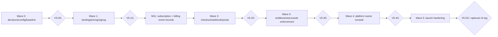

# PLAN — Version 5 execution plan

| | |
|---|---|
| Version | **V5 — public marketing site, self-serve billing and a separate platform-owner management console** |
| Status | **Wave 0 (partly) and Waves 1–5 (engineering) implemented and merged to `master` (`028fdee`, fast-forward, 2026-11-22) at the owner's request; no commercial terms, prices or legal content have been approved, and the release gate is not cut.** V4 is the released product baseline; billing stays disabled, the operator console stays off, and no live Stripe test has run. An annotated `v5` tag was cut and pushed on `bfe81f5` (2026-11-22) as an **engineering marker only** — it is not a release. |
| Baseline at Wave 0 start | `master` at `918c9b1`; immutable tag `v4` at `4f03487`; Alembic current/head `f33497bc1ecd` (single V4 M10 head). Working tree was clean before Wave 0 implementation. |
| Scope | 5 features (F1–F5), 6 waves (W0–W5), 6 gates, planned migrations M11–M12, Stripe Checkout + Billing Portal + signed webhooks, separate platform-owner console. |
| Derived from | `plans/PLAN_V4.md`, `plans/PLAN_V3.md` (§4 invariants and §8 immutable tags), `plans/SPEC.md`, `README.md`, current frontend routes, registration/auth, company settings and quota services. |
| Out of scope | New chatbot/AI capabilities; replacing the customer admin console; self-service creation of platform-owner accounts; marketplace; sales CRM; mobile app; custom card entry or storing card data; accounting/tax filing; usage-based metering beyond approved plan limits; custom enterprise contracts; compliance certification or legal advice. Stripe handles hosted payment entry; SiteGPT owns subscription and entitlement state. |

> **Launch dependency:** V5 integrates **Stripe** for recurring payments using Stripe Checkout in subscription mode, Stripe Billing Portal and signed Stripe webhooks. Wave 0 still requires approval for tier names, features, limits, prices/currency, billing cadence, trial/refund/cancellation policy, merchant country/account readiness and legal copy. Until these business and launch inputs are approved and Stripe test/live configuration is ready, paid checkout must remain disabled.

---

## 1. How to use this plan

- V5 focuses on the gap the request identifies: there is no public product landing/pricing funnel or subscription purchase workflow. It does **not** assume a marketing site, Stripe account/configuration, price list, plan catalog, or subscription state already exists; Stripe integration is part of this plan.
- The app already has `/api/register`, `/token`, `/login`, a company-admin role, and a React admin console. Extend those flows; do not create a parallel account or password system.
- Each task has an ID, size, dependencies, files/surfaces, and a completion condition. Check it only after evidence is recorded in a `Done:` line. Each gate is a separate commit and blocks the next wave.
- Marketing, tenant-console and platform-owner paths are intentionally separated in §3 and §5. Preserve existing API and widget URLs; platform ownership is not implied by tenant `admin`.
- No exact price, quota, feature entitlement, free-trial length, platform privilege, or legal promise is implied by examples in this plan. Empty decisions are blockers for production launch, not permission to guess.
- Follow `plans/PLAN_V3.md` §8: a release tag is immutable and is cut only on the exact commit verified by the release gate. Do not move/delete/force-push `v4` or any published tag.

## 2. Traceability — current gap and V5 target

| V5 feature | User need | Current verified state | Planned outcome | Migration | Wave | Exit criterion |
|---|---|---|---|---|---|---|
| F1 Public landing and pricing | Understand the product, plans and next step before creating an account | `frontend/src/App.tsx` mounts the authenticated console at `/`; there are `/register` and `/login` forms, but no public landing/pricing funnel or marketing shell | Responsive public home, pricing and FAQ/legal-link surfaces; clear CTA; accessible mobile/desktop behavior; public routes do not inherit admin navigation | — | 1 | Anonymous visitor can move from landing → pricing → selected plan → registration, while existing authenticated console routes remain reachable |
| F2 Signup-to-checkout | Register and purchase a chosen plan without manual operator intervention | `POST /api/register` creates a company, admin user and settings; login is JWT. No checkout, subscription or Stripe integration exists | Carry an allowlisted plan choice through signup; authenticated company admin creates a Stripe Checkout Session; a verified Stripe webhook, not the browser redirect, confirms paid status | M11 | 2 | Stripe test-mode checkout completes end-to-end and updates the correct company once; spoofed client redirects/amounts cannot grant a paid plan |
| F3 Plan entitlements and account billing | Know the current plan/usage and manage/cancel a subscription | Daily message limit is company setting/env based; per-session cap and other V4 features are available but not sold/gated as a commercial catalog. No subscription page | One server-side catalog and entitlement resolver; admin billing page for plan/status/usage, upgrade and Stripe Billing Portal; enforce only approved limits/features in the relevant services | M11 | 3 | Each approved entitlement is enforced at its existing service boundary; legacy/self-hosted mode remains unchanged when Stripe billing is disabled |
| F4 Production readiness | Operate paid accounts safely | No Stripe webhook, event idempotency store, operational billing guide or pricing/legal approval path | Stripe-signature-verified, replay-safe webhook processing; documented support/incident/refund/cancellation operations; launch checklist and gates | M11 | 5 | Full test-mode runbook passes on a throwaway DB; billing cannot be enabled accidentally or with missing configuration |
| F5 Platform-owner console | Let the project owner manage plans/prices, subscriptions and approved global settings | `admin` is company-scoped; no platform-owner role or cross-company operator console exists | Separate out-of-band-provisioned owner permission and isolated `/platform` console with audited catalog, billing operations and allowlisted non-secret settings | M12 | 4 | Tenant roles/API keys cannot access the surface; privileged changes are validated, audited and recoverable |

**Existing foundations to reuse:** company/user registration and JWT (`src/site_gpt/app/api/routes.py`, `schemas/user.py`, `core/auth.py`); frontend auth/API (`frontend/src/pages/Register.tsx`, `Login.tsx`, `context/AuthContext.tsx`, `utils/api.ts`); company settings and limits (`api/setting.py`, `services/quota.py`); router wiring (`src/site_gpt/app/main.py`). The actual current route `/` is protected and renders the dashboard. V5 must explicitly migrate that UI route rather than silently replacing it.

## 3. Pre-flight decisions (blocking)

Resolve, record the owner/date/evidence, and update this table before implementation of the affected task. These are business and architecture decisions, not facts inferred from the repository.

| ID | Question | Proposed engineering default (requires approval) | Must resolve before |
|---|---|---|---|
| D1 | Where do the public site and app live? | Same SPA/origin: `/` marketing, `/pricing`, `/register`, `/login`; console moves to `/app` (including `/app` dashboard and console navigation). An authenticated visitor hitting `/` is offered a clear “Go to app” link. Add a compatibility redirect from old authenticated `/` dashboard to `/app`; preserve deep links and `ProtectedRoute` return-to behavior. If deployment instead uses a marketing subdomain, document its origin/CORS/SEO separately before Wave 1. | V5-10 |
| D2 | What are the saleable plans and exact terms? | Product owner supplies approved tier names, display descriptions, feature matrix, limits (sites, messages, seats, source/integration/analytics features), price in integer minor units, currency, billing cadence, and whether any free tier exists. No placeholder price or “unlimited” claim in production. Public plan response is server-owned and is the only UI source of truth. | V5-01 and V5-10 |
| D3 | Payment processor and merchant readiness? | **Stripe is the V5 payment processor.** Use Stripe Checkout in `subscription` mode for hosted payment entry, Stripe Billing Portal for self-service billing, the official Stripe Python SDK on the backend, and Stripe-signed webhooks for lifecycle updates. Configure Stripe Price IDs on the server for every approved plan/cadence; never return them to the browser. Pin/review the SDK and Stripe API version. Confirm merchant-country eligibility, account ownership, test/live keys, webhook endpoint, supported currencies/payment methods and Stripe test-mode access. If the project's merchant account cannot use Stripe, paid billing is blocked pending an explicit revised plan; do not silently substitute another processor or build custom card entry. | V5-02 and V5-20 |
| D4 | Trial, free plan and registration semantics? | No Stripe trial by default. Registration may choose an approved free tier or create a company in `pending`/free state, then authenticate and start Stripe Checkout for a paid tier. Paid access begins only after a verified Stripe webhook confirms subscription/payment state; the Checkout success URL is informational only. If a trial is desired, approve duration, eligibility, card requirement and conversion/expiry behavior first, then configure it explicitly in Stripe Checkout and verify state server-side. | V5-10, V5-20 |
| D5 | Subscription lifecycle policy? | One current Stripe subscription per company; only the company admin can start Checkout, open Stripe Billing Portal or request plan/cancellation changes. Cancellation is at period end by default. Define Stripe invoice retry/grace period, past-due behavior, upgrade/downgrade/proration, refund policy and reactivation before implementation; configure Stripe Billing consistently and mirror confirmed state from webhooks. Until approved, payment failure never silently grants a higher entitlement. | V5-20, V5-30 |
| D6 | Existing company rollout and self-hosted deployments? | `BILLING_ENABLED=false` by default. Disabled means current registration, settings limits, chat and features behave as they do today; no Stripe secrets are required. For hosted billing-enabled deployments, explicitly choose grandfathering/migration for existing companies and never mass-disable accounts as a side effect of enabling billing. Self-hosters can leave billing disabled. | V5-02, V5-30 |
| D7 | Which enforcement policy is approved? | Map the approved plans to explicit entitlements and resolve conflicts with existing admin-set `daily_message_limit`, `session_message_limit`, feature flags, website status and env defaults. The plan tier is a ceiling, not a client-editable setting; retain internal safety caps. Do not enforce an unapproved limit or change chat refusal semantics. | V5-01, V5-30 |
| D8 | Legal and public content? | Product owner/legal supplies terms of service, privacy notice, cancellation/refund/tax wording, support contact, company identity and approved claims. Existing `docs/security.md` disclaimers remain accurate; engineering does not claim SOC 2/HIPAA/GDPR certification. | V5-10, V5-50 |
| D9 | Public branding and content? | Confirm product name/logo, target audience, approved screenshots/testimonials, copy, locale(s), SEO title/description/social preview, analytics/consent approach. No invented customer quotes, security guarantees or performance metrics. | V5-10 |
| D10 | Who is a platform owner and how is that identity granted? | Use a distinct platform-owner grant bound to an existing authenticated user and provisioned out of band (never infer it from `users.role='admin'`, company membership, public registration or an API key). No tenant admin/UI can grant or revoke this privilege. Require MFA/SSO or approved strong auth before production exposure; until available, restrict the console to a private operator-only route/network. | V5-40 |
| D11 | What can platform owners change? | Allowlisted plan catalog/Stripe price mappings, subscription support actions and explicitly approved non-secret runtime settings only. Every mutation is validated, confirmed for high-impact actions and written to append-only redacted audit history. Secrets, DB credentials, JWT keys, CORS and deployment topology remain in deployment secret/config management, not a browser form. | V5-41–43 |
| D12 | Which global settings are runtime-editable? | Define a typed allowlist with validation, safe defaults, auditability and rollback. Do not expose arbitrary `core/config.py` environment variables. Auth, networking, secrets, destructive retention/erasure and billing enforcement are not generic live settings; require a separate approved operational procedure. | V5-43 |

### Pre-flight checklist

- [ ] Confirm current `master`, immutable `v4` tag and branch delta; create `feat/v5` from the intended current `master` only after reviewing any post-tag commits.
- [ ] Inspect and preserve any unrelated user changes/untracked files; do not include them in V5 commits.
- [ ] Confirm `uv run alembic current` = `uv run alembic heads` = `f33497bc1ecd` (single head), PostgreSQL/pgvector version, database backup and a disposable test database.
- [ ] Run and record current Python test/module counts, `node --test tests/*.mjs`, frontend build/lint, import checks and `trail build`. Never copy historical counts from `AGENTS.md` or V4.
- [ ] Complete D1–D12 as applicable. A live Stripe test is blocked until test-mode credentials/account exist; unit tests and signed Stripe fixture tests are still mandatory.
- [ ] Verify hosted deployment topology, TLS, `FRONTEND_URL`, CORS and Stripe webhook reachability. Configure a Stripe test-mode endpoint and use Stripe CLI/test events where appropriate. Stripe secret keys, webhook signing secret and Price IDs stay backend-only, never in frontend env/build artifacts.

## 4. Invariants (every task)

1. **Auth and card data:** keep JWT and existing password hashing/auth helpers. Never log/store raw passwords, Stripe secret keys, card data or bearer tokens. Stripe Checkout hosts payment entry; SiteGPT never receives or stores PAN/CVC.
2. **Checkout authority:** browser-provided plan code is validated against the server catalog. Never trust client-supplied amount, currency, customer ID, success URL, entitlement, or a `success` query parameter as evidence of payment.
3. **Webhook integrity and idempotency:** verify the `Stripe-Signature` against the exact raw body with the Stripe SDK before parsing. Persist a unique Stripe event ID and apply subscription changes atomically; duplicate/replayed events are harmless. Validate Stripe object/customer/company linkage and tolerate delayed/out-of-order events without restoring stale status.
4. **Tenant scope:** every subscription, billing status, portal and usage read/write is scoped through the authenticated user's company. Foreign IDs are not disclosed. Only company admins may change billing.
5. **Billing-off compatibility:** default billing is off. With it off, no Stripe calls occur, no Stripe credentials are needed, and current self-hosted/legacy registration, quotas and feature behavior remain unchanged.
6. **Plan enforcement:** centralize catalog/entitlement lookup; enforce through existing quota/feature service boundaries, not UI-only checks or scattered plan-name comparisons. Preserve per-IP → session cap → daily quota ordering, refusal response behavior, and existing Redis fail-open semantics. The plan must not override a stricter safety cap.
7. **No sudden lockout:** a billing flag rollout does not retroactively remove service from existing companies without an explicit migration/communication plan. Unknown or temporarily unavailable billing state fails according to the approved policy and is observable; it must not be mistaken for a successful payment.
8. **Pricing/content correctness:** the server catalog is authoritative. Public prices and configured Stripe Price IDs must match; live Stripe Checkout refuses incomplete/mismatched Stripe configuration. Stripe Price IDs and secret keys are private server configuration, never public catalog fields. No made-up prices, tier promises, trials, legal claims, reviews or logos.
9. **Route compatibility:** preserve all existing `/api/...`, `/api/v1/...`, `/chat/{website_id}`, widget URLs and localStorage behavior. Moving the frontend dashboard from `/` to `/app` includes a tested compatibility path for signed-in users and deep links.
10. **Privacy/minimal retention:** store Stripe identifiers and only the billing/event fields needed for account state, support and reconciliation. Do not persist full webhook payloads by default; document retention/deletion implications for subscription records and event IDs. Do not add payment details to privacy export unless explicitly required and designed.
11. **Migrations:** M11 and M12 chain linearly from `f33497bc1ecd`, keep one head and follow migration guidance in `AGENTS.md`. Review autogenerate drift; never edit an applied revision. Indexes on busy tables use `CONCURRENTLY` where applicable.
12. **Frontend:** React/Vite/TypeScript/Ant Design/axios; no new UI framework. Public routes use a distinct responsive marketing shell and must remain readable without auth. Preserve admin shell behavior under `/app`.
13. **Config/docs:** every new env var is added to `core/config.py`, `.env.example`, and the README env table in the same wave. Secrets are backend-only. Update `README.md`, `AGENTS.md`, relevant security/API docs and this plan at gates.
14. **Platform-owner access:** company admin/manager, API key and ordinary JWT never imply platform-owner permission. Owner access is separately provisioned, checked server-side on every platform endpoint, protected by strong authentication, and privileged mutations are audited. Never implement tenant impersonation as an authorization shortcut.
15. **Platform settings and audit:** expose only a typed allowlist of non-secret settings. Secret values are not readable/writable there; deployment config remains authoritative for secrets. Audit records are append-only at the application/DB-role boundary, redacted, actor/target/action/time stamped and cannot be edited through the UI. Any retention/deletion exception is explicit and tested.
16. **Release:** gate commit contains release docs and `trail build`; release tag is created once on the verified commit and never moved. Do not tag or deploy paid billing before D2–D12 and operational readiness are approved.

## 5. Waves and tasks

### Wave 0 — Product, billing and migration foundation

**Goal:** resolve business constraints, freeze the catalog contract, add safe disabled-by-default configuration, and record the baseline. **Entry:** §3 pre-flight. No production billing or new schema in this wave. Baseline observed at Wave 0 start: 56 Python test modules / 919 tests, 46 node checks, frontend build/lint clean, API+worker import clean, Alembic current=head `f33497bc1ecd`, `master` at `918c9b1` with immutable `v4` tag at `4f03487`.

- [ ] **V5-01 · Approve catalog and entitlement matrix** — `M`, depends: D2/D4/D5/D7/D8. Files: this plan, `plans/SPEC.md` or a focused pricing reference if product approves. Record approved tier codes, exact limits/features, price/currency/cadence, free/trial choice, upgrade/downgrade/cancel/refund/grace policies and existing-customer treatment. Keep sensitive commercial details out of env files. **Done when:** product/legal owner approval is recorded and every displayed plan has an enforceable definition or is explicitly marked “contact sales” and excluded from self-serve checkout.
- [x] **V5-02 · Stripe SDK and billing configuration** — `M`, depends: D3/D6. Files: `src/site_gpt/app/core/config.py`, `.env.example`, `README.md`, `pyproject.toml`, `uv.lock`, tests. Added bounded official Stripe Python SDK dependency (`>=17.1.0,<18.0.0`) and explicit API-version setting; added `BILLING_ENABLED=false` plus backend-only `STRIPE_SECRET_KEY` and `STRIPE_WEBHOOK_SECRET`. No plan/Price IDs are placed in frontend config. When billing is explicitly enabled, startup validates required Stripe secrets; after catalog management lands, V5-42 must also reject a published plan whose Stripe mapping is absent. Billing-off import/startup requires no Stripe credentials and performs no provider calls. **Done:** `tests/test_billing_config.py` covers off/default, missing settings, valid config and no frontend-secret keys. `stripe==17.1.0`; SDK-reported API version `2026-11-18.endive`. Product catalog/Price ID configuration remains for V5-42 after D2 approval.
- [ ] **V5-03 · Baseline and schema design review** — `S`, depends: V5-01/02. Record actual suite/build counts, route behavior, current limits, existing-company fixtures, and M11 data/lifecycle/retention design before code. **Done when:** baseline evidence and M11 schema/event idempotency contract are in this plan or a reviewed task note; branch is free of unrelated changes. **Baseline recorded:** see Wave 0 goal; no migration or schema change made.

#### Gate V5-0G — Foundation

- [ ] D1–D12 decisions needed for following waves are resolved or explicitly excluded from V5; Stripe account/test endpoint and platform-owner provisioning/strong-auth readiness are documented. **BLOCKED:** product/legal decisions D1/D2/D4/D5/D7–D12 and Stripe merchant/test-account readiness have not been approved/provided; do not invent defaults as approved terms.
- [x] Billing defaults off; backend imports/startup/tests work without Stripe credentials. Stripe dependency/config validation added and tested; no Price IDs or secrets exposed to frontend.
- [ ] Catalog/entitlement matrix and legal/content owners are approved; no public price is guessed. **BLOCKED:** requires product/legal owner input.
- [x] Actual baseline recorded: 56 modules / 919 Python tests, 46 node checks, clean frontend build/lint and imports; single migration head `f33497bc1ecd`. `trail build` completed successfully at Wave 0.
- [ ] Commit `chore(v5): V5-0G gate — foundation` (not committed in this task).

**Wave 0 implementation evidence (2026-11-21):** `stripe==17.1.0`; SDK API version `2026-11-18.endive` is explicitly configured and asserted by test. Added `BILLING_ENABLED=false`, backend-only Stripe secret/webhook settings, and FastAPI startup validation which is a no-op when disabled and fails with setting names (not values) when enabled but incomplete. Updated `.env.example` and README. Focused config suite passes **8/8**; post-change full suite passes **927 tests across 57 modules**, Node **46/46**, frontend build/lint, API/worker imports, Alembic current=head `f33497bc1ecd`, and `trail build`. No business/legal approvals or Stripe merchant/test account credentials were supplied; V5-01 and full V5-0G remain blocked, and production billing stays disabled.

### Wave 1 — Public landing page, pricing and signup funnel (F1)

**Goal:** make the product understandable and let an anonymous visitor reach registration with a selected, validated plan. No payment is claimed in this wave.

**Wave 1 implementation evidence (2026-11-22):** all four tasks are implemented to the limit of the unapproved decisions. `/` is a public landing page, `/pricing` reads `GET /api/plans` (server-owned catalog, deliberately empty until V5-01), `/register` carries a validated `?plan=` choice for display only, and the console moved to `/app` with compatibility redirects from every old console path. Backend: `services/plan_catalog.py`, `schemas/plan.py`, `api/plan.py`, `tests/test_plans_catalog.py`. Frontend: `components/PublicLayout.tsx` + `.less`, `pages/Landing.tsx`, `pages/Pricing.tsx`, `pages/Register.tsx`, `utils/useDocumentTitle.ts`, new SEO tags in `index.html`, `App.tsx` route table, `LayoutComponent` outlet. **Verification:** `npm run build` and `npm run lint` clean, `uv run python -c "import site_gpt.app.main"` passes, `uv run python -m unittest discover -s tests` = **58 modules / 934 tests OK**, `node --test tests/*.mjs` = **46/46**, Alembic head unchanged at `f33497bc1ecd`. **Browser run (uvicorn :8000 + vite :5173, Chromium):** `/` renders the marketing shell with no console navigation and `Go to app` for a signed-in visitor; `/pricing` calls `GET /api/plans` (200) and renders the "plans are being finalised" state for the empty catalog; `/register?plan=x` shows the unknown-plan notice and keeps the form; an anonymous `/app/websites` and `/app/analytics` each redirect to `/login` and sign-in returns to the exact original path; `/websites` → `/app/websites` and `/settings?tab=widget` → `/app/settings?tab=widget` with the query intact; registration signs the new admin in and lands on `/app`; logout from the console returns to `/login`; the landing page has no horizontal overflow at 390 px. Two defects found and fixed in that run: the marketing `<title>` leaked onto console and login pages (now `LayoutComponent` sets `Site GPT` and `Login` sets `Sign in — Site GPT`). A follow-up browser pass fixed two routing gaps this wave opened: the Analytics "Transcript" link pointed at `/chat?website=…&focus=…` (no such route — it fell through the catch-all to the landing page) and now opens `/app/playground?website=<id>&focus=<session_id>`, the deep link `components/Chat.tsx` already honours (verified end to end against a seeded conversation: the Playground opened that session's messages); and the catch-all no longer swallows a signed-in visitor's mistyped URL — `NotFoundRedirect` sends them to `/app<path>`, where a new console-scoped `*` route renders a 404 inside the admin shell (`/setting` → `/app/setting`, `/app/websits` stays put; both verified in the browser), while an anonymous visitor still lands on `/`. `Settings.tsx` was then made deep-linkable: its `activeKey` now comes from `?tab=` over `SETTINGS_TABS` (`profile`, `model`, `privacy`, `api-keys`, `widget`, `appearance`; anything else falls back to Profile) and `onChange` writes the parameter back with `replace`, dropping it for the default tab — so `/settings?tab=widget` opens the Widget tab (verified in the browser: `?tab=widget` selects Widget/"Chat Widget Integration", `?tab=api-keys` and `?tab=appearance` select theirs, `?tab=bogus` falls back to Profile, clicking Privacy writes `?tab=privacy` and clicking Profile removes it). One pre-existing behaviour is **not** a regression and was left alone: the copy-snippet helper sends `HEAD /widget.js`, which the GET-only route answers 405 by design (the code retries two times and falls back). **Blocked:** the approved catalog and legal/marketing content (V5-01, D2/D8/D9), a frontend route-test runner (none exists in this repo), and the gate's desktop/mobile/accessibility checklist — so V5-1G stays open and no task is ticked.

- [ ] **V5-10 · Public route architecture and marketing shell** — `L`, depends: V5-0G / D1 / D9. Files: `frontend/src/App.tsx`, new public layout/page components and styles, `frontend/src/components/Layout.tsx`, tests. Implement `/` landing, `/pricing`, `/register`, `/login` outside the authenticated console shell; move dashboard to `/app`; use a safe compatibility redirect for authenticated legacy `/` and preserve console deep links. Add FAQ/feature sections, accessible nav/footer, responsive layout and approved legal links. **Done when:** anonymous routes render without auth/API credentials; logged-in navigation can reach `/app`; existing API/widget URLs are untouched; route tests cover old `/` and protected deep links. **Landed (implemented on D1's proposed engineering default; D1/D9 approval still outstanding):** `PublicLayout.tsx` + `PublicLayout.less` (skip link, `aria-current` nav, footer, focus-visible outlines, responsive breakpoints), `Landing.tsx`, `Pricing.tsx`, `Register.tsx`, console under `/app` with `LayoutComponent` rendering `<Outlet />`, `CONSOLE_PATHS` → `LegacyConsoleRedirect` for `/websites`, `/websites/:id`, `/playground`, `/contacts`, `/users`, `/documents`, `/integrations`, `/analytics`, `/handoffs`, `/inbox`, `/training`, `/settings` (query/hash preserved), catch-all to `/`, `Login.tsx` fallback `/app`, and every in-console link updated to `/app/...`. `npm run build` and `npm run lint` pass, and the route table was exercised in a real browser (anonymous `/app/...` → `/login` → return to the original path, old paths redirecting with their query intact, `Go to app` from the landing page). **Not met:** no frontend route-test *runner* exists (no npm `test` script by design), so this behaviour is browser-verified but not regression-tested in CI — adding a runner is a decision for the gate; legal links await D8/D9.
- [ ] **V5-11 · Pricing page and server-owned plan listing** — `M`, depends: V5-01, V5-10. **Landed (catalog blocked on V5-01):** `services/plan_catalog.py` (dataclass `Plan`, `PLANS` deliberately empty, `published_plans()` filtering unpublished *and* invalid entries, `find_plan` case-insensitive over published plans only, `public_payload` whose key set is asserted by test), `schemas/plan.py`, `api/plan.py` (`GET /api/plans`, unauthenticated, read-only, no database), wired in `main.py`, `tests/test_plans_catalog.py` (7 cases: empty default, anonymous read, published listing, unpublished hidden, invalid filtered, no Stripe configuration in the payload, `find_plan` negatives), frontend types + `getPlans()` + `Pricing.tsx` (server-derived price formatting from minor units, loading/error/empty states). **Remaining:** the approved tiers/prices/limits themselves (V5-01), and V5-42's move to durable published records — the public response contract does not change. Files: `src/site_gpt/app/api/` and matching schemas/service, `main.py`, frontend pricing page/API types/tests, docs. Read the approved server-side catalog source and expose public fields (code, name, approved display price/interval, included features/limits, CTA eligibility), never Stripe secrets or Product/Price IDs. V5-42 later moves this source to durable published plan records without changing the public response contract. Render the approved comparison with clear limit definitions and no unsupported claims. **Done when:** endpoint is unauthenticated/read-only, stable, validated, test-covered; UI derives all displayed values from it and shows a safe unavailable/error state when catalog is misconfigured.
- [ ] **V5-12 · Plan-aware registration handoff** — `M`, depends: V5-10/11. **Landed:** `Register.tsx` reads `?plan=`, matches it against `GET /api/plans` (case-insensitive) purely for display, shows a neutral notice for an unknown/stale code or a failed catalog read, never posts the code to `POST /api/register`, keeps the existing fields and validation, and after a successful registration signs the new admin in through the existing `/api/token` + `AuthContext.login` path and routes to `/app` (falling back to `/login` if that sign-in fails). No redirect target, price or entitlement is read from the query string. **Remaining:** the paid branch (authenticated checkout start) is Wave 2 (V5-21), and an integration test for the signup → console handoff needs a browser or a route-test runner. Files: `Register.tsx`, route/API helpers and registration tests. Carry plan code through `/register?plan=…`, validate it against public catalog, keep existing registration fields/validation and avoid accepting a redirect target or price from query parameters. After registration, authenticate/route to `/app` (free plan) or to an explicit authenticated checkout start for a paid plan. **Done when:** unknown/stale plan code never upgrades an account, company/user registration remains tenant-safe and duplicate/rate-limit behavior is unchanged.
- [ ] **V5-13 · Marketing content, SEO and accessibility** — `S`, depends: V5-10, approved content D8/D9. **Landed (approval-less part):** `index.html` title/description/`theme-color`/Open-Graph/Twitter tags (text only — no approved preview image, logo or canonical domain exists), per-page `useDocumentTitle` on the public pages, semantic `header`/`nav`/`main`/`footer`/`section` landmarks with `aria-labelledby`, one `h1` per page, `<details>` FAQ with keyboard-operable summaries, visible `:focus-visible` outlines, skip-to-content link, and desktop/tablet/mobile breakpoints. **Browser-checked:** landing/pricing/register/login titles, single-column layout and no horizontal overflow at 390 px, and the skip link/tab order on the public pages. **Blocked:** approved product copy, imagery, testimonials/logos (none invented), legal pages and links (D8/D9), and the gate's full desktop/mobile/accessibility checklist. Files: public page components, metadata/index HTML, styles, README if relevant. Add title/description/social preview, semantic headings, keyboard/focus behavior, contrast, mobile layout and approved product imagery. No public testimonials, customer logos, guarantees, or legal language without supplied approval. **Done when:** production build succeeds and the gate's desktop/mobile/accessibility checklist passes.

#### Gate V5-1G — Public funnel

- [ ] Landing/pricing/register/login are public and separated from the console shell; `/app` works after login.
- [ ] Pricing data comes only from the backend catalog; invalid plan query cannot create paid entitlement.
- [ ] Responsive, accessibility, SEO metadata, frontend build/lint and route tests pass.
- [ ] Existing login/register rate limiting, CORS and API/widget paths remain covered.
- [ ] `trail build`, README/AGENTS updates and commit `chore(v5): V5-1G gate — public site`.

### Wave 2 — Subscription checkout, webhook and schema (F2)

**Goal:** support paid signup via Stripe-hosted Checkout, with verified Stripe webhooks as the subscription source of truth. **M11** is introduced here after catalog and Stripe configuration decisions.

**Wave 2 implementation evidence (2026-11-22):** all five tasks are implemented to the limit of the unapproved decisions. **Backend:** `models.Subscription` (one row per company, unique Stripe customer/subscription ids, lifecycle status/cadence/period/cancel-at-period-end, `last_event_at` ordering guard) and `models.BillingEvent` (unique Stripe event id, type, Stripe creation time, processed time — no payload); Alembic **M11 `a7c41d9e6b52`** chains from `f33497bc1ecd`; `services/billing.py` parses the private `STRIPE_PRICE_IDS` mapping, resolves the plan from the published catalog, creates/reuses the Stripe Customer with server-side metadata and a deterministic idempotency key, and opens Checkout in `subscription` mode with `FRONTEND_URL` return URLs; `api/billing.py` exposes status/summary/checkout/portal/webhook, admin-only mutations, company-scoped by the JWT; the webhook verifies `Stripe-Signature` over the raw body before parsing, receipts each event id first (duplicate → 200, no apply), skips events older than `last_event_at`, refuses customer/company mismatches, treats a canceled subscription as final for invoice events, and rolls the receipt back on failure so Stripe retries. `STRIPE_PRICE_IDS` added to `core/config.py`, `.env.example` and the README env table; frontend billing types and API helpers added (no billing page — that is V5-32). **Verification:** `tests/test_billing.py` (34 cases: server-pinned Checkout request, unknown/contact-sales/unmapped plan fail closed, customer reuse, tenant scope, admin-only, signature failure changes no rows, duplicate applied once, stale event ignored, unknown customer ignored, metadata mismatch ignored, canceled not revived by `invoice.paid`, past-due, failed apply rolls its receipt back and the same event then applies exactly once, no payload columns, price-mapping parser) plus 18 M11 schema/migration cases in `tests/test_models_indexes.py`; full suite **59 modules / 986 tests OK**, `node --test` **46/46**, `npm run build` + `npm run lint` clean, `import site_gpt.app.main`/`worker` pass, `alembic upgrade head` applied M11 on the dev Postgres (current = head `a7c41d9e6b52`), `trail build` clean. **M11 throwaway-Postgres replay (2026-11-22, database `v5_gate_2g`, dropped afterwards):** upgraded `f33497bc1ecd` → `a7c41d9e6b52` (both tables created, V4 tables intact), inserted one company + one subscription row, downgraded back to `f33497bc1ecd` (both tables dropped, `conversation_insights` and the rest of the V4 schema intact), and re-upgraded to head (company kept, billing state reset) — all assertions passed. A second throwaway database (`v5_gate_2g_empty`) was also replayed from empty: `alembic upgrade head` built the full schema and landed on `a7c41d9e6b52`. Both databases were dropped afterwards. **Blocked and unexecuted:** live Stripe test-mode Checkout/webhook, because no Stripe merchant test account (D3) or approved catalog (V5-01/D2) exists.

- [x] **V5-20 · M11 Stripe subscription and event schema** — `M`, depends: V5-0G / D3–D6. Files: `src/site_gpt/app/models.py`, Alembic revision generated from current head, schema/index tests. Store company-scoped subscription state and Stripe Customer/Subscription identifiers, approved plan code and cadence, lifecycle timestamps/status/cancel-at-period-end, plus a minimal idempotency receipt for Stripe event IDs/types/creation/processing. Establish uniqueness/check/index/FK cascade policy. Do not store card data or full raw webhook JSON. Support one current subscription per company without accidental duplicate paid subscriptions. **Done when:** single linear M11 upgrades/downgrades on PostgreSQL, schema/index/revision-chain tests pass, and rollback/data-retention implications are documented before deployment. **Done:** `a7c41d9e6b52` is the sole head, chained from `f33497bc1ecd`; it created both tables and upgraded the dev PostgreSQL database. 18 cases in `tests/test_models_indexes.py` pin one subscription per company, unique provider ids, CASCADE, status/interval checks, the renewal index, timezone-aware timestamps, the receipt's exact column set and the downgrade. The throwaway-Postgres replay is verified: upgrade from `f33497bc1ecd` creates both tables, a seeded subscription row downgrades away with them while the V4 schema survives, and a re-upgrade returns to head with billing state reset. The downgrade discards billing state, so it stays documented as disposable-only. An empty-database (`base` → head) replay also passed (full schema, head `a7c41d9e6b52`).
- [x] **V5-21 · Stripe Customer and Checkout Session** — `L`, depends: V5-20 / D3/D5. Files: `services/billing.py` and a focused Stripe client wrapper, billing API/schema, router registration, config/tests. Authenticated company admin selects a plan code; backend resolves the approved Stripe Price ID, creates/reuses the Stripe Customer safely, associates it with the company through trusted server-side metadata and creates a Stripe Checkout Session with `mode='subscription'`. Construct success/cancel return URLs from configured `FRONTEND_URL`; use Stripe idempotency keys for retryable session creation. Never accept arbitrary URLs, Price IDs, quantities or amounts from the client. **Done when:** mocked tests pin the Stripe request and tenant/customer linkage; bad/unknown/unconfigured plans fail closed; card entry stays on Stripe's hosted domain and browser return alone grants no subscription. **Done:** `services/billing.py::start_checkout`; `tests/test_billing.py` pins the exact `stripe.checkout.Session.create` kwargs (subscription mode, resolved Price ID, company customer, `FRONTEND_URL` URLs, metadata, idempotency key), asserts a posted amount/Price ID/URL never reaches the call, and covers unknown (400), contact-sales and unmapped (409) plans with no provider call, customer reuse, and a company-scoped row left `incomplete`.
- [x] **V5-22 · Stripe-signed webhook lifecycle processing** — `L`, depends: V5-20/21. Files: Stripe webhook route/service/tests/docs. Read the raw request body and verify `Stripe-Signature` with the configured endpoint signing secret using the Stripe SDK before applying changes. Handle the required Stripe events (`checkout.session.completed`, relevant asynchronous checkout payment events if enabled, `customer.subscription.created/updated/deleted`, `invoice.paid` and `invoice.payment_failed`); finalize the event set against the approved billing lifecycle and pinned Stripe API version. Validate Stripe Customer/Subscription IDs against trusted stored mappings and company metadata, atomically record unique Stripe event IDs and apply allowed state transitions. Handle Stripe retries/duplicates, stale or out-of-order events, unknown customer/object, invalid signatures and DB failures; return non-2xx on transient processing failure so Stripe retries, and acknowledge already-processed duplicates. Do not trust Checkout return URL as fulfillment. **Done when:** tests prove signature failure changes no rows, duplicate event changes state once, out-of-order events cannot restore stale access, and failed DB processing can be retried. **Done:** `services/billing.py::process_webhook` verifies the signature before parsing, receipts the unique event id before applying (a duplicate answers 200 with `duplicate: true` and changes nothing), applies only `checkout.session.completed`, `customer.subscription.created/updated/deleted`, `invoice.paid` and `invoice.payment_failed`, ignores unknown customers and customer/company metadata mismatches, refuses to revive a canceled subscription from an invoice event, and rolls the receipt back on failure so Stripe's retry processes it. Tests cover all of that plus invalid/missing signatures and the absence of any payload column. The retry path is pinned end to end: with `_apply` forced to raise after the receipt is flushed, the delivery answers 500 with no `billing_events` row and no state change, redelivering the same event id applies it once (non-duplicate, one receipt), and a third delivery is the duplicate no-op. A real Stripe-signed delivery is **blocked** on D3 test credentials.
- [x] **V5-23 · Stripe Billing Portal and billing API** — `M`, depends: V5-21/22. Files: billing router/schema/service, frontend API/types. Expose company-admin-scoped subscription summary, Stripe Checkout start, Stripe Billing Portal session creation and the Stripe webhook endpoint. Create portal sessions only for the authenticated company's stored Stripe Customer; portal return URL is fixed from configured `FRONTEND_URL`; foreign-company Stripe IDs are never addressable. **Done when:** non-admin and foreign-tenant requests are refused; no Stripe secret, raw Stripe object or payment method details are returned. **Done:** `api/billing.py` (`GET /api/billing/status`, `GET /api/billing/subscription`, `POST /api/billing/checkout`, `POST /api/billing/portal`, `POST /api/billing/webhook`), schemas in `schemas/billing.py`, frontend `BillingStatus`/`BillingSummary`/`BillingUrl` types and `getBillingStatus`/`getBillingSummary`/`startBillingCheckout`/`openBillingPortal`. Tests prove a member gets 403, each company sees and portals only its own customer (404 without one), the portal return URL is fixed from `FRONTEND_URL`, the summary carries no Stripe id, and billing off makes the surface (except status) a 404 with no provider call.
- [x] **V5-24 · Migration/API lifecycle tests** — `M`, depends: V5-20–23. Extend `tests/test_models_indexes.py` and focused Stripe billing tests; test M11 from empty DB and from V4 head, downgrade in throwaway DB, event-ID race/idempotency transaction semantics, Stripe signature verification and no raw event payload retention. **Done when:** M11 invariants and Stripe subscription lifecycle state table are pinned without a live Stripe account. **Done:** `tests/test_models_indexes.py` (M11 model/migration/index/head cases) and `tests/test_billing.py` (Checkout, portal, summary scoping, signature, duplicate, stale, unknown/mismatched customer, canceled/failed, forced-apply-failure rollback + retry, no payload retention, billing off) — 52 new cases total, all passing with no live account. The disposable-Postgres upgrade-from-V4/downgrade replay passed (see the Wave 2 evidence: `f33497bc1ecd` → M11 → `f33497bc1ecd` → M11 on `v5_gate_2g`).

#### Gate V5-2G — Test-mode checkout

- [x] M11 is the sole Alembic head; empty replay, upgrade from V4 and safe downgrade pass on disposable PostgreSQL. **Done:** `a7c41d9e6b52` is the sole head; on the throwaway `v5_gate_2g`, `upgrade f33497bc1ecd` → head created both tables, a seeded row + `downgrade f33497bc1ecd` dropped them and left the V4 schema intact, and a re-upgrade returned to head with the company kept and billing state reset; a second throwaway database replayed from empty to the same head. Both gate databases were dropped.
- [x] Stripe Checkout never grants access from browser return; a valid Stripe-signed webhook grants the correct subscription exactly once. `tests/test_billing.py` pins both (`?checkout=success` leaves `incomplete`; `checkout.session.completed` activates once, a replay is a duplicate no-op).
- [x] Stripe signature, duplicate, retry, stale event, invalid customer/company, canceled/failed and tenant-scope negatives pass (mocked SDK/signature fixtures; retry semantics are the rolled-back receipt + 500 path).
- [ ] Stripe test-mode Checkout/webhook is exercised with Stripe test keys or Stripe CLI fixtures if available; otherwise marked **blocked and unexecuted** with the missing Stripe prerequisite, while mocked SDK/signature fixture tests still pass. **BLOCKED:** no Stripe merchant test account/keys (D3) and no approved catalog (V5-01/D2); the mocked SDK/signature/idempotency fixtures pass.
- [ ] Billing-off behavior and startup remain unchanged; imports, suites, build/lint, `trail build` pass; docs and commit `chore(v5): V5-2G gate — subscription checkout`. **Checks pass** (986 tests / 59 modules, 46 node, build/lint, imports, `trail build`); README/.env/AGENTS/plan updated. The gate commit has not been created (the gate stays open on the Stripe/D2 blockers).

### Wave 3 — Entitlements, usage and in-app billing (F3)

**Goal:** connect paid status to approved product access without changing self-hosted defaults or scattering plan logic.

**Wave 3 implementation evidence (2026-11-22):** all four tasks are implemented to the limit of the unapproved decisions. The resolver (`services/entitlements.py`) grants limits only for `active`/`trialing` plus a currently published catalog plan; every other status, and an unpublished/unknown plan code, grants none — which is the V4 baseline, not a guessed free tier and not a lockout. With `BILLING_ENABLED=false` it returns an empty snapshot **without a database read**. `effective` is the stricter of the company setting and the plan ceiling; the four enforced keys are `websites`, `seats`, `daily_messages` and `session_messages`; a limit of `0` is treated as "not stated". Enforcement lives at the canonical boundaries: 403 at the website/seat ceilings (`POST /api/websites`, `POST /api/companies/users`) and the plan ceiling wrapped around both caps in all three chat handlers, with V4 ordering and refusal semantics unchanged. Each chat handler resolves **one** snapshot per request and derives both caps from it (one subscription read per message, pinned by the handler source test), and the seat ceiling counts only `active` users through `entitlements.seat_count` — the same count `GET /api/billing/usage` reports — so deactivating a user frees a seat without deleting anything. `GET /api/billing/usage` and `/app/billing` (nav gated by `GET /api/billing/status`) render plan, mirrored status, renewal/cancel-at-period-end, usage against the ceilings, a Billing Portal button and a plan selector; mutations stay admin-only and the page never treats the Checkout return URL as payment. `docs/billing.md` is the operator runbook; webhook outcomes and failures are logged by event type/id only. **Verification:** `tests/test_entitlements.py` (26 cases: resolution table, `effective`, usage, both 403 boundaries, chat-handler pins and three behavioural cases that drive the sync, stream and `/api/v1` handlers with the subscription read counted — one read per message, both caps carrying the plan's values) and two new usage cases in `tests/test_billing.py` (plus the usage route in its existing billing-off check); full suite **60 modules / 1014 Python tests OK**, `node --test` **46/46**, `npm run build`/`npm run lint` clean, API import clean, Alembic head unchanged at `a7c41d9e6b52`. **Blocked:** D2/D4/D5/D7 (no approved plan, so no limit is enforced), D3 (no Stripe test account, so no live Checkout/Portal/webhook), D8 (legal/support copy). The Billing page was not exercised in a browser this wave: no plan is published and billing is off, so it renders only its "billing is not enabled" state.

- [x] **V5-30 · Entitlement resolver and compatibility policy** — `L`, depends: V5-01/20/22 / D5–D7. Files: `services/entitlements.py` (or a reviewed existing-service extension), config/catalog, tests. Resolve subscription status + plan code to a typed entitlement snapshot; define free/past-due/canceled/grace/unknown behavior and existing-company grandfather policy. Centralize allowed site/message/seat/feature values. Billing disabled bypasses paid-plan enforcement exactly as before. **Done when:** exhaustive state/plan table tests prove the approved policy; missing/stale Stripe subscription data cannot become a higher plan. **Done:** `services/entitlements.py` with the documented policy table; `tests/test_entitlements.py` covers billing off (asserting no subscription read), no row, every Stripe status, trialing, an unpublished plan, an unknown plan code, unknown/zero limits, and the `effective` matrix. The approved policy itself (grace/past-due behaviour, grandfathering) remains open on D5/D6/D7 and is recorded as such rather than invented.
- [x] **V5-31 · Enforce plan ceilings at existing boundaries** — `L`, depends: V5-30. Files: services/quota and relevant company/website/user/API endpoints, tests. Enforce only approved caps/features at server-side creation/use points (e.g. website/seat limits and chat daily/session ceilings); preserve existing limit parsing, settings and internal ceilings, and the current chat guard ordering/refusal semantics. A plan limit cannot be raised by `PUT /api/settings` or bypassed through `/api/v1`. **Done when:** every entitlement has at least one direct allow/deny service/API test, including both auth paths where applicable, and existing-company behavior is regression-tested. **Done:** `websites` and `seats` are refused with 403 at the ceiling and allowed below it (API tests in `tests/test_entitlements.py`); `daily_messages`/`session_messages` are wrapped in `/api/chat`, `/api/chat/stream` and `/api/v1/chat`, pinned by both a source test and the existing ordering suites; the existing quota/settings/session-cap suites still pass, and a past-due/absent plan and billing-off both keep V4 creation and chat behaviour.
- [x] **V5-32 · Console billing and usage page** — `M`, depends: V5-23/30/31. Files: new frontend billing page, `App.tsx`, console navigation, `utils/api.ts`, API types, possibly `Settings.tsx`. Show plan, lifecycle status, renewal/cancel-at-period-end, Stripe Billing Portal link, and accurate current usage versus approved limits; provide upgrade/select/cancel entry points according to policy. Admin-only mutation controls; ordinary members see only whatever summary D5 approves. **Done when:** loading/error/past-due/canceled/disabled states are clear, no UI implies paid status before Stripe webhook confirmation, and account is scoped to the signed-in company. **Done:** `frontend/src/pages/Billing.tsx` + `/app/billing` route + nav gated on `GET /api/billing/status`; `GET /api/billing/usage` (company-scoped, read-only, no Stripe id) and `getBillingUsage`/types. States: loading, error with retry, billing-off, no subscription, every lifecycle tag, `?checkout=success` as "confirming" only, `?checkout=cancelled`; a member sees the summary and is told an admin manages billing. `npm run build` and `npm run lint` pass; the page was not opened in a browser (billing is off and no plan is published).
- [x] **V5-33 · Stripe lifecycle operations, notices and reconciliation** — `M`, depends: V5-22/30. Files: worker only if an approved scheduled reconciliation is required, mail/templates only if notice content is approved, docs/tests. Define operator procedure for delayed/failed Stripe webhooks, Stripe Dashboard reconciliation, invoice failures and cancellation; implement only minimal alert/reconciliation needed to detect drift. No worker should silently rewrite status without verifying canonical Stripe state. **Done when:** runbook gives actionable recovery steps and tests/metrics cover Stripe API/webhook failure visibility. **Done:** `docs/billing.md` (stored fields, entitlement policy, failed-delivery/wrong-state/invoice-failure/cancellation procedures, rollback table, blocked prerequisites); `services/billing.py` logs each delivery's outcome (`processed`/`duplicate`/`ignored`/`stale`) and each failed apply by event type and id, never the payload. No scheduled reconciliation worker and no customer notices: both need approved policy (D5) and a canonical-state check that only Wave 4's owner console can offer; nothing rewrites status without a verified Stripe event.

#### Gate V5-3G — Entitlement enforcement

- [ ] Each approved paid entitlement is enforced server-side at its canonical boundary; client-only gating is not counted. **Mechanism verified** for `websites`, `seats`, `daily_messages` and `session_messages`; **no entitlement is approved yet** (empty catalog, D2/D7), so the gate stays open on the approved values.
- [x] Billing-off mode reproduces V4 behavior; legacy companies follow approved rollout policy; Redis-down and current quota ordering semantics remain intact. **Verified:** billing-off resolver reads no row; existing quota/settings/session-cap/ordering suites pass; a past-due or absent subscription enforces nothing.
- [x] Billing page status/usage is tenant-scoped and Stripe-authoritative; admin mutations are protected. **Verified by API tests and source review; not browser-exercised** (billing off, no published plan).
- [x] Existing quota/settings, widget/chat, API-key `/api/v1` and company registration tests pass; no daily/session cap is silently raised or bypassed. **Verified:** full suite 60 modules / 1008 tests, `node --test` 46/46, build/lint clean.
- [ ] Docs, fresh test counts, build/lint and `trail build` recorded; commit `chore(v5): V5-3G gate — plan entitlements`. Docs and counts recorded; `trail build` run; **the gate commit is not created** while the Wave 1/2 gates and D2/D3 remain open.

### Wave 4 — Platform-owner operations console (F5)

**Goal:** provide the project owner a separate control plane for plan/pricing management, subscription operations and safe global settings. This is not the tenant company-admin console. Entry: V5-3G signed off and D10–D12 resolved.

**Wave 4 implementation evidence (started 2026-11-22, V5-40):** the entry condition is **not** met — gate V5-3G is still open and D10–D12 are unapproved — so this wave is being implemented on the engineering defaults D10/D11/D12 already spell out, exactly as Waves 1–3 were, and nothing is ticked. **V5-40 (landed, unticked):** `models.PlatformOwner` (one *active* grant per user via the partial unique `uq_platform_owners_user_id_active`, `revoked_at` as history, CASCADE to the user) and `models.PlatformAuditLog` (append-only: actor user/label, action, target type/id, time, redacted JSON detail, no payload column) in Alembic **M12 `0b22b30bf930`**, chained from M11 and verified upgrade → downgrade → upgrade on a throwaway PostgreSQL database (dropped afterwards). `services/platform.py` owns `is_owner`/`active_grant`, the idempotent `grant_owner`, the timestamp `revoke_owner`, `record_audit` (secret-shaped keys and non-scalar values are redacted) and `recent_audit`; `core.auth.require_platform_owner` is the route dependency and never reads `users.role`; `api/platform.py` exposes only `GET /api/platform/session` and `GET /api/platform/audit` (limit 1–200), both behind `PLATFORM_CONSOLE_ENABLED=false` (404 for the whole surface while off, config + `.env.example`). Provisioning is the out-of-band `scripts/platform_owner.py grant|revoke|list [--history]` with a required `--actor` that the audit row records; there is **no** API that mints a grant. **Verification:** `tests/test_platform_owner.py` (17 cases — flag default off via a clean-env import, flag-off 404, anonymous/API-key refusal, member/manager/company-admin refusal, a provisioned operator allowed, revocation effective on the next request, idempotent grant, revoked-then-regranted history, CASCADE on user delete, audit actor/action/target/time, redaction of password/api-key/nested-secret/non-scalar values, owner-only bounded audit read) plus seven M12 schema/migration cases in `tests/test_models_indexes.py` (partial index predicate, exact audit column set, both FKs' delete rules, drift not taken, transactional index build, downgrade). Full suite **61 modules / 1043 Python tests OK**, `node --test` **46/46**, `import site_gpt.app.main`/`worker` clean, and the CLI exercised end to end on the throwaway database (grant, idempotent re-grant, list, revoke, list --history, second revoke exits 1, two audit rows with the actor label). **Blocked / not built (V5-40 alone):** strong authentication (MFA/SSO) or a private-network restriction for the console (D10's production requirement — neither is approved, so the flag stays off), what operators may change (D11) and the typed runtime-settings allowlist (D12). The gate commit is not created and no task is ticked while V5-3G, V5-2G and these decisions stay open.

**Wave 4 implementation evidence (2026-11-22, V5-41…V5-44; entry still blocked):** the rest of the wave is implemented on the engineering defaults D10–D12 spell out, and every task stays unticked for the same reason — V5-3G is unsigned and D10–D12 are unapproved. `services/plan_catalog.py` is now durable-first: `catalog_plans` (`status` `draft|published|archived`) and immutable `plan_prices` (one active price per plan through the partial unique `uq_plan_prices_active_plan`; a price change archives the old row) live in M12, the public payload contract is unchanged, `GET /api/plans` reads the database, Checkout and the entitlement resolver resolve the durable plan first (the static `PLANS` list remains the empty-table fallback and the `STRIPE_PRICE_IDS` env mapping the checkout fallback). Publishing requires a usable price and, with billing on, a `price_…` mapping. `services/platform_ops.py` adds the cross-company overview, paginated/searchable companies and subscriptions (opaque Stripe ids only) and the two approved actions: `cancel_at_period_end` calls Stripe and **never** writes the mirror, `request_reconciliation` is audit-only, and there is no grant/`mark_paid`/impersonation action. `services/platform_settings.py` is the typed non-secret allowlist (`public_status_message`, `support_contact_email`) with preview and audited upsert; `GET /api/public/config` exposes only those two values anonymously. The isolated `/platform` UI (`frontend/src/pages/platform/*`) has Overview, Companies, Plans & pricing, Subscriptions, Settings and Audit sections, its own shell, a 404 state when the switch is off and a 403 state for a tenant account. `docs/platform.md` now carries the authorization matrix, catalog/settings procedures, audit retention, recovery/break-glass and the explicit non-goals. **Verification:** `tests/test_platform_console.py` (32 cases: overview/lists, action validation + mocked Stripe + billing-off + provider failure, draft/publish/price history/archive, settings allowlist/preview/audit/public config, every route owner-only, audit read-only, no grant/impersonation route), extended `tests/test_platform_owner.py`, `tests/test_plans_catalog.py`, `tests/test_billing.py`, `tests/test_entitlements.py` and M12 schema/migration cases; full suite **62 modules / 1094 Python tests OK**, `node --test` **46/46**, `npm run build`/`npm run lint` clean, API/worker imports clean, Alembic current=head `0b22b30bf930`, M12 upgrade → downgrade → upgrade replayed on a throwaway PostgreSQL database (dropped afterwards), `trail build` run. **Browser pass (completed 2026-11-22, uvicorn :8000 with `PLATFORM_CONSOLE_ENABLED=true` + Vite :5173):** anonymous `/platform` redirected to `/login`; the signed-in tenant admin got the 403 operator-required state; a CLI grant plus reload rendered the Overview console; a plan was created as a draft through the Plans UI; a settings preview (empty → message) and Save produced the audited `override` row and the public landing banner; cleanup removed the test company/plan/grant/setting and the servers were stopped. **Blocked:** D10 (strong auth/private network; the UI checkbox is procedural only), D3 (no Stripe test-mode Checkout or Price creation), D2/D4/D5/D7 (no approved plan may be published), D11/D12 (mutation set and settings allowlist are defaults), and the gate commit. Nothing is ticked.

- [ ] **V5-40 · Platform-owner access boundary and M12** — `L`, depends: V5-2G / D10. Files: `models.py`, Alembic M12, `core/auth.py`, platform-admin API/dependencies, tests. Add an out-of-band provisioned platform-owner grant bound to an existing authenticated user (not the tenant role field) and an append-only audit record model; protect every route with a distinct `require_platform_owner` dependency. Add deployment procedure to grant/revoke owners; no public or tenant-admin endpoint can do so. Require approved strong auth or private-network restriction for production. Never add tenant impersonation. **Done when:** ordinary admin/manager/member/API key/anonymous callers are denied across platform routes; provisioned owner is allowed; revocation takes effect; audit captures actor/action/target/time with secrets redacted. **Landed on D10's stated default (unticked: V5-3G, D10's strong-auth/network requirement and D11/D12 are open):** `PlatformOwner` + `PlatformAuditLog` in **M12 `0b22b30bf930`**; `services/platform.py` grant/revoke/audit with redaction; `require_platform_owner` (tenant admin denied); owner-only `GET /api/platform/session` and `/audit`; whole surface 404 while `PLATFORM_CONSOLE_ENABLED=false`; out-of-band `scripts/platform_owner.py grant|revoke|list`; 17 cases in `tests/test_platform_owner.py`, 7 M12 cases in `tests/test_models_indexes.py`, and `docs/platform.md` documents the boundary, procedure and non-goals. M12 replay (upgrade/downgrade/upgrade) and the CLI were run on a throwaway database; no strong auth or network restriction exists yet, so the console must stay off in production.
- [ ] **V5-41 · Platform overview and subscription operations** — `M`, depends: V5-40 / V5-20–23. Provide searchable/paginated company and subscription overview, plan/status/period/usage, minimal Stripe references and dashboard links. Support only approved actions (e.g. cancel at period end or request reconciliation); require reason/confirmation for high-impact changes and audit them. No card details, manual “mark paid” bypass or implicit impersonation. **Done when:** cross-company operations are platform-owner-only, paginated/minimal and auditable; Stripe/webhook state remains authoritative. **Landed (unticked: V5-3G / D10–D12 open):** `services/platform_ops.py` + owner-only `GET /api/platform/overview|companies|subscriptions` (search, bounded pagination, opaque Stripe ids) and `POST /api/platform/subscriptions/{company_id}/actions` with only `request_reconciliation` (audit-only) and `cancel_at_period_end` (reason + `confirm`, Stripe call, no mirror write, 409 while billing is off, 502 + `provider_error` audit on failure). No `mark_paid`, no impersonation; tests cover every branch and provider failure with a mocked SDK.
- [ ] **V5-42 · Plan and Stripe price catalog management** — `L`, depends: V5-40 / V5-01/02/11/21 / D2/D11. M12 migrates the initial approved server-side catalog into durable plan, feature/limit, publication and cadence/currency price-mapping records; a database-backed catalog is required for operator edits. Preserve plan codes and public response compatibility through cutover. Owners can draft/edit/publish/archive plans and create Stripe Products/Prices server-side or map validated pre-created Stripe Price IDs. Price IDs remain private. Stripe Prices are immutable: a price change creates a new Price and preserves existing subscribers on the old price unless a separately approved migration occurs. Public pricing reads only the published catalog; edits have preview/confirmation and audit history. **Done when:** CRUD validation, Stripe test-mode sync/mapping, publish/archive, price-change behavior and existing-subscriber preservation are tested; no secret or provider ID leaks into public pricing. **Landed (unticked: V5-01/D2, D3 and D11 open):** M12 `catalog_plans` + `plan_prices`, `services/plan_catalog.py` CRUD (draft → published → archived; immutable price rows; one active price per plan; publish requires a usable price and, with billing on, a `price_…` mapping), `GET/PUT/POST /api/platform/plans…`, durable-first public listing with the unchanged payload, and Checkout/entitlement resolution through the stored price with the env fallback. Stripe Product/Price **creation** remains blocked (D3); operators map validated pre-created IDs. Tests pin validation, draft invisibility, publish gating, price history, archive freeze, tenant denial, and the absence of a Stripe id in public output.
- [ ] **V5-43 · Safe global settings and owner dashboard UX** — `M`, depends: V5-40 / D11/D12. M12 stores only explicitly allowlisted global runtime values; setting readers must validate these typed overrides, and deployment environment remains authoritative for secrets and non-editable configuration. Build categorized `/platform` sections (overview, plans/pricing, subscriptions, settings, audit) separate from `/app`. Allow approved non-secret settings and rollout toggles with validation, preview, high-impact confirmation and audit trail. Never expose arbitrary env vars, API/JWT/webhook secrets, DB URLs, CORS or destructive retention settings as generic form inputs. **Done when:** unknown keys rejected; secrets cannot be read/written; allowed changes validate, audit and have rollback docs; service runs if UI unavailable. **Landed (unticked: D12 open):** M12 `platform_settings`, `services/platform_settings.py` with the complete two-key display allowlist (`public_status_message`, `support_contact_email`), typed validation, `/api/platform/settings` + preview + audited upsert, `GET /api/public/config` for the anonymous shell, and the isolated `/platform` UI sections (overview, companies, plans/pricing, subscriptions, settings, audit) with its own shell and session gate. No environment/auth/network/secret/retention key is reachable; the API and the service run without the UI.
- [ ] **V5-44 · Platform security and recovery operations** — `M`, depends: V5-40–43. Add authorization matrix, audit tamper/secret-redaction tests, CSRF/session hardening as applicable, owner grant/revoke and lockout recovery procedure, backups/restore and break-glass guide. Browser-test role separation between public marketing, tenant `/app` and platform `/platform`; confirm sensitive operations require re-auth/confirmation. **Done when:** no privilege escalation path remains; high-impact actions are audited; owner recovery does not depend on ad hoc production DB edits. **Landed (unticked: D10 strong auth remains blocked):** the authorization matrix is pinned in `tests/test_platform_console.py` (every route carries `require_platform_owner`; tenant admin/member and anonymous callers are refused; no grant/revoke/impersonation route; audit is read-only over HTTP), secret redaction is covered by `tests/test_platform_owner.py`, and `docs/platform.md` documents revocation, lockout recovery, the CLI as break-glass, accidental-enable rollback, audit retention, the CSRF/JWT trade-off and the deployment-role recommendation. The browser role-separation pass was completed (anonymous → login, tenant admin → 403, granted owner → console, draft/settings/public-banner flows). Strong authentication/MFA, re-auth prompts and an IP allowlist remain **blocked** on D10, not silently skipped.

#### Gate V5-4G — Platform-owner operations

- [ ] M12 is the sole Alembic head chained from M11; migration/audit constraints are verified on a disposable PostgreSQL DB. **Verified:** five tables + indexes; upgrade → downgrade → upgrade replayed on a throwaway database (dropped) and the dev database upgraded; the gate commit is still pending.
- [ ] Platform owner is separately provisioned; tenant admin/manager/member, anonymous visitor and API key cannot access platform pages or APIs. **Verified by API tests, source review and a browser pass:** every route carries `require_platform_owner`, a tenant admin is refused, no route mints a grant, anonymous `/platform` redirects to login, and a CLI-granted account reaches the console.
- [ ] Plan/price CRUD/publish/archive, Stripe test-mode sync, approved subscription actions and safe global-setting updates pass and create redacted audit records. **Mocked paths pass** (CRUD/publish/archive, immutable price history, cancel-at-period-end + reconciliation + failures, settings preview/update, audit); Stripe test-mode sync is **blocked** on D3.
- [ ] No “mark paid” shortcut, raw secret/card display, arbitrary environment editing or implicit tenant impersonation exists. **Verified by tests/source:** the action Literal has no such value, the catalog/public payload exposes no Stripe id, the settings registry is the whole writable surface, and no route accepts a tenant identity.
- [ ] Platform routes/shell are isolated from `/app` and public routes; auth/API tests, frontend build/lint, suites and `trail build` pass. **Checks pass** (62 modules / 1094 tests, 46 node, build/lint, imports, `trail build`) and the browser pass is completed; the gate commit is not created while V5-3G/D10–D12 stay open.
- [ ] Docs/dashboard updated; commit `chore(v5): V5-4G gate — platform owner console`.

### Wave 5 — Launch hardening and V5 release (F4)

**Goal:** prove the marketing-to-Stripe-payment and owner-operations journeys. Do not enable live billing or release until commercial/legal, merchant, privileged-access and operational readiness are signed off.

**Wave 5 implementation evidence (2026-11-22):** implemented to the limit of the missing approvals, and **not released**. **V5-50:** `docs/billing.md` now carries the data-flow diagram, key/webhook-secret rotation, subscription deletion, platform-console reconciliation and the global-settings boundary; `docs/security.md` gained the operator boundary/mutation rows and the deployment-role/strong-auth section; README records the M12 head, durable Price resolution and a launch section. **V5-51:** `scripts/gate_v5_5g/gate.py` (+ `run_all.sh`, `README.md`) creates and drops its own `v5_gate_5g` database, migrates head, starts a real `uvicorn` and drives the runbook over HTTP with a temporary `stripe` fixture on `PYTHONPATH` (records calls to JSONL; verifies `t=…,v1=…` HMAC signatures). It covers schema/M12, public funnel APIs, owner grant/tenant/anonymous/API-key refusal, draft → publish → immutable price change, tampered Checkout input, unknown/contact-sales/unmapped plans failing closed, signed webhook activation once, duplicate/invalid-signature/stale/foreign-customer negatives, the website ceiling + usage, Portal scoping, reconciliation, cancel-at-period-end vs the mirror, settings preview/update/public display, audit redaction/read-only, invoice failure, cancellation without revival, owner revocation and billing-off parity (404 surface, no provider call, no plan enforcement). Recorded run: **72/72 checks passed, 2 blocked** — live Stripe test-mode Checkout/Portal/webhook (no D3 merchant account) and the browser journey (the gate is headless; the manual Wave 4 pass is recorded and must be repeated on deployment). **V5-52:** `docs/release-v5.md` records prerequisites, configuration, test-mode rehearsal, launch sequence, go/no-go and rollback; every commercial/legal/Stripe/operator row is **BLOCKED/NO-GO** — no owner or approval was supplied. **V5-53 is not executed:** no release authorization and V5-1G/2G/3G/4G remain unsigned, so `BILLING_ENABLED=false` / `PLATFORM_CONSOLE_ENABLED=false` stay the production values and no release tag exists. The engineering branch was nevertheless **merged to `master` and pushed** at the owner's explicit request (fast-forward to `028fdee`, 2026-11-22), and an annotated `v5` tag was then cut and pushed on `bfe81f5` (2026-11-22) as an **engineering marker only** — a merge and a marker, not a release: the release gate and paid launch remain unapproved. Suite: **62 modules / 1094 Python tests OK**, `node --test` 46/46, build/lint/imports clean, Alembic head `0b22b30bf930`.

- [ ] **V5-50 · Security, privacy, docs and support runbook** — `M`, depends: V5-1G/2G/3G/4G / D5/D8/D10–D12. Update README, AGENTS, security/API docs and pricing/operations docs. Document Stripe data flow, webhook signing/rotation, platform-owner provisioning/revocation, audit retention, subscription deletion, cancellation/refunds/grace policy, reconciliation, global-setting boundaries and billing-off self-hosted mode. Include approved legal links and support ownership. **Done when:** docs match code and make no unsupported certification/legal claims. **Landed (unticked: approvals absent):** `docs/billing.md` §1.1/§4 now document the data flow, key and webhook-secret rotation, subscription deletion, platform-console reconciliation and the no-billing-settings boundary; `docs/security.md` §2/§3 add the operator boundary, the mutation surface and the deployment-role/strong-auth requirements; README records the M12 head, durable Price resolution and a V5 launch section; `docs/release-v5.md` carries the checklist. **Blocked:** approved legal links, support owner, refund/grace wording and claims (D5/D8) — none were supplied, so none were invented.
- [ ] **V5-51 · End-to-end test-mode and platform gate** — `L`, depends: V5-50. On a **throwaway DB** and Stripe test mode only, drive landing → pricing → registration → Stripe Checkout → signed webhook → entitlement → Billing Portal/cancellation; separately provision an owner and exercise catalog/price management, subscription overview, allowlisted setting update and audit history. Test role escalation, owner revocation, price tampering, duplicate webhook, tenant isolation, secret redaction, billing disabled, existing-company policy and `/app` vs `/platform`. **Done when:** runnable checks pass and missing Stripe/browser prerequisites are explicitly blocked, not skipped. **Landed (unticked):** `scripts/gate_v5_5g/gate.py` + `run_all.sh` + `README.md` — self-created `v5_gate_5g` PostgreSQL database, Alembic head, real `uvicorn`, HTTP-driven register/login → owner grant → catalog → Checkout → signed webhook → entitlements → Portal → platform actions/settings/audit → revocation → billing-off, with a temporary Stripe fixture (JSONL call log + HMAC signature verification). Recorded **72/72 passed, 2 blocked** (live Stripe test mode, browser journey). The manual Wave 4 browser pass is the only browser evidence so far.
- [ ] **V5-52 · Release content and deployment checklist** — `S`, depends: V5-50/51. Confirm approved catalog and Stripe live configuration, webhook/signing-secret rotation, platform-owner strong-auth/bootstrap and network access, CORS/FRONTEND_URL, backups/audit retention, legal/support contact, monitoring, rollback and staged rollout. **Done when:** each launch prerequisite has an owner and go/no-go sign-off. **Checklist landed, sign-off blocked:** `docs/release-v5.md` lists the prerequisites, configuration, test-mode rehearsal, launch sequence, go/no-go record and rollback. Every commercial/legal/Stripe/operator row is **BLOCKED/NO-GO** because no approver or owner was supplied; the provider-free gate row is PASS (with its two external blocks).
- [ ] **V5-53 · Release gate and immutable tag** — `M`, depends: V5-51/52 and all gates. Re-run verification, inspect migrations/release diff, update dashboard/docs in the same commit, run `trail build`, merge/fast-forward the verified commit and create `v5` once only if authorized. **Done when:** tag points exactly to V5-5G-verified commit; if business/legal/Stripe/owner-access prerequisites are unresolved, billing remains disabled and no paid launch is claimed. **Not executed (unticked):** no release authorization, V5-1G/2G/3G/4G are unsigned and the Wave 5 go/no-go table is NO-GO, so `master` was not touched by the release step, no release tag was created and the production flags stay off. An annotated `v5` marker tag was cut on `bfe81f5` afterwards; it does not satisfy this task, which requires a tag on the V5-5G-verified commit. The verified state is recorded here; the release step remains the owner's explicit decision.

#### Gate V5-5G — Release gate

- [ ] All tasks/gates have evidence; unresolved business, legal, Stripe merchant or owner-access prerequisites are explicitly blocking. **Recorded:** the Wave 5 evidence and `docs/release-v5.md` name every blocker; V5-1G/2G/3G/4G are unsigned, so no gate commit was created.
- [ ] Full suites/imports/build/lint/migration replay-current/`trail build` pass; actual counts are recorded from this run. **Passed from our run:** 62 modules / 1094 Python tests, 46 node, build/lint, API+worker imports, Alembic current=head `0b22b30bf930`, M12 replay on a throwaway database, `trail build`.
- [ ] Stripe test-mode checkout/webhook/entitlement/cancellation and platform-owner catalog/settings/audit paths pass, or external checks are blocked with prerequisites. **Provider-free gate passes 72/72**: checkout fixture, signed/duplicate/invalid/stale/foreign webhooks, entitlement ceiling, Portal scoping, catalog/price, settings/audit, revocation and billing-off. **Blocked:** live Stripe test mode (D3) and the browser journey.
- [ ] No production Stripe secrets or real card data were used in tests; billing-off and tenant/platform authorization boundaries are proven. **Verified:** the gate uses a local fixture and a test-only secret; tenant admin/anonymous/API-key platform calls are refused, foreign-company portal/summary are scoped, and billing off makes no provider call.
- [ ] README/AGENTS/security/API/operations docs, plan, release notes and dashboard match implementation in the gate commit. **Docs updated in this working tree**; the gate commit is not created while the release is unauthorized.
- [ ] Only after explicit authorization: fast-forward verified release to `master`, create annotated tag `v5` once on that exact commit and verify target; never move it afterward. **Partly done:** `master` was fast-forwarded to `028fdee` and pushed at the owner's request (2026-11-22), and an annotated `v5` tag was cut and pushed on the then-current `master` (`bfe81f5`, 2026-11-22) as an engineering marker. The release requirement is still unmet: the tag does not point at a V5-5G-verified commit, and because published tags are immutable a later release needs its own new tag rather than moving `v5`; the release remains blocked on authorization and the unsigned gates.

## 6. Dependency graph and migration ledger



Critical path: **decisions/catalog → public signup → M11/Stripe Checkout + webhook → entitlement enforcement → M12/platform-owner console → release gate**. Public marketing can be authored without Stripe credentials after content is approved, but paid checkout cannot precede the Stripe configuration decision and M11 gate.

| ID | Revision | Contents (planned; review autogenerate) | Task | Chains from |
|---|---|---|---|---|
| M11 | Generated only when V5-20 starts | Company subscription state and Stripe Customer/Subscription identifiers plus a minimal unique Stripe event receipt for idempotency; no card data/raw event payload. | V5-20 | `f33497bc1ecd` → **`a7c41d9e6b52`** (applied) |
| M12 | Generated only when V5-40 starts | Separately provisioned platform-owner grants, append-only audit records, durable plan/price catalog and typed allowlisted global-setting records; no secret values/card data. | V5-40/42/43 | M11 head |

M11 design review must decide whether a single current Stripe subscription row per company is sufficient or whether lifecycle history needs a separate table. Prefer the smallest schema that supports uniqueness, webhook replay protection, support, deletion and retry semantics. M12 is justified by the approved requirement for owner-managed pricing/global settings: it includes durable catalog and typed setting records, separately provisioned owner grants and redacted audit history. Stripe Price IDs are private catalog fields, never public API output. Pin the Stripe API version used by the SDK/webhook endpoint. M12 design establishes owner-grant revocation, audit-retention and company-deletion policies. Keep secrets in deployment config. The Alembic chain remains linear. Apply the known drift cleanup rules from `AGENTS.md` and test on PostgreSQL, not SQLite alone.

## 7. Verification runbook and acceptance scenarios

Run the standard repository checks after tasks and at every gate; follow `AGENTS.md` for exact commands and current suite modules.

```bash
source .venv/bin/activate
uv run python -c "import site_gpt.app.main"
uv run python -c "import site_gpt.app.worker"
uv run alembic upgrade head && uv run alembic current
uv run python -m unittest discover -s tests -v
node --test tests/*.mjs
cd frontend && npm run build && npm run lint
trail build
bash scripts/gate_v5_5g/run_all.sh   # provider-free HTTP gate, throwaway DB
```

`scripts/gate_v5_5g/gate.py` implements the paid-account and platform-owner
journeys below with a local Stripe fixture; it creates/drops its own
`v5_gate_5g` database and records live Stripe/browser items as **BLOCKED**.
Recorded run (2026-11-22): **72/72 passed, 2 blocked**.

At relevant gates, use one dedicated disposable PostgreSQL database and Stripe test-mode credentials/Stripe CLI only. Never run destructive scripts against a user database or use Stripe live-mode keys/real cards in tests. The final end-to-end scenario is:

1. Visit `/` anonymously; navigate to `/pricing`; verify exact approved tier/limits/price and legal links; select a paid tier.
2. Register using that plan selection, authenticate as company admin, and begin Stripe-hosted Checkout. Verify the backend created a `subscription`-mode session for the server-mapped Stripe Price ID, the correct Stripe Customer/company association and configured return URLs only.
3. Return from Stripe Checkout without a webhook: paid entitlements remain off. Deliver a valid Stripe-signed test webhook: the correct company changes state once. Replay the same Stripe event: no duplicate state change. Deliver invalid-signature and foreign-customer Stripe events: no account mutation.
4. Check plan limits at each enforced API/service boundary; attempt a client price/plan tamper, a non-admin upgrade, foreign-company portal access, and `/api/v1` bypass. All fail safely.
5. Exercise cancel-at-period-end, duplicate/out-of-order events, invoice failure/past-due policy, reactivation and Stripe outage according to D5 and the configured Stripe Billing policy. Check user-facing billing/usage state and operator recovery docs.
6. Disable billing and repeat relevant V4 flows: login, registration, website/chat, settings quotas, widget and API paths behave as before; no Stripe call is made.
7. Confirm M11 foreign-key behavior, event receipt retention/minimal data, M12 owner-grant revocation/audit retention/catalog-setting constraints, migration replay/downgrade and company/account deletion policy on the disposable DB.
8. Confirm `/app` dashboard and all old protected pages work; old signed-in `/` reaches `/app`; anonymous `/` remains the marketing landing page; no widget/storage/API URL changed.
9. As a provisioned platform owner, publish a test plan/Stripe Price mapping, inspect a subscription, update an allowlisted global setting and verify its redacted audit record. Confirm tenant admins, members and API keys cannot perform these actions; revoke owner access and verify it takes effect.

**Negative checks are mandatory:** fake success redirect; unknown plan code; Stripe Price ID missing/mismatched; altered webhook body/signature; duplicate webhook; stale event after cancellation; event for unknown customer; checkout retry; billing disabled with secrets absent; existing company under rollout; non-admin billing mutation; foreign tenant subscription/portal; limit changed from browser/admin settings; dark/mobile layout; keyboard-only CTA; invalid/expired signup selection. No real card data, real charges or destructive live database steps.

**Blocked-item rule:** absence of a Stripe test account/secret, Stripe CLI access, browser, legal approval or production merchant approval blocks only the corresponding external check. Record the exact prerequisite and leave it unchecked. Unit/service tests, Stripe SDK mock/signature/idempotency fixtures, migration tests and the billing-off proof still run. Production go-live cannot be marked complete while Stripe merchant/legal/catalog prerequisites are unresolved.

## 8. Rollback and operational safety

| Situation | Action |
|---|---|
| Marketing route/build regression | Revert the isolated frontend task; preserve `/app` and auth route fallback. |
| Stripe unavailable or credentials misconfigured | Set `BILLING_ENABLED=false`; public content may remain only if its pricing/CTA accurately explains Stripe Checkout is unavailable. Do not claim purchase succeeded. |
| Stripe webhook processing failure | Keep Stripe webhook retries enabled; inspect Stripe event ID/status and redacted logs without exposing secrets/PII; replay through the documented idempotent path after fixing cause. Do not manually mark paid based on a browser redirect. |
| Wrong entitlement/limit rollout | Disable billing enforcement through the approved flag/rollback; restore prior config. Do not delete subscription/event records or silently mutate plan state. |
| M11 migration incorrect before deployment | Regenerate an unapplied revision after review. |
| M11 already applied and incorrect | Never edit the applied revision; write a forward migration. Back up and review before any downgrade that discards billing state. |
| Stripe live launch incident | Disable new Stripe Checkout sessions first; preserve existing service per approved grace/rollout policy; keep the signed webhook endpoint/reconciliation available if needed to process cancellations/refunds. Escalate to named billing operator and Stripe support. |
| V5 abandoned after deployment | Leave billing disabled and follow the existing V4 behavior. Only downgrade after backup, account-state review, and explicit data-loss approval. Published tags remain immutable. |

## 9. Risk register

| Risk | Trigger | Mitigation | Owner tasks |
|---|---|---|---|
| Incorrect/unapproved price or feature claim | Placeholder content reaches production | D2/D8 approvals; server catalog is authoritative; release checklist blocks unknown terms | V5-01, V5-11, V5-42 |
| Client redirect or plan tampering grants paid access | Frontend treats a Stripe Checkout success URL as payment | Only a verified Stripe webhook updates state; server resolves the approved plan and Stripe Price ID | V5-21, V5-22 |
| Forged/replayed/out-of-order Stripe webhook corrupts status | Missing `Stripe-Signature` verification/idempotency/ordering check | Verify exact raw body with Stripe SDK; unique Stripe event ID; atomic update; stale event protection; negative tests | V5-22, V5-24 |
| Cross-company billing exposure | Subscription/customer ID supplied by another tenant | Resolve through `user.company_id`; admin-only; Stripe IDs never authorize a tenant on their own | V5-23, V5-32 |
| Self-hosted behavior breaks | Billing code assumes Stripe credentials or active plan | Off-by-default flag; no Stripe calls when disabled; parity gate | V5-02, V5-30, V5-41 |
| Tenant privilege escalates to platform owner | Company `admin`, JWT or API key is treated as platform authority | Separate out-of-band grant, endpoint-level owner dependency, revoke test and isolated route/shell | V5-40, V5-44, V5-51 |
| Owner changes wrong price or unsafe setting | Catalog publish or global mutation bypasses validation/audit | Typed allowlists, preview/confirmation, append-only redacted audit, Stripe Price immutability and recovery procedure | V5-42, V5-43, V5-44 |
| Existing customers lose access | Billing enabled without grandfather policy | D6 and staged rollout; explicit migration/communication; no mass downgrade on enable | V5-01, V5-30, V5-42 |
| Limits conflict or can be bypassed | Plan cap exists only in UI, or conflicts with company settings/API | Central entitlement resolver; enforce at canonical service boundary and both public/admin API paths; preserve safety caps | V5-30, V5-31 |
| Cancellation/failure surprise or wrongful lockout | Stripe webhook delay, retry state, ambiguous grace policy | Approve D5, display true status, operational reconciliation and conservative transition behavior | V5-22, V5-33 |
| Secret/card/PII exposure | SDK/debug logs, webhook payload retention, client bundle | Backend-only secrets, hosted card entry, minimal event receipts, redaction tests, security docs | V5-02, V5-22, V5-40 |
| Route collision with existing dashboard | `/` repurposed without compatibility plan | D1 route migration and signed-in/anonymous regression tests | V5-10, V5-12 |
| Dark patterns / accessibility / SEO defects | CTA or price unclear, mobile-only regression | Approved content, semantic/keyboard/responsive checklist, browser gate | V5-11, V5-13 |
| Release tag moved or billing launched prematurely | Docs/tag after gate or live keys enabled before approval | V3 §8 immutable-tag rule; separate release authorization; disabled default; explicit operator checklist | V5-42, V5-43 |

## 10. Progress dashboard

| Wave | Planned tasks | Done | Gate |
|---|---:|---:|---|
| 0 — Foundation and decisions | 3 | 1 / 3 (V5-02 ticked; V5-03 evidence recorded; V5-01 approval blocked) | ☐ V5-0G |
| 1 — Landing, pricing and registration | 4 | 0 / 4 (4 landed, approvals pending) | ☐ V5-1G |
| 2 — Subscription checkout and webhook | 5 | 5 / 5 (gate pending) | ☐ V5-2G |
| 3 — Entitlements and billing console | 4 | 4 / 4 (gate pending) | ☐ V5-3G |
| 4 — Platform-owner operations console | 5 | 0 / 5 (5 landed, decisions/gate pending) | ☐ V5-4G |
| 5 — Launch hardening and release | 4 | 0 / 4 (3 landed; release not authorized) | ☐ V5-5G |
| **Total** | **25 tasks + 6 gates** | **10 / 25 (23 landed; gates and approvals pending)** | **0 / 6 gates** |

## 11. Definition of done — V5

- [ ] All 25 tasks and 6 gates have checked completion evidence; unresolved approvals are explicitly recorded as blockers, not hidden.
- [ ] Anonymous visitors can understand the product and approved pricing, select a plan, register, and start Stripe-hosted Checkout for an eligible paid plan.
- [ ] Only verified, tenant-linked, idempotently processed Stripe events confirm paid status; Checkout redirects never grant access.
- [ ] Approved plan entitlements are enforced server-side; billing page accurately reflects subscription/usage; billing mutations are company-admin scoped.
- [ ] Billing disabled remains the default and preserves V4 self-hosted behavior, with no Stripe secret requirement or call.
- [ ] M11 and M12 chain from `f33497bc1ecd` as one Alembic head and are verified on disposable PostgreSQL; no card data/full event payload is stored.
- [ ] Existing widget/API/auth compatibility is proven; the dashboard route migration and deep-link behavior are tested.
- [ ] Python and node suites, imports, frontend build/lint, migration checks and `trail build` pass; counts recorded from the final run, never copied.
- [ ] README/AGENTS/security/API/pricing/operations/release docs match code and approved terms.
- [ ] The platform-owner console is inaccessible to tenant admins/ordinary users; plan/price, subscription and safe global-setting changes are authorized, validated and audited.
- [ ] Production Stripe billing is enabled only after Stripe merchant readiness, catalog/legal approval, platform-owner strong-auth/provisioning, operator support and release authorization. Tag `v5`, if cut, points once to the exact verified release commit and is never moved.

## Appendix — task index

| Wave | IDs |
|---|---|
| 0 | V5-01, V5-02, V5-03 → gate V5-0G |
| 1 | V5-10, V5-11, V5-12, V5-13 → gate V5-1G |
| 2 | V5-20 (M11), V5-21, V5-22, V5-23, V5-24 → gate V5-2G |
| 3 | V5-30, V5-31, V5-32, V5-33 → gate V5-3G |
| 4 | V5-40, V5-41, V5-42, V5-43, V5-44 → gate V5-4G (platform-owner console) |
| 5 | V5-50, V5-51, V5-52, V5-53 → gate V5-5G (release only if authorized) |
