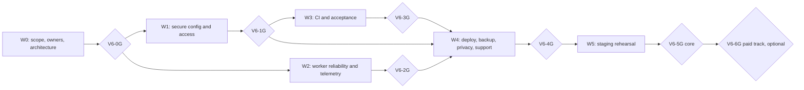

# PLAN — Version 6: production readiness and go-live

| | |
|---|---|
| Version | **V6 — secure, operable, recoverable production launch for Site GPT** |
| Status | **Wave 0 completed on branch `feat/v6` on 2026-11-24 and gate V6-0G is signed for Track A (hosted core, billing off).** V6-01…V6-04 are done. D1–D8, D11 and D13 are approved by the repository owner, recorded as the single approver for all roles; D12 is not applicable and D9/D10 remain open for Waves 2–3. **Wave 1 has started: V6-10 (production configuration validation) and V6-13 (D6 upload policy) are done, and V6-12, V6-15 and V6-16 are done on their D13 deferral scope (session/credential incident controls, the `compat` embed/session posture, and the recorded MFA/SSO deferral); V6-11's console-off half is implemented but V6-11 stays unticked because the ingress-enforced MFA/SSO or operator network its Done-when requires does not exist, and V6-14 stays unticked as a recorded D13 deferral. Wave 2 has started: V6-22 (structured logging and redaction) is done, V6-21 and V6-23 are implemented on their code scope but unticked pending the V6-40 staging evidence checklist, and V6-20 is blocked by the unapproved D9.** The current measured run on this branch (2026-11-25) is **78 Python test modules / 1324 tests OK**, **46/46 node checks**, and Alembic current = heads = `0b22b30bf930` (no new migration). No production deployment, commercial approval or release authorization is implied. V4 is the last released product baseline. V5's `v5` tag is an immutable engineering marker, not a verified release; do not move it. |
| Repository snapshot reviewed | `master` at `66dd197` (`docs(v5): refresh README gallery and add landing, analytics, inbox screenshots`), reviewed as a clean checkout of that commit. This row describes that reviewed snapshot only — later branch work (starting with this plan itself) is not part of it. The repo documents Alembic head `0b22b30bf930` (M12); reconfirm with Alembic before implementation/deployment. |
| Baseline at Wave 0 start | `master` at `66dd197`, branch `feat/v6` (2026-11-23). Alembic current = head = `0b22b30bf930` (single head, M12). Observed run: **62 Python test modules / 1094 tests OK**, **46 node checks**, `npm run build` + `npm run lint` clean, `site_gpt.app.main` / `site_gpt.app.worker` imports clean, Python 3.13.13, Node v24.19.0, `trail build` 251 files / 3735 nodes. The provider-free V5 release gate also ran: `bash scripts/gate_v5_5g/run_all.sh` → **72/72 checks passed, 2 blocked**, on its own throwaway `v5_gate_5g` database, which the script created, migrated to head and dropped; no other database was touched. |
| Scope | Close the deployment, security, reliability, support and release-process gaps that prevent a responsible hosted go-live. Separate the core hosted launch from the optional paid-billing/platform-operator launch. |
| Migration target | **None planned by default.** Add a migration only if a reviewed V6 requirement needs durable state; preserve a single linear Alembic head and the migration safety rules in `AGENTS.md`. |
| Derived from | `AGENTS.md`, `plans/PLAN_V4.md`, `plans/PLAN_V5.md`, `docs/security.md`, `docs/release-v5.md`, `docs/billing.md`, `docs/platform.md`, and the current backend/frontend/repository structure. |
| Out of scope | New LLM/chat product features, mobile apps, new messaging channels, white-label, custom card handling, compliance certification, claims of SOC 2/HIPAA/GDPR certification, and unapproved commercial or legal terms. |

> **Launch rule:** passing engineering checks is necessary but not sufficient. Live launch additionally requires named business, security, operations and support owners; a chosen deployment topology; approved customer-facing/legal content; and an explicit go decision. If Stripe billing or the platform console is not approved, keep `BILLING_ENABLED=false` and `PLATFORM_CONSOLE_ENABLED=false` and launch only the explicitly approved core scope.

---

## 1. Executive recommendation

The project already has a substantial product surface: public marketing/pricing shell, tenant console, widget and hosted chat page, analytics, knowledge ingestion, inbox, integrations, privacy export/erasure, retention, and an engineered Stripe/platform-owner path. The primary gap is not another product feature. It is proving that a selected deployment can be configured securely, survive failures, be monitored and restored, and be operated by named people.

Recommended sequence:

1. Decide what “go live” means (hosted core vs paid SaaS), where it runs, who owns operations/support, and what data/service promises apply.
2. Close production security/configuration gaps and secure the platform-operator boundary before exposing it.
3. Make background work recoverable and make failures visible; verify backup and restore, not just backup creation.
4. Put the existing test suites and release gates into repeatable CI, and add an approved browser smoke path.
5. Rehearse deploy, rollback, incident and recovery procedures on staging; launch a small controlled cohort.
6. Enable paid billing only through a separate, explicitly approved commercial/Stripe gate.

**Do not make new AI features, new integrations, or a broad rewrite prerequisites for the first launch.** Resolve each accepted risk against the actual deployment and user promise; do not claim a risk is closed just because it is documented.

---

## 2. Repository review — findings and go-live implications

This is a code/document review, not a production penetration test, cloud review, full test run or legal review. Findings describe repository evidence; deployment state must be inspected separately.

| Priority | Finding observed in repo | Go-live implication / proposed response |
|---|---|---|
| **P0 — secure boot** | `src/site_gpt/app/core/config.py` supplies a known development fallback for `JWT_SECRET_KEY` and defaults `CORS_ORIGINS` to `*`. The FastAPI lifespan in `main.py` currently validates enabled Stripe configuration, not a general production profile. | Add an explicit production-mode validation that fails closed for unsafe/missing required settings. Keep local/test defaults usable; test the validator against clean environments. Do not expose deployment secrets in errors. |
| **P0 — operator security** | V5 documents `PLATFORM_CONSOLE_ENABLED=false` as required until D10's MFA/SSO or private operator-network control is approved and in place. Strong authentication, re-authentication and IP/network restriction are not implemented by the app. | Keep the console off until one approved, enforceable control is operating and independently verified. A UI checkbox/confirmation is not authentication. Prefer the deployment's established identity/network control over adding an unapproved auth dependency. |
| **P0 — unapproved paid launch** | `docs/release-v5.md` records NO-GO for commercial catalog/legal terms, Stripe merchant/test readiness, support ownership and operator strong-auth; V5 gates are not signed. Billing is documented off by default. | This blocks paid V5 launch, but need not block a separately approved billing-off core launch. Do not publish guessed prices, policies or legal copy; do not describe `v5` as a release. |
| **P0 — operational ownership not evidenced** | Release docs leave topology verification, backup/restore, monitoring, named support and incident ownership pending. | Select an environment and named owners; define measurable service and recovery objectives; perform and record a restore and an incident/rollback rehearsal before launch. |
| **P1 — background job recovery** | `services/redis.py::enqueue_job` pushes jobs to a Redis list; `worker.py::worker` consumes with destructive `BRPOP` before handling. Ingest has stale-claim recovery, and some services have their own claims/retries, but the generic queue has no visible acknowledgement/visibility-timeout contract. | A worker/process crash after pop can lose work unless that job's own state recovers it. Audit every job type; implement and test retry/ack/dead-letter or durable outbox semantics where required, preserving idempotency and avoiding duplicate destructive work. |
| **P1 — health and telemetry** | `/health` reports DB/Redis and limiter degradation in its JSON, while returning the health response used by current gates; no tracked CI/deployment workflow or observability vendor configuration was found. Worker mostly reports with `print` statements. | Preserve `/health` compatibility; add separate liveness/readiness semantics if needed, structured/redacted logs, actionable alerts and worker/queue visibility. Choose tooling only after the deployment target is known. |
| **P1 — automated regression coverage** | Plain `unittest`, node checks, frontend build/lint and project gate scripts exist. No tracked `.github` workflow/CI config or frontend test runner was found. V5 explicitly records a headless browser gate item. | Make existing checks repeatable in CI and add browser smoke coverage for critical journeys. Select CI/browser tooling and secrets handling as an explicit decision; do not add a framework by accident. |
| **P1 — data protection operations** | Security docs correctly put TLS, encryption at rest, private DB/Redis networking and encrypted backups on the operator. Restore testing and audit-retention sign-off remain pending in V5 docs. | Treat backup, restore, upload-volume consistency, access review and deletion/backup retention as launch tasks with evidence, not documentation-only boxes. |
| **P1 — file uploads** | `docs/security.md` states uploads are not virus-scanned. Uploaded documents and derived embeddings can be used by the product. | Decide the public-upload threat model. Before enabling uploads for untrusted users, either integrate an approved malware/content scanning path or restrict/disable the affected upload surface and document the accepted risk. |
| **P2 — tenant/admin auditability** | `docs/security.md` records no general admin audit log; platform-owner mutations are audited separately. | Decide which tenant actions need an audit trail (at minimum privileged access, API-key lifecycle, settings, data export/erasure, and billing actions for a paid service). Avoid logging transcript contents or credentials. |
| **P2 — session/security response** | JWTs are held by the SPA in `localStorage`; logout clears the browser token, and no server-side JWT revocation/refresh mechanism is evidenced. Session-token revocation is documented as a manual row deletion, without a user-facing control. | Define acceptable session lifetime/revocation and incident response. Add controls only to the agreed threat model; do not silently break embeds or current auth compatibility. |
| **P2 — tenant identity** | Every tenant user authenticates with email plus password and a 24-hour bearer JWT: there is no second factor, no SSO/federated login, no email verification and no login lockout beyond the per-IP limiter, so one stolen or reused password is a full takeover of that tenant and its API keys. | Decide require-or-defer with an owner and expiry (D13, recorded as R13), or implement one approved factor or federation with enrolment, recovery and lockout tested. Never describe a control the login path does not have. |
| **P2 — residual embed boundary** | `docs/security.md` explicitly accepts K18: Origin/Referer is soft and the embed token is public/replayable. `SESSION_TOKEN_MODE=compat` also retains legacy reads for compatibility. | Make a rollout decision per customer embed and threat model. Stage any enforcement change, measure legacy usage where possible, and document compatibility/rollback. This is not a blocker if the residual risk is explicitly accepted for the chosen launch. |

### Review exclusions

No claim is made that the deployment is vulnerable or unfit in every hosting context. This review did not inspect a cloud account, production network, live Stripe account, real customer data, external legal terms, live dependency advisories, or run the full suites. The pre-flight must supply that evidence.

---

## 3. Launch tracks and scope control

### Track A — hosted core, billing off

A controlled hosted launch of the approved core product can be considered without Stripe if product/legal approves the offer and public content, deployment controls pass, and V6 core gates are signed. Leave billing/platform flags off. Decide whether an empty pricing catalog and “plans being finalised” state are acceptable for that launch; otherwise supply approved content before making pricing claims.

### Track B — paid SaaS and platform operations (conditional)

Track B is an additional gate, not an assumption of Track A. It requires all Track A checks plus the unresolved V5 decisions and evidence: approved catalog and subscription policies, legal/support content, Stripe merchant and live/test readiness, real test-mode rehearsal, platform-owner strong authentication or private-network enforcement, audit policy, and explicit release authorization. No production payment is permitted before that gate.

### Non-goals for V6

- No new AI/provider capability just to increase feature count.
- No self-service or HTTP route for granting platform-owner access; no tenant impersonation.
- No guessed data residency, SLO, RPO/RTO, pricing, refund, trial or retention promise.
- No mandatory Docker/Kubernetes/cloud vendor selection before D2 is decided.
- No compliance badge or certification claim created by engineering work.

---

## 4. Pre-flight decisions (blocking for the affected tasks)

Record a decision owner, approver, date and evidence. A proposed default is not an approval. The live record for every row is [`docs/preflight-v6.md`](../docs/preflight-v6.md); the Decision brief column links to that decision's appendix, which lays out the options and the evidence an approver must sign. **On 2026-11-24 the repository owner (Jacky, recorded as the single approver for all roles) approved the ten Wave 0/Wave 1 decisions for Track A** — the full text and consequences are in [`docs/preflight-v6.md` → Recorded decisions](../docs/preflight-v6.md#recorded-decisions--2026-11-24). D9 and D10 remain unapproved, and D12 does not apply because Track B was not chosen.

| ID | Recorded answer (2026-11-24) | Status |
|---|---|---|
| D1 | Track A, public registration, Vietnam cohort, public website content + chat transcripts + contact details, empty plan catalog accepted | APPROVED |
| D2 | Managed containers for API and worker, managed Postgres/pgvector, managed Redis, CDN SPA, object storage as the (not yet implemented) upload target | APPROVED |
| D3 | 99.5% monthly availability, RPO 24h, RTO 8h, 30-day encrypted backups | APPROVED |
| D4 | Fail-closed production profile: required secrets, exact CORS, `SQL_ECHO=false`, Redis limiter, docs hidden, trusted proxies | APPROVED |
| D5 | `PLATFORM_CONSOLE_ENABLED=false`; MFA/SSO or operator network deferred to 2027-02-28 | APPROVED |
| D6 | Admin-only uploads, parser-supported formats, 20 MB ceiling, no scanner; residual owned to 2027-02-28 | APPROVED |
| D7 | Existing retention default, 30-day backups, 1-year audit retention, privacy owner named | APPROVED |
| D8 | Redacted structured logs, `/health`, minimal alerts, no vendor, 30-day logs | APPROVED |
| D9 | Background-job delivery guarantee | **UNAPPROVED** — blocks V6-20 |
| D10 | CI and browser execution | **UNAPPROVED** — blocks V6-30/V6-32/V6-33 |
| D11 | Support owner Jacky, `tdhungit@gmail.com`, Mon–Fri 09:00–17:00 ICT, 1 business day, no resolution commitment | APPROVED |
| D12 | Track B commercial, merchant and legal answers | **NOT APPLICABLE** — Track A chosen |
| D13 | Tenant MFA/SSO, admin audit, session-revocation UI and origin-bound widget auth all deferred to 2027-02-28 | APPROVED |

| ID | Decision | Required before | Decision brief |
|---|---|---|---|
| D1 | Launch Track A, Track B, or both; target customers, regions, data types, and whether public registration is open or invite-only. | V6-01 / V6-02 | [D1](../docs/preflight-v6.md#appendix--d1-decision-brief) |
| D2 | Hosting/runtime topology: API, worker, Postgres/pgvector, Redis, upload storage, frontend/CDN, TLS termination, network boundaries, deployment and rollback mechanism. | V6-02 / V6-10 / V6-40 | [D2](../docs/preflight-v6.md#appendix--d2-decision-brief) |
| D3 | Availability/support promise and measurable SLOs; database/upload RPO and RTO; capacity assumptions and maintenance window. | V6-02 / V6-21 / V6-42 | [D3](../docs/preflight-v6.md#appendix--d3-decision-brief) |
| D4 | Production security profile: required secret/config policy, trusted proxy addresses, CORS origins, rate-limit backend, docs exposure and environment separation. | V6-02 / V6-10 | [D4](../docs/preflight-v6.md#appendix--d4-decision-brief) |
| D5 | Platform-owner authentication: approved MFA/SSO or private operator-only network enforcement; bootstrap, recovery and revocation owner. | V6-02 / V6-11 (any platform-console exposure) | [D5](../docs/preflight-v6.md#appendix--d5-decision-brief) |
| D6 | Upload policy for untrusted files: scanner/vendor, supported formats, quarantine behavior, or disable/restrict uploads. | V6-13 (public/untrusted uploads) | [D6](../docs/preflight-v6.md#appendix--d6-decision-brief) |
| D7 | Data handling: retention defaults, audit retention, backup expiry, user/company deletion and backup restore/deletion semantics; legal/privacy owner. | V6-41 / V6-42 (and the retention questions inside V6-14 / V6-15) | [D7](../docs/preflight-v6.md#appendix--d7-decision-brief) |
| D8 | Logs, error tracking, metrics and alerting: selected tools, data sent to vendors, PII redaction, access and retention. | V6-21 / V6-22 | [D8](../docs/preflight-v6.md#appendix--d8-decision-brief) |
| D9 | Background work delivery guarantee and acceptable duplicate/loss behavior by job type; retry limits, dead-letter owner and replay procedure. | V6-20 | [D9](../docs/preflight-v6.md#appendix--d9-decision-brief) |
| D10 | CI and browser-test execution environment, dependency policy, artifact handling and who may deploy from a passing workflow. | V6-30 / V6-32 / V6-33 | [D10](../docs/preflight-v6.md#appendix--d10-decision-brief) |
| D11 | Customer support owner, contact channel, escalation target and response expectations; no promise without approval. | V6-02 / V6-41 | [D11](../docs/preflight-v6.md#appendix--d11-decision-brief) |
| D12 | If Track B: resolve the commercial V5 answers — D2 catalog and terms, D3 Stripe and merchant readiness, D4 trial/free tier and registration, D5 lifecycle, D6 existing-company rollout, D7 enforcement, D8 legal content, D9 branding — and assign commercial/legal approvers and a merchant account owner, name the Stripe operational owner for refunds, disputes, reconciliation and webhook failures, and record explicit live activation authority and how the approved catalog is published. V5 D10–D12 (platform-owner grant, permitted mutations, runtime settings) are the operator boundary: V6 D5 takes only the console's authentication requirement and the rest stays open in `plans/PLAN_V5.md` §3, so it is not part of this decision. | V6-51 / gate V6-6G (Track B only) | [D12](../docs/preflight-v6.md#appendix--d12-decision-brief) |
| D13 | Whether tenant MFA/SSO, broader admin audit, session revocation UI and origin-bound widget authentication are required for the target customer/security posture, or explicitly accepted/deferred. | V6-12 / V6-14 / V6-15 / V6-16 | [D13](../docs/preflight-v6.md#appendix--d13-decision-brief-sessions-and-security-response) |

---

## 5. Invariants

1. Production startup must not silently use the known JWT development key, wildcard CORS, debug SQL logging, missing required secrets or a per-process limiter where the chosen topology requires shared limits.
2. Development and test workflows remain usable without production secrets. A production-only validator must be deterministic, tested and report setting names only.
3. Keep billing and platform console disabled by default. No customer/browser redirect can grant paid access; only verified Stripe events update mirrored subscription state.
4. Preserve tenant scoping, API/widget route compatibility, existing session/localStorage keys and documented V4 behavior unless a separate compatibility migration is approved and tested.
5. Every background job must have a stated delivery/retry/idempotency policy. Never solve retry by allowing duplicate destructive jobs or duplicate external sends.
6. Readiness and liveness must be independently usable by the selected orchestrator; do not break the established `/health` contract without a versioned/deployment-reviewed change.
7. Logs, traces, metrics and alerts must not contain passwords, bearer tokens, API keys, integration secrets, card data, raw webhook bodies or full customer transcripts by default.
8. Backup success is not restore evidence. Recovery tests use isolated disposable/staging infrastructure and never overwrite a database the team cares about.
9. Security/privacy claims in UI and docs must match verified controls and approved legal wording. Engineering does not claim certification.
10. A release tag is created once on the exact authorized, gate-verified commit. `v5` is immutable and remains an engineering marker; a future release must use a new tag if authorized.

---

## 6. Waves and tasks

### Wave 0 — launch scope, owners and baseline

**Goal:** turn “go live” into an approved scope and measurable deployment target. No schema change or production flag change. **Entry:** none — Wave 0 is where the track is chosen; all four tasks are now complete. **Baseline observed at Wave 0 start (2026-11-23):** 62 Python test modules / 1094 tests, 46 node checks, frontend build/lint clean, API+worker imports clean, Alembic current=head `0b22b30bf930`, branch `feat/v6` from `66dd197`.

- [x] **V6-01 · Approve launch track and product boundary** — `S`. Resolve D1 and D12's applicability. Identify initial user cohort, registration policy, included product features, excluded/disabled features and whether an empty public plan catalog is acceptable. **Done when:** Track A/B scope is signed by product/business owner; no unapproved pricing, guarantees or feature claims are in launch copy. **Done (2026-11-24):** D1 approved — **Track A** (hosted core, `BILLING_ENABLED=false`, `PLATFORM_CONSOLE_ENABLED=false`), public registration, Vietnam cohort, data categories public website content + chat transcripts + contact details, and an empty public plan catalog accepted (the pricing page shows its being-finalised state). D12 is **not applicable** because Track B was not chosen. Approver: Jacky, repository owner, single approver for all roles; recorded in [`docs/preflight-v6.md`](../docs/preflight-v6.md#recorded-decision-d1). Launch copy may claim no price, guarantee, certification or feature beyond this scope; V6-41 owns the approved public text.
- [x] **V6-02 · Name operational, security, privacy and support owners** — `M`. Resolve D1, D2, D3, D4, D5, D7, D11; set SLO/RPO/RTO targets based on the selected deployment and business promise, not invented engineering defaults. **Done when:** each owner, escalation path, coverage window, customer contact and objective is documented and accepted. **Done (2026-11-24):** Jacky holds product, infrastructure, security, privacy, engineering and support ownership single-handedly (recorded as a single-approver limitation, not independent review). Support: `tdhungit@gmail.com`, Monday–Friday 09:00–17:00 ICT, acknowledgement within 1 business day, no resolution commitment, no deputy (residual owned to 2027-02-28). Objectives: 99.5% monthly availability measured externally, RPO 24h, RTO 8h, encrypted daily backups kept 30 days, platform audit retained 1 year. Recorded in [`docs/preflight-v6.md`](../docs/preflight-v6.md#recorded-decisions--2026-11-24) and [`docs/risk-register-v6.md`](../docs/risk-register-v6.md).
- [x] **V6-03 · Production architecture and threat-model review** — `M`. Resolve D2/D4/D5/D6/D8/D13; review public routes, admin/operator boundary, data flows, provider exposure, uploads, backups, Redis/Postgres access, proxy trust and secrets. Classify each V6 §2 finding as fix-before-launch, mitigated, or explicitly accepted with owner/expiry. **Done when:** architecture diagram/runbook and risk register match the chosen environment; no critical risk is left ownerless. **Done (2026-11-24):** D2/D4/D5/D6/D8/D13 approved, so the target topology, boundaries, data flows, deploy/rollback and upload position are written down in [`docs/architecture-v6.md`](../docs/architecture-v6.md), and every §2 finding is classified in [`docs/risk-register-v6.md`](../docs/risk-register-v6.md) v1 with an owner and, where a residual is accepted, an expiry of 2027-02-28. No critical risk is ownerless. The review is **self-assessed by the single repository owner**, not an independent architecture or penetration review; the object-storage adapter, admin-only upload enforcement, production validator, job-delivery contract, telemetry, CI and restore rehearsal remain open as launch-blocking tasks (V6-10, V6-13, V6-20…V6-23, V6-30…V6-42).
- [x] **V6-04 · Reproducible baseline** — `S`. Record actual Python module/test count, Node checks, imports, build/lint, Alembic current=head and gate results from this checkout. **Done when:** evidence is generated by the pre-flight run; historical counts are not copied. No production DB is used for destructive checks. **Done (2026-11-23, branch `feat/v6`):** **62 modules / 1094 Python tests OK** (`uv run python -m unittest discover -s tests`; module count also confirmed through the loader), **46/46 node checks** (`node --test tests/*.mjs`), `npm run build` and `npm run lint` clean in `frontend/`, `site_gpt.app.main` + `site_gpt.app.worker` import clean, `uv run alembic current` = `uv run alembic heads` = `0b22b30bf930`, `trail build` = 251 files / 3735 nodes, Python 3.13.13, Node v24.19.0. **Gate results:** `bash scripts/gate_v5_5g/run_all.sh` — the provider-free V5-5G release gate, which needs no LLM/embedding provider, SMTP or browser — reported **72/72 checks passed, 2 blocked**. It created, migrated to head and dropped its own throwaway database `v5_gate_5g` (PostgreSQL 16.6 at `127.0.0.1:5432`), required no Redis (memory rate-limit path) and replaced Stripe with the gate's local fixture, which signs webhooks with the endpoint secret; the real SDK was never called and no merchant account was used. The V3/V4 gate scripts (`gate_v3_4g`, `gate_v4_4g`, `gate_v4_5g`) were **not run** in this pass, because they regress earlier versions and need inputs beyond this checkout: a `v3` (and, for V4-4G, a V4-1G) source tree for their byte comparisons, the real Redis on ports 8011–8013 for V3-4G, and live LLM/embedding/YouTube/Notion endpoints for V4-4G/V4-5G. V6-31 plans to automate these gate runs in CI; it adds no gate of its own. The two **blocked** items are live Stripe test-mode Checkout/Portal/webhook delivery (no D3 merchant credentials) and the browser journey across `/`, `/pricing`, `/app` and `/platform` (the gate is headless) — recorded as blocked, never as passes. No other database was created, dropped or upgraded, and no shared database was contacted.

#### Gate V6-0G — approved scope

- [x] The ten decisions that block Wave 0 and Wave 1 — D1/D3/D7/D11 and D2/D4/D5/D6/D8/D13, briefed in `docs/preflight-v6.md` — have owners and decisions for the chosen launch track. **Signed 2026-11-24 for Track A** by Jacky (repository owner, single approver for all roles); the recorded answers are in [`docs/preflight-v6.md` → Recorded decisions](../docs/preflight-v6.md#recorded-decisions--2026-11-24). D9/D10 remain unapproved and D12 is not applicable; they are not part of this gate.
- [x] Hosting topology, SLO/RPO/RTO, launch cohort, support owner and risk register are recorded — [`docs/architecture-v6.md`](../docs/architecture-v6.md), [`docs/risk-register-v6.md`](../docs/risk-register-v6.md) v1 and `docs/preflight-v6.md` D1/D2/D3/D11.
- [x] Track A vs Track B boundary is explicit: Track A only, `BILLING_ENABLED=false`, `PLATFORM_CONSOLE_ENABLED=false`, D12 not applicable, and paid activation (V6-51/gate V6-6G) out of scope.

**Wave 0 evidence (2026-11-23):** branch `feat/v6` created from `master` at `66dd197`; V6-04 is the only completed task and it added no code, so the baseline counts equal V5's recorded 62 / 1094 / 46. Three latent defects found by the Wave 0 await audit were then repaired as standalone fixes — the retention producer's missing `await` (`e4bdc21`), the scheduler loops' unheld task references (`ab7cb8a`) and the mail send that could fail unseen or abandon its coroutine (`ab7cb8a`, `88860c6`) — which is the only reason the suite moved: the completed Wave 0 run is **63 modules / 1102 Python tests OK** (`uv run python -m unittest discover -s tests`) and **46/46 node checks** (`node --test tests/*.mjs`). No dependency was added and no migration was written (head stays `0b22b30bf930`); none of those repairs starts V6-20 or decides D9 (`docs/worker-delivery.md` findings 1, 8 and 9). Gate **V6-0G was signed on 2026-11-24:** the ten Wave 0/Wave 1 decisions are approved for Track A by Jacky (repository owner, single approver for all roles), recorded in [`docs/preflight-v6.md`](../docs/preflight-v6.md#recorded-decisions--2026-11-24), so V6-01…V6-03 are ticked. **Wave 0 completion (2026-11-24):** the approved scope is Track A (public registration, Vietnam cohort, empty plan catalog), the topology and threat-model classification are in [`docs/architecture-v6.md`](../docs/architecture-v6.md), the risk register v1 has an owner for every row, and the residual limitations are explicit — one person held every approver role (no independent architectural, security or legal review), no production environment exists yet, uploads had to stay disabled until the V6-13 restriction and a durable storage adapter landed, and D9/D10 remain open. **Wave 1 has started with V6-10 and V6-13:** the `APP_ENV=production` validator now fails closed on the D4 unsafe defaults, covered by `tests/test_production_config.py`, and the suite is **64 modules / 1120 Python tests OK**. **V6-11 then implemented the console-off half of D5 without closing the task:** the production validator refuses `PLATFORM_CONSOLE_ENABLED=true`, every `/api/platform` route is a 404 to every caller while the switch is off (no host or proxy header changes that), and `scripts/exercise_platform_disable.py` records **14/14** emergency disable/recovery checks — suite **64 modules / 1128 Python tests OK**. **V6-22 then replaced print/traceback reporting with structured, redacted JSON events, request and job correlation ids and a JSON access log:** no `print()` remains under `src/`, `tests/test_logging.py` adds 16 cases, and the suite is **65 modules / 1144 Python tests OK**. V6-12, V6-15 and V6-16 then followed on their D13 deferral scope — the 24-hour `exp`/`iat` session lifetime with `tests/test_session_incidents.py`, the `compat` token posture with `tests/test_token_mode_posture.py` and the recorded MFA/SSO deferral (R13) with `tests/test_identity_copy.py` — while V6-14 stays a recorded D13 deferral and V6-11 stays unticked, with no new dependency and no migration (head stays `0b22b30bf930`); the current measured run (2026-11-25) is **78 modules / 1324 Python tests OK** and **46/46 node checks**; `BILLING_ENABLED=false` and `PLATFORM_CONSOLE_ENABLED=false` remain the defaults and `docs/release-v5.md`'s NO-GO rows still stand.

### Wave 1 — secure production configuration and access

**Entry:** V6-0G signed for the affected scope (signed 2026-11-24 for Track A). **Goal:** make unsafe production configuration fail closed and secure privileged access. **Status: started — V6-10, V6-12, V6-13, V6-15 and V6-16 are done (the last three as D13 deferrals with owned residuals); V6-11 is partially implemented and stays unticked; V6-14 is a recorded deferral and stays open** (D5 keeps the platform console off, D13 defers tenant MFA/SSO and broader admin audit to 2027-02-28).

- [x] **V6-10 · Production configuration validation** — `L`. Add an explicit production mode/profile in `core/config.py`/`main.py` (or deployment bootstrap) that rejects unsafe/missing settings: JWT secret fallback, wildcard/empty CORS, inappropriate `SQL_ECHO`, missing API-key pepper when `/api/v1` is enabled, insecure/missing external URLs, and incompatible limiter/proxy settings. Preserve dev/test defaults. Update `.env.example`, README and tests. **Done when:** clean-env production boot fails with actionable names and no values; a valid staged profile boots; all existing development tests/imports still work. **Done (2026-11-24):** `APP_ENV` (default `development`) selects the profile; `core/config.py::production_config_errors`/`ensure_production_config` reject the dev `JWT_SECRET_KEY` fallback, a wildcard/empty/malformed `CORS_ORIGINS`, `SQL_ECHO` on, a non-Redis `RATE_LIMIT_BACKEND`, an unset `API_KEY_PEPPER` or `INTEGRATION_WEBHOOK_SECRET`, an empty/invalid `TRUSTED_PROXY_IPS` and `DOCS_ENABLED` on, naming settings only; `main.py`'s lifespan calls it before `validate_billing_config`, and `/docs`, `/redoc` and `/openapi.json` follow `DOCS_ENABLED`. `tests/test_production_config.py` (12 cases) covers dev/test pass-through, every rejection, a complete profile, no secret values in the message and the docs wiring. Verified: `APP_ENV=production` with dev defaults exits 1 listing the seven unsafe names, the same profile with all values set is accepted, imports and the full suite pass (64 modules / 1120 tests). `.env.example` and README document the profile; no dependency or migration.
- [ ] **V6-11 · Platform-owner control** — `L`, conditional on console exposure. Implement or integrate the D5-approved MFA/SSO or network gate and test it at the actual ingress; retain out-of-band owner grants and immediate revocation. Add an emergency disable/recovery exercise. **Done when:** the protection cannot be bypassed via a direct API origin or alternate hostname, and an unapproved/tenant account cannot use `/api/platform`; otherwise the console remains off. **Partial (2026-11-24, console-off scope) — not ticked:** D5 approved keeping the console off, so the Done-when's first clause — an ingress-enforced MFA/SSO or operator-only network, tested at the actual ingress — is unmet and untested, and only its "otherwise the console remains off" fallback is evidenced. A tick would claim a control that does not exist and cannot be tested at any edge, so the task stays open; this is recorded as partial progress. What is enforced today: `core/config.py::production_config_errors` now refuses `PLATFORM_CONSOLE_ENABLED=true` under `APP_ENV=production` (setting name only), so a production deployment cannot expose the surface until a new D5 answer approves an ingress control. `tests/test_platform_owner.py::ConsoleOffAtTheIngressTests` pins that the switch hides **all 15** `/api/platform` routes with the gate's own `{"detail":"Not found"}` for a granted operator and a tenant admin, that `Host`/`X-Forwarded-Host`/`X-Forwarded-Proto`/`Origin` neither reveal the surface nor substitute for the owner check, that every route carries the gate dependency (a route added without it fails the test), and that toggling the switch off and on keeps grants and audit rows. `scripts/exercise_platform_disable.py` is the recorded emergency disable/recovery exercise — **14/14 checks** on its own throwaway SQLite database: production refuses the switch, the out-of-band CLI grants, the switch hides every route, revocation is refused on the next request with no restart, re-granting restores access, and the switch takes it away again with grants, history and audit rows intact. **Blocked (unchanged):** no MFA/SSO, operator re-authentication or private operator network exists, and there is no production ingress to test one at; re-opening the console needs a new D5 answer plus an exercise of that control at the actual edge. Residual owner Jacky, review 2027-02-28 (R2). Suite: **64 modules / 1128 Python tests OK**.
- [x] **V6-12 · Session and credential incident controls** — `M`, resolve D13. Set/document JWT lifetime and re-auth requirements for privileged operations; decide revocation after password reset, account deactivation, key leak or operator compromise. Add only the approved server-side revocation/recovery mechanism and tests. Decide whether admins need a session-token revoke UI. **Done when:** a documented incident can invalidate the relevant access promptly without breaking other tenants or legacy widget compatibility. **Done (2026-11-25, D13 deferral scope):** the lifetime is now one named constant (`core/auth.py::ACCESS_TOKEN_TTL`, 24 h) that every token carries as `exp` beside a new `iat`, and `verify_token` refuses a signed token with no `exp` — jose validates `exp` only when it is present, so that was the one way a token could never age out. `get_current_user` coerces `sub` to a UUID, turning a malformed subject into a 401 instead of a database error surfacing as a 500. The tools and their blast radius are a runbook, `docs/security.md` → "Session incidents": deactivation or deletion refuses that account's JWTs on its next request (tenant-scoped), API-key revocation is immediate, a signing-key rotation ends every tenant's JWTs while API keys and K4 widget tokens are unaffected, and an operator grant is revoked out of band. `tests/test_session_incidents.py` (9 cases) pins the 24-hour claim, a token with no expiry, expiry, deactivation, deletion, the working token before a rotation, a malformed `sub`, and a widget session token surviving a JWT incident. **Residual (D13/R11):** no per-session revocation and no invalidation on password reset — deactivation or a key rotation are the tools and the 24-hour expiry is the bound; privileged re-authentication is not required for this cohort. A single-session revoke UI would need a new decision, not a quiet mechanism.
- [x] **V6-13 · Upload safety decision and implementation** — `M`, conditional on D6. Integrate an approved scanner/quarantine/size policy before serving files to public/untrusted users, or enforce a documented restriction/disablement. Cover archive bombs, MIME/extension mismatch and scanner outage behavior at the boundary. **Done when:** malicious/unsupported/scanner-unavailable cases fail safely and accepted files still follow the existing ingestion path; if deferred, the disabled/restricted behavior is tested. **Done (2026-11-24):** D6 is enforced in `api/upload.py`. All five routes (local `POST /api/uploads/`, `/url`, `/youtube`, `/notion`, `/google-drive`) depend on `get_admin_user`, so a `user`/`manager` gets 403 before any fetch, write or row. `ALLOWED_UPLOAD_EXTENSIONS` (`.pdf`, `.docx`, `.pptx`, `.txt`/`.text`, `.md`/`.markdown`, `.html`/`.htm`) is checked before a byte is written — on the client filename for a local upload and on the fetched filename inside `_save_attachment`, which every remote route funnels through — so `.csv`, `.json`, legacy `.doc`, archives and extensionless names answer 400 and leave no file or row. The existing `MAX_UPLOAD_BYTES` (20 MB) streaming ceiling is unchanged and covers both paths. `tests/test_upload_limits.py::UploadPolicyTests` covers the admin-only matrix over all five routes, the refused formats, the accepted list and a remote import of an unsupported type, beside the pre-existing 413 cases; the full suite is **64 modules / 1120 Python tests OK**. Residuals stay as D6/R9 record them, accepted to 2027-02-28: no malware scanner, no MIME-versus-extension cross-check, and uploads still land in the local `uploads/` directory until a durable object-storage adapter exists.
- [ ] **V6-14 · Admin audit scope** — `M`, resolve D7/D13. Define and implement auditable security-relevant tenant actions (minimum candidate: user/role/status changes, API-key issue/revoke, settings/model changes, data export/erasure, and billing mutations if Track B). Audit metadata only; do not store transcript/body/secrets. **Done when:** access control, actor, tenant, action, target and timestamp are tested, retention is approved, and read access is bounded. **Recorded deferral (D13, recorded in `docs/security.md` §5 on 2026-11-25 — task unticked):** broader tenant-admin audit is deferred to 2027-02-28; today only `platform_audit_logs` exists, for the operator boundary, and tenant user/role/status changes, API-key issue/revoke, settings and model changes, exports and erasures write no audit row. The Done-when requires an implemented scope with approved retention and bounded read access, so this stays open: a later approval has to name the action set, the retention window and who may read it.
- [x] **V6-15 · Embed/session compatibility rollout** — `S`, conditional on risk decision. Specify whether to move `SESSION_TOKEN_MODE` or `EMBED_TOKEN_MODE` from `compat` to `enforce`, and whether K18 needs a separate origin-bound design. Stage, observe and provide rollback; no guessed hard cutover. **Done when:** tenant/embed impact, legacy behavior, communication and rollback are evidenced or the current residual is explicitly accepted for the launch cohort. **Done (2026-11-25, D13 deferral scope):** D13 keeps both modes at `compat`, and the impact is written down instead of implied — `docs/security.md` → "Session incidents" records what a tokenless legacy session read (K4) and a tokenless embed (K18) still reach, the rollout order (snippet live first), and the rollback (`SESSION_TOKEN_MODE`/`EMBED_TOKEN_MODE` back to `compat`, no code or data change). `config.compat_token_modes_in_production` reports the modes still in `compat` for a production profile (setting names only) and `main.py`'s lifespan logs one `config.token_modes_compat` warning at boot; it is deliberately not a `production_config_errors` entry, because a boot refusal would take a working deployment offline over a migration it has not done. `tests/test_token_mode_posture.py` (10 cases) pins development silence, both/one mode named, case handling, the configured defaults, the posture staying valid at boot, the dev defaults being `compat`, and the warning firing once. **Residual (R12/D13):** the soft origin boundary, the tokenless compatibility window and origin-bound widget authentication are accepted for this cohort to 2027-02-28.
- [x] **V6-16 · Tenant identity requirements (MFA/SSO)** — `L`, resolve D13. Implement the approved second factor or federated login for tenant users, or record the explicit deferral with its residual, owner and review date; the existing password login, session tokens and widget compatibility stay unless a separate compatibility migration is approved. Cover enrolment, recovery and lockout, so a lost factor, a disabled account or a provider outage cannot strand a tenant, and add no identity dependency the decision has not approved. **Done when:** the require-or-defer answer is recorded for the launch cohort, and if required, enrolment, recovery, lockout and deactivated-account paths are tested; if deferred, the residual is recorded in the risk register with an owner and expiry, and no login or launch copy claims a second factor or federated login that does not exist. **Done (2026-11-25, D13 deferral scope):** the approved answer for this cohort is *defer*, and it is recorded where the Done-when requires it — **[R13](../docs/risk-register-v6.md#r13)** in `docs/risk-register-v6.md`, owner Jacky, expiry 2027-02-28, mapped both ways with D13: the decision's register cell, the recorded-decision bullet, the appendix cross-checks and the appendix sign-off item all name R13, the row names D13 back in its evidence cell, and `scripts/check_v6_doc_links.py` verifies the pairing (13 risk rows, 23 decision-risk pairings). The residual is stated rather than softened: a stolen or reused password is a full takeover of that tenant and its API keys, because there is no second factor, no federated login, no email verification and no lockout beyond the per-IP limiter; `docs/security.md` §5 says no page or launch copy may claim otherwise, and that absence is now pinned by `tests/test_identity_copy.py` instead of a hand grep: it scans the SPA's text sources under `frontend/src`, `frontend/index.html` (title and meta copy are customer-facing but sit outside `src/`), the modules that carry outgoing message copy (`services/digest.py` for the digest HTML and subject, `api/user.py` for the reset email, `api/handoff.py` for the handoff notification, and `api/chat_page.py` for the hosted `/chat/{id}` page), every module under `src/site_gpt/app/api`, `src/site_gpt/app/schemas` and `src/site_gpt/app/services` (the `detail` strings a toast or error banner renders — including the ones services raise themselves and the two exception handlers `main.py` registers, whose prose lives in `services/session_tokens.py` and `services/embed_guard.py` — the field descriptions the OpenAPI page publishes, and the `rag.py` assistant prompt a visitor is answered from) and `README.md` for MFA/2FA/two-factor/multi-factor/SSO/SAML/single-sign-on (case-insensitive), fails with `file:line` when one appears, and tests the detector itself — a known claim string must produce a hit and a plain sentence none — so a pattern that stopped matching fails the suite instead of passing quietly. Outgoing copy is scanned as whole modules, not extracted literals, so a claim in a comment counts too. The brief's other connection points hold: the scope line is D1's, the operator half stays D5's, and the incident response is V6-12's runbook. **Limitations:** the copy test is deliberately strict — it does not tell a negation ("no MFA yet") from a claim, so a doc that needs the words has to widen the test in the same change that names the reviewer — and it covers only the checkout — `frontend/src`, `frontend/index.html`, the outgoing-message modules, every module under `api/`, `schemas/` and `services/`, and `README.md` — so external launch copy is out of scope, as is `main.py` itself (it wires routers and registers two handlers but holds no copy of its own) and `services/integrations.py`'s webhook payloads and `services/qa_training.py`'s training document, which are data for other systems rather than copy a customer reads. `core/config.py`'s operator comment on unapproved MFA/SSO is also out of scope: it explains the missing ingress control to whoever runs the service and is never rendered to a customer. There is no enrolment, recovery or lockout surface to exercise because nothing is built, so a later *require* answer reopens V6-16 and must test those paths before any copy mentions them.

#### Gate V6-1G — security baseline

- [x] Production config fails closed; test/dev compatibility remains intact. **V6-10** — `tests/test_production_config.py`, now including the V6-11 refusal of `PLATFORM_CONSOLE_ENABLED=true` in production.
- [x] The operator surface is protected by the approved control or is disabled. **Disabled per D5 and enforced by V6-11's console-off half (the task itself stays unticked: no MFA/SSO or operator network exists):** production refuses the switch, every route answers 404 to every caller including a granted operator, and `scripts/exercise_platform_disable.py` records 14/14 disable/recovery checks. No MFA/SSO or operator network is implemented, so the console must stay off.
- [x] Tenant identity (MFA/SSO), upload, tenant-admin audit and session/embed decisions are implemented or explicitly out of launch scope with tested restrictions/accepted risks. **Signed 2026-11-25, item by item:** identity is the approved *defer* (V6-16, [R13](../docs/risk-register-v6.md#r13), owner Jacky, expiry 2027-02-28) with `tests/test_identity_copy.py` pinning that no page, email, schema, error or README copy claims a second factor; uploads are V6-13's enforced restriction (admin-only on all five routes, format allowlist, 20 MB) with `tests/test_upload_limits.py::UploadPolicyTests` and accepted risk [R9](../docs/risk-register-v6.md#r9); tenant-admin audit is the recorded D13 deferral (V6-14 stays unticked, [R10](../docs/risk-register-v6.md#r10) mitigate with owner and 2027-02-28 expiry, stated in `docs/security.md` §5); sessions are V6-12's tested incident tools (`tests/test_session_incidents.py`, [R11](../docs/risk-register-v6.md#r11)) and the embed/session posture is V6-15's recorded acceptance of the `compat` residual (`tests/test_token_mode_posture.py`, [R12](../docs/risk-register-v6.md#r12)). Nothing here claims an unimplemented control: the box's "explicitly out of launch scope with … accepted risks" clause is what the two deferrals rest on.
- [x] No credentials/PII are introduced into new logs, audit rows, frontend bundles or errors. **Signed 2026-11-25 after the two missing surfaces were tested — and one real leak was fixed.** Logs: `tests/test_logging.py` (16 cases) pins field-name redaction at depth (password, api_key, access_token, `Authorization`, email), secret-shaped text scrubbing (Bearer, `sk_live_…`, `whsec_…`, `password=`), bounded values, no `repr`/bytes leak and an exception with a scrubbed message and no traceback, while `RequestContextMiddleware` logs only method, path, status and duration — no headers, query string or body. Audit rows: `tests/test_platform_owner.py::AuditTests::test_secret_shaped_detail_is_redacted` plus the platform-console case that audits a Stripe failure without provider detail. **Built SPA bundle:** `tests/test_frontend_bundle_secrets.py` scans every file under `frontend/dist` for credential-shaped values (Stripe `sk_`/`rk_`/`whsec_`, `sk-`-style, Google, Slack, GitHub, AWS, PEM private keys, credentials in a connection URL, literal JWTs, the dev JWT fallback) and for a secret-shaped `VITE_` name, which Vite would inline at build time; it proves the detector can fail, keeps legitimate copy such as Settings naming `OPENAI_API_KEY` unflagged, and self-checks that `index.html` plus a JS asset were actually scanned. It runs in the plain `unittest` suite **after `cd frontend && npm run build`** (the built artifact is the evidence, not the sources); a checkout without a build skips with instructions, and the gate run sets `REQUIRE_FRONTEND_BUNDLE=1` so that skip becomes a failure. **Error responses:** `tests/test_error_responses.py` (7 cases, `uv run python -m unittest tests.test_error_responses -v`) drives the real handlers, routes and services — an unhandled exception (generic 500, no message), a validation error, a K4 session refusal through the real `mint`, `get_api_key`, `get_current_user` and the Notion route's `SourceAuthError` — and asserts the submitted secret never appears. **Fixing that surface found a real leak:** FastAPI's default 422 handler echoed the offending input, so a missing sibling field returned the whole body — Notion `token`, Drive `access_token`, a password — in the response (`{"loc":["body","url"],"input":{"token":"…"}}`). `core/errors.py::request_validation_error_response` now answers FastAPI's `{detail:[{type,loc,msg}]}` shape without `input`/`ctx`, is registered app-wide in `main.py` (pinned by a wiring test), and the SPA only ever read string `detail`, so no client contract changed. Suite after both modules: **78 modules / 1324 Python tests OK**, `node --test` 46/46, `npm run build` clean (the scan ran against that build with `REQUIRE_FRONTEND_BUNDLE=1`), API/worker imports clean, Alembic head unchanged at `0b22b30bf930`.

### Wave 2 — worker reliability and operational visibility

**Goal:** recover background work predictably and detect customer-impacting degradation. **Status: started — V6-22 is done; V6-21 and V6-23 are implemented on their code scope and unticked because their evidence is the V6-40 staging checklist; V6-20 is blocked by the unapproved D9. V6-23's code scope now covers the fleet 5xx buckets, multi-replica coverage in `scripts/ops_status.py`, per-worker heartbeats with a roster, bounded Redis I/O with a durability check, graceful API/worker shutdown and the pool ceiling, all tested locally (see the paragraphs under the task and the gate). Nothing in Wave 2 is ticked.**

- [ ] **V6-20 · Background job delivery and recovery** — `L`, depends: V6-0G / D9. Inventory `ingest`, `digest`, `retention`, `topic_clusters`, `sitemap_scan`, `insights` and any new job. Choose a durable acknowledgement/visibility-timeout mechanism (e.g. reliable Redis processing list or DB outbox, based on D2); add bounded retry/backoff, dead-letter visibility and safe replay. Respect existing service claims and external side-effect idempotency. **Done when:** crash-before-ack, crash-during-handler, transient provider/DB failure, poison job and duplicate-delivery scenarios pass on disposable infrastructure; each job's owner/replay path is documented. Evidence already collected for this task — producer, re-arm path, idempotency key, destructive effect and what a crash between `BRPOP` and commit loses, per job type — is in [`docs/worker-delivery.md`](../docs/worker-delivery.md) (including the retention producer that currently enqueues nothing), and the D9 brief's §1a records what each candidate mechanism (acknowledgement list vs durable job record) does to each of the six types while §6 records the evidence matrix this task has to produce to close gate V6-2G box 1.
- [ ] **V6-21 · Health, worker heartbeat and alerts** — `M`, depends: D3/D8. Preserve `/health`; provide separate liveness/readiness responses if needed by the chosen platform, with correct status codes and no sensitive internals. Expose worker heartbeat, queue depth/age, retry/dead-letter count and dependency degradation through the approved telemetry path. Alert on API error rate, DB/Redis failure, worker stopped/stale backlog, repeated job failure and (Track B) webhook failure/drift. **Done when:** staging fault injection triggers the intended alert and recovery; health checks do not restart a merely dependency-degraded process in a crash loop. **Implemented on its code scope (2026-11-24), unticked:** `/health` keeps its exact payload and status and two additive probes split what the orchestrator needs — `/health/live` answers 200 without touching any dependency, so a merely degraded process is never restarted in a crash loop, and `/health/ready` answers 503 only when the database is unreachable while reporting Redis as `degraded` on a 200, because chat still serves with the limiter failing open. `core/telemetry.py` is the D8 alert set: the V6-22 access middleware now counts every response into a rolling `API_ERROR_RATE_WINDOW_SECONDS` 5xx window (with `API_ERROR_RATE_MIN_REQUESTS` so one failure cannot page), the worker publishes `ops:worker:heartbeat` every `WORKER_HEARTBEAT_INTERVAL_SECONDS` with a three-interval TTL, stamps `ops:queue:last_pop` on every consume and counts handler failures in `ops:worker:job_failures` over `JOB_FAILURE_WINDOW_SECONDS`, and `redis_snapshot` turns those keys plus `LLEN queue:jobs` into heartbeat age, backlog age (only while the queue is non-empty: a Redis list carries no per-item timestamp, so the signal is "work is no longer being taken off the queue") and failure counts. `evaluate` raises `api.database_unreachable`, `api.redis_unreachable`, `api.error_rate`, `worker.heartbeat_missing`/`worker.heartbeat_stale`, `queue.depth_high`, `queue.age_high` and `worker.job_failures`, each with a stable code, a severity and aggregate evidence only — no tenant id, path, payload or secret — and every threshold is environment configuration in `.env.example`. `GET /api/ops/status` serves that snapshot with `Cache-Control: no-store` behind `OPS_STATUS_TOKEN` (404 while the token is unset, 401 on a missing or wrong header compared in constant time, never echoed), and `scripts/ops_status.py` is the vendor-free external check: it prints the snapshot and exits 1 on any critical alert, 2 when the check itself cannot run. **Per-instance, not aggregate:** the 5xx window is an in-memory deque in the API process and `/api/ops/status` is answered by whichever instance the caller reaches, so with several API containers each snapshot is that one instance — `api.error_rate` means "this instance saw at least the threshold in its own window", never the fleet's rate, and the window starts empty after every restart or rolling deploy. The worker keys are the same shape: one `ops:worker:heartbeat` document carries a single process's pid and loop list and is overwritten by every heartbeat, so the snapshot proves that *a* worker is alive and that the queue is being drained, not how many workers run or which one is stuck — a dead worker whose peers keep heartbeating is invisible, and the queue depth is the fleet's only because the list is shared. What the external check therefore proves, plainly: the instance it reached is serving HTTP, can reach the database, and sees a fresh worker heartbeat and a draining queue; it does **not** prove a fleet-wide error rate, the liveness of every API replica, or per-worker progress. Nothing aggregates or exports these counters, because D8 chose no vendor; a real fleet view needs an external collector or Redis-side counters, which is V6-40/V6-23 work, and the scale-out obligations that leaves open — the 5xx source, replica coverage for the external check and a heartbeat key per worker — are recorded as V6-23's own acceptance evidence, so this limit has an owner. **Partially closed by V6-23 (2026-11-24):** the rate this alert reads is now the fleet's Redis bucket sum whenever the buckets are readable, with `source: "fleet"` in the evidence; the paragraph above describes what remains per-instance — the labelled `source: "instance"` fallback used when Redis is down, and the legacy worker document, which is still one overwritten key beside the per-worker `ops:worker:heartbeat:<host>:<pid>` keys that now raise per worker. Tests: `tests/test_telemetry.py` (window counting/expiry/min-sample, rate severities, heartbeat TTL and failure counter, snapshot ages, every alert's at-threshold vs above behaviour, no tenant/payload text, middleware wiring) and `tests/test_health_ops.py` (live with dependencies down, ready 503 without a database, degraded-but-ready without Redis, the `/health` contract preserved next to the probes, and the ops route's 404/401/200 with no token echo). Suite: **67 modules / 1179 Python tests OK**. An unset `OPS_STATUS_TOKEN` means a 404 in every environment rather than a production boot failure: the route then exposes nothing, so the validator does not require it, and a production boot logs one `config.ops_status_disabled` warning, which is the only signal that the deployment has no alert path (`tests/test_production_config.py::OpsStatusTokenTests` pins the warning, the 404 and that the validator does not ask for the token). **Unticked:** the Done-when's staging fault injection needs V6-40's environment, so no alert has fired against real infrastructure; retry/dead-letter counts stay with V6-20 because D9 is open, and alert transport is the host's cron/monitor reading the exit code (D8 chose no vendor).
- [x] **V6-22 · Structured logging and PII/secret redaction** — `M`, depends: D8. Replace operationally important print/traceback-only reporting with structured event fields, correlation/request IDs and safe exception categories. Add centralized redaction tests. Keep user text and provider request/response bodies out of logs. **Done when:** representative auth, ingest, LLM, webhook, retention and worker failures are diagnosable without sensitive payloads. **Done (2026-11-24):** `core/logging.py` is the single writer — one JSON object per line from `log_event`/`log_exception`, a central redactor that masks sensitive field names at any depth (`password`, `*secret`, `*token`, `api_key`, `authorization`, `cookie`, `card*`, `email`, `phone`, `transcript`, `question`, `body`, `payload`, `content`), bearer/Stripe/webhook/Slack/JWT-shaped strings and email addresses in free text, bounds every field and never logs a `repr`; an exception event carries `error_type`, a small `error_category` and a scrubbed `error_message`, with a traceback only at `LOG_LEVEL=DEBUG`. `RequestContextMiddleware` reuses a well-formed inbound `X-Request-ID` (anything that could inject a line is replaced), mints one otherwise, binds it for the handler and echoes it, and logs the access event at DEBUG for 2xx / WARNING for 4xx / ERROR for 5xx — the surface V6-21's alerts will read — while passing streaming responses through untouched. The worker installs the same JSON handler, binds one correlation id per job and routes jobs through `_JOB_HANDLERS`; every `print()` and `traceback.print_exc()` under `src/` is gone, so worker queue/job/scheduler failures, the retention/digest/topics/sitemap/insights runs, Redis fallbacks, the quota fail-open path, crawler/parse/YouTube failures, the sitemap API's logged reason and `rag.ask_stream`'s traceback message are structured events. `tests/test_logging.py` (16 cases) pins redaction at depth, secret-shaped text, field bounds, no-`repr`, categories without tracebacks, JSON shape, inbound and malformed request ids, the 5xx access level, handler idempotency and exactly one JSON handler. The message-form `logger.*` calls still left in `integrations`, `retention`, `digest`, `insights`, `topics` and `billing` are converted too, so those modules carry fields rather than pre-formatted text; the webhook delivery failure and the upload delete/refusal events are pinned in `tests/test_integration_delivery.py` and `tests/test_retention.py`. Suite: **65 modules / 1148 Python tests OK**. Residual: the D8 alert set, worker heartbeat and 30-day log retention are V6-21/host work, not this task.
- [ ] **V6-23 · Database/Redis capacity and graceful lifecycle** — `M`, depends: D2/D3. Validate connection-pool/process sizing, Redis persistence/eviction/timeouts, API and worker shutdown behavior, proxy/SSE timeouts and scale-out assumptions. **Done when:** restart/rolling-deploy and dependency interruption tests meet approved SLO/RPO/RTO; no claimed horizontal safety depends on per-process memory limits. **Code scope done 2026-11-24…25 and unticked:** the paragraphs below record the fleet 5xx buckets, multi-replica `scripts/ops_status.py`, per-worker heartbeats and roster, bounded Redis I/O with a durability check, graceful shutdown and the pool ceiling; what still needs the V6-40 checklist is the real instance, the orchestrator's stop window and the measured pool under load.

  **Alert-path obligations inherited from V6-21 (owner of its per-instance limit):** V6-21's snapshot is deliberately per-process and both docs and code say so; V6-23 settles the three things that make that limitation closable behind more than one API instance, each with evidence rather than prose. **5xx source:** choose between the ingress/CDN access log and aggregated Redis counters (bucketed `INCR`+`EXPIRE` from the access middleware), and record the choice with its blind spot — an ingress log is the only source that sees the 5xx returned when no healthy upstream exists (no API process runs for it), while an aggregate sees per-replica errors that a sticky or partially-sampled load balancer would hide from the single-URL check; no in-process counter sees traffic the ingress rejected. Evidence: on staging with N ≥ 2 instances, one replica returns 5xx while healthy, and the alert fires from the chosen source within one window; removing the replica from rotation instead still alerts from the ingress source. **Replica coverage:** `scripts/ops_status.py` must either address every instance (an explicit deployment-fed list, checking each and exiting on the worst result) or read a fleet-wide source, never a single arbitrary replica presented as the fleet; the check names the instance or source it used. Evidence: with two instances and one broken (5xx) but the other healthy, repeated runs cannot exit 0, and a run that happens to reach only the healthy one is distinguishable in its output from one that covered all. **Worker heartbeat:** replace the one overwritten `ops:worker:heartbeat` document with a self-expiring key per worker (`ops:worker:heartbeat:<host>:<pid>`, TTL three intervals) read by scan, so `worker.heartbeat_missing`/`stale` is raised per worker; keep the current single-key read as a compatibility path until the per-worker keys exist. Evidence: two workers on a disposable Redis, one stops — its key ages out and raises while the other's stays fresh — and a second worker joining does not refresh the dead one. **Done for these obligations:** the three pieces of evidence exist on the V6-40 staging environment and the operator runbook names the 5xx source, how the check covers replicas, and how many workers the heartbeat keys prove.

  **Alert-path design (proposed 2026-11-24; recommendation only — no code changed, nothing ticked):** the three obligations above are answered in that order. **5xx source — options.** (A) The ingress/CDN access log is the only source that sees the 5xx the edge returns when no healthy upstream exists, and it counts every replica without touching the app; but it is shaped by the ingress product D2 leaves unnamed, several log products lag minutes or sample, each record has to be parsed and attributed to the edge or the app, and nothing in this checkout can exercise it. (B) Aggregated Redis counters, bucketed `INCR`+`EXPIRE` from the access middleware V6-22 installed — `record_request` is already that call site — summed over `API_ERROR_RATE_WINDOW_SECONDS` when read: every replica contributes because Redis is already mandatory for the rate limiter, threshold and severity stay in `core/telemetry.evaluate`, and the path is unit-testable with the fake client the existing tests use. Its costs are one pipelined round trip per request (a streaming route still counts once, at the response status) and a count that stops during a Redis outage, which is acceptable only because `api.redis_unreachable` is critical then; it shares A's blind spot, because a request the edge rejected never reaches the middleware. (C) Both, as two alerts: an app-side `api.error_rate` from B and an edge count from A. (D) Rejected: summing the per-replica windows at scrape time — a 300 s window overlapped by minute-spaced scrapes cannot be deduplicated, a replica missing from the check's list is invisible, and the window dies with its process. **Recommended: B now, C as the target.** B is the smallest change that removes "one instance's memory" from the alert — one existing call site, the shared Redis, no vendor and no new dependency, fully testable here — while C's edge half is a host/vendor integration whose lag, sampling and attribution can only be measured against the staging ingress, so it is V6-40's work and the ingress line in `docs/architecture-v6.md` §1 is its spec. Until then the blind spot stays recorded rather than closed: no counter inside the app sees a 5xx returned because there was no healthy upstream. **Replica coverage — options.** (A) A deployment-fed list (`OPS_STATUS_URLS`, comma-separated, with `OPS_STATUS_URL` kept as the single-origin default): one authenticated request per origin, every snapshot printed with its origin, alerts unioned, exit code the worst (`2` when any origin is unreachable or refuses the token, else `1` when any critical alert fired, else `0`), so the output names what it covered and a one-replica run cannot read as a fleet run. (B) Round-robin or DNS discovery — no list to maintain, but no guarantee of covering every replica in a window and no evidence of which ones it reached. (C) Read only the fleet-wide aggregate — right for the rate, but it proves nothing about "this replica can still reach the database" or "this replica is not hung behind a healthy peer", and during a total outage no process answers it. (D) A live replica registry (each instance registering a TTL key the check lists) — staleness disappears, but it adds state and failure modes inside the alert path that would then have to report them. **Recommended: A now, D only if autoscaling makes a static list untrue.** It is a small change to `scripts/ops_status.py`, keeps the token/404/401 contract per origin, and once B above is the 5xx source the check's claim becomes "every listed replica answered and reaches its dependencies" instead of "this instance's rate is the rate". **Worker heartbeat — options.** (A) One self-expiring key per worker, `ops:worker:heartbeat:<host>:<pid>` with the same three-interval TTL, read by `SCAN` over that prefix: each worker writes only its own key, so a dead worker's key expires while its peers' stay fresh, and `worker.heartbeat_missing`/`_stale` can name the worker in `evidence`. (B) One hash with a field per worker — one read, but Redis has no per-field TTL, so a dead worker's field never expires without a sweeper, a second component inside the alert path. (C) A sorted set scored by the heartbeat epoch — one read and age straight from the score, but the TTL is per key and every reader must prune, which is more logic than A for the same answer. **Recommended: A**, as the inherited obligation already specifies: `write_heartbeat` sets the per-worker key (`socket.gethostname()` is the container name under the chosen topology and the pid separates two workers on one host), `redis_snapshot` returns the additive `workers: [{worker, age_seconds, loops}]`, `evaluate` raises per worker with the id as evidence, and the legacy single key keeps being written for one release so an older reader or test still works. It still cannot prove a worker that never started or how many are expected; that needs a deployment-fed `OPS_EXPECTED_WORKERS` compared with the fresh-key count, implemented on 2026-11-25 (below). **Evidence split.** Unit-testable here without staging: the bucket sum and its expiry, the rate/min-request/severity behaviour, the multi-origin union and worst-exit-code, the per-worker scan and per-worker alert, and the compatibility read. **Needs V6-40 staging evidence (the obligations stay open until it exists):** N ≥ 2 instances with one returning 5xx while healthy, so `api.error_rate` fires from the aggregate inside one window; the same fault with the replica pulled from rotation, so it still alerts from the ingress source — the C half, which is why C is not claimed yet; two instances with one broken, so repeated `ops_status.py` runs cannot exit 0 and the output distinguishes full from partial coverage; two workers on one disposable Redis with one `SIGKILL`ed, so its key ages out and raises while the other's stays fresh and a rolling worker restart does not flap; a Redis interruption, so the rate's under-reporting is measured while `api.redis_unreachable` is critical; and the chosen ingress's log lag, sampling and parsing path in the V6-40 operator runbook, which must also name the 5xx source, where the replica list comes from and the expected worker count.

  **Implemented 2026-11-24 — the 5xx source only (B):** `core/telemetry.py` gains `record_request_shared` (one pipelined `INCR`+`EXPIRE` per response into `ops:api:requests:<bucket>` and, on a 5xx only, `ops:api:errors:<bucket>`; bucket width is a sixth of `API_ERROR_RATE_WINDOW_SECONDS`, TTL the window plus one bucket, so a bucket outlives its usefulness and no key is unbounded) and `fleet_window` (sums the buckets covering the window plus one, so a request exactly one window old still counts; unreadable buckets report `ok: false` with `requests`/`errors_5xx` as `None`, never as zero). `RequestContextMiddleware` writes them beside `record_request` through an optional `shared_client` — `main.py` passes `get_client()`, so every replica feeds the same keys and a bare middleware in a test or script needs no Redis — and `evaluate` raises `api.error_rate` from the fleet sum when it is readable, falling back to the instance window with `evidence.source` naming which one it read, so a fallback can never be mistaken for a fleet-wide rate. `GET /api/ops/status` carries the fleet window inside `api.fleet` beside the instance detail, and `build_snapshot` takes it additively. `tests/test_telemetry.py::FleetWindowTests` (10 cases) pins the bucket pair and its TTL, a success leaving the error bucket untouched, replicas adding up in one sum, a bucket falling out of the window while one exactly at the edge still counts, a write and a read failing without raising, the fleet sum beating a loud instance, the `instance` fallback being labelled, the min-request and warning/critical boundaries applied to fleet counts, the middleware's own write, and the snapshot keeping both views. **Replica coverage implemented 2026-11-24 (A):** `scripts/ops_status.py` takes `OPS_STATUS_URLS` (comma-separated, trailing slash and repeats normalised) and keeps `OPS_STATUS_URL` as the single-origin default — then `http://localhost:8000` — so an existing cron line is unchanged. Each origin is checked with the same token header and timeout, and stdout is one JSON document (`checked`, `worst_exit`, `results`) whose every result carries the origin, its `ok`, the failure reason and its snapshot; a non-200 reports the status only and no body, and the token is never printed. The exit code is the worst across origins (2 transport/non-200 > 1 critical > 0 clean), so a run that reached one healthy replica of two cannot exit 0. `tests/test_ops_status.py` (18 cases, stubbed transport) pins the list-vs-single precedence and normalisation, each origin's result and exit code, a critical alert kept as such, a non-200 and a transport failure as `2` with no body or token echoed, the worst-exit rule both ways, partial coverage not reading as a pass, the labels, two clean replicas passing, the single-URL path and that an unset token makes no request. **Per-worker heartbeat implemented 2026-11-24:** `write_heartbeat` writes the payload twice — the legacy `ops:worker:heartbeat` (one release of compatibility, so an older reader or test still sees that *a* worker is alive) and `ops:worker:heartbeat:<host>:<pid>`, where `worker_key()` takes `socket.gethostname()` and `os.getpid()` and accepts overrides for tests — both with the three-interval TTL, and the payload gains the `worker` id additively. `redis_snapshot` reads the prefix with `SCAN` (never `KEYS`) into an additive `workers: [{worker, age_seconds, loops}]` sorted by id; one unreadable key is skipped and a scan failure leaves `workers` empty rather than failing the snapshot, because the legacy key still proves a worker is alive. `evaluate` raises `worker.heartbeat_missing` when a worker's key carries no usable timestamp and `worker.heartbeat_stale` past `WORKER_HEARTBEAT_STALE_SECONDS`, each naming the worker in `evidence` — so one stopped worker alerts while its peers stay fresh and the aggregate alerts still fire only when the legacy document itself is missing or stale. `tests/test_telemetry.py::PerWorkerHeartbeatTests` (7 cases) pins the key shape, both writes with the TTL and the id in the payload, two workers reported separately, only the stale one alerting with its id as evidence, an unusable timestamp as that worker's `missing`, a scan failure keeping the legacy view, and an expired key not being invented (the expected-count roster is the follow-on, implemented below). **Redis timeouts and durability implemented 2026-11-25:** `services/redis.create_client` applies three bounds from configuration to every client it builds — `REDIS_SOCKET_CONNECT_TIMEOUT_SECONDS` (default 5), `REDIS_SOCKET_TIMEOUT_SECONDS` (default 30) and `REDIS_HEALTH_CHECK_INTERVAL_SECONDS` (default 30) — so a reachable-but-silent Redis fails a command instead of pinning an API request or the worker's whole job loop, and a pooled connection the server dropped is replaced on the next command rather than failing it. The socket timeout must outlive `INBOX_STREAM_HEARTBEAT_SECONDS` because an idle SSE read waits that long deliberately, so `production_config_errors` refuses a value at or below the heartbeat (name only, like every other entry). `services/redis.durability_problems` names the two settings that can delete `queue:jobs` — a `maxmemory-policy` other than `noeviction`, and no persistence (`appendonly no` with an empty `save`) — and `durability()` reads them with one `CONFIG GET`; an unreadable setting set (Redis down, or a managed instance that refuses `CONFIG`) reports `ok: false`, which is unknown and not safe. `GET /api/ops/status` carries it as `redis.durability` and `evaluate` raises `redis.durability_unsafe` (critical) only when the settings were read and one is bad, because nothing later would show the loss of queued work. `tests/test_redis_config.py` (16 cases) pins the client's three bounds, the override path, the validator's relation, the classifier's cases, the unreadable report and the alert's evidence. This validates the *configuration*, not a real instance: whether the deployed Redis actually has those settings needs V6-40. **Graceful shutdown implemented 2026-11-25:** the API's lifespan runs `close_client()` and `dispose_engine()` after `yield`, so uvicorn's drained shutdown gives the Redis client slots and the Postgres backends back instead of leaving them to the server's timeout during a rolling deploy; both are best-effort and log rather than raise, because a stop must not fail. The worker installs `SIGTERM`/`SIGINT` handlers through `install_stop_handlers` (the loop is injectable, and a platform without signal support keeps the default disposition), pops with `WORKER_QUEUE_POP_TIMEOUT_SECONDS` instead of `BRPOP 0` so an idle loop notices the event, runs a job it already popped to completion — the list no longer holds it, so dropping it would lose work — then cancels the scheduler loops, closes Redis and the database pool and writes `worker.stopped`. The heartbeat key is left to expire on purpose: a planned stop and a crash must look the same, or a rolling restart would have to suppress its own alert. `tests/test_lifecycle.py` (11 cases) pins the lifespan hooks, both best-effort paths, the signal mapping, a popped job completing after the stop, no pop at all when stopped first, an idle timeout that keeps waiting, a read failure that retries, and an unknown job type that is skipped without counting a failure. What it cannot show without staging is the orchestrator's own grace period: a job longer than the platform's `stop_grace_period` is still killed, so the value has to exceed the longest ingest — which is V6-40's measurement. **Pool sizing implemented 2026-11-25:** `db.session.engine_options` gives a networked database an explicit pool (`DB_POOL_SIZE` 5 idle, `DB_MAX_OVERFLOW` 5, `DB_POOL_TIMEOUT_SECONDS` 30 to wait for one, `DB_POOL_RECYCLE_SECONDS` 1800 so a connection a proxy or failover killed is replaced before reuse, and `pool_pre_ping` for what still slips through) and leaves SQLite on SQLAlchemy's default pool, so the suite and a local run are unchanged. `pool_ceiling(instances)` is the number an operator compares with the database's `max_connections`: one process holds at most pool + overflow, so two API replicas and one worker at the defaults are 30 connections before migrations and an operator shell. `tests/test_db_pool.py` (9 cases) pins the networked and SQLite paths, the defaults coming from configuration, the ceiling arithmetic and that the module engine was actually built with those options. This is arithmetic and configuration, not a measurement: the real pool behaviour under load, the database's own `max_connections` and the platform's `stop_grace_period` are V6-40 staging evidence, and a replica count above the list `OPS_STATUS_URLS` covers still has to be kept in step by hand. **Expected-worker roster implemented 2026-11-25:** `OPS_EXPECTED_WORKERS` (default 0, disabled) is the deployment-fed count the per-worker keys cannot supply, because a worker that never started or whose key already expired leaves no key to name. `core/telemetry.fresh_worker_count` counts only workers inside `WORKER_HEARTBEAT_STALE_SECONDS` — a key lives three intervals, so counting every key would let a corpse satisfy the roster — `redis_snapshot` exposes the count as `workers_live` beside `workers`, and `evaluate` raises `worker.count_low` (critical, `evidence` = expected/live/missing only) when a configured roster is not met; a snapshot from a producer without the count derives it from the same helper rather than reading a missing field as zero, and `build_snapshot` reports the roster in `thresholds.expected_workers`. 0 never alerts, because a guessed expectation would either page a single-worker deployment or hide a dead worker, and changing the worker count is a deployment change — a live registry would move that failure mode into the alert path. `tests/test_telemetry.py::ExpectedWorkerCountTests` (8 cases) pins the disabled path, a met roster staying quiet, the short-roster alert and its evidence, a dead fleet raising both `worker.count_low` and the aggregate `worker.heartbeat_missing`, a stale key and an un-timestamped key not counting as live, the snapshot's `workers_live`/`thresholds.expected_workers`, and the derived count for an older snapshot. **Still open here:** the edge-only 5xx (C's ingress half), and every staging item above — none of it is verified, and V6-23 stays unticked.

##### V6-21 / V6-23 staging evidence checklist (run under V6-40)

Run this only on the V6-40 environment, with a **throwaway** Postgres and Redis: several items stop a dependency, evict keys or `CONFIG SET` the instance. Nothing here ticks V6-21 or V6-23 by itself — each row is signed only when its observed output is pasted beside it, and an item that cannot be measured stays recorded as blocked. Set once in the shell:

```bash
API_A=https://api-a.staging.example      # replica A, healthy
API_B=https://api-b.staging.example      # replica B, the one to break
INGRESS=https://staging.example          # the public ingress origin
T=$OPS_STATUS_TOKEN                      # same token the deployment uses
R="redis-cli -h $REDIS_HOST"             # add -a/$REDIS_PASSWORD as the host requires
snap() { curl -sS -H "X-Ops-Token: $T" "$1/api/ops/status"; }
```

Deployment settings these items assume: `OPS_STATUS_TOKEN` set, `OPS_STATUS_URLS=$API_A,$API_B`, `OPS_EXPECTED_WORKERS=2`, two worker processes, and the defaults for the heartbeat/queue thresholds (`WORKER_HEARTBEAT_INTERVAL_SECONDS=15`, stale `90`, TTL `45`, `QUEUE_DEPTH_ALERT=100`, `QUEUE_AGE_ALERT_SECONDS=900`, `JOB_FAILURE_ALERT_COUNT=3`).

1. **Health probes (V6-21).** `curl -sS $API_A/health | jq -c .` → `{"status":"ok","db":true,"redis":true,"rate_limiter":{…}}`, and the payload/status are identical to the pre-V6 contract. With B's database stopped (or B booted with a closed port): `curl -sS -o /dev/null -w '%{http_code}\n' $API_B/health/ready` → `503` with `{"status":"not_ready","db":false,…}`, while `…/health/live` → `200 {"status":"alive"}`. With Redis stopped: `/health/ready` → `200 {"status":"degraded","db":true,"redis":false}`. Note `/health` itself always answers `200` and only flips its `status` field to `degraded` — it never returns an HTTP error — so `/health/ready` is the one probe that can answer `503`. Expected: the orchestrator restarts nothing for a degraded-but-serving replica.

2. **Ops route contract (V6-21).** With the token unset, `GET /api/ops/status` → `404` in every environment; with a wrong `X-Ops-Token` → `401`; with `$T` → `200`, `Cache-Control: no-store`, and `snap $API_A | jq -c '{db, codes:[.alerts[].code], thresholds}'`. Expected: the token never appears in the body, every response carries `no-store`, and an unset token logs one `config.ops_status_disabled` at boot in production. The route *is* registered on the app, so it appears in the OpenAPI schema whenever `DOCS_ENABLED=true`; production requires docs off (D4), so the gate that hides it is the token (404), not the schema — do not record "absent from /docs" as evidence.

3. **Worker stopped (V6-21).** Stop **all** workers and note the time: with a peer still running, the legacy `ops:worker:heartbeat` key keeps being refreshed and only item 10's roster alert applies, not this aggregate one. `$R GET ops:worker:heartbeat` → the key disappears at most `3 × interval = 45 s` after its last write; `snap $API_A | jq -c '[.alerts[]|select(.code|startswith("worker."))]'` → `worker.heartbeat_missing` **on the first read after the key expires** (so roughly within a minute, not 90 s). Expect `missing`, **not** `heartbeat_stale`: the TTL (45 s) is shorter than `WORKER_HEARTBEAT_STALE_SECONDS` (90 s), so a stopped worker's key is gone before it can ever be stale — stale covers an old-but-present payload (a clock jump or a suspended write), which is why the roster in item 10 is the real per-worker signal. Restart the workers → the next read has no worker alert. Record both timings (stop → key gone, stop → alert, restart → clear).

4. **Queue backlog (V6-21).** First let one job be consumed so `ops:queue:last_pop` exists — age is measured from that key, and a fresh Redis with no pop reads `queue_age_seconds: null` and cannot raise the age alert. Then, with all workers stopped: `for i in $(seq 1 101); do $R LPUSH queue:jobs '{"type":"noop"}'; done; $R LLEN queue:jobs` → `101`; `snap $API_A | jq -c '[.alerts[]|select(.code|startswith("queue."))]'` → `queue.depth_high` (depth 101 > 100) immediately, and `queue.age_high` once `ops:queue:last_pop` is older than `900 s`. Clean up with `$R DEL queue:jobs` on the throwaway instance, restart the workers, and confirm both clear (depth 0 removes the age signal by design).

5. **Repeated job failure (V6-21).** `for i in 1 2 3; do $R LPUSH queue:jobs '{"type":"ingest","website_id":"not-a-uuid"}'; done`. `handle_ingest` does not coerce the id — it binds the string straight into the `uuid` column, so on Postgres the execute raises `DataError`, the handler's `except` rolls back, retries the row lookup once (and swallows that failure), then re-raises: exactly **one** `worker.job.failed` and one counter increment per job. This item therefore needs the Postgres staging database; on SQLite the bind is not an error and the job would just log `ingest.website_not_found` without a failure. `$R GET ops:worker:job_failures` → `3` (TTL one window); `snap $API_A` → `worker.job_failures` (warning) with `failures=3`. Expected: each failure is one `worker.job.failed` JSON line with `job_type`, and the loop keeps consuming after them.

6. **Dependency alerts (V6-21).** Database down on B → B's `/api/ops/status` still answers `200` (a `Session` is created lazily and the probe catches the failure) with `db: false` and `api.database_unreachable` (critical) among its alerts; Redis down → `api.redis_unreachable` (critical) from every replica, `/health/ready` still `200 degraded`, and an `api.error_rate` that fires while Redis is down must carry `evidence.source: "instance"`. Restart each dependency and confirm the alert clears within one snapshot.

7. **Fleet 5xx from Redis buckets (V6-23).** B is the broken replica (its database closed, so DB-backed routes 500 while A is healthy): `for i in $(seq 1 25); do curl -sS -o /dev/null -w '%{http_code}\n' $API_B/api/plans; done` → `500` twenty-five times. Then `snap $API_A | jq -c '{instance:.api.errors_5xx, fleet:.api.fleet, rate:[.alerts[]|select(.code=="api.error_rate")]}'`. Expected: `instance` is `0` (A served none of it), `fleet.ok` is `true` with `errors_5xx ≥ 25` and a rate above `API_ERROR_RATE_ALERT`, and the alert's evidence says `source: "fleet"` — i.e. the alert no longer depends on which replica the caller reached. Record the snapshot from A and from B side by side. Because B's API is still up (only its database is gone), `scripts/ops_status.py` on this fault exits `1`, not `2` — a `2` needs B's API to stop answering, which is item 9's second case.

8. **Ingress-only 5xx (V6-23, the open blind spot).** Pull both replicas out of rotation (or stop them) and request `$INGRESS/health` → `502`/`503` from the edge; `snap $API_A` then has no process to answer. Expected: **no app alert exists for this**, and the row is recorded as the still-open C half, together with the edge source that will cover it: name the ingress/CDN product, the query that counts 5xx over `API_ERROR_RATE_WINDOW_SECONDS`, and its observed lag and sampling (e.g. `# product: …; query: …; lag: … s; sampled: yes/no`). Until that line exists, V6-23's 5xx evidence is app-side only.

9. **Replica coverage of the external check (V6-23).** `OPS_STATUS_URLS=$API_A,$API_B OPS_STATUS_TOKEN=$T uv run python scripts/ops_status.py; echo "exit:$?"`. Healthy → `exit:0`, `checked` lists both origins, every `results[].ok` is `true`. B's API **stopped** (or its ingress path answering non-200) → `exit:2`, stderr `…/api/ops/status: unreachable: ConnectError` (or `answered 5xx`), `results[1].ok=false`, `results[0].snapshot` present. B's API up but its database down (item 6/7's fault) → `exit:1`, because B still answers `200` and its own snapshot carries `api.database_unreachable` — the check's exit code ranks "critical alert" above "clean" but below "could not read". A replica answering `200` with any critical alert also gives `exit:1`. Also run it with `OPS_STATUS_URLS=$API_A` alone while B is broken: `exit:0` is **expected** — record that the printed `checked` list is the only thing that distinguishes a partial run from a full one, which is why the deployment-fed list must name every replica.

10. **Per-worker heartbeat and the roster (V6-23).** With two workers up: `$R --scan --pattern 'ops:worker:heartbeat:*'` → exactly two `ops:worker:heartbeat:<host>:<pid>` keys, and `$R GET ops:worker:heartbeat` → one legacy document. `kill -9 <pid of worker B>`; within `45 s` its key is gone while the legacy key stays fresh (A keeps writing it). `snap $API_A | jq -c '{workers:.redis.workers, live:.redis.workers_live, worker_alerts:[.alerts[]|select(.code|startswith("worker."))]}'` → `live: 1`, one `worker.count_low` with `{expected: 2, live: 1, missing: 1}`, and **no** aggregate `worker.heartbeat_missing`/`stale` (A still refreshes the legacy key). Restart B → `live: 2` and `count_low` clears; A's key must never flap. Expect the dead worker's key to *disappear* rather than turn stale (45 s TTL versus the 90 s stale threshold), so `worker.count_low` is the alert a SIGKILL produces; a per-worker `heartbeat_stale` would need a key that outlives the stale window, which these defaults cannot produce. Then set `OPS_EXPECTED_WORKERS=0` (or unset) on one replica and restart it — the value is read at import, so an environment change needs the process — and confirm `count_low` disappears from that replica's snapshot while the per-worker alerts remain: that is the documented disabled path.

11. **Redis durability (V6-23).** `$R CONFIG GET maxmemory-policy appendonly save` → expected `noeviction` and `appendonly yes` (or a non-empty `save`); `snap $API_A | jq -c '.redis.durability'` → `{"ok":true,"problems":[],"settings":{…}}`, no alert. On the **throwaway** instance only: `$R CONFIG SET maxmemory-policy allkeys-lru` → `redis.durability_unsafe` (critical) with `evidence.problems: ["maxmemory-policy"]`, then `$R CONFIG SET maxmemory-policy noeviction` → clears. If the provider refuses `CONFIG` (common on managed Redis), the report is `{"ok":false,…}` with **no** alert: record that and verify the two settings in the provider's console instead.

12. **Redis interruption while serving (V6-23).** Stop Redis. First confirm the missing fleet view itself: `snap $API_A | jq -c '{redis:.redis.ok, fleet:.api.fleet}'` → `redis.ok: false`, `fleet.ok: false`, `fleet.requests: null` (unknown, never zero), plus `api.redis_unreachable` critical, `/health/ready` `200 degraded` and the rate limiter failing open. To observe the *label* rather than just the gap, make the replica you read from return 5xx while Redis is down — e.g. stop A's database as in item 6 — and send `≥ API_ERROR_RATE_MIN_REQUESTS` requests to it: `api.error_rate` must then carry `evidence.source: "instance"` even though two replicas are erroring, because the fleet buckets are unreadable. Restart Redis (and A's database) → `fleet.ok` is true, new 5xx land in the buckets and `source` returns to `fleet`. Record the under-reporting window while the buckets were unreadable; without generating those 5xx the row proves the gap, not the label.

13. **Graceful shutdown (V6-23).** Queue one slow ingest, then `kill -TERM <worker pid>`: the JSON log ends with the job's own completion event and then `worker.stopped {"graceful":true}`, with no `worker.job.failed` for that job and no lost job when the worker restarts. Measure that job's duration and compare it with the platform's `stop_grace_period`; record both. For the API: `kill -TERM <uvicorn pid>` → no `db.dispose_failed`/`redis.close_failed` in the log and the ingress sees the replica leave after the drain window.

14. **Pool sizing under load (V6-23).** On the staging database: `psql "$DATABASE_URL" -c "select count(*) from pg_stat_activity where datname = current_database();"` while both replicas and the worker serve load. Expected: each process stays `≤ DB_POOL_SIZE + DB_MAX_OVERFLOW` (`10` at the defaults), the whole deployment `≤ pool_ceiling(3) = 30`, plus migration/operator headroom — so the database's `max_connections` must be above that. After a rolling restart, the same query must not include backends from the replaced process.

**Record here (one line per item, pasted output — not a summary):**

| # | Item | Observed (command + output, timestamp) | Commit / image | By |
|---|---|---|---|---|
| 1 | Health probes | **PASS** <br> $ curl -sS http://127.0.0.1:65347/health -> 200 {"status": "ok", "db": true, "redis": true, "rate_limiter": {"backend": "memory", "degraded": false}} <br> $ curl -sS http://127.0.0.1:65348/health -> 200 {"status": "degraded", "db": false, "redis": true, "rate_limiter": {"backend": "memory", "degraded": false}} <br> $ curl -sS http://127.0.0.1:65349/health -> 200 {"status": "degraded", "db": true, "redis": false, "rate_limiter": {"backend": "memory", "degraded": false}} <br> $ curl -sS -o /dev/null -w '%{http_code}' http://127.0.0.1:65348/health/ready -> 503 {"status": "not_ready", "db": false, "redis": true} <br> $ curl -sS http://127.0.0.1:65348/health/live -> 200 {"status": "alive"} <br> $ curl -sS http://127.0.0.1:65349/health/ready -> 200 {"status": "degraded", "db": true, "redis": false} <br> fault: B = closed database port, C = closed Redis port (item 1's own 'booted with a closed port'); no shared service was stopped | 5a84bcd+dirty | gate (local rehearsal) |
| 2 | Ops route contract | **PASS** <br> $ curl -sS -o /dev/null -w '%{http_code}' <production, token unset>/api/ops/status -> 404 <br> $ curl -sS -H 'X-Ops-Token: not-the-token' http://127.0.0.1:65347/api/ops/status -> 401 <br> $ curl -sS -H 'X-Ops-Token: $T' http://127.0.0.1:65347/api/ops/status -> 200, Cache-Control: no-store <br>   jq -c '{db, codes:[.alerts[].code], thresholds}' -> {"codes": [], "db": true, "thresholds": {"api_error_rate": 0.02, "api_error_rate_min_requests": 20, "api_error_rate_window_seconds": 300, "expected_workers": 2, "job_failure_window_seconds": 3600, "job_failures": 3, "queue_age_seconds": 900, "queue_depth": 100, "worker_heartbeat_interval_seconds": 15, "worker_heartbeat_stale_seconds": 90}} <br> production boot log: config.ops_status_disabled x1 | 5a84bcd+dirty | gate (local rehearsal) |
| 3 | Worker stopped | **PASS** <br> $ redis-cli GET ops:worker:heartbeat -> (nil) after 45.6 s (TTL budget 3 x 15 s = 45 s; the key outlives the last beat by up to one interval, so the pass window is 45 + 15 s) <br> alerts ['worker.count_low', 'worker.heartbeat_missing'] at 45.7 s after the stop; worker.heartbeat_stale present: False <br> restarted both workers -> {"worker_alerts": []} | 5a84bcd+dirty | gate (local rehearsal) |
| 4 | Queue backlog | **PASS** <br> $ redis-cli LPUSH queue:jobs '{"type":"noop"}' -> consumed; ops:queue:last_pop written: True (value 2026-11-26T00:40:49.416604+00:00) <br> $ redis-cli LLEN queue:jobs -> 101 (threshold 100); alerts ['queue.depth_high', 'api.error_rate'] <br> $ redis-cli SET ops:queue:last_pop 2026-11-26T00:23:58.756486+00:00  # backdated instead of waiting 900 s -> queue_age_seconds=1020.00381, alerts ['queue.depth_high', 'queue.age_high', 'api.error_rate'] <br> $ redis-cli DEL queue:jobs -> depth 0; queue alerts [] <br> shortcut: last_pop is backdated; the threshold itself is unchanged (900 s) | 5a84bcd+dirty | gate (local rehearsal) |
| 5 | Repeated job failure | **PASS** <br> $ for i in 1 2 3; do redis-cli LPUSH queue:jobs '{"type":"ingest","website_id":"not-a-uuid"}'; done <br> $ redis-cli GET ops:worker:job_failures -> 3 <br> jq -c '[.alerts[]\|select(.code=="worker.job_failures")]' -> [{"code": "worker.job_failures", "severity": "warning", "summary": "Jobs are failing repeatedly inside the alert window.", "evidence": {"failures": 3, "threshold": 3}}] <br> worker logs: 3 x worker.job.failed (job_type: ['ingest']) <br> loop still consuming after the failures: True | 5a84bcd+dirty | gate (local rehearsal) |
| 6 | Dependency alerts | **BLOCKED** — the alerts are observed on closed-port replicas, but this run does not stop the host's shared PostgreSQL/Redis, so the stop -> restart -> clears-in-one-snapshot half needs the staging pass. B (closed database port) `/api/ops/status` -> codes `["api.database_unreachable", "worker.job_failures", "api.error_rate"]`, `db: false`; C (closed Redis port) -> codes `["api.redis_unreachable"]`, `redis: false`; A (both reachable) -> the alert half only, so the clear half is A | 5a84bcd+dirty | gate (local rehearsal) |
| 7 | Fleet 5xx | **PASS** <br> $ for i in $(seq 1 25); do curl -sS -o /dev/null -w '%{http_code}\n' http://127.0.0.1:65531/api/plans; done -> {500: 25} <br> A: jq -c '{instance:.api.errors_5xx, fleet:.api.fleet}' -> {"fleet": {"bucket_seconds": 50, "error_rate": 0.4262295081967213, "errors_5xx": 26, "ok": true, "requests": 61, "window_seconds": 300}, "instance": 0} <br> B: instance errors_5xx = 25 <br> A: jq -c '[.alerts[]\|select(.code=="api.error_rate")]' -> [{"code": "api.error_rate", "severity": "critical", "summary": "The API 5xx rate is above its threshold.", "evidence": {"source": "fleet", "error_rate": 0.4262, "requests": 61, "errors_5xx": 26, "threshold": 0.02}}] | 5a84bcd+dirty | gate (local rehearsal) |
| 8 | Ingress-only 5xx (blocked until named) | **BLOCKED** — an ingress or CDN product must be named with the query that counts 5xx over `API_ERROR_RATE_WINDOW_SECONDS` and its observed lag/sampling, then run on staging. There is no ingress in this checkout: with both replicas out of rotation the edge answers 502/503 and no process serves `/api/ops/status`, so there is no app alert to read — the row stays the open C half | 5a84bcd+dirty | gate (local rehearsal) |
| 9 | Replica coverage | **PASS** <br> $ OPS_STATUS_URLS=http://127.0.0.1:65347,http://127.0.0.1:65350 python scripts/ops_status.py; echo exit:$? -> exit:0 checked=['http://127.0.0.1:65347', 'http://127.0.0.1:65350'] ok=[True, True] <br> $ OPS_STATUS_URLS=http://127.0.0.1:65347,http://127.0.0.1:65348 … (B's database is closed) -> exit:1 ok=[True, True] <br> $ kill -TERM <B>; OPS_STATUS_URLS=http://127.0.0.1:65347,http://127.0.0.1:65348 … -> exit:2 ok=[True, False] stderr='http://127.0.0.1:65348/api/ops/status: unreachable: ConnectError' <br> $ OPS_STATUS_URLS=http://127.0.0.1:65347 (B still down) -> exit:0 checked=['http://127.0.0.1:65347'] — a partial run is only distinguishable by the printed checked list <br> B restarted: True | 5a84bcd+dirty | gate (local rehearsal) |
| 10 | Per-worker heartbeat + roster | **PASS** <br> $ redis-cli --scan --pattern 'ops:worker:heartbeat:*' -> ['ops:worker:heartbeat:Jacky-Computer.local:45071', 'ops:worker:heartbeat:Jacky-Computer.local:45072'] <br> $ redis-cli GET ops:worker:heartbeat -> True <br> $ kill -9 45072 -> ops:worker:heartbeat:Jacky-Computer.local:45072 gone after 42.2 s; legacy key still present: True <br> jq -c '{workers:.redis.workers, live:.redis.workers_live, worker_alerts:[…]}' -> {"count_low": {"code": "worker.count_low", "evidence": {"expected": 2, "live": 1, "missing": 1}, "severity": "critical", "summary": "Fewer workers are heartbeating than the deployment expects: a worker is stopped or never started."}, "live": 1, "worker_alerts": ["worker.count_low", "worker.job_failures"]} <br> restarted the worker -> live=2, count_low cleared=True <br> replica with OPS_EXPECTED_WORKERS=0 (restarted process) -> count_low=[] (thresholds.expected_workers=0) <br> note: a per-worker heartbeat_stale cannot be produced with these defaults (45 s TTL vs the stale threshold), so count_low is what a SIGKILL raises here | 5a84bcd+dirty | gate (local rehearsal) |
| 11 | Redis durability | **PASS** — recorded 2026-11-26T00:44:35+00:00 on a throwaway instance (Docker `redis:6.2` 6.2.16, random loopback port, index 15, `GATE_REDIS_ALLOW_CONFIG=1`, started and removed by `scripts/gate_v6_2g/run_disposable_redis.sh`) — never the shared Redis. <br> `$ redis-cli CONFIG GET maxmemory-policy appendonly save` -> `{"appendonly": "no", "maxmemory-policy": "noeviction", "save": "3600 1 300 100 60 10000"}` <br> `snap .redis.durability` -> `{"ok": true, "problems": [], "settings": {"appendonly": "no", "maxmemory-policy": "noeviction", "save": "3600 1 300 100 60 10000"}}`, expected problems `[]`, `redis.durability_unsafe=false` <br> `$ redis-cli CONFIG SET maxmemory-policy allkeys-lru` -> `{"code": "redis.durability_unsafe", "severity": "critical", "evidence": {"problems": ["maxmemory-policy"]}}` <br> `$ redis-cli CONFIG SET maxmemory-policy noeviction` -> `redis.durability_unsafe` present: False <br> The server (6.2) refuses a multi-name `CONFIG GET`, so this row also covers the pre-7 read path of `services/redis.py::durability()`; the snapshot is `ok: true` with all three settings. Full table of that run: 11 passed, 3 blocked (6, 8, 12), 0 failed | 5a84bcd+dirty | gate (local rehearsal) |
| 12 | Redis interruption | **BLOCKED** — the outage state and both labels are observed through replicas, but the under-reporting window needs a real Redis stop/restart on a service this run does not own, and that half belongs to staging. C (closed Redis port): `/health/ready` -> 200 `{"status": "degraded", "db": true, "redis": false}`, fleet `ok: false` with `error_rate: null`, alert `api.redis_unreachable`. E (database and Redis both closed), 25 x `GET /api/plans` -> `{500: 25}`, `api.error_rate` 0.9615 sourced `instance`; E2 (same fault, Redis reachable) -> 0.5258 sourced `fleet` | 5a84bcd+dirty | gate (local rehearsal) |
| 13 | Graceful shutdown | **PASS** <br> $ redis-cli LPUSH queue:jobs '{"type":"retention","company_id":"0d1fd072-1c8e-4c76-baeb-22c34e7fdac0"}' -> received: True; chat_messages held by a table lock (the slow job this checkout can produce without network/providers) <br> $ kill -TERM 45869 while the job runs -> process still alive: True, worker.stopped logged yet: False <br> released the lock -> exit 0 after 11.0 s; last events ['retention.purge_completed', 'retention.purged', 'worker.stopped']; worker.stopped graceful=True; worker.job.failed=0; chat_messages left=0 <br> job duration 11.0 s; platform stop_grace_period not set here — record it beside this number on the deployment <br> $ kill -TERM 45201 (uvicorn) -> exit -15; db.dispose_failed/redis.close_failed present: [] | 5a84bcd+dirty | gate (local rehearsal) |
| 14 | Pool sizing | **PASS** <br> while A + two workers serve 48 concurrent /api/plans: peak backends per application_name = {"gate-api-a": 5, "gate-api-c": 1, "gate-api-d": 1, "gate-api-roster-off": 1, "gate-worker-1": 1, "gate-worker-2": 1} (per-process ceiling 10, deployment ceiling 3 x 10 = 30); max_connections = 100 <br> $ pg_stat_activity before/after replacing worker-2: {"(unlabelled)": 1, "gate-api-a": 5, "gate-api-c": 1, "gate-api-d": 1, "gate-api-roster-off": 1, "gate-worker-1": 1, "gate-worker-2": 1} -> {"(unlabelled)": 1, "gate-api-a": 5, "gate-api-c": 1, "gate-api-d": 1, "gate-api-roster-off": 1, "gate-worker-1": 1}; gate-worker-2-again present after restart: True <br> attribution: each process is started with its own application_name (`gate-<process>`), so this row is per process; a deployment that sets none can only show the total | 5a84bcd+dirty | gate (local rehearsal) |

V6-21 and V6-23 are ticked only when every row has an observation, item 8 names the ingress source and its lag, and item 10 was run with two real worker processes on one disposable Redis. Rows that could not be run stay "blocked" with the reason, exactly like the gate records in `docs/release-v5.md`. Every row above comes from one run recorded 2026-11-26T00:44:35+00:00, whose commit cell reads `5a84bcd+dirty` verbatim: `5a84bcd` was the code under test and the only uncommitted files were this gate's own wrapper script and README (since committed as `677430f`). Rows 6, 8 and 12 are the gate's own summaries of the blocked half, not reformatted output.

#### Gate V6-2G — reliability and observability

- [ ] Every active job type has tested delivery/retry/idempotency behavior and an operator replay/dead-letter procedure. **Not signable — blocked on D9/V6-20, not on V6-40.** The first half exists and is tested per type: `ingest` has an atomic claim plus stale-claim recovery (`tests/test_ingest_dedup.py::IngestDedupTests`, `tests/test_worker.py::RecoverStuckIngestsTests` and `RequeueStuckIngestsTests`), `digest` claims its period before the mail (`tests/test_digest.py`, 26 cases), `topic_clusters` and `insights` have unique-run claims with stale takeover (`tests/test_topics.py` 25, `tests/test_insights.py` 23), `retention` is an age-cutoff producer whose repeat run can only find fewer rows past the same cutoff (`tests/test_worker.py::BackgroundLoopRetentionTests`, `EnqueueDueRetentionTests` — idempotent by construction, not by a pinned repeat-run test), and `sitemap_scan` **replays safely, it is not exactly-once**: `tests/test_sitemap_scan.py` pins that a second scan of the same sitemap changes no row and queues no ingest (`test_a_second_scan_of_the_same_sitemap_is_a_no_op`) and that the interval key stops a second enqueue (`test_the_same_website_is_not_queued_twice_inside_one_interval`), but that key is best-effort with no database claim, so a lost key costs one extra scan. `tests/test_site_map_errors.py` pins only the endpoint's error mapping (404/400/generic 500) and capped **resumption** — one capped sync continues where the last stopped — not replay of a `sitemap_scan` job, and `integration_deliveries` retry, `SKIP LOCKED` claim and re-arm are `tests/test_integration_delivery.py` (41). The second half is missing, not untested: the queue is still a bare `LPUSH`/`BRPOP` with no acknowledgement, visibility timeout, dead-letter or operator replay procedure, `docs/worker-delivery.md` findings 2–7 record the loss/duplicate windows per type, and its "What this does not decide" list still leaves "retry limits, backoff, dead-letter ownership and the replay procedure" to D9. No staging run can close that gap — only the D9 answer and V6-20 can, which is why this box stays open independently of V6-40.
- [ ] Staging can detect API/worker/dependency degradation and produces actionable, redacted alerts. **Code scope implemented and tested (V6-21 + V6-23); unticked, blocked only on the V6-40 staging checklist items 1–12.** Present: `/health/live` (200 without touching a dependency) and `/health/ready` (503 only when the database is unreachable, Redis reported as `degraded` on a 200) beside the unchanged `/health` (`tests/test_health.py` 5, `tests/test_health_ops.py` 11); the token-gated `GET /api/ops/status` answering 404 with no token and `no-store` snapshots; `core/telemetry.evaluate`'s alert set (API error rate, DB/Redis unreachable, worker heartbeat missing/stale, queue depth/age, repeated job failures, Redis durability) with `tests/test_alerts_carry_no_tenant_or_payload_data` pinning redaction (`tests/test_telemetry.py` 46); fleet-wide 5xx buckets so the rate does not depend on which replica was read, with an `instance` fallback that labels itself; `scripts/ops_status.py` checking every configured origin and exiting on the worst result rather than a single arbitrary replica (`tests/test_ops_status.py` 18); per-worker heartbeats plus the `OPS_EXPECTED_WORKERS` roster; and Redis timeouts/durability (`tests/test_redis_config.py` 19). What is missing is deployment evidence: no staging environment exists yet (V6-40 is not started), so nobody has observed a real replica returning 5xx, a stopped worker, a 100-deep backlog, a Redis/DB outage, an alert delivery or the ingress-only 5xx case (item 8, which also still needs the ingress product named with its query and lag).
- [ ] Process restart, graceful shutdown and Redis/DB interruption behavior are verified for the selected topology. **Code behaviour tested (V6-23); unticked, blocked only on the V6-40 checklist items 11–14 plus the orchestrator's own stop window.** `tests/test_lifecycle.py` (11 cases) pins the API lifespan's best-effort `close_client()`/`dispose_engine()`, the `SIGTERM`/`SIGINT` mapping, a popped job finishing after the stop, no pop when stopped first, the idle pop timeout, a read failure retrying, and an unknown job type skipped without counting a failure; `tests/test_redis_config.py` (19) pins the three client bounds and the `noeviction`/persistence classifier; `tests/test_db_pool.py` (9) pins the per-process pool ceiling. “Verified for the selected topology” is exactly what these cannot show here: the deployed Redis's real `maxmemory-policy`/persistence (item 11), a Redis interruption while serving (12), a measured `kill -TERM` against the platform's `stop_grace_period` (13) and `pg_stat_activity` under load across the rolling restart (14).

**Gate status 2026-11-25: 0/3 ticked.** Box 1 is blocked by D9/V6-20; boxes 2 and 3 have their code scope implemented and are blocked only on the V6-40 staging checklist — no evidence from this checkout can stand in for it.

### Wave 3 — automated quality and release controls

**Goal:** make the project's existing safety checks run on every change and prove the critical user journeys.

- [ ] **V6-30 · CI pipeline** — `M`, depends: D10. Add the chosen CI workflow to run Python unittest discovery, Node built-in tests, API/worker imports, frontend build/lint and safe static checks. Cache dependencies safely; pin tool/runtime versions; never expose deployment or Stripe live secrets to pull-request jobs. **Done when:** a clean checkout gets a reproducible pass/fail result and protected release branches require the approved checks.
- [ ] **V6-31 · Migration and gate automation** — `M`. Run migration-chain/current-head checks in CI; run destructive PostgreSQL gates only against self-created disposable DBs, with database-name guards. Keep provider-free fixtures separate from live test credentials. **Done when:** empty DB → head and supported upgrade path are tested; all destructive scripts refuse shared/non-gate DBs; job artifacts contain no secrets.
- [ ] **V6-32 · Browser acceptance smoke** — `M`, depends: D10. Add an approved browser runner for public landing/pricing/register/login, `/app` protected route/deep link, core chat/widget or hosted chat, settings and relevant platform role separation. Run in staging or isolated fixtures; do not require real Stripe for core checks. **Done when:** the critical journey is regression-tested at desktop/mobile viewport sizes, keyboard navigation has a recorded check, and Track B's Stripe journey remains clearly separate.
- [ ] **V6-33 · Dependency and artifact hygiene** — `S`, depends: D10. Establish an approved dependency vulnerability/license review cadence for Python/npm and release artifacts; decide whether to emit an SBOM and how findings are triaged. **Done when:** the build records dependency versions and has a documented severity/exception owner; no automatic breaking upgrade is enabled without review.

#### Gate V6-3G — repeatable release candidate

- [ ] All standard tests/imports/build/lint run in CI from a clean checkout; current test counts are recorded from the gate run.
- [ ] Disposable DB migration and applicable project gate scripts pass; no production/shared DB credentials are used.
- [ ] Critical browser acceptance checks pass or a missing browser prerequisite is explicitly blocking; it is never reported as a pass.
- [ ] Dependency/artifact exceptions have owners and expiry dates.

### Wave 4 — deployment, backup, privacy and support readiness

**Goal:** make the selected deployment reproducible and recoverable; document customer and operator paths.

- [ ] **V6-40 · Deployment configuration and runbook** — `L`, depends: D2/V6-10. Add only the packaging/manifests required by the selected host; document API, worker, frontend, migrations, proxy/TLS, CORS, Redis/DB connectivity, upload volume, secrets injection, scaling and deploy/rollback order. Add staging/production separation. **Done when:** a new staging environment can be built from the runbook without undocumented manual state and its configuration passes V6-10.
- [ ] **V6-41 · Privacy, support and customer-facing readiness** — `M`, depends: D7/D11. Publish approved privacy notice/terms/support details and accurate subprocessors/data-flow/retention language for the selected region and providers. Document export, erasure, retention, backups and escalation. No unsupported compliance claims. **Done when:** product/legal/privacy/support owners approve the actual copy and support contact is tested end-to-end.
- [ ] **V6-42 · Backup and restore rehearsal** — `L`, depends: D2/D3/D7. Automate/confirm encrypted database and upload-volume backups, access control and retention. Rehearse restore to isolated staging, including Postgres/pgvector version, Alembic state, upload-to-row consistency, Redis rebuild/recovery assumptions and time measured against RPO/RTO. **Done when:** restore evidence lists recovery point/time, data integrity checks and owner; backup files are not treated as verified solely because a job succeeded.
- [ ] **V6-43 · Incident, rollback and recovery runbooks** — `M`, depends: V6-20–23/V6-40. Document operator actions for API outage, DB/Redis outage, worker backlog, provider outage/cost anomaly, credential compromise, data incident, bad migration, upload issue and (Track B) Stripe webhook/billing incident. Identify who may disable flags, revoke credentials, restore and contact customers. **Done when:** a tabletop/rehearsal is completed with named participants and findings closed or tracked.
- [ ] **V6-44 · Staged rollout and rollback proof** — `M`, depends: V6-30–43. Define canary/cohort, feature flags, success/abort thresholds, schema compatibility and rollback limits; rehearse rollback of the application and config without pretending an applied migration is reversible. **Done when:** staging proves the operator can stop rollout, return to the prior healthy version and preserve data without moving an immutable tag.

#### Gate V6-4G — production readiness

- [ ] The selected topology is reproducible; TLS, exact CORS, proxy trust, secret management and private data services are verified in staging.
- [ ] Encrypted DB + upload backups restore within approved objectives; privacy/retention/deletion behavior is understood for backups.
- [ ] Monitoring, support contact, incident escalation, rollback and credential recovery have named owners and rehearsed evidence.
- [ ] Customer-facing/legal/privacy content is approved for Track A. Billing/platform claims are absent unless Track B is approved.

### Wave 5 — launch rehearsal and authorization

**Goal:** run the production-shaped acceptance path, then make a recorded go/no-go decision. No automatic launch on completion of code tasks.

- [ ] **V6-50 · End-to-end staging rehearsal** — `L`, depends: V6-3G/V6-4G. Exercise anonymous marketing, registration/login, tenant creation, website/setup, content ingest, chat answer/citations, widget or hosted page, admin settings, privacy export/erasure, retention preview, worker restart/retry, alerting, restore and rollback. Verify billing/platform remain unavailable if Track A. **Done when:** a clean staging run has signed expected results, no critical/open-high defect, and no customer data or live card is used.
- [ ] **V6-51 · Paid SaaS rehearsal (Track B only)** — `L`, depends: V5 decisions/gates and V6-11/V6-41–50. Use Stripe test mode/CLI with approved test catalog; exercise Checkout, signed webhook, duplicate/out-of-order/failure, Portal/cancel, entitlement limits, reconciliation and operator audit/revocation. Confirm flag-off parity. **Done when:** live test-mode evidence and a separate authorized production activation checklist exist; fixture-only tests are not misrepresented as live Stripe verification.
- [ ] **V6-52 · Go/no-go record** — `S`. Collect gate evidence, known risks, unresolved blockers, approvers and rollback authority. **Done when:** the launch owner records GO for a named track/environment/cohort, or NO-GO with specific blockers. Silence is not approval.
- [ ] **V6-53 · Release and immutable tag** — `S`, depends: V6-52 GO. Re-run final gates on the exact commit, inspect migrations/config/docs, update README/AGENTS/plan as needed, run `trail build`, and create the release tag once on that verified commit. Because `v5` is already an immutable engineering marker, do not move it; use a new release tag only with explicit authorization. **Done when:** tag target equals the verified commit and deployment evidence/rollback owner are recorded. If no GO, no release tag/deployment claim is made.

#### Gate V6-5G — Track A core launch

- [ ] V6-0G through V6-4G pass for the approved Track A cohort; no unresolved critical/high-risk issue without signed exception.
- [ ] Production configuration and security controls are verified against the actual ingress/host, not only unit tests.
- [ ] Public content, support path, backup restore, alerts, worker recovery, rollback and browser acceptance have evidence.
- [ ] Billing/platform flags stay off unless Track B independently passes. Launch authorization is recorded for a specific environment/cohort.

#### Gate V6-6G — Track B paid activation (conditional)

- [ ] V5 V5-1G through V5-5G are revalidated and all applicable V5 decisions (catalog, subscription policy, legal, merchant, strong operator auth, support) are approved by named owners.
- [ ] Real Stripe test-mode rehearsal passes; secret/live-key handling, webhook endpoint, retry/reconciliation, invoices/cancellation/refunds and customer support procedures are ready.
- [ ] Platform console is protected by approved MFA/SSO or private-network control; audit retention/permissions and break-glass are tested.
- [ ] Live activation is a separately authorized, staged change with monitoring, abort thresholds and rollback owner. Otherwise billing/platform remain disabled.

---

## 7. Dependency graph



Core Track A can proceed with billing and the platform console disabled; it cannot bypass production security, operational recovery or approved customer-facing content. Track B adds V5's external commercial and Stripe prerequisites and is not implied by a successful core launch.

---

## 8. Verification commands and evidence

Use the current `AGENTS.md` commands as the base; report counts from the actual run, not this plan or historical docs.

```bash
source .venv/bin/activate
uv run python -c "import site_gpt.app.main; import site_gpt.app.worker"
uv run python -m unittest discover -s tests -v
node --test tests/*.mjs
cd frontend && npm run build && npm run lint
cd .. && uv run alembic current && uv run alembic heads
trail build
bash scripts/gate_v5_5g/run_all.sh  # only in a safe environment; it creates/drops v5_gate_5g
```

Only run database-dropping gates that create their own guarded disposable database. Do not point a V5/V6 gate or migration downgrade at a database with data that matters. Add V6-specific scripts only when a task requires them; keep provider/live credential checks explicitly separate from provider-free CI.

For each gate, record: commit SHA, runtime/tool versions, test/module counts, Node count, frontend build/lint, imports, Alembic current=head, disposable migration result, gate pass/blocked count, staging/browser evidence, approver and date. Never convert a blocked external prerequisite into “passed” because mocks passed.

---

## 9. Risk register

| Risk | Mitigation / release condition |
|---|---|
| Production starts with a known JWT secret or wildcard CORS | V6-10 fail-closed production profile; staging boot test |
| Operator account compromised or platform console exposed without strong auth | V6-11; keep platform switch off until the ingress-level control is verified |
| Background job disappears or runs twice after worker crash | V6-20 durable acknowledgement/retry/idempotency and crash tests |
| Outage is detected late or not attributable | V6-21/22 redacted telemetry, worker/queue alerts and fault injection |
| Database/upload loss or unusable backup | V6-42 measured isolated restore and integrity checks |
| Malicious upload reaches parsers or stored knowledge | V6-13 scan/quarantine or restrict/disable untrusted upload path |
| Customer data leaks through logs/audit/provider telemetry | V6-22 redaction, V6-14 metadata-only audit, D8 data-flow approval |
| Legal, support or pricing promise exceeds actual product | V6-01/02/41; approved copy and named support owner |
| Paid launch happens before merchant/catalog/legal readiness | Track B gate, flags off by default, V5 NO-GO items retained |
| Rollback loses data or rewrites a tag | V6-44/53 forward-only migration review and immutable-tag policy |

---

## 10. Definition of done — V6

- [x] Approved launch track, target environment/cohort, named owners, support path and measurable operational objectives exist — Track A, Vietnam cohort with public registration, owners and objectives recorded 2026-11-24 in `docs/preflight-v6.md` and `docs/architecture-v6.md`.
- [ ] Production-only configuration validation blocks known unsafe defaults while local tests/development remain usable.
- [ ] Platform access is protected by the approved control or the console remains disabled; tenant identity, session/upload/audit/embed decisions are tested or explicitly scoped out.
- [ ] Background work has job-specific delivery/retry/idempotency and recovery evidence; staging alerts on material API/worker/dependency failures.
- [ ] CI runs backend, Node, imports, frontend build/lint and safe migration/gate checks; critical browser journeys have repeatable acceptance evidence.
- [ ] Database and upload recovery is restore-tested against approved RPO/RTO; privacy, retention, support and incident/rollback procedures are approved and rehearsed.
- [ ] Track A can be launched without claiming billing/platform readiness. Track B is separately approved and has real Stripe test-mode evidence before live activation.
- [ ] Final GO is tied to a specific environment, cohort, commit and approver. If blockers remain, status is NO-GO; no release tag or live-launch claim is created.

## Appendix — task index

| Wave | Tasks | Gate |
|---|---|---|
| 0 — scope and baseline | V6-01…04 | V6-0G |
| 1 — security and access | V6-10…16 | V6-1G |
| 2 — reliability and visibility | V6-20…23 | V6-2G |
| 3 — quality automation | V6-30…33 | V6-3G |
| 4 — deployment and recovery | V6-40…44 | V6-4G |
| 5 — rehearsal and release | V6-50…53 | V6-5G (core), V6-6G (paid, optional) |
