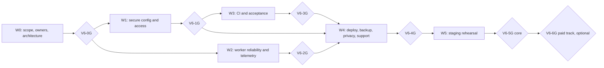

# PLAN — Version 6: production readiness and go-live

| | |
|---|---|
| Version | **V6 — secure, operable, recoverable production launch for Site GPT** |
| Status | **Wave 0 started on branch `feat/v6` (created from `master` at `66dd197` on 2026-11-23). Only V6-04 is done; V6-01…V6-03 and gate V6-0G are blocked on external approvals.** No V6 implementation beyond that baseline, no production deployment, commercial approval or release authorization is implied. V4 is the last released product baseline. V5's `v5` tag is an immutable engineering marker, not a verified release; do not move it. |
| Repository snapshot reviewed | `master` at `66dd197` (`docs(v5): refresh README gallery and add landing, analytics, inbox screenshots`), reviewed as a clean checkout of that commit. This row describes that reviewed snapshot only — later branch work (starting with this plan itself) is not part of it. The repo documents Alembic head `0b22b30bf930` (M12); reconfirm with Alembic before implementation/deployment. |
| Baseline at Wave 0 start | `master` at `66dd197`, branch `feat/v6` (2026-11-23). Alembic current = head = `0b22b30bf930` (single head, M12). Observed run: **62 Python test modules / 1094 tests OK**, **46 node checks**, `npm run build` + `npm run lint` clean, `site_gpt.app.main` / `site_gpt.app.worker` imports clean, Python 3.13.13, Node v24.19.0, `trail build` 251 files / 3735 nodes. The provider-free V5 release gate also ran: `bash scripts/gate_v5_5g/run_all.sh` → **72/72 checks passed, 2 blocked**, on its own throwaway `v5_gate_5g` database, which the script created, migrated to head and dropped; no other database was touched. |
| Scope | Close the deployment, security, reliability, support and release-process gaps that prevent a responsible hosted go-live. Separate the core hosted launch from the optional paid-billing/platform-operator launch. |
| Migration target | **None planned by default.** Add a migration only if a reviewed V6 requirement needs durable state; preserve a single linear Alembic head and the migration safety rules in `AGENTS.md`. |
| Derived from | `AGENTS.md`, `plans/PLAN_V4.md`, `plans/PLAN_V5.md`, `docs/security.md`, `docs/release-v5.md`, `docs/billing.md`, `docs/platform.md`, and the current backend/frontend/repository structure. |
| Out of scope | New LLM/chat product features, mobile apps, new messaging channels, white-label, custom card handling, compliance certification, claims of SOC 2/HIPAA/GDPR certification, and unapproved commercial or legal terms. |

> **Launch rule:** passing engineering checks is necessary but not sufficient. Live launch additionally requires named business, security, operations and support owners; a chosen deployment topology; approved customer-facing/legal content; and an explicit go decision. If Stripe billing or the platform console is not approved, keep `BILLING_ENABLED=false` and `PLATFORM_CONSOLE_ENABLED=false` and launch only the explicitly approved core scope.

---

## 1. Executive recommendation

The project already has a substantial product surface: public marketing/pricing shell, tenant console, widget and hosted chat page, analytics, knowledge ingestion, inbox, integrations, privacy export/erasure, retention, and an engineered Stripe/platform-owner path. The primary gap is not another product feature. It is proving that a selected deployment can be configured securely, survive failures, be monitored and restored, and be operated by named people.

Recommended sequence:

1. Decide what “go live” means (hosted core vs paid SaaS), where it runs, who owns operations/support, and what data/service promises apply.
2. Close production security/configuration gaps and secure the platform-operator boundary before exposing it.
3. Make background work recoverable and make failures visible; verify backup and restore, not just backup creation.
4. Put the existing test suites and release gates into repeatable CI, and add an approved browser smoke path.
5. Rehearse deploy, rollback, incident and recovery procedures on staging; launch a small controlled cohort.
6. Enable paid billing only through a separate, explicitly approved commercial/Stripe gate.

**Do not make new AI features, new integrations, or a broad rewrite prerequisites for the first launch.** Resolve each accepted risk against the actual deployment and user promise; do not claim a risk is closed just because it is documented.

---

## 2. Repository review — findings and go-live implications

This is a code/document review, not a production penetration test, cloud review, full test run or legal review. Findings describe repository evidence; deployment state must be inspected separately.

| Priority | Finding observed in repo | Go-live implication / proposed response |
|---|---|---|
| **P0 — secure boot** | `src/site_gpt/app/core/config.py` supplies a known development fallback for `JWT_SECRET_KEY` and defaults `CORS_ORIGINS` to `*`. The FastAPI lifespan in `main.py` currently validates enabled Stripe configuration, not a general production profile. | Add an explicit production-mode validation that fails closed for unsafe/missing required settings. Keep local/test defaults usable; test the validator against clean environments. Do not expose deployment secrets in errors. |
| **P0 — operator security** | V5 documents `PLATFORM_CONSOLE_ENABLED=false` as required until D10's MFA/SSO or private operator-network control is approved and in place. Strong authentication, re-authentication and IP/network restriction are not implemented by the app. | Keep the console off until one approved, enforceable control is operating and independently verified. A UI checkbox/confirmation is not authentication. Prefer the deployment's established identity/network control over adding an unapproved auth dependency. |
| **P0 — unapproved paid launch** | `docs/release-v5.md` records NO-GO for commercial catalog/legal terms, Stripe merchant/test readiness, support ownership and operator strong-auth; V5 gates are not signed. Billing is documented off by default. | This blocks paid V5 launch, but need not block a separately approved billing-off core launch. Do not publish guessed prices, policies or legal copy; do not describe `v5` as a release. |
| **P0 — operational ownership not evidenced** | Release docs leave topology verification, backup/restore, monitoring, named support and incident ownership pending. | Select an environment and named owners; define measurable service and recovery objectives; perform and record a restore and an incident/rollback rehearsal before launch. |
| **P1 — background job recovery** | `services/redis.py::enqueue_job` pushes jobs to a Redis list; `worker.py::worker` consumes with destructive `BRPOP` before handling. Ingest has stale-claim recovery, and some services have their own claims/retries, but the generic queue has no visible acknowledgement/visibility-timeout contract. | A worker/process crash after pop can lose work unless that job's own state recovers it. Audit every job type; implement and test retry/ack/dead-letter or durable outbox semantics where required, preserving idempotency and avoiding duplicate destructive work. |
| **P1 — health and telemetry** | `/health` reports DB/Redis and limiter degradation in its JSON, while returning the health response used by current gates; no tracked CI/deployment workflow or observability vendor configuration was found. Worker mostly reports with `print` statements. | Preserve `/health` compatibility; add separate liveness/readiness semantics if needed, structured/redacted logs, actionable alerts and worker/queue visibility. Choose tooling only after the deployment target is known. |
| **P1 — automated regression coverage** | Plain `unittest`, node checks, frontend build/lint and project gate scripts exist. No tracked `.github` workflow/CI config or frontend test runner was found. V5 explicitly records a headless browser gate item. | Make existing checks repeatable in CI and add browser smoke coverage for critical journeys. Select CI/browser tooling and secrets handling as an explicit decision; do not add a framework by accident. |
| **P1 — data protection operations** | Security docs correctly put TLS, encryption at rest, private DB/Redis networking and encrypted backups on the operator. Restore testing and audit-retention sign-off remain pending in V5 docs. | Treat backup, restore, upload-volume consistency, access review and deletion/backup retention as launch tasks with evidence, not documentation-only boxes. |
| **P1 — file uploads** | `docs/security.md` states uploads are not virus-scanned. Uploaded documents and derived embeddings can be used by the product. | Decide the public-upload threat model. Before enabling uploads for untrusted users, either integrate an approved malware/content scanning path or restrict/disable the affected upload surface and document the accepted risk. |
| **P2 — tenant/admin auditability** | `docs/security.md` records no general admin audit log; platform-owner mutations are audited separately. | Decide which tenant actions need an audit trail (at minimum privileged access, API-key lifecycle, settings, data export/erasure, and billing actions for a paid service). Avoid logging transcript contents or credentials. |
| **P2 — session/security response** | JWTs are held by the SPA in `localStorage`; logout clears the browser token, and no server-side JWT revocation/refresh mechanism is evidenced. Session-token revocation is documented as a manual row deletion, without a user-facing control. | Define acceptable session lifetime/revocation and incident response. Add controls only to the agreed threat model; do not silently break embeds or current auth compatibility. |
| **P2 — residual embed boundary** | `docs/security.md` explicitly accepts K18: Origin/Referer is soft and the embed token is public/replayable. `SESSION_TOKEN_MODE=compat` also retains legacy reads for compatibility. | Make a rollout decision per customer embed and threat model. Stage any enforcement change, measure legacy usage where possible, and document compatibility/rollback. This is not a blocker if the residual risk is explicitly accepted for the chosen launch. |

### Review exclusions

No claim is made that the deployment is vulnerable or unfit in every hosting context. This review did not inspect a cloud account, production network, live Stripe account, real customer data, external legal terms, live dependency advisories, or run the full suites. The pre-flight must supply that evidence.

---

## 3. Launch tracks and scope control

### Track A — hosted core, billing off

A controlled hosted launch of the approved core product can be considered without Stripe if product/legal approves the offer and public content, deployment controls pass, and V6 core gates are signed. Leave billing/platform flags off. Decide whether an empty pricing catalog and “plans being finalised” state are acceptable for that launch; otherwise supply approved content before making pricing claims.

### Track B — paid SaaS and platform operations (conditional)

Track B is an additional gate, not an assumption of Track A. It requires all Track A checks plus the unresolved V5 decisions and evidence: approved catalog and subscription policies, legal/support content, Stripe merchant and live/test readiness, real test-mode rehearsal, platform-owner strong authentication or private-network enforcement, audit policy, and explicit release authorization. No production payment is permitted before that gate.

### Non-goals for V6

- No new AI/provider capability just to increase feature count.
- No self-service or HTTP route for granting platform-owner access; no tenant impersonation.
- No guessed data residency, SLO, RPO/RTO, pricing, refund, trial or retention promise.
- No mandatory Docker/Kubernetes/cloud vendor selection before D2 is decided.
- No compliance badge or certification claim created by engineering work.

---

## 4. Pre-flight decisions (blocking for the affected tasks)

Record a decision owner, approver, date and evidence. A proposed default is not an approval. The live record for D1/D3/D7/D11 and D2/D4/D5/D6/D8/D13 is [`docs/preflight-v6.md`](../docs/preflight-v6.md), where every row is still **UNAPPROVED**; D1, D2, D3, D4, D7 and D11 each have an appendix there (`D1 decision brief`, `D2 decision brief`, `D3 decision brief`, `D4 decision brief`, `D7 decision brief`, `D11 decision brief`) that lays out the options and the evidence an approver must sign.

| ID | Decision | Required before |
|---|---|---|
| D1 | Launch Track A, Track B, or both; target customers, regions, data types, and whether public registration is open or invite-only. | V6-01 / V6-02 |
| D2 | Hosting/runtime topology: API, worker, Postgres/pgvector, Redis, upload storage, frontend/CDN, TLS termination, network boundaries, deployment and rollback mechanism. | V6-10 / V6-40 |
| D3 | Availability/support promise and measurable SLOs; database/upload RPO and RTO; capacity assumptions and maintenance window. | V6-02 / V6-21 / V6-42 |
| D4 | Production security profile: required secret/config policy, trusted proxy addresses, CORS origins, rate-limit backend, docs exposure and environment separation. | V6-10 |
| D5 | Platform-owner authentication: approved MFA/SSO or private operator-only network enforcement; bootstrap, recovery and revocation owner. | Any platform-console exposure |
| D6 | Upload policy for untrusted files: scanner/vendor, supported formats, quarantine behavior, or disable/restrict uploads. | Public/untrusted uploads |
| D7 | Data handling: retention defaults, audit retention, backup expiry, user/company deletion and backup restore/deletion semantics; legal/privacy owner. | V6-41 / V6-42 |
| D8 | Logs, error tracking, metrics and alerting: selected tools, data sent to vendors, PII redaction, access and retention. | V6-20 / V6-21 |
| D9 | Background work delivery guarantee and acceptable duplicate/loss behavior by job type; retry limits, dead-letter owner and replay procedure. | V6-20 |
| D10 | CI and browser-test execution environment, dependency policy, artifact handling and who may deploy from a passing workflow. | V6-30 |
| D11 | Customer support owner, contact channel, escalation target and response expectations; no promise without approval. | V6-41 |
| D12 | If Track B: resolve V5 D2–D12, assign commercial/legal approvers, merchant account owner, Stripe operational owner and explicit live activation authority. | Paid billing gate |
| D13 | Whether tenant MFA/SSO, broader admin audit, session revocation UI and origin-bound widget authentication are required for the target customer/security posture, or explicitly accepted/deferred. | V6-11 / V6-12 / V6-13 / V6-15 |

---

## 5. Invariants

1. Production startup must not silently use the known JWT development key, wildcard CORS, debug SQL logging, missing required secrets or a per-process limiter where the chosen topology requires shared limits.
2. Development and test workflows remain usable without production secrets. A production-only validator must be deterministic, tested and report setting names only.
3. Keep billing and platform console disabled by default. No customer/browser redirect can grant paid access; only verified Stripe events update mirrored subscription state.
4. Preserve tenant scoping, API/widget route compatibility, existing session/localStorage keys and documented V4 behavior unless a separate compatibility migration is approved and tested.
5. Every background job must have a stated delivery/retry/idempotency policy. Never solve retry by allowing duplicate destructive jobs or duplicate external sends.
6. Readiness and liveness must be independently usable by the selected orchestrator; do not break the established `/health` contract without a versioned/deployment-reviewed change.
7. Logs, traces, metrics and alerts must not contain passwords, bearer tokens, API keys, integration secrets, card data, raw webhook bodies or full customer transcripts by default.
8. Backup success is not restore evidence. Recovery tests use isolated disposable/staging infrastructure and never overwrite a database the team cares about.
9. Security/privacy claims in UI and docs must match verified controls and approved legal wording. Engineering does not claim certification.
10. A release tag is created once on the exact authorized, gate-verified commit. `v5` is immutable and remains an engineering marker; a future release must use a new tag if authorized.

---

## 6. Waves and tasks

### Wave 0 — launch scope, owners and baseline

**Goal:** turn “go live” into an approved scope and measurable deployment target. No schema change or production flag change. **Entry:** none — Wave 0 is where the track is chosen, and only V6-04 can be completed without an approval. **Baseline observed at Wave 0 start (2026-11-23):** 62 Python test modules / 1094 tests, 46 node checks, frontend build/lint clean, API+worker imports clean, Alembic current=head `0b22b30bf930`, branch `feat/v6` from `66dd197`.

- [ ] **V6-01 · Approve launch track and product boundary** — `S`. Resolve D1 and D12's applicability. Identify initial user cohort, registration policy, included product features, excluded/disabled features and whether an empty public plan catalog is acceptable. **Done when:** Track A/B scope is signed by product/business owner; no unapproved pricing, guarantees or feature claims are in launch copy. **Blocked:** no product/business owner has signed a Track A/B scope, launch cohort, registration policy or the empty-catalog decision (D1, D12 applicability). Left unticked deliberately — a proposed default is not an approval.
- [ ] **V6-02 · Name operational, security, privacy and support owners** — `M`. Resolve D3, D7, D11; set SLO/RPO/RTO targets based on the selected deployment and business promise, not invented engineering defaults. **Done when:** each owner, escalation path, coverage window, customer contact and objective is documented and accepted. **Blocked:** no named operations, security, privacy or support owner exists and no SLO/RPO/RTO may be set without D3/D7/D11.
- [ ] **V6-03 · Production architecture and threat-model review** — `M`. Resolve D2/D4/D5/D6/D8/D13; review public routes, admin/operator boundary, data flows, provider exposure, uploads, backups, Redis/Postgres access, proxy trust and secrets. Classify each V6 §2 finding as fix-before-launch, mitigated, or explicitly accepted with owner/expiry. **Done when:** architecture diagram/runbook and risk register match the chosen environment; no critical risk is left ownerless. **Blocked on decisions:** the classification needs D2/D4/D5/D6/D8/D13 owners to fix the target topology, security profile, upload policy and logging/CI/data-handling choices first. The code-side evidence the review will classify is §2 of this plan; reviewing it closes no finding by itself. The draft register those findings become is [`docs/risk-register-v6.md`](../docs/risk-register-v6.md), whose owner, expiry and approval cells are deliberately blank.
- [x] **V6-04 · Reproducible baseline** — `S`. Record actual Python module/test count, Node checks, imports, build/lint, Alembic current=head and gate results from this checkout. **Done when:** evidence is generated by the pre-flight run; historical counts are not copied. No production DB is used for destructive checks. **Done (2026-11-23, branch `feat/v6`):** **62 modules / 1094 Python tests OK** (`uv run python -m unittest discover -s tests`; module count also confirmed through the loader), **46/46 node checks** (`node --test tests/*.mjs`), `npm run build` and `npm run lint` clean in `frontend/`, `site_gpt.app.main` + `site_gpt.app.worker` import clean, `uv run alembic current` = `uv run alembic heads` = `0b22b30bf930`, `trail build` = 251 files / 3735 nodes, Python 3.13.13, Node v24.19.0. **Gate results:** `bash scripts/gate_v5_5g/run_all.sh` — the provider-free V5-5G release gate, which needs no LLM/embedding provider, SMTP or browser — reported **72/72 checks passed, 2 blocked**. It created, migrated to head and dropped its own throwaway database `v5_gate_5g` (PostgreSQL 16.6 at `127.0.0.1:5432`), required no Redis (memory rate-limit path) and replaced Stripe with the gate's local fixture, which signs webhooks with the endpoint secret; the real SDK was never called and no merchant account was used. The V3/V4 gate scripts (`gate_v3_4g`, `gate_v4_4g`, `gate_v4_5g`) were **not run** in this pass, because they regress earlier versions and need inputs beyond this checkout: a `v3` (and, for V4-4G, a V4-1G) source tree for their byte comparisons, the real Redis on ports 8011–8013 for V3-4G, and live LLM/embedding/YouTube/Notion endpoints for V4-4G/V4-5G. V6-31 plans to automate these gate runs in CI; it adds no gate of its own. The two **blocked** items are live Stripe test-mode Checkout/Portal/webhook delivery (no D3 merchant credentials) and the browser journey across `/`, `/pricing`, `/app` and `/platform` (the gate is headless) — recorded as blocked, never as passes. No other database was created, dropped or upgraded, and no shared database was contacted.

#### Gate V6-0G — approved scope

- [ ] D1–D13 needed by the chosen launch track have owners and decisions; open external approvals remain explicitly blocked.
- [ ] Hosting topology, SLO/RPO/RTO, launch cohort, support owner and risk register are recorded.
- [ ] Track A vs Track B boundary is explicit. If Track B prerequisites are open, paid launch is out of scope and flags remain off.

**Wave 0 evidence (2026-11-23):** branch `feat/v6` created from `master` at `66dd197`; V6-04 is the only completed task and it added no code, so the baseline counts equal V5's recorded 62 / 1094 / 46. Three latent defects found by the Wave 0 await audit were then repaired as standalone fixes — the retention producer's missing `await` (`e4bdc21`), the scheduler loops' unheld task references (`ab7cb8a`) and the mail send that could fail unseen or abandon its coroutine (`ab7cb8a`, `88860c6`) — which is the only reason the suite moved: the current run is **63 modules / 1102 Python tests OK** (`uv run python -m unittest discover -s tests`) and **46/46 node checks** (`node --test tests/*.mjs`). No dependency was added and no migration was written (head stays `0b22b30bf930`); none of those repairs starts V6-20 or decides D9 (`docs/worker-delivery.md` findings 1, 8 and 9). Gate **V6-0G is not signed:** D1/D3/D7/D11 (launch track, SLO/RPO/RTO, data handling and backups, support owner) and D2/D4/D5/D6/D8/D13 (topology, security profile, operator auth, uploads, telemetry, session/embed posture) have no recorded owner or approval, so V6-01…V6-03 stay unticked. **Wave 1 must not start:** no production-config validator (V6-10), no platform-console or session/upload/audit work (V6-11…V6-15), no new dependency and no migration (head stays `0b22b30bf930`); `BILLING_ENABLED=false` and `PLATFORM_CONSOLE_ENABLED=false` remain the defaults and `docs/release-v5.md`'s NO-GO rows still stand.

### Wave 1 — secure production configuration and access

**Entry:** V6-0G signed for the affected scope. **Goal:** make unsafe production configuration fail closed and secure privileged access.

- [ ] **V6-10 · Production configuration validation** — `L`. Add an explicit production mode/profile in `core/config.py`/`main.py` (or deployment bootstrap) that rejects unsafe/missing settings: JWT secret fallback, wildcard/empty CORS, inappropriate `SQL_ECHO`, missing API-key pepper when `/api/v1` is enabled, insecure/missing external URLs, and incompatible limiter/proxy settings. Preserve dev/test defaults. Update `.env.example`, README and tests. **Done when:** clean-env production boot fails with actionable names and no values; a valid staged profile boots; all existing development tests/imports still work.
- [ ] **V6-11 · Platform-owner control** — `L`, conditional on console exposure. Implement or integrate the D5-approved MFA/SSO or network gate and test it at the actual ingress; retain out-of-band owner grants and immediate revocation. Add an emergency disable/recovery exercise. **Done when:** the protection cannot be bypassed via a direct API origin or alternate hostname, and an unapproved/tenant account cannot use `/api/platform`; otherwise the console remains off.
- [ ] **V6-12 · Session and credential incident controls** — `M`, resolve D13. Set/document JWT lifetime and re-auth requirements for privileged operations; decide revocation after password reset, account deactivation, key leak or operator compromise. Add only the approved server-side revocation/recovery mechanism and tests. Decide whether admins need a session-token revoke UI. **Done when:** a documented incident can invalidate the relevant access promptly without breaking other tenants or legacy widget compatibility.
- [ ] **V6-13 · Upload safety decision and implementation** — `M`, conditional on D6. Integrate an approved scanner/quarantine/size policy before serving files to public/untrusted users, or enforce a documented restriction/disablement. Cover archive bombs, MIME/extension mismatch and scanner outage behavior at the boundary. **Done when:** malicious/unsupported/scanner-unavailable cases fail safely and accepted files still follow the existing ingestion path; if deferred, the disabled/restricted behavior is tested.
- [ ] **V6-14 · Admin audit scope** — `M`, resolve D7/D13. Define and implement auditable security-relevant tenant actions (minimum candidate: user/role/status changes, API-key issue/revoke, settings/model changes, data export/erasure, and billing mutations if Track B). Audit metadata only; do not store transcript/body/secrets. **Done when:** access control, actor, tenant, action, target and timestamp are tested, retention is approved, and read access is bounded.
- [ ] **V6-15 · Embed/session compatibility rollout** — `S`, conditional on risk decision. Specify whether to move `SESSION_TOKEN_MODE` or `EMBED_TOKEN_MODE` from `compat` to `enforce`, and whether K18 needs a separate origin-bound design. Stage, observe and provide rollback; no guessed hard cutover. **Done when:** tenant/embed impact, legacy behavior, communication and rollback are evidenced or the current residual is explicitly accepted for the launch cohort.

#### Gate V6-1G — security baseline

- [ ] Production config fails closed; test/dev compatibility remains intact.
- [ ] The operator surface is protected by the approved control or is disabled.
- [ ] Upload, tenant-admin audit and session/embed decisions are implemented or explicitly out of launch scope with tested restrictions/accepted risks.
- [ ] No credentials/PII are introduced into new logs, audit rows, frontend bundles or errors.

### Wave 2 — worker reliability and operational visibility

**Goal:** recover background work predictably and detect customer-impacting degradation.

- [ ] **V6-20 · Background job delivery and recovery** — `L`, depends: V6-0G / D9. Inventory `ingest`, `digest`, `retention`, `topic_clusters`, `sitemap_scan`, `insights` and any new job. Choose a durable acknowledgement/visibility-timeout mechanism (e.g. reliable Redis processing list or DB outbox, based on D2); add bounded retry/backoff, dead-letter visibility and safe replay. Respect existing service claims and external side-effect idempotency. **Done when:** crash-before-ack, crash-during-handler, transient provider/DB failure, poison job and duplicate-delivery scenarios pass on disposable infrastructure; each job's owner/replay path is documented. Evidence already collected for this task — producer, re-arm path, idempotency key, destructive effect and what a crash between `BRPOP` and commit loses, per job type — is in [`docs/worker-delivery.md`](../docs/worker-delivery.md) (including the retention producer that currently enqueues nothing).
- [ ] **V6-21 · Health, worker heartbeat and alerts** — `M`, depends: D3/D8. Preserve `/health`; provide separate liveness/readiness responses if needed by the chosen platform, with correct status codes and no sensitive internals. Expose worker heartbeat, queue depth/age, retry/dead-letter count and dependency degradation through the approved telemetry path. Alert on API error rate, DB/Redis failure, worker stopped/stale backlog, repeated job failure and (Track B) webhook failure/drift. **Done when:** staging fault injection triggers the intended alert and recovery; health checks do not restart a merely dependency-degraded process in a crash loop.
- [ ] **V6-22 · Structured logging and PII/secret redaction** — `M`, depends: D8. Replace operationally important print/traceback-only reporting with structured event fields, correlation/request IDs and safe exception categories. Add centralized redaction tests. Keep user text and provider request/response bodies out of logs. **Done when:** representative auth, ingest, LLM, webhook, retention and worker failures are diagnosable without sensitive payloads.
- [ ] **V6-23 · Database/Redis capacity and graceful lifecycle** — `M`, depends: D2/D3. Validate connection-pool/process sizing, Redis persistence/eviction/timeouts, API and worker shutdown behavior, proxy/SSE timeouts and scale-out assumptions. **Done when:** restart/rolling-deploy and dependency interruption tests meet approved SLO/RPO/RTO; no claimed horizontal safety depends on per-process memory limits.

#### Gate V6-2G — reliability and observability

- [ ] Every active job type has tested delivery/retry/idempotency behavior and an operator replay/dead-letter procedure.
- [ ] Staging can detect API/worker/dependency degradation and produces actionable, redacted alerts.
- [ ] Process restart, graceful shutdown and Redis/DB interruption behavior are verified for the selected topology.

### Wave 3 — automated quality and release controls

**Goal:** make the project's existing safety checks run on every change and prove the critical user journeys.

- [ ] **V6-30 · CI pipeline** — `M`, depends: D10. Add the chosen CI workflow to run Python unittest discovery, Node built-in tests, API/worker imports, frontend build/lint and safe static checks. Cache dependencies safely; pin tool/runtime versions; never expose deployment or Stripe live secrets to pull-request jobs. **Done when:** a clean checkout gets a reproducible pass/fail result and protected release branches require the approved checks.
- [ ] **V6-31 · Migration and gate automation** — `M`. Run migration-chain/current-head checks in CI; run destructive PostgreSQL gates only against self-created disposable DBs, with database-name guards. Keep provider-free fixtures separate from live test credentials. **Done when:** empty DB → head and supported upgrade path are tested; all destructive scripts refuse shared/non-gate DBs; job artifacts contain no secrets.
- [ ] **V6-32 · Browser acceptance smoke** — `M`, depends: D10. Add an approved browser runner for public landing/pricing/register/login, `/app` protected route/deep link, core chat/widget or hosted chat, settings and relevant platform role separation. Run in staging or isolated fixtures; do not require real Stripe for core checks. **Done when:** the critical journey is regression-tested at desktop/mobile viewport sizes, keyboard navigation has a recorded check, and Track B's Stripe journey remains clearly separate.
- [ ] **V6-33 · Dependency and artifact hygiene** — `S`, depends: D10. Establish an approved dependency vulnerability/license review cadence for Python/npm and release artifacts; decide whether to emit an SBOM and how findings are triaged. **Done when:** the build records dependency versions and has a documented severity/exception owner; no automatic breaking upgrade is enabled without review.

#### Gate V6-3G — repeatable release candidate

- [ ] All standard tests/imports/build/lint run in CI from a clean checkout; current test counts are recorded from the gate run.
- [ ] Disposable DB migration and applicable project gate scripts pass; no production/shared DB credentials are used.
- [ ] Critical browser acceptance checks pass or a missing browser prerequisite is explicitly blocking; it is never reported as a pass.
- [ ] Dependency/artifact exceptions have owners and expiry dates.

### Wave 4 — deployment, backup, privacy and support readiness

**Goal:** make the selected deployment reproducible and recoverable; document customer and operator paths.

- [ ] **V6-40 · Deployment configuration and runbook** — `L`, depends: D2/V6-10. Add only the packaging/manifests required by the selected host; document API, worker, frontend, migrations, proxy/TLS, CORS, Redis/DB connectivity, upload volume, secrets injection, scaling and deploy/rollback order. Add staging/production separation. **Done when:** a new staging environment can be built from the runbook without undocumented manual state and its configuration passes V6-10.
- [ ] **V6-41 · Privacy, support and customer-facing readiness** — `M`, depends: D7/D11. Publish approved privacy notice/terms/support details and accurate subprocessors/data-flow/retention language for the selected region and providers. Document export, erasure, retention, backups and escalation. No unsupported compliance claims. **Done when:** product/legal/privacy/support owners approve the actual copy and support contact is tested end-to-end.
- [ ] **V6-42 · Backup and restore rehearsal** — `L`, depends: D2/D3/D7. Automate/confirm encrypted database and upload-volume backups, access control and retention. Rehearse restore to isolated staging, including Postgres/pgvector version, Alembic state, upload-to-row consistency, Redis rebuild/recovery assumptions and time measured against RPO/RTO. **Done when:** restore evidence lists recovery point/time, data integrity checks and owner; backup files are not treated as verified solely because a job succeeded.
- [ ] **V6-43 · Incident, rollback and recovery runbooks** — `M`, depends: V6-20–23/V6-40. Document operator actions for API outage, DB/Redis outage, worker backlog, provider outage/cost anomaly, credential compromise, data incident, bad migration, upload issue and (Track B) Stripe webhook/billing incident. Identify who may disable flags, revoke credentials, restore and contact customers. **Done when:** a tabletop/rehearsal is completed with named participants and findings closed or tracked.
- [ ] **V6-44 · Staged rollout and rollback proof** — `M`, depends: V6-30–43. Define canary/cohort, feature flags, success/abort thresholds, schema compatibility and rollback limits; rehearse rollback of the application and config without pretending an applied migration is reversible. **Done when:** staging proves the operator can stop rollout, return to the prior healthy version and preserve data without moving an immutable tag.

#### Gate V6-4G — production readiness

- [ ] The selected topology is reproducible; TLS, exact CORS, proxy trust, secret management and private data services are verified in staging.
- [ ] Encrypted DB + upload backups restore within approved objectives; privacy/retention/deletion behavior is understood for backups.
- [ ] Monitoring, support contact, incident escalation, rollback and credential recovery have named owners and rehearsed evidence.
- [ ] Customer-facing/legal/privacy content is approved for Track A. Billing/platform claims are absent unless Track B is approved.

### Wave 5 — launch rehearsal and authorization

**Goal:** run the production-shaped acceptance path, then make a recorded go/no-go decision. No automatic launch on completion of code tasks.

- [ ] **V6-50 · End-to-end staging rehearsal** — `L`, depends: V6-3G/V6-4G. Exercise anonymous marketing, registration/login, tenant creation, website/setup, content ingest, chat answer/citations, widget or hosted page, admin settings, privacy export/erasure, retention preview, worker restart/retry, alerting, restore and rollback. Verify billing/platform remain unavailable if Track A. **Done when:** a clean staging run has signed expected results, no critical/open-high defect, and no customer data or live card is used.
- [ ] **V6-51 · Paid SaaS rehearsal (Track B only)** — `L`, depends: V5 decisions/gates and V6-11/V6-41–50. Use Stripe test mode/CLI with approved test catalog; exercise Checkout, signed webhook, duplicate/out-of-order/failure, Portal/cancel, entitlement limits, reconciliation and operator audit/revocation. Confirm flag-off parity. **Done when:** live test-mode evidence and a separate authorized production activation checklist exist; fixture-only tests are not misrepresented as live Stripe verification.
- [ ] **V6-52 · Go/no-go record** — `S`. Collect gate evidence, known risks, unresolved blockers, approvers and rollback authority. **Done when:** the launch owner records GO for a named track/environment/cohort, or NO-GO with specific blockers. Silence is not approval.
- [ ] **V6-53 · Release and immutable tag** — `S`, depends: V6-52 GO. Re-run final gates on the exact commit, inspect migrations/config/docs, update README/AGENTS/plan as needed, run `trail build`, and create the release tag once on that verified commit. Because `v5` is already an immutable engineering marker, do not move it; use a new release tag only with explicit authorization. **Done when:** tag target equals the verified commit and deployment evidence/rollback owner are recorded. If no GO, no release tag/deployment claim is made.

#### Gate V6-5G — Track A core launch

- [ ] V6-0G through V6-4G pass for the approved Track A cohort; no unresolved critical/high-risk issue without signed exception.
- [ ] Production configuration and security controls are verified against the actual ingress/host, not only unit tests.
- [ ] Public content, support path, backup restore, alerts, worker recovery, rollback and browser acceptance have evidence.
- [ ] Billing/platform flags stay off unless Track B independently passes. Launch authorization is recorded for a specific environment/cohort.

#### Gate V6-6G — Track B paid activation (conditional)

- [ ] V5 V5-1G through V5-5G are revalidated and all applicable V5 decisions (catalog, subscription policy, legal, merchant, strong operator auth, support) are approved by named owners.
- [ ] Real Stripe test-mode rehearsal passes; secret/live-key handling, webhook endpoint, retry/reconciliation, invoices/cancellation/refunds and customer support procedures are ready.
- [ ] Platform console is protected by approved MFA/SSO or private-network control; audit retention/permissions and break-glass are tested.
- [ ] Live activation is a separately authorized, staged change with monitoring, abort thresholds and rollback owner. Otherwise billing/platform remain disabled.

---

## 7. Dependency graph



Core Track A can proceed with billing and the platform console disabled; it cannot bypass production security, operational recovery or approved customer-facing content. Track B adds V5's external commercial and Stripe prerequisites and is not implied by a successful core launch.

---

## 8. Verification commands and evidence

Use the current `AGENTS.md` commands as the base; report counts from the actual run, not this plan or historical docs.

```bash
source .venv/bin/activate
uv run python -c "import site_gpt.app.main; import site_gpt.app.worker"
uv run python -m unittest discover -s tests -v
node --test tests/*.mjs
cd frontend && npm run build && npm run lint
cd .. && uv run alembic current && uv run alembic heads
trail build
bash scripts/gate_v5_5g/run_all.sh  # only in a safe environment; it creates/drops v5_gate_5g
```

Only run database-dropping gates that create their own guarded disposable database. Do not point a V5/V6 gate or migration downgrade at a database with data that matters. Add V6-specific scripts only when a task requires them; keep provider/live credential checks explicitly separate from provider-free CI.

For each gate, record: commit SHA, runtime/tool versions, test/module counts, Node count, frontend build/lint, imports, Alembic current=head, disposable migration result, gate pass/blocked count, staging/browser evidence, approver and date. Never convert a blocked external prerequisite into “passed” because mocks passed.

---

## 9. Risk register

| Risk | Mitigation / release condition |
|---|---|
| Production starts with a known JWT secret or wildcard CORS | V6-10 fail-closed production profile; staging boot test |
| Operator account compromised or platform console exposed without strong auth | V6-11; keep platform switch off until the ingress-level control is verified |
| Background job disappears or runs twice after worker crash | V6-20 durable acknowledgement/retry/idempotency and crash tests |
| Outage is detected late or not attributable | V6-21/22 redacted telemetry, worker/queue alerts and fault injection |
| Database/upload loss or unusable backup | V6-42 measured isolated restore and integrity checks |
| Malicious upload reaches parsers or stored knowledge | V6-13 scan/quarantine or restrict/disable untrusted upload path |
| Customer data leaks through logs/audit/provider telemetry | V6-22 redaction, V6-14 metadata-only audit, D8 data-flow approval |
| Legal, support or pricing promise exceeds actual product | V6-01/02/41; approved copy and named support owner |
| Paid launch happens before merchant/catalog/legal readiness | Track B gate, flags off by default, V5 NO-GO items retained |
| Rollback loses data or rewrites a tag | V6-44/53 forward-only migration review and immutable-tag policy |

---

## 10. Definition of done — V6

- [ ] Approved launch track, target environment/cohort, named owners, support path and measurable operational objectives exist.
- [ ] Production-only configuration validation blocks known unsafe defaults while local tests/development remain usable.
- [ ] Platform access is protected by the approved control or the console remains disabled; session/upload/audit/embed decisions are tested or explicitly scoped out.
- [ ] Background work has job-specific delivery/retry/idempotency and recovery evidence; staging alerts on material API/worker/dependency failures.
- [ ] CI runs backend, Node, imports, frontend build/lint and safe migration/gate checks; critical browser journeys have repeatable acceptance evidence.
- [ ] Database and upload recovery is restore-tested against approved RPO/RTO; privacy, retention, support and incident/rollback procedures are approved and rehearsed.
- [ ] Track A can be launched without claiming billing/platform readiness. Track B is separately approved and has real Stripe test-mode evidence before live activation.
- [ ] Final GO is tied to a specific environment, cohort, commit and approver. If blockers remain, status is NO-GO; no release tag or live-launch claim is created.

## Appendix — task index

| Wave | Tasks | Gate |
|---|---|---|
| 0 — scope and baseline | V6-01…04 | V6-0G |
| 1 — security and access | V6-10…15 | V6-1G |
| 2 — reliability and visibility | V6-20…23 | V6-2G |
| 3 — quality automation | V6-30…33 | V6-3G |
| 4 — deployment and recovery | V6-40…44 | V6-4G |
| 5 — rehearsal and release | V6-50…53 | V6-5G (core), V6-6G (paid, optional) |
